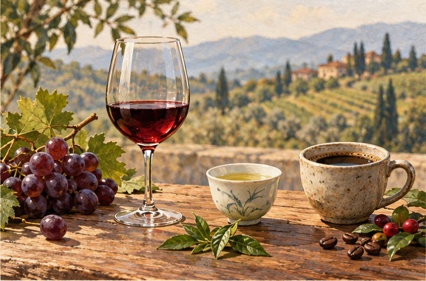
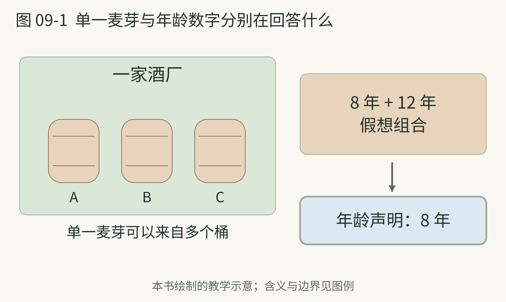
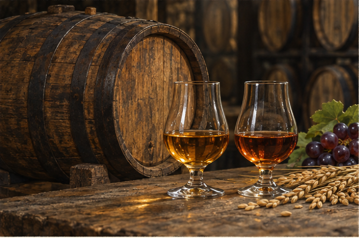
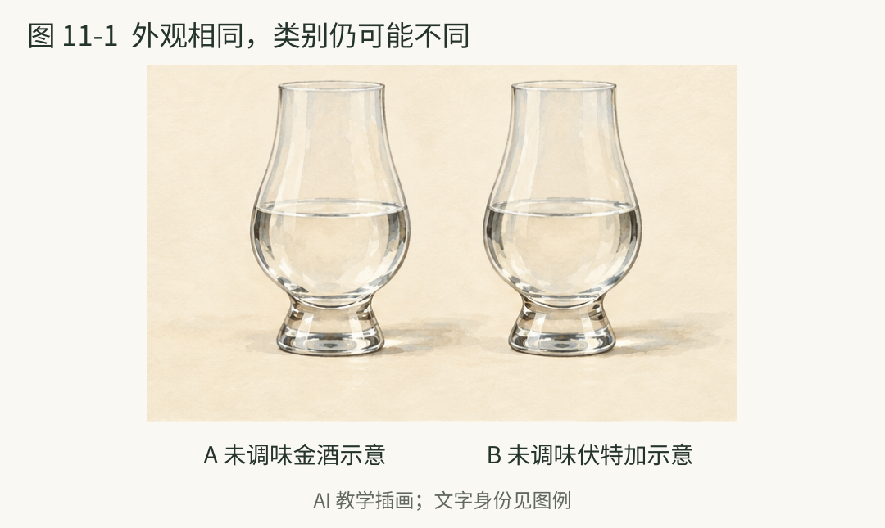
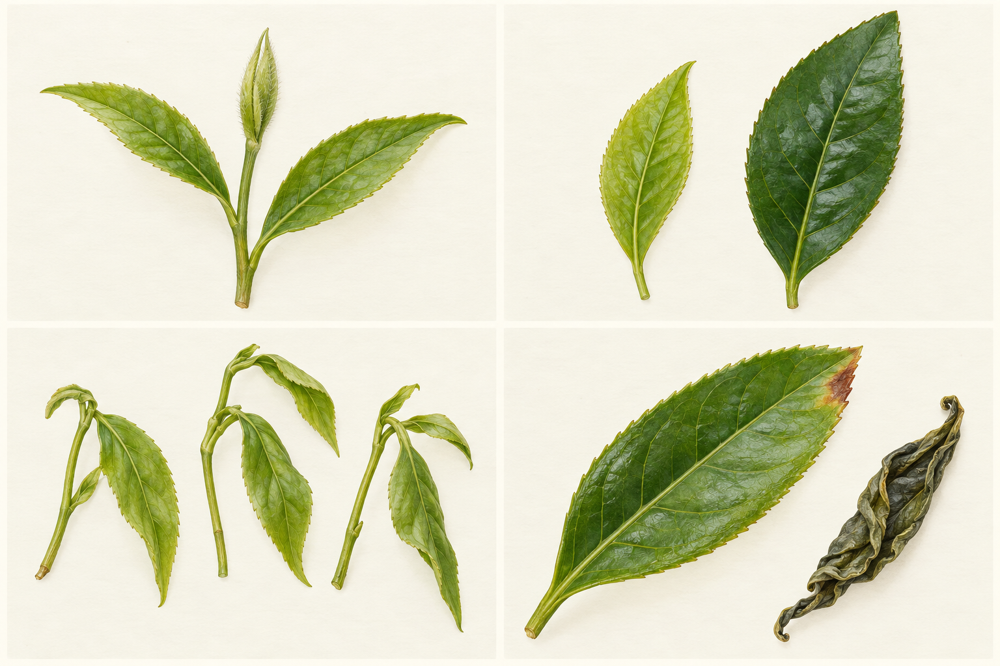
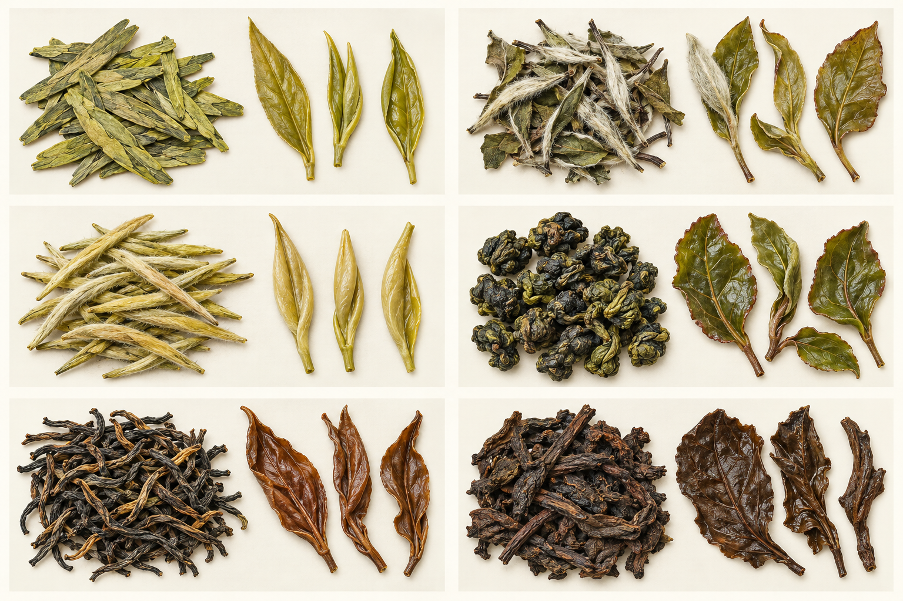

# 杯中世界

酒 茶 咖啡的起源与风味

个人兴趣读本 图例增补版

图例：酒杯、茶杯与咖啡杯为主题情境，不用于饮品身份判定。 AI 阅读情境插画。

**策划与整理：YZ**

正文由 AI 编写，插画由 AI 生成。YZ 负责选题、需求设定与成稿整理。

## 署名与许可

[CC BY 4.0 · 知识共享署名 4.0 国际许可协议](https://creativecommons.org/licenses/by/4.0/)

在许可适用的范围内，你可以复制、分享、翻译、改编及商用；请保留署名、作品出处与许可链接，注明所作改动，且不得暗示 YZ 为你的使用背书。不得另加法律条款或技术措施，限制他人行使许可授予的权利。

许可仅适用于 YZ 有权许可且依法受保护的部分。纯 AI 生成内容是否受著作权保护，取决于适用法律；对不受保护的内容、公共领域材料及依法无需许可的使用，本许可不额外产生权利或施加限制。

正文、项目自制图表与 AI 插画采用 CC BY 4.0；构建与导出脚本采用 MIT。字体及其派生文件遵循原有 SIL OFL 1.1。引用的第三方文字、作品、商标及链接目标资料不在本项目授权范围内，权利归各自权利人。

作品出处：https://github.com/YZYExp/Learn-A-Cup-Of-World

推荐署名：《杯中世界》，策划与整理：YZ；正文由 AI 编写，插画由 AI 生成；CC BY 4.0。出处：https://github.com/YZYExp/Learn-A-Cup-Of-World；许可：https://creativecommons.org/licenses/by/4.0/；如有改动，请注明。

---

这本书从一个很日常的疑问开始：为什么我们能花很长时间谈一瓶酒、一壶茶或一杯咖啡？它们看起来只是水里多了一些东西，却牵连着植物、微生物、火、器具和人的生活。

本书以酒为主线，也给茶和咖啡留出完整的入门空间。你会认识主要酒类，理解它们怎么做、为什么不同；随后再看茶叶加工和咖啡烘焙，发现一些知识可以互相照亮。它是兴趣读本，读到哪里算哪里，不必背年份、产区或配方。

可以顺读，也可以先挑喜欢的一章。对制作不感兴趣，先看历史；对历史不感兴趣，就从“为什么有这种味道”开始。读到实验，只做想做的。那些实验是本书设计的观察方法，不是专业感官测试，也不要求买齐样品。

学习的一个小目标是：下次面对菜单，你能问出比“哪个好”更具体的问题。比如这是麦芽香为主，还是酒花香为主？这杯咖啡是烘焙偏深，还是冲得偏浓？这款茶的花香来自茶叶，还是后来的窨制？

正文中的 [数字] 对应本页下方资料。页下注提供出处和原文链接，书末列完整题名。传说、证据和本书的解释会分开。正文由 AI 编写，插画由 AI 生成；插画用于营造阅读情境，不作为植物鉴定、历史复原或工艺操作依据；流程图和比较表另行绘制。

这本书最希望留下的习惯，是先观察，再命名。你可以只写“像刚掰开的橘子皮”，不必急着学会复杂词汇。能把自己的感觉说清楚，已经开始学会品饮。

本页资料：

本页为原创阅读说明或自拟观察方法。

---

## 怎样读配图与图例

章内图片与文字一起帮助识别、解释和比较。多数图呈现典型例子；偶尔出现一张打破外观预期的图，是为了提醒你补看工艺和标签，不把直觉当成定律。

每幅教学图都有编号、图题与图例。图例会说明字母对应哪个对象、箭头表示什么、颜色代表材料还是类别，以及面积是否按数量绘制。没有注明比例的图，不能拿尺子测配方。

AI 插画标明为教学或阅读情境示意，不是样品照片、历史证据或检测记录。它们的身份由文字设定，事实由就近资料支持。工艺关系与数量比较由本书明确绘制，并注明简化边界。

外观相似而身份不同，可以是有意安排的例子；把原料、器具、过程画错则仍要修正。读图时先看见什么，再读图例，最后核对正文。这样一来，图片既让阅读轻松，也能帮你学会多问一个问题。

本页资料：

本页为原创阅读说明或自拟观察方法。

---

# 01 酒 茶 咖啡的亲缘关系

把一粒麦子、一片茶叶和一颗咖啡果摆在桌上，它们没有明显的相似。变成饮品以后，讨论它们的人却会不断说起同样的词：产地、加工、香气、口感，还有“这次与上次不一样”。

本书用一个共同框架理解它们：原料带来可能性，加工选择其中的一部分，饮用方式决定你最后遇见什么。这个框架是阅读工具，不是三类饮品共用的一套科学分类。

酒要先解释糖从哪里来。葡萄汁已有糖，谷物通常需要先把淀粉分解成可发酵的糖；酵母再把糖转成酒精和二氧化碳。不同酿法还会形成不同的风味物质。[15] 茶更常从一片叶子的加工变化开始；咖啡则需要从果实里的种子一路走到处理、烘焙和冲煮。[34][37]

于是，“都发酵”是一个方便但不够准确的说法。红茶常被称为全发酵茶，核心变化却主要是酶促氧化；一些黑茶的加工才明显涉及微生物活动。[34] 咖啡处理可以利用发酵，但普通黑咖啡并不是靠保留酒精来形成饮用身份。

相似的地方在于，我们都在给植物材料创造条件，让它发生变化。差别在于，什么变化最重要，以及它发生在哪一步。把这两件事分开，许多术语就不会打架。

本页资料：

- [15] 日本酒造組合中央会 JSS，《How is Sake Made》，网页。[原文](https://japansake.or.jp/sake/en/basic/how-is-sake-made/)

- [34] Food Chemistry X，《Processing chemical signature and food industry applications of Camellia sinensis teas An overview》，2021。[原文](https://doi.org/10.1016/j.fochx.2021.100160)

- [37] International Coffee Organization ICO，《Coffee Development Report 2022 23》，2022/23 报告。[原文](https://icocoffee.org/documents/cy2024-25/coffee-development-report-2022-23.pdf)

---

## 原料、加工与成杯，是三个问题

**图 01-1 图例。** 每行是一条入门主线；实线箭头表示阅读顺序，不表示所有工厂都按同一流程生产。绿色框为原料，棕色框为加工，蓝色框为饮用前的呈现。

同样摆在杯中，三类饮品经历的关键变化却不同。先把原料、加工、成杯分开，后面的糖化、氧化和萃取才有位置可放。[15][34][37] 图中只画骨架；酒还可能过滤、调配，茶还可能再加工，咖啡也可能拼配。箭头不是时间刻度。

本页资料：

- [15] 日本酒造組合中央会 JSS，《How is Sake Made》，网页。[原文](https://japansake.or.jp/sake/en/basic/how-is-sake-made/)

- [34] Food Chemistry X，《Processing chemical signature and food industry applications of Camellia sinensis teas An overview》，2021。[原文](https://doi.org/10.1016/j.fochx.2021.100160)

- [37] International Coffee Organization ICO，《Coffee Development Report 2022 23》，2022/23 报告。[原文](https://icocoffee.org/documents/cy2024-25/coffee-development-report-2022-23.pdf)

---

## 先问过程 再问名气

本书建议第一次认识一种饮品时，问四个问题：它原来是什么？经过哪些关键变化？喝之前还要做什么？人们通常在哪里、与谁一起喝？

| 饮品|材料与主要变化|饮用前的呈现 |
| --- | --- | --- |
| 酒|糖的准备 发酵 部分再蒸馏熟成|温度 稀释或调配 |
| 茶|叶子加工 控制氧化及其他变化|以水冲泡或煮饮 |
| 咖啡|果实处理 种子干燥与烘焙|研磨后冲煮 |

上图只保留入门主线。实际制作可能有重复、交叉和额外处理，例如酒液过滤、茶叶焙火和咖啡拼配，不应把图当成完整工厂流程。

对“产地”的理解也需要克制。一个地名可以帮助你缩小范围，却不能替你尝到成品。同一地点的原料，经过不同处理，也会变成不同风味。咖啡品种目录之所以同时描述品种表现和适应条件，正说明植物与环境需要一起看。[36]

同样，名气和价格可以告诉你市场在意什么，不能直接告诉你自己喜欢什么。你喜欢淡一点的茶、没有烟熏味的威士忌、加奶的咖啡，都不影响学习。学习是在增加选择，而不是替口味排座次。

**试着观察。** 下次饮用时，只写三行：原料是什么、关键加工是什么、我最先注意到什么。没有资料就写“不知道”。把不知道留下来，比猜出一个专业词更有用。这个练习是本书建议。

本页资料：

- [15] 日本酒造組合中央会 JSS，《How is Sake Made》，网页。[原文](https://japansake.or.jp/sake/en/basic/how-is-sake-made/)

- [34] Food Chemistry X，《Processing chemical signature and food industry applications of Camellia sinensis teas An overview》，2021。[原文](https://doi.org/10.1016/j.fochx.2021.100160)

- [36] World Coffee Research WCR，《Coffee varieties catalog Arabica and Robusta》，网页。[原文](https://varieties.worldcoffeeresearch.org/)

- [37] International Coffee Organization ICO，《Coffee Development Report 2022 23》，2022/23 报告。[原文](https://icocoffee.org/documents/cy2024-25/coffee-development-report-2022-23.pdf)

---

# 02 舌头之外的风味

你说咖啡“有巧克力味”，并不一定是说它像糖一样甜。许多时候，你是在形容香气或整体印象。味觉与嗅觉共同参与风味；口感和温度也会改变体验。[01]

一个容易理解的例子是感冒鼻塞：甜和咸可能仍能分辨，食物的完整风味却变得模糊。这不是舌头突然失去了全部工作，而是少了嗅觉的参与。[01] 所以品饮时，把“闻到什么”和“嘴里发生什么”分别记下来，会比一句“味道很浓”清楚。

甜、酸、苦描述的是味觉。涩更像口腔摩擦和干燥的触感。红葡萄酒里的单宁会带来抓住口腔的感觉；茶的加工也会影响多酚组成与饮用表现。[09][34] 酒精的热感、咖啡的厚薄、气泡的刺激，又各自增加了体验层次。

你不用一次识别很多香气。先在“植物、果实、烘烤、发酵”这样的日常方向里找位置即可。这是本书的记忆办法，不是正式风味轮。能分清“像鲜果”与“像烤面包”，已经足以比较许多饮品。

**小实验。** 闻一片橘子皮，再闻一小块面包，分别写一句话。随后喝一口熟悉的饮品，看它使你想到哪一种。这只是建立自己的气味记忆，不是在证明饮品里真的有橘子或面包。

本页资料：

- [01] NIDCD 美国国立耳聋及其他交流障碍研究所，《Taste Disorders》，网页。[原文](https://www.nidcd.nih.gov/health/taste-disorders)

- [09] WSET，《What determines the colour of wine》，2021。[原文](https://www.wsetglobal.com/knowledge-centre/blog/2021/september/23/what-determines-the-colour-of-wine)

- [34] Food Chemistry X，《Processing chemical signature and food industry applications of Camellia sinensis teas An overview》，2021。[原文](https://doi.org/10.1016/j.fochx.2021.100160)

---

## 把“味道”拆成三个观察位置

**图 02-1 图例。** 三个并列卡片代表观察角度，编号只方便记录，不表示感官的先后或重要程度。图中词语是本书自拟例子，不是完整感官分类表。

“像巧克力”可以是在说香气，“苦”是在说味觉，“嘴里收紧”又是在说触感。把一句笼统的“很浓”分成三个位置，记录会更有用。[01][09][34] 香气参照不等于配料清单；闻到某种水果的印象，仍需另查实际材料。

本页资料：

- [01] NIDCD 美国国立耳聋及其他交流障碍研究所，《Taste Disorders》，网页。[原文](https://www.nidcd.nih.gov/health/taste-disorders)

- [09] WSET，《What determines the colour of wine》，2021。[原文](https://www.wsetglobal.com/knowledge-centre/blog/2021/september/23/what-determines-the-colour-of-wine)

- [34] Food Chemistry X，《Processing chemical signature and food industry applications of Camellia sinensis teas An overview》，2021。[原文](https://doi.org/10.1016/j.fochx.2021.100160)

---

## 不必假装尝到了别人说的东西

菜单上写了白花、莓果和香料，你只闻到“有点香”，非常正常。一部分差别来自经验，另一部分来自人与人感知的差异。描述首先应忠于当下，不必向菜单交作业。

World Coffee Research 的感官词汇研究使用具体参考物，帮助训练者对某种感觉建立比较一致的理解。[42] 本书借用这种“找得到参照”的思路，却不复制专业测试：你自己的参照可以是桂花、米饭、烤红薯、湿木头或柚子皮。

写“像巧克力”，还可以再问：偏可可粉的苦，还是牛奶巧克力的甜香？写“果香”，可以问：偏清鲜，还是偏熟果、果干？第二句话往往比第一个名词更有信息。

**本书建议的简短记录。** 先闻，再喝；写出最明显的一项香气、最明显的一项口感，最后写“喜欢、不喜欢、还不确定”。不要把十项全部填满，也不要把喜好与品质判断混在一起。

有时，饮品放凉后变得更容易描述。你可以隔几分钟重新闻、尝，记录差别，但别急着用一次变化解释所有饮品。咖啡研究也提醒我们，温度、浓度和萃取之间的关系需要拆开研究，而不是凭“越热越好”下结论。[40]

能说“第二次比第一次更容易分辨酸味”，已经是一条有效观察。它比“高级”“醇厚”“层次丰富”更容易让另一个人明白你经历了什么。

本页资料：

- [40] Specialty Coffee Association SCA，《How Hot is Hot Enough Brew Temperature Sensory Profile and Consumer Acceptance of Brewed Coffee》，网页。[原文](https://sca.coffee/sca-news/25/issue-15/how-hot-is-hot-enough-brew-temperature-sensory-profile-and-consumer-acceptance-of-brewed-coffee-5dj5b)

- [42] World Coffee Research WCR，《Sensory Lexicon version 2.0》，2017。[原文](https://worldcoffeeresearch.org/news/2017/announcing-the-coffee-lexicon-2-0)

---

## 一张自己的气味地图

图例：图02-0 柑橘、莓果、面包与可可为气味参照，不是杯中添加物清单。 AI 阅读情境插画。

图中的果实、烘烤面包与可可只是记忆参照，不是杯中添加物的清单。你可以把自己熟悉的气味放在旁边；参照能使描述更具体，这是感官词汇研究也使用的思路。[42]

| 先找的方向|生活中的参照|再多问一句 |
| --- | --- | --- |
| 清鲜或果香|柑橘皮 鲜莓果|偏果皮 果汁还是熟果 |
| 烘烤|面包边 可可 烤坚果|偏轻烤还是明显焦烤 |
| 植物与香料|鲜叶 花香 熟悉香料|偏清鲜 干燥还是辛香 |

这张地图是本书自拟学习工具，不是正式风味轮。一次认识一项已经足够。

本页资料：

- [42] World Coffee Research WCR，《Sensory Lexicon version 2.0》，2017。[原文](https://worldcoffeeresearch.org/news/2017/announcing-the-coffee-lexicon-2-0)

---

# 03 起源常常没有发明人

想象史前的一只容器，里头留着谷物或果实。今天的研究者不可能伸手拿到一杯当年的成品，只能从残留物、植物遗存和器物环境寻找线索。起源研究更像拼图，很少像“某年某人发明”的登记表。

2004 年发表的贾湖研究，把河南新石器时代陶器中的残留解释为米、蜂蜜和水果组成的混合发酵饮品，年代约在公元前第七千纪。水果可能涉及山楂和／或葡萄；原文也说明，酒精本身没有直接保存为化学证据。[02]

这很值得兴奋，却不能直接写成“九千年前已在酿今天的黄酒”。原料组合、工艺与现代分类都可能不同。更准确的说法是：这些发现支持中国很早就存在制作混合发酵饮品的活动。

格鲁吉亚遗址的研究则报告了约公元前 6000—5800 年与葡萄酒相关的化学和考古证据。[03] 它帮助我们把葡萄酿造历史向前追溯，却没有给全世界唯一的“第一位酿酒者”发证书。

这两项研究放在一起，最有趣的不是争谁第一，而是看到不同人群如何使用身边的糖、果实与容器。人类很早就开始探索能入口的变化；我们今天熟悉的商品类别，是更长时间里逐步形成的。

本页资料：

- [02] McGovern 等 PNAS，《Fermented beverages of pre- and proto-historic China》，2004。[原文](https://doi.org/10.1073/pnas.0407921102)

- [03] McGovern 等 PNAS，《Early Neolithic wine of Georgia in the South Caucasus》，2017。[原文](https://doi.org/10.1073/pnas.1714728114)

---

## 从器物到历史判断，中间还有证据

**图 03-1 图例。** 实线箭头表示论证需要经过的环节；框内短语是证据类型。最右侧没有画“唯一发明者”，因为这不是上述证据必然能够回答的问题。

一只陶罐的样子可以启发提问，但饮品身份需要残留物、年代与情境共同支撑。贾湖、格鲁吉亚与 Raqefet 的研究也使用不同组合的证据。[02][03][04] 这幅图是本书整理的阅读路线，不是某个遗址的出土记录或复原图。

本页资料：

- [02] McGovern 等 PNAS，《Fermented beverages of pre- and proto-historic China》，2004。[原文](https://doi.org/10.1073/pnas.0407921102)

- [03] McGovern 等 PNAS，《Early Neolithic wine of Georgia in the South Caucasus》，2017。[原文](https://doi.org/10.1073/pnas.1714728114)

- [04] Liu 等 Journal of Archaeological Science Reports，《Fermented beverage and food storage in 13,000 y-old stone mortars at Raqefet Cave, Israel Investigating Natufian ritual feasting》，2018。[原文](https://doi.org/10.1016/j.jasrep.2018.08.008)

---

## 证据能说到哪里

Raqefet 洞穴的研究把约一万三千年前石臼中的遗存及使用痕迹，与谷物酿造活动联系起来，并通过实验与情境分析提出解释。[04] 这是很早的酿造线索，但读者应记住：研究讨论的是古代遗存的解释，不是发现了一罐仍能饮用的古代啤酒。

| 年代线索|地点与研究解释 |
| --- | --- |
| 约一万三千年前|Raqefet 洞穴 石臼遗存与谷物酿造解释 [04] |
| 约公元前第七千纪|河南贾湖 米 蜂蜜与水果混合饮品 [02] |
| 约公元前 6000—5800 年|格鲁吉亚 葡萄酒相关证据 [03] |

上图按年代并列线索，饮品、证据类型和研究方法并不相同。它不能用于宣布“所有酒都源于某一种酒”，也不能把今天的清澈啤酒、白酒或葡萄酒原样投射回史前。

本书采用一个读历史的规则：看到“最早”，再问一句“最早的什么证据”。是文字记录、化学残留，还是器具？看到“发明”，再问一句“故事来自什么时代”。这不是破坏趣味，反而让故事更耐读。

后面的茶与咖啡也会遇见同样问题。咖啡牧羊人的故事会让人记住植物的吸引力，却不能替代史料；某一份酿酒账目可以证明当地当时已经在生产，却不能证明此前无人尝试。

如果你读完这一章，只留下“发现最早记录，不等于找到起点”，就已经拿到了全书最实用的一把钥匙。

本页资料：

- [02] McGovern 等 PNAS，《Fermented beverages of pre- and proto-historic China》，2004。[原文](https://doi.org/10.1073/pnas.0407921102)

- [03] McGovern 等 PNAS，《Early Neolithic wine of Georgia in the South Caucasus》，2017。[原文](https://doi.org/10.1073/pnas.1714728114)

- [04] Liu 等 Journal of Archaeological Science Reports，《Fermented beverage and food storage in 13,000 y-old stone mortars at Raqefet Cave, Israel Investigating Natufian ritual feasting》，2018。[原文](https://doi.org/10.1016/j.jasrep.2018.08.008)

---

## 看见器物 仍要读证据

图例：图03-0 陶器、谷物与果实构成阅读情境，不复原任何特定遗址。 AI 阅读情境插画。

这幅图用容器、谷物和果实表现“从材料寻找线索”的阅读情境，不复原某一遗址。真实研究会把残留物分析、植物证据与环境结合，证据也有各自限度。[02][03][04]

| 看到什么|可能帮助回答什么|还不能直接断定什么 |
| --- | --- | --- |
| 器物形状|使用场景与处理方式的线索|装过哪一种现代酒 |
| 残留物|曾有什么成分的线索|完整配方与全部步骤 |
| 年代与环境|活动发生的大致背景|全世界唯一发明起点 |

把图当作提问的入口，把事实交给资料。这条分工也适用于后面的工艺插画。

本页资料：

- [02] McGovern 等 PNAS，《Fermented beverages of pre- and proto-historic China》，2004。[原文](https://doi.org/10.1073/pnas.0407921102)

- [03] McGovern 等 PNAS，《Early Neolithic wine of Georgia in the South Caucasus》，2017。[原文](https://doi.org/10.1073/pnas.1714728114)

- [04] Liu 等 Journal of Archaeological Science Reports，《Fermented beverage and food storage in 13,000 y-old stone mortars at Raqefet Cave, Israel Investigating Natufian ritual feasting》，2018。[原文](https://doi.org/10.1016/j.jasrep.2018.08.008)

---

# 04 啤酒是一种会变化的谷物饮品

一杯淡金色啤酒和一杯近乎黑色的啤酒，常让人以为用了完全不同的原料。实际上，许多啤酒都从麦芽、水、酵母与酒花出发；不同选择把它们带向不同风格。[05]

先认识麦芽。谷物发芽后，相关酶能帮助把淀粉变成可供酵母使用的糖。酿造中的糖化，是把这种能力用在麦芽与水的混合物里。随后得到的麦汁经过煮沸、冷却，再让酵母进行发酵。[07]

麦芽还参与颜色和香气。较浅的麦芽可能使人想到面包或谷物，较深烘烤的材料则可能带来烤面包、咖啡或巧克力方向的印象。[05] 因此，闻到咖啡香，不必立即认定添加了咖啡；当然，确实添加咖啡的啤酒也存在，仍要看标签。

酒花既贡献苦味，也能贡献香气。不同酒花和使用方式，会让香气偏向花草、柑橘、热带水果等方向。酵母则负责产酒精，也参与风味形成。[06] 一杯酒里的果香，可能不需要一片真正的水果。

后来，间接麦芽干燥、制冷和大规模运输等技术，帮助拉格从地方饮品走向更广阔市场。[48] 一杯看起来普通的啤酒，因此也装着制造与运输发展的历史。先分清麦芽、酒花与发酵的贡献，再看这些技术怎样改变生产，会比只记品牌更有意思。

本页资料：

- [05] WSET 葡萄酒与烈酒教育基金会，《What is beer A beginner's guide》，2023。[原文](https://www.wsetglobal.com/knowledge-centre/blog/2023/november/what-is-beer-a-beginner-s-guide/)

- [06] WSET，《Your beer questions answered》，2024。[原文](https://www.wsetglobal.com/knowledge-centre/blog/2024/february/our-experts-answer-your-beer-faqs)

- [07] American Homebrewers Association，《The Brewing Process》，网页。[原文](https://www.homebrewersassociation.org/wp-content/uploads/Ingredient-Signs.pdf)

- [48] WSET，《More than just a cold one Lager uncovered》，2025。[原文](https://www.wsetglobal.com/knowledge-centre/blog/2025/more-than-just-a-cold-one-lager-uncovered/)

---

## 拉格 艾尔与其他线索

拉格与艾尔的区别主要与使用的酵母及发酵安排有关，不是淡色与深色的区别。两边都有许多风格，还有使用其他微生物的啤酒。[05] “拉格就是工业啤酒、艾尔就是精酿”也不是可靠分类。

想从菜单进入这个世界，可以先找三种不同主线。皮尔森常给你观察清爽感、酒花与苦味的机会；IPA 家族让酒花的存在更明显；波特和世涛则适合观察深色麦芽带来的烘烤方向。具体产品仍会有差别，风格名称只是入口。[08]

**别把黑色当成浓度表。** 颜色、酒精度、苦味与甜感是不同信息。“黑啤更烈”不能靠颜色证明；“不苦所以没有酒花”也未必成立。[06] 标签上的 ABV 表示酒精体积分数，比颜色更适合回答强度问题。

**本书建议的观察。** 不必一次买三瓶。每次遇见啤酒，记录“颜色、标签酒精度、最明显的香气、苦味是否明显”。过几次再比较，你会发现原来一直混在一起的判断开始分开。

也别因为写着“精酿”，就预先替自己决定好喝。这个词可以关联生产规模与行业定义，不会自动保证一杯酒符合你的口味。对个人学习来说，能看懂一种风格，通常比记住很多品牌更耐用。

本页资料：

- [05] WSET 葡萄酒与烈酒教育基金会，《What is beer A beginner's guide》，2023。[原文](https://www.wsetglobal.com/knowledge-centre/blog/2023/november/what-is-beer-a-beginner-s-guide/)

- [06] WSET，《Your beer questions answered》，2024。[原文](https://www.wsetglobal.com/knowledge-centre/blog/2024/february/our-experts-answer-your-beer-faqs)

- [08] Brewers Association，《2025 Beer Style Guidelines》，2025。[原文](https://cdn.brewersassociation.org/wp-content/uploads/2025/06/20143326/2025_BA_Beer_Style_Guidelines.pdf)

---

## 两杯啤酒，先别把颜色当成强度

**图 04-1 图例。** A 为左杯，B 为右杯；杯中深浅仅示意外观，AI 教学插画不对应真实品牌或实测样品。假想标签：A 4.2% ABV，B 6.5% ABV。

这组构造样例故意让较深色的杯子酒精度较低。两个假想数值分别落在 BJCP 爱尔兰世涛与美式 IPA 的风格范围内，用来说明颜色和酒精度是两项信息，不是记录某两瓶实际产品。[52][56] 深色麦芽会影响色泽与烘烤印象；要判断酒精度，仍看 ABV 标签，不能从图里测出来。

本页资料：

- [52] BJCP，《2021 Beer Style Guidelines American IPA》，2021。[原文](https://www.bjcp.org/style/2021/21/21A/american-ipa/)

- [56] BJCP，《2021 Beer Style Guidelines Irish Stout》，2021。[原文](https://www.bjcp.org/style/2021/15/15B/irish-stout/)

---

## 精酿先看生产 再看风格

走进一家精酿吧，你可能同时遇到皮尔森、小麦、IPA、世涛和酸啤。这里的“精酿”不与这些名字处于同一层：它常讨论生产者，而风格描述杯中的作品。美国 Brewers Association 的定义强调小型与独立，并有其自身口径；不要把它当成全球统一定义。[51]

图例：图04-0 从左至右：淡金、浑浊金色、琥珀、深色啤酒示意；颜色不确定风格。 AI 阅读情境插画。

图中的颜色与杯型只帮助记忆，不用于判断真实产品。精酿可以酿拉格，也可以酿艾尔；传统风格和新创作都可能出现。先前说的四个声音——麦芽、酒花、酵母和其他发酵因素——仍是更稳妥的入口。

点单时试着说“想要酒花香明显，但别太苦”，或者“想试烘烤味，但酒精度低一点”。这比“来一杯最精酿的”更容易让对方理解。下面几页把常见名字放进这些问题中。

本页资料：

- [51] Brewers Association，《Craft Brewer Definition》，网页。[原文](https://www.brewersassociation.org/statistics-and-data/craft-brewer-definition/)

---

## Pale Ale 与 IPA 家族

美式 IPA 常强调酒花与苦味，麦芽支撑整体；Hazy IPA 则更强调浓郁水果方向的酒花表达及相应口感。浑浊不是倒进果汁的证明，也不是品质的排名。[52][53]

| 菜单名称|入门观察方向|读名称时要留意 |
| --- | --- | --- |
| American Pale Ale|麦芽与酒花的配合|不能仅当作较淡的 IPA |
| American IPA|明显酒花 苦味与较干收尾|同名产品仍有差别 |
| Hazy IPA|水果方向酒花 浑浊与口感|看起来像果汁仍含酒精 |
| Double IPA|更强的 IPA 表达|Double 不表示两倍好喝 |

表格结合风格资料作入门整理，不规定每款酒的味道。[08][52][53] “West Coast”“Session”等词还会继续细分方向。遇到它们，先问酒精度、苦味和主香气，不必立刻掌握完整家谱。

假设你觉得某款 IPA 太苦。下一次可以改变选择方向，而不是得出“我不喜欢精酿”。你不喜欢的可能是这款产品的平衡，精酿货架远不止这一排。

本页资料：

- [08] Brewers Association，《2025 Beer Style Guidelines》，2025。[原文](https://cdn.brewersassociation.org/wp-content/uploads/2025/06/20143326/2025_BA_Beer_Style_Guidelines.pdf)

- [52] BJCP，《2021 Beer Style Guidelines American IPA》，2021。[原文](https://www.bjcp.org/style/2021/21/21A/american-ipa/)

- [53] BJCP，《2021 Beer Style Guidelines Hazy IPA》，2021。[原文](https://www.bjcp.org/style/2021/21/21C/hazy-ipa/)

---

## 一杯啤酒里的三条风味线索

**图 04-2 图例。** 三张卡片并列表示贡献来源，不是杯中百分比，也不是每种香气的唯一成因。词语是入门观察方向。

用这三条线索读啤酒菜单，比先把它排成浅色、深色两组更有帮助。[05][06] 酒花加入方式还会改变你遇见的香气与苦味；“干投”描述一个工艺选择，并不自动给出整杯的 IBU 或甜度。[58] 图中没有把颜色、苦味、酒精度合并为一个“浓度”。

本页资料：

- [05] WSET 葡萄酒与烈酒教育基金会，《What is beer A beginner's guide》，2023。[原文](https://www.wsetglobal.com/knowledge-centre/blog/2023/november/what-is-beer-a-beginner-s-guide/)

- [06] WSET，《Your beer questions answered》，2024。[原文](https://www.wsetglobal.com/knowledge-centre/blog/2024/february/our-experts-answer-your-beer-faqs)

- [58] WSET，《What is dry hopping》，2026。[原文](https://www.wsetglobal.com/knowledge-centre/blog/2026/what-is-dry-hopping)

---

## 不爱 IPA 还有很多入口

德式小麦常让人联想到香蕉与丁香，这些典型方向与发酵表达有关，不要求配方里真加香蕉。赛松则可呈现水果、香辛与偏干收尾。[54][55]

| 风格入口|可能注意到什么|适合先问的问题 |
| --- | --- | --- |
| 皮尔森与 Helles|清爽 谷物与酒花的不同平衡|偏麦芽还是偏苦 |
| 德式小麦 Weissbier|香蕉 丁香 蓬松气泡|有没有明显酵母香 |
| Witbier|小麦与香辛果皮方向|是否使用香料或果皮 |
| 波特与世涛|烘烤 可可或咖啡方向|偏干还是偏甜 |
| Saison 赛松|较干 水果与香辛表达|酒精度与酵母方向 |
| 酸啤及柏林酸小麦|酸味与其他成分的平衡|有没有水果 是否甜 |

这是一张入口地图，概括自风格资料，不把名称视为固定配方。[08][54][55][56][57] 酸啤又包括不同生产路径；“酸”不能一概解释为保存坏了，“加水果”也不自动等于酸啤。

你的第一条路线可以是：清爽型、酵母型、烘烤型、酸味型各读一份介绍。认识这些方向后，精酿吧的菜单会从一串陌生名字，变成几条可以选择的街道。

本页资料：

- [08] Brewers Association，《2025 Beer Style Guidelines》，2025。[原文](https://cdn.brewersassociation.org/wp-content/uploads/2025/06/20143326/2025_BA_Beer_Style_Guidelines.pdf)

- [54] BJCP，《2021 Beer Style Guidelines Weissbier》，2021。[原文](https://styles.bjcp.org/bjcp-2021-beer/10/10a-weissbier)

- [55] BJCP，《2021 Beer Style Guidelines Saison》，2021。[原文](https://www.bjcp.org/style/2021/25/25B/saison/)

- [56] BJCP，《2021 Beer Style Guidelines Irish Stout》，2021。[原文](https://www.bjcp.org/style/2021/15/15B/irish-stout/)

- [57] BJCP，《2021 Beer Style Guidelines Berliner Weisse》，2021。[原文](https://www.bjcp.org/style/2021/23/23A/berliner-weisse/)

---

## 干投与菜单上的缩写

酒花进入啤酒的时间和方式，会影响它贡献什么。干投常指在发酵相关阶段向较冷酒液加入酒花，以强化香气等表现；它不等于让干燥酒花直接成为杯底装饰。[58]

| 菜单信息|主要帮你读什么|它没有单独回答什么 |
| --- | --- | --- |
| ABV|酒精体积分数|一整杯实际酒精量 |
| IBU|苦味相关的分析或估算指标|你主观觉得有多苦 |
| Dry hopped 干投|酒花加入方式的线索|有没有水果添加 |
| Barrel aged 桶陈|木桶相关处理的线索|一定很烈或一定更好 |

表中对数字的提醒是本书的阅读整理。风格指南会给出 IBU 与 ABV 范围，实际苦味体验还要放回酒的整体平衡中。[52] 麦芽、甜感和口感不同，两个相近数字也未必给你相同印象。

下次看见“香气很强、喝着柔和”的描述，记住它没有说酒精量少。把风味问题交给鼻子和口腔，把酒精问题交给容量与标签，会让点单更清楚。[43]

本页资料：

- [43] NIAAA 美国国立酒精滥用与酒精中毒研究所，《Alcohol Calculators》，网页。[原文](https://rethinkingdrinking.niaaa.nih.gov/tools/calculators)

- [52] BJCP，《2021 Beer Style Guidelines American IPA》，2021。[原文](https://www.bjcp.org/style/2021/21/21A/american-ipa/)

- [58] WSET，《What is dry hopping》，2026。[原文](https://www.wsetglobal.com/knowledge-centre/blog/2026/what-is-dry-hopping)

---

# 05 葡萄酒从果实进入时间

把一颗深色葡萄剥开，果肉通常没有外皮那么深。葡萄酒的红、白与桃红差别，不只是果实在水果摊上看起来什么颜色，更与果汁是否接触葡萄皮有关。[09]

红葡萄酒通常让果汁与皮一起进入发酵阶段，从皮中获得颜色和单宁；许多白葡萄酒先压榨，分开果汁与皮，再发酵。因此，深色葡萄也可能做出白葡萄酒。桃红常通过较短的皮接触获得较浅颜色。[09] 这些是常见路径，不能穷尽所有酿法。

果实提供的东西也不只有糖。酸度、香气前体和其他组成，会与酿造过程共同影响结果。发酵及后续处理还会增加新的风味物质。[10] “葡萄味”只是其中一部分，酒并不是放久的葡萄汁。

这解释了一个入门困惑：名字相同的葡萄，成品为何差别很大？本书的理解办法是，先承认品种给的是范围；成熟程度与酿造选择，还会继续改变这个范围。你不必用产区地图立即解决所有差异。

**小观察。** 有机会吃葡萄时，分别注意果肉的甜酸与葡萄皮的口感。它不能模拟酿酒，但能让“皮接触”从抽象术语变成具体记忆。本书不建议把所有食用葡萄的表现直接套到酿酒葡萄上。

本页资料：

- [09] WSET，《What determines the colour of wine》，2021。[原文](https://www.wsetglobal.com/knowledge-centre/blog/2021/september/23/what-determines-the-colour-of-wine)

- [10] WSET，《What is wine》，2021。[原文](https://www.wsetglobal.com/knowledge-centre/blog/2021/december/14/what-is-wine)

---

## 同一颗深色葡萄，酿法会让路线分叉

**图 05-1 图例。** 上方紫色圆形为深色葡萄的简化示意；箭头表示三种常见酿造方向；杯中色块分别示意白、桃红、红葡萄酒，不表示残糖或精确皮接触时长。

果汁与葡萄皮怎样相处，往往比水果摊上的外皮颜色更能解释酒的颜色。先分开果汁与皮可以走向白葡萄酒；较短皮接触常用于桃红；带皮进入发酵则是红葡萄酒的常见路线。[09] 这些是典型路径，不穷尽所有酿法。图中的杯子不代表具体品种，也不能凭颜色判断甜度。

本页资料：

- [09] WSET，《What determines the colour of wine》，2021。[原文](https://www.wsetglobal.com/knowledge-centre/blog/2021/september/23/what-determines-the-colour-of-wine)

---

## 先把甜 酸 涩分开

“干型”谈的是残余糖相关的风格，不是喝完嘴里干不干。干葡萄酒也可能有非常成熟的水果香，让你联想到甜；相反，明显的涩感也不等于糖更少。[10][11]

所以你可以用三个独立问题代替“是不是很干”：舌头有没有明显甜味？酸味让人觉得活泼还是尖锐？嘴里有没有收紧、干涩的感觉？这套问题是本书建议，目的是减少词语误会。

认识品种时，也先把它们当成方向。赤霞珠、黑皮诺、霞多丽、长相思这些名字很常见，但“某品种一定是什么味”会很快遇到例外。本书不要求你记住固定香气清单，而建议同时看：品种、产地、有没有橡木处理，以及酒庄的风格说明。

一张标签可以提供身份，不能替代实际体验。尤其是“果香丰富”这类词，不直接等于甜酒；“酒体饱满”也不是“酒精越高越好”的另一种说法。[10]

**本书建议的第一次记录。** 只选一种熟悉的水果来比喻香气，再记录甜、酸、涩哪个最突出。如果没有准确参照，就写“像熟水果，但说不出名字”。不用开瓶追求比较，可以先借餐饮中的单杯机会理解风格。

葡萄酒的魅力并不要求你先学会给它评分。找到自己喜欢的平衡，比在第一天说对十种香气更有价值。

本页资料：

- [10] WSET，《What is wine》，2021。[原文](https://www.wsetglobal.com/knowledge-centre/blog/2021/december/14/what-is-wine)

- [11] WSET，《A guide to wine types and styles》，2023。[原文](https://www.wsetglobal.com/knowledge-centre/blog/2023/october/03/how-many-wine-types-and-styles-are-there/)

---

# 06 气泡酒与加强酒

同样是葡萄酒，有的轻轻冒泡，有的带着明显烘焙香，有的甜而浓郁。理解它们，可以先看两个制作问题：二氧化碳怎样留下来？有没有加入蒸馏酒？

很多气泡酒利用发酵形成二氧化碳。传统法常在瓶中进行第二次发酵；罐式法则在承压罐中完成相应过程。二者不仅是设备不同，也会影响生产安排与风格表达。[12]

酒液与酵母沉淀接触的安排，是理解一些面包、饼干方向香气的线索。另一类作品可能更强调新鲜果香。不要把这简化成“瓶中发酵高级、罐中发酵低级”；对个人阅读，更值得问的是你想体验什么，以及制作方式怎样服务这个目标。[12]

香槟是有特定产区和制作要求的名称，不是所有带泡葡萄酒的通称。卡瓦、普罗塞克和其他地方的气泡酒，也值得分别认识。[12] 本书只建立名称边界，不要求你背法规。

**本书建议。** 看到气泡酒标签，先找生产地与制作方式，再找甜度描述。不要仅凭泡沫大小判断品质。倒酒、杯子和观察时刻都可能影响你看到的现象，一次视觉印象不适合承担那么大的结论。

本页资料：

- [12] WSET，《A guide to sparkling wine production methods and regional styles》，2026。[原文](https://www.wsetglobal.com/knowledge-centre/blog/2026/a-guide-to-sparkling-wine-production-methods-and-regional-styles)

---

## 气泡与加强，发生在不同工艺问题上

**图 06-1 图例。** 每行是一条简化路径；箭头表示工艺关系。绿色框为起点，棕色框为关键操作，蓝色框为后续安排；不同列不表示统一的时间长度。

前两行回答二氧化碳怎样留下来，第三行回答有没有加强操作，两种问题不能靠一个“酒精高不高”解决。[12][13] 图中加强的时机不固定：波特与雪利让人看到不同安排。气泡大小也不是这张工艺图的质量评分。

本页资料：

- [12] WSET，《A guide to sparkling wine production methods and regional styles》，2026。[原文](https://www.wsetglobal.com/knowledge-centre/blog/2026/a-guide-to-sparkling-wine-production-methods-and-regional-styles)

- [13] Sherry Wines 雪利产区机构，《Fortification》，网页。[原文](https://www.sherry.wine/sherry-wine/production/fortification)

---

## 加强酒不是烈酒的别名

加强酒是在葡萄酒制作中加入一定量的酒精或蒸馏酒，改变酒精度和生产过程的一类酒。加入的时间与后续陈年方式不同，成品也会不同。[11][13]

波特常用在发酵尚未结束时加强的方式，保留糖分；雪利则让人看到另一条路线：葡萄酒完成发酵后，加强可以服务于不同熟成方向。雪利有干型，也有甜型，不能因为酒精度较高就把它统称为甜酒。[11][13]

这一组饮品可以帮你拆开三件常混淆的事：酒精来自哪里、甜味留下多少、陈年怎样改变风味。同一杯里，三件事会互相影响，却不是同一项指标。

| 问题|先看什么|不宜直接推断 |
| --- | --- | --- |
| 有没有气泡|气泡类型与制作说明|气泡越细一定越好 |
| 是不是甜|甜度或残糖风格说明|闻到果香就是甜 |
| 是不是加强酒|是否有加强工艺|酒精度高就一定是加强酒 |

**本书建议的入口。** 想继续读，先找一款强调果香的气泡酒与一款强调酵母接触的风格介绍，再看一款干型雪利与一款波特的制作说明。即使不实际喝，工艺的两组对照也能帮助你读懂菜单。

这个章节的用处，是提醒你：酒的分类不只是把瓶子排在货架上，更是为不同制作路径取名字。名字知道得越多，仍然要回到过程。

本页资料：

- [11] WSET，《A guide to wine types and styles》，2023。[原文](https://www.wsetglobal.com/knowledge-centre/blog/2023/october/03/how-many-wine-types-and-styles-are-there/)

- [13] Sherry Wines 雪利产区机构，《Fortification》，网页。[原文](https://www.sherry.wine/sherry-wine/production/fortification)

---

# 07 黄酒与清酒

米饭放进容器，不会因为看起来含有很多能量，就自动像葡萄汁一样发酵成酒。酵母需要可利用的糖，谷物里的淀粉要先经过糖化。理解黄酒与清酒，先认识负责打开这道门的曲或麴。

黄酒通常使用谷物、曲与相关发酵体系。原料、微生物活动及陈年中的反应，共同参与风味形成。[14] 曲不是单纯撒进去的调味粉，更是与酿造能力有关的一套材料和微生物条件。

在酒类货架上，黄酒常被酒精度更高的白酒遮住存在感。但它属于值得独立理解的谷物酿造酒，不能因为名字里有“黄”，就靠颜色判断身份。现代黄酒与古代谷物酒有联系，也不能把每一项史前谷物发酵证据都认作今天的黄酒。

甜感是进入黄酒的一条简单路线。不同产品可能偏干、偏甜，也可能让人联想到谷物、熟果或陈年香。本书建议先看糖分风格说明，再看生产信息；香气词只是可能方向，不能替每一瓶作保证。[14]

**本书建议的观察。** 在同一款成品允许的饮用方式中，比较常温与稍温时的香气，不必追求固定“最佳温度”。加热会改变你遇见香气的方式；如果烫到只注意温度，观察就已经被打断了。并非所有黄酒都需要温饮。

黄酒这一页最值得记住的，是谷物酿酒背后有人在安排糖化，而不仅仅是在等待。

本页资料：

- [14] Frontiers in Microbiology，《Flavor Formation in Chinese Rice Wine Huangjiu Impacts of the Flavor-Active Microorganisms Raw Materials and Fermentation Technology》，2020。[原文](https://pmc.ncbi.nlm.nih.gov/articles/PMC7691429/)

---

## 精米与同时进行的两条路

清酒也从米、水与麴等条件出发。麴提供的酶把淀粉分解成糖，酵母把糖转成酒精；两条过程能在酒醪中同时进行，常被称为并行复发酵。[15] 这里的“并行”值得记住，但不要据此宣布世界其他谷物酒没有相近的糖化与发酵安排。

清酒不是因为名字里有“清”，就与伏特加同类；它一般是酿造酒，不是蒸馏酒。[15] 把它与黄酒放在相邻位置，是为了看见谷物糖化这条共同线，而不是认定二者工艺一样。

精米步合表示磨去外层后，米粒剩下的质量比例。数字越小，磨去的部分越多；不是“磨掉百分之多少”的意思。[16] 它能帮你理解一个生产选择，却不能独自决定哪一瓶最值得喝。

“纯米”“吟酿”等术语也应先作为制作与类别信息来读。别把标签直接变成单一质量排行榜：不同生产目标，可以产生不同的香气与口感方向。[16]

2024 年，日本以麴酿酒的传统知识与技艺列入联合国教科文组织非遗名录。这个项目强调工匠、条件控制、团队协作和文化实践，并不只是给某种酒颁发品质奖章。[17]

本书建议第一次接触清酒时，不急着收集名词。先回答：它是蒸馏酒吗？米的处理信息告诉了我什么？这杯让我想到轻柔的水果香，还是更明显的米与发酵印象？能把这三件事分开，就足够继续读下去。

本页资料：

- [15] 日本酒造組合中央会 JSS，《How is Sake Made》，网页。[原文](https://japansake.or.jp/sake/en/basic/how-is-sake-made/)

- [16] 日本酒造組合中央会 JSS，《Glossary of Sake Terms》，网页。[原文](https://japansake.or.jp/sake/en/basic/glossary/)

- [17] UNESCO，《Traditional knowledge and skills of sake-making with koji mold in Japan》，2024。[原文](https://ich.unesco.org/en/RL/traditional-knowledge-and-skills-of-making-sake-with-koji-mold-in-japan-01977)

---

## 同一酒醪中，糖化和发酵可以并行

**图 07-1 图例。** 绿色框为材料或产物，棕色框内写关键参与者；实线箭头表示淀粉到糖、糖到酒精的物质转化关系。外框表示同一酒醪，不表示必须先完成全部糖化才启动发酵。

清酒资料中的并行复发酵，把麴提供的酶与酵母放在不同职责上：前者帮助淀粉形成可利用的糖，后者把糖转向酒精与二氧化碳。[15] 它们可以在同一酒醪里同时工作。图中箭头画的是关系，不是两段互不重叠的操作日程，也不拿这幅图指导家庭制麴。

本页资料：

- [15] 日本酒造組合中央会 JSS，《How is Sake Made》，网页。[原文](https://japansake.or.jp/sake/en/basic/how-is-sake-made/)

---

## 米里的两条变化

图例：图07-0 米饭、米粒与麴的阅读情境；不用于菌种辨认或家庭制麴。 AI 阅读情境插画。

上图是米与麴的阅读情境，不用于辨认菌种或指导家庭制麴。清酒资料解释的并行复发酵，可以用下面的关系记忆。[15]

| 从哪里开始|关键参与者|发生什么 |
| --- | --- | --- |
| 米中的淀粉|麴提供的相关酶|形成可利用的糖 |
| 形成的糖|酵母|转向酒精与二氧化碳 |
| 同一酒醪中的安排|工艺条件与酿造管理|两条过程可以同时进行 |

过程同时发生，不表示同一种微生物做完全部事情。分清职责以后，谷物为什么需要糖化就更容易记住。

本页资料：

- [15] 日本酒造組合中央会 JSS，《How is Sake Made》，网页。[原文](https://japansake.or.jp/sake/en/basic/how-is-sake-made/)

---

# 08 白酒与微生物的房间

白酒常给初学者留下一个强烈印象：热、冲、香气很大。假如只用“烈”来解释它，就会错过真正有趣的部分。许多传统白酒从谷物、酒曲与固态发酵出发，再经过蒸馏、储存和调配。[18]

“固态”不表示完全没有水，而是与大量液体中的发酵环境不同。蒸熟的原料、曲、空间与温度，给微生物创造特定条件。曲也不是只有一种酵母，研究讨论的是复杂微生物体系与工艺之间的关系。[18][19]

本书把它比喻成一间共同工作的房间：有的成员提供分解能力，有的负责后续转化，环境还会筛选谁能活跃。这个类比帮助理解复杂性，不能拿来认定每种微生物在所有香型里都有相同职责。

不同白酒的工序和发酵条件并不统一。[19] 因此，听到“老窖”“大曲”“高温”时，最好追问它具体属于哪种工艺，而不是把熟悉的一套说法套到全部白酒。

白酒的历史同样需要区分谷物酿造与蒸馏酒的发展。贾湖的混合饮品证据支持早期发酵活动，不能直接证明当时已有现代意义的白酒。我们可以承认酿酒传统很长，也承认今天的类别在更晚阶段逐渐形成。

本页资料：

- [18] Foods，《Automatic and Intelligent Technologies of Solid-State Fermentation Process of Baijiu Production Applications Challenges and Prospects》，2021。[原文](https://doi.org/10.3390/foods10030680)

- [19] Journal of Ethnic Foods，《Baijiu Chinese liquor History classification and manufacture》，2016。[原文](https://doi.org/10.1016/j.jef.2016.03.001)

---

## 白酒工艺，沿着关键变化来读

**图 08-1 图例。** 编号与实线箭头表示入门阅读顺序，框内只保留三个观察段落；曲的图形不用于菌种鉴定，也没有把全部白酒画成同一工艺。

这幅图把原料、发酵条件与蒸馏后的安排分别放好。许多传统白酒涉及固态发酵与复杂微生物体系，不同香型与工艺之间还会有差别。[18][19] 闻起来强烈只是一项感受；要认识身份，还需看香型、产品类别及具体生产说明。

本页资料：

- [18] Foods，《Automatic and Intelligent Technologies of Solid-State Fermentation Process of Baijiu Production Applications Challenges and Prospects》，2021。[原文](https://doi.org/10.3390/foods10030680)

- [19] Journal of Ethnic Foods，《Baijiu Chinese liquor History classification and manufacture》，2016。[原文](https://doi.org/10.1016/j.jef.2016.03.001)

---

## 从清香 浓香 酱香进入

白酒有多种分类和香型。对个人入门，先认识清香、浓香、酱香这些常见名称，比一次背全分类更合适。研究把它们与不同原料处理、曲和发酵体系联系起来，说明“香型”不是随意的广告形容词。[19]

但香型也不能代替成品。你可以把它理解成一片范围较大的街区，具体产品仍可能不同。闻到的香气强弱、酒精刺激、入口质地与后段变化，值得分别观察。

**本书建议。** 如果实际接触白酒，先用极少量观察香气，杯子与鼻子保持舒服的距离，不必深吸，也不必把“能喝下去”当成能力。写下最明显的一项印象即可：偏清爽、偏浓郁发酵、偏烘烤，或者暂时无法形容。它们是你的观察，不是正式香型定义。

“勾调”也常被误会。不同基酒的组合，是生产中可能存在的工序；看到调配一词，本身不能判定为劣质或造假。[18] 真正需要看的，是产品类别、标签与具体生产信息。把所有调配都想成随便兑酒精，会把许多正常工艺一起误解。

你也完全可以不喜欢白酒。理解它所使用的发酵与蒸馏方式，并不要求你的身体和口味配合某种社交期待。个人兴趣阅读的收获，是看见原来“只有酒精味”的杯子背后，有一套丰富而具体的制造过程。

本页资料：

- [18] Foods，《Automatic and Intelligent Technologies of Solid-State Fermentation Process of Baijiu Production Applications Challenges and Prospects》，2021。[原文](https://doi.org/10.3390/foods10030680)

- [19] Journal of Ethnic Foods，《Baijiu Chinese liquor History classification and manufacture》，2016。[原文](https://doi.org/10.1016/j.jef.2016.03.001)

---

# 09 威士忌与时间的容器

威士忌的入门主线可以记成：谷物提供淀粉，经过糖化和发酵得到含酒精液体，再蒸馏，之后熟成。前几步与谷物酿酒相连，后面的选择让它进入另一种风味空间。[21]

蒸馏不是把所有味道洗干净。它通过加热、汽化和冷凝进行分离，设备和操作会影响收集到的成分。我们关心的不仅是提高酒精度，还包括哪些风味一起进入成品。这条一般原理也适用于后面认识其他烈酒。[29]

木桶不是消极地存放液体。木材、此前使用情况和熟成环境，会参与风味变化。[21] 所以同样的谷物主线，也能走向不同成品。把威士忌闻起来的香草、木质或烘烤印象全部归给谷物，常会漏掉桶的作用。

苏格兰 1494 年的税务记录中已有蒸馏相关记载，这是一条有文献支持的历史线索。[20] 它证明当时当地存在这种活动，不能当成“威士忌在那一年凭空诞生”。后来生产规模、贸易和规则的发展，又逐步塑造我们今天熟悉的类别。

本书建议把威士忌读成一段接力：谷物、发酵、蒸馏和桶，每一棒都有机会改变结果。第一口不必知道所有细节，先认出自己注意到的主线即可。

本页资料：

- [20] Scotch Whisky Association，《Story of Scotch》，网页。[原文](https://www.scotch-whisky.org.uk/discover-scotch/story-of-scotch/)

- [21] Scotch Whisky Association，《Scotch Whisky FAQs》，网页。[原文](https://www.scotch-whisky.org.uk/discover-scotch/faqs/)

- [29] WSET，《Level 2 Award in Spirits Specification》，2018。[原文](https://www.wsetglobal.com/media/6331/wset_l2spirits_specification_en_jun2018.pdf)

---

## 把几个标签词读清楚

在苏格兰威士忌语境里，单一麦芽强调来自一家蒸馏厂，并符合麦芽威士忌类别的生产条件；不表示一只桶、一批酒，或只来自一块麦田。调和类别也有明确区分，不能一概理解为低品质。[22]

| 看到的词|先理解什么|不要直接联想 |
| --- | --- | --- |
| 单一麦芽|一家蒸馏厂的麦芽类别|只用一只桶 |
| 调和|不同组分按类别组合|品质必然较差 |
| 年份或年龄信息|生产者说明的熟成信息|数字越大越适合我 |
| 地区名称|地理来源信息|地区内全部风味相同 |

表中后两行是本书的阅读提醒。学习标签，是为了解开信息，不是为每个词建立固定分数。

还有一个值得保留的差别：桶中的熟成与装瓶后放在柜子里，不是同一环境。苏格兰行业机构说明，威士忌装瓶后不会继续以桶中方式变老。[21] 所以一瓶已经装瓶的酒，在家多放十年，不能简单把年龄标签加十。

**本书建议。** 先看一张真实标签，找到产地、类别和酒精度；再看酒厂有没有提供桶的信息。然后问自己：我能用这些信息解释哪一项观察，哪一项还不知道？不需要先买高年份的酒，才有资格学这件事。

本页资料：

- [21] Scotch Whisky Association，《Scotch Whisky FAQs》，网页。[原文](https://www.scotch-whisky.org.uk/discover-scotch/faqs/)

- [22] Scotch Whisky Association，《Scotch Whisky Categories》，网页。[原文](https://www.scotch-whisky.org.uk/discover-scotch/enjoying-scotch/scotch-whisky-categories/)

---

## 单一麦芽与年龄数字分别在回答什么

**图 09-1 图例。** 绿色外框示意一家酒厂，三个棕色桶形代表可以使用多个桶；右侧年龄举例为假想组成，桶大小和颜色不表示真实体积、年份或配比。

苏格兰单一麦芽的“单一”指一家酒厂，不等于一只桶。[22] 年龄声明又是另一项信息：按苏格兰威士忌规则，它反映其中最年轻威士忌的年龄，不是把参与调配的年份做平均。[21] 图用 8 年与 12 年的假想组合解释这个口径；本书不据此给哪杯更好喝排序。

本页资料：

- [21] Scotch Whisky Association，《Scotch Whisky FAQs》，网页。[原文](https://www.scotch-whisky.org.uk/discover-scotch/faqs/)

- [22] Scotch Whisky Association，《Scotch Whisky Categories》，网页。[原文](https://www.scotch-whisky.org.uk/discover-scotch/enjoying-scotch/scotch-whisky-categories/)

---

## 从谷物到熟成的接力

图例：图09-0 木桶与琥珀色酒液示意；外观不能确定年份或烈酒类别。 AI 阅读情境插画。

插画用木桶与酒杯表现熟成情境，不根据酒液颜色判断年龄。理解威士忌时，可以沿着下面三段回看来源。[21][29]

| 阶段|先问什么|可能影响哪一部分 |
| --- | --- | --- |
| 谷物与发酵|怎样准备糖 怎样安排发酵|含酒精液体与风味基础 |
| 蒸馏|设备与收集方式是什么|哪些成分进入蒸馏液 |
| 桶中熟成|木材 此前用途与环境怎样|后续风味变化 |

表是本书的入门整理，不覆盖全部工艺。瓶中存放与桶中熟成的区别，回到本章前页看即可。

本页资料：

- [21] Scotch Whisky Association，《Scotch Whisky FAQs》，网页。[原文](https://www.scotch-whisky.org.uk/discover-scotch/faqs/)

- [29] WSET，《Level 2 Award in Spirits Specification》，2018。[原文](https://www.wsetglobal.com/media/6331/wset_l2spirits_specification_en_jun2018.pdf)

---

# 10 白兰地与朗姆

白兰地让我们回到果实，只是这次不会停在酿造酒。它以水果发酵液为起点，经蒸馏进入烈酒世界；葡萄白兰地是常见的一支。[29] 原料像什么，并不能保证最终入口就像同一种鲜果。

干邑是特定来源与工艺条件下的一类葡萄白兰地。BNIC 的制作资料把葡萄种植、采收、酿造、蒸馏、陈年与调配放在同一条链上。[23] “干邑”与“白兰地”因此不是两个平行而互不相干的名字，更接近特定类别与较大范围的关系。

本书建议先比较葡萄酒与葡萄白兰地的过程，而不是立刻比较名气。前者的风味在发酵和后续处理里成形；后者还经过蒸馏及相应陈年选择。原料共同，路线却分叉了。

想理解这种差别，可以读一段酒厂工艺介绍，标出“发酵结束”在哪里，再标出“蒸馏”和“桶”在哪里。你会发现，好些香气不必来自新添加的香料，而可能与生产过程有关。

**本书建议的闻香练习。** 若有适合的成品，只比较自己的三个印象：偏鲜果、偏果干，还是偏木质烘烤。不要把它们当成真假鉴别方法，更不必为这些方向寻找昂贵样品。判断个人喜好，比给一瓶酒写鉴定书更符合这本书的用途。

本页资料：

- [23] BNIC 干邑行业机构，《Origin and production process》，网页。[原文](https://www.cognac.fr/en/discover/expertise/production/)

- [29] WSET，《Level 2 Award in Spirits Specification》，2018。[原文](https://www.wsetglobal.com/media/6331/wset_l2spirits_specification_en_jun2018.pdf)

---

## 水果与甘蔗，分别走向哪条烈酒路线

**图 10-1 图例。** 各行按原料并列；实线箭头为简化工艺顺序；绿色为原料，棕色为关键变化，蓝色为后续安排。白兰地第一行以葡萄为常见示例，不排除其他水果。

白兰地与朗姆都进入了蒸馏路线，但发酵前的材料不同。[25][29] 图中只标出后处理需要查明，没有把深色自动画成“年份更长”，也没有把甘蔗原料自动画成“成品更甜”。认识这些共同点和分叉，读标签时就知道下一步要问什么。

本页资料：

- [25] WSET，《History of rum Styles origins and traditions》，2025。[原文](https://www.wsetglobal.com/knowledge-centre/blog/2025/august/history-of-rum-styles-origins-and-traditions)

- [29] WSET，《Level 2 Award in Spirits Specification》，2018。[原文](https://www.wsetglobal.com/media/6331/wset_l2spirits_specification_en_jun2018.pdf)

---

## 朗姆与制糖世界

朗姆以甘蔗相关原料为出发点，可以使用糖蜜，也可以使用甘蔗汁等原料。发酵、蒸馏与熟成选择，会让这个类别出现不同地域风格。[25] 由甜的植物而来，并不意味着成品一定保留明显甜味。

它的历史也不该只用海盗和海岛作背景。美国国家历史博物馆把早期加勒比朗姆生产与制糖、糖蜜利用、出口贸易，以及被奴役者的劳动放在一起讲述。[24] 一瓶看起来轻松的饮品，也可能连着沉重的经济史。

本书不打算用这些历史否定今天的个人兴趣，而是希望让画面完整一些。风味、贸易与劳动并不是互不相关的三件事；它们共同决定某种饮品为什么会在某地发展起来。

看到白朗姆、金色或深色朗姆时，可以先把颜色当成外观信息。它不是全球统一的风格等级，也不能单独替你解释原料、桶和添加处理。[25] 更有帮助的是查生产者说明，以及这瓶酒准备怎样使用。

**本书建议。** 读两份朗姆介绍，一份以糖蜜为原料，一份以甘蔗汁为原料；用同样三个问题记录：发酵原料是什么、有没有熟成信息、风味说明更强调什么。这组文字对照就能帮助你理解区别，不必通过实际饮酒完成。

读到这里，你已经能沿着谷物、葡萄与甘蔗，追踪三条通往烈酒的路线。后面还会出现一种长得不像常见果实和粮食的植物。

本页资料：

- [24] Smithsonian 美国国家历史博物馆，《Rum》，网页。[原文](https://americanhistory.si.edu/explore/exhibitions/on-the-water/online/living-atlantic-world/new-tastes-new-trades/rum)

- [25] WSET，《History of rum Styles origins and traditions》，2025。[原文](https://www.wsetglobal.com/knowledge-centre/blog/2025/august/history-of-rum-styles-origins-and-traditions)

---

# 11 金酒 伏特加与龙舌兰酒

三杯无色烈酒放在桌上，你可能很难仅靠外观知道哪一杯是什么。这是颜色最容易误导我们的时刻。理解它们，要转向原料、蒸馏目标与调味方式。

金酒让植物香料进入酒中。杜松是理解这个类别的关键，柑橘皮、芫荽籽等材料又会影响整体香气；不同制作安排也会改变结果。[26] 因此，它与本书茶章的一个问题相通：香气是在材料本身，还是加工时组合进来的？

金酒的发展线索常从荷兰的 genever 讲起，再进入英国十八世纪的社会生活及之后的风格变化。[27] 本书只保留这条历史路径，不把复杂演化压成某位医生在某一天发明了今天全部金酒。

伏特加则适合帮助我们理解另一种生产目标：用不同可发酵原料，经处理得到相对中性的基酒，再按具体产品选择过滤或调味。[29] “相对中性”不是没有任何差别，也不是所有产品都以相同原料或完全相同工序制作。

**本书建议。** 看两份产品说明，先把“基酒来自什么”与“有没有加入或提取香料”分开。不要根据清澈外观猜工艺，也不要把“喝不出味”直接理解成酒精度低。视觉、香气与强度，仍是三条独立信息。

本页资料：

- [26] WSET，《Understanding flavours in gin》，2023。[原文](https://www.wsetglobal.com/knowledge-centre/blog/2023/june/08/understanding-flavours-in-gin)

- [27] WSET，《WSET Bitesize Celebrating Gin changing tastes attitudes and technology》，2024。[原文](https://www.wsetglobal.com/news-events/events/2024-events/2024-12-17-wset-bitesize-celebrating-gin-changing-tastes-attitudes-and-technology)

- [29] WSET，《Level 2 Award in Spirits Specification》，2018。[原文](https://www.wsetglobal.com/media/6331/wset_l2spirits_specification_en_jun2018.pdf)

---

## 外观相同，类别仍可能不同

**图 11-1 图例。** A 为左杯，B 为右杯；两杯都画成无色透明。AI 教学插画的身份由旁边文字设定，不由像素证明；不对应真实产品或酒精度测量。

金酒与伏特加都可能呈现无色透明的外观，但认识它们要转向植物香料、原料和制作目标。金酒的杜松方向与伏特加相对中性的生产目标，是工艺信息而不是颜色信息。[26][29] 这张偶尔插入的对照提醒我们：即使杯形与颜色都一样，也可以属于不同类别。实际饮品仍以标签及材料说明核对。

本页资料：

- [26] WSET，《Understanding flavours in gin》，2023。[原文](https://www.wsetglobal.com/knowledge-centre/blog/2023/june/08/understanding-flavours-in-gin)

- [29] WSET，《Level 2 Award in Spirits Specification》，2018。[原文](https://www.wsetglobal.com/media/6331/wset_l2spirits_specification_en_jun2018.pdf)

---

## 先认识植物 再认识名字

龙舌兰酒里的 Tequila 使用蓝色龙舌兰及规定来源与生产条件。CRT 的介绍说明，它从植物的心部材料出发，通过糖的转化、提取、发酵与蒸馏形成酒液。[28] 龙舌兰的外形容易让人联想到仙人掌，但它们不是同一植物类别。

这里又出现了第一章的老问题：糖怎样变得可利用。葡萄汁的糖已经在汁中，谷物要处理淀粉；龙舌兰原料也需要相应转化。这三种原料并不是走同一条准备路线。

看标签上的“100% agave”，应理解为发酵用糖的来源类别，不是成品里只有植物汁、没有水，也不是“酒精百分之百”。CRT 区分了全部发酵糖来自蓝色龙舌兰与允许部分其他糖来源的类别。[28]

不同熟成名称还在描述后续处理；本书不要求背各类最低时长。先理解有没有木材接触及生产者说明，比仅凭颜色猜年份更实用。颜色和标签要一起读，不能互相代替。

“所有龙舌兰相关烈酒都叫 Tequila”也会把名字边界抹平。这里把 Tequila 当作明确类别介绍，不用它代称所有以龙舌兰植物为原料的饮品。[28]

**本书建议的练习。** 把酒的原料分为果实、谷物、甘蔗和龙舌兰四组，再为每组补上“发酵之前最重要的准备”。如果能解释这个差别，你已经比只背四个酒名多学了一层。

本页资料：

- [28] Consejo Regulador del Tequila CRT，《Our Tequila》，网页。[原文](https://www.crt.org.mx/en/our-tequila/)

---

# 12 鸡尾酒与一杯里的平衡

鸡尾酒把成品饮料重新组合。你可以把它理解为第二次设计：基酒提供风味与酒精，其他材料改变甜、酸、苦、香气和口感，冰又通过降温与融水参与结果。

读配方时，先找“谁是主体、谁在调整”。这套问题是本书的理解办法，并不是所有鸡尾酒都遵守同一个公式。某些作品主要围绕基酒，某些重视酸甜结构，还有些利用气泡或低酒精材料组织风味。

代基里提供一个简单例子。IBA 的配方使用白朗姆、青柠汁和糖，以冰摇和后过滤入杯。[30] 三种主要材料清楚地展示了基酒、酸和甜如何组合。你不用立刻照做，也能从配方读懂它大致在解决什么问题。

利口酒则是认识调酒时常遇见的材料类别。它通常以基酒、风味材料和甜化处理组成；与一杯现场调好的鸡尾酒不是同一个层面的分类。芳香化葡萄酒也有自己的生产路径，不能把所有带香味的酒都叫利口酒。[29]

本书建议读菜单时少看神秘形容词，先看材料表：有没有柑橘汁、有没有明显甜化材料、有没有苦味材料、有没有气泡。你会开始预测风味，但仍要给实际作品和个人感知留下空间。

本页资料：

- [29] WSET，《Level 2 Award in Spirits Specification》，2018。[原文](https://www.wsetglobal.com/media/6331/wset_l2spirits_specification_en_jun2018.pdf)

- [30] International Bartenders Association IBA，《Daiquiri》，网页。[原文](https://iba-world.com/iba-cocktail/daiquiri/)

---

## 稀释不是自动变差

在许多调饮里，冰不只是把杯子变冷，还会带来水。加入水改变了成分在整杯里的比例。对于需要稀释的配方，融水属于设计的一部分，不该自动理解为偷工减料。

这个想法与茶、咖啡相通：同样的香气材料，用不同的液体比例呈现，会给人不同体验。区别是调酒常在成品之间组合，茶与咖啡通常还要把材料中的成分提取出来。这是本书的跨章节类比。

**不用酒也能做的观察。** 取一杯自己熟悉的柠檬水，先尝原样，再分出一小杯加入少量清水。比较酸、甜和整体强度怎样改变。随后在另一杯里调整一点甜度，看看“变淡”与“改变平衡”是否是同一种感觉。用可饮用原料，保持卫生，比例不必追求专业标准。

这个练习不等于证明所有调酒都能用柠檬水代替。它只帮你分清“材料数量”和“材料关系”。理解关系以后，再读配方会更有趣。

最后提醒一个容易忽略的数字：兑了果汁或气泡水，会降低整杯酒精浓度，却不会把原来倒入的酒精删除。NIAAA 的计算工具也提醒，一杯混合饮品可能含有不止一份标准酒精量。[43]

前面的酒类知识在这里成为材料知识。下面再读几种经典结构和动作，把这杯里的关系看得更具体。

本页资料：

- [43] NIAAA 美国国立酒精滥用与酒精中毒研究所，《Alcohol Calculators》，网页。[原文](https://rethinkingdrinking.niaaa.nih.gov/tools/calculators)

---

## 补水改变浓度，酒精不会自动消失

**图 12-2 图例。** 棕色区为纯酒精体积的算术示意，蓝色区为其余液体；杯宽相同，液面高度按假想体积比较。箭头表示补水，所有数值忽略混合体积收缩。

假设 40 毫升、40% ABV 的基酒含 16 毫升纯酒精；再补 40 毫升水，按简单体积相加得到约 80 毫升、20% ABV 的饮品，纯酒精仍是 16 毫升。数字只用于说明浓度与总量的区别，不是经典配方。[43] 冰融化或加入其他饮料也需要分别考虑；口感变轻不等于原来倒入的酒精被删除。

本页资料：

- [43] NIAAA 美国国立酒精滥用与酒精中毒研究所，《Alcohol Calculators》，网页。[原文](https://rethinkingdrinking.niaaa.nih.gov/tools/calculators)

---

## 用结构读菜单

以下四组是本书为学习整理的方向，并非 IBA 的官方分类；经典配方是各组的参照。[30][59][60][61][62][63]

图例：图12-0 从左至右：短饮、碟形杯调饮、气泡长饮；杯形不证明具体配方。 AI 阅读情境插画。

| 学习方向|主要结构|参照作品 |
| --- | --- | --- |
| 基酒主导|基酒 少量甜与苦的调整|Old Fashioned |
| 酸甜组织|基酒 柑橘酸 甜化材料|Daiquiri Margarita |
| 芳香与苦味|基酒 芳香化酒或苦味酒|Dry Martini Negroni |
| 长饮与清爽|基酒 辅料 较大液体体积|Mojito 及多种 Highball |

一个家族里的材料还会继续变化。奶油、蛋白、水果与香料也能参与调饮；无酒精调饮同样可以组织酸甜苦与香气。学习结构的好处，是换了名字仍知道先问什么。

本页资料：

- [30] International Bartenders Association IBA，《Daiquiri》，网页。[原文](https://iba-world.com/iba-cocktail/daiquiri/)

- [59] IBA，《Old Fashioned》，网页。[原文](https://iba-world.com/iba-cocktail/old-fashioned/)

- [60] IBA，《Negroni》，网页。[原文](https://iba-world.com/iba-cocktail/negroni/)

- [61] IBA，《Dry Martini》，网页。[原文](https://iba-world.com/iba-cocktail/dry-martini/)

- [62] IBA，《Margarita》，网页。[原文](https://iba-world.com/iba-cocktail/margarita/)

- [63] IBA，《Mojito》，网页。[原文](https://iba-world.com/iba-cocktail/mojito/)

---

## 调酒的几个动作

经典代基里与玛格丽特采用加冰摇和；干马天尼使用搅拌后过滤，尼格罗尼则在杯中轻搅。它们让我们看到，做法与材料结构一起决定呈现。[30][60][61][62]

| 动作|你在安排什么|入门观察点 |
| --- | --- | --- |
| 量取|材料间的相对用量|先能重复 再改比例 |
| 摇和 Shake|混合 降温 稀释与空气参与|液体质地和整体结合 |
| 搅拌 Stir|混合 降温与稀释|动作并非不产生融水 |
| 直接杯中调制 Build|在饮用杯中组合|先后次序及气泡保留 |
| 过滤 Strain|分离所需液体与冰或固体|看配方要不要保留冰 |

表格是本书对动作的解释，不能压成“有果汁一律摇、清澈一律搅”的无例外规则。参照配方学习，比只背动作口诀更可靠。

基础器具也可以按功能理解：量酒器负责计量，摇壶或搅拌杯负责处理，滤器负责分离。个人阅读不要求买齐器具；看一段制作视频，标出每个动作在做什么，也能学到这杯的结构。

本页资料：

- [30] International Bartenders Association IBA，《Daiquiri》，网页。[原文](https://iba-world.com/iba-cocktail/daiquiri/)

- [60] IBA，《Negroni》，网页。[原文](https://iba-world.com/iba-cocktail/negroni/)

- [61] IBA，《Dry Martini》，网页。[原文](https://iba-world.com/iba-cocktail/dry-martini/)

- [62] IBA，《Margarita》，网页。[原文](https://iba-world.com/iba-cocktail/margarita/)

---

## 代基里与玛格丽特

下面的用量依据 IBA 原配方整理，目的在于读懂结构，不是建议一次做完或喝完。配方会随机构更新或酒吧表达而变化，原文入口在本页下方。

| 配方信息|Daiquiri 代基里|Margarita 玛格丽特 |
| --- | --- | --- |
| 基酒|白朗姆 60 毫升|100% agave Tequila 50 毫升 |
| 酸|鲜青柠汁 20 毫升|鲜青柠汁 15 毫升 |
| 甜与其他香气|细砂糖 2 吧匙|Triple Sec 橙味利口酒 20 毫升 |
| 方法|使糖溶解 加冰摇和 过滤|加冰摇和 过滤 |
| 装饰|原配方无指定装饰|半圈盐口可选 |

两份表列配方分别出自 [30] 与 [62]。吧匙是配方所用的量具名称，这里不把它猜换成固定克重。也不要把糖与利口酒视为可按同一体积互换：后者还会带入酒精和香气。

读这两杯时，可以沿着同一条问题走：基酒提供什么，酸来自哪里，甜化材料是否还有别的职责？柑橘品种、酸度与材料品牌都会使实际结果变化。能看见这种结构，已经可以读懂许多相邻配方。

本页资料：

- [30] International Bartenders Association IBA，《Daiquiri》，网页。[原文](https://iba-world.com/iba-cocktail/daiquiri/)

- [62] IBA，《Margarita》，网页。[原文](https://iba-world.com/iba-cocktail/margarita/)

---

## 三杯经典调酒，把量与职责分开看

**图 12-1 图例。** 每条横带只比较表列两三种主体液体的毫升量；同一条内可按宽度比较，条与条不能据总宽推断成杯体积。棕色为基酒，红色为苦味酒，绿色为味美思，蓝色为柑橘汁。

尼格罗尼的金酒、Campari 与甜红味美思各 30 毫升；干马天尼的金酒 60 毫升、干味美思 10 毫升；玛格丽特的龙舌兰酒 50 毫升、橙味利口酒 20 毫升、青柠汁 15 毫升。[60][61][62] 橙味利口酒另用带名称的浅棕色块区分。横带未计融水与装饰；等量也不等于风味贡献相同。

本页资料：

- [60] IBA，《Negroni》，网页。[原文](https://iba-world.com/iba-cocktail/negroni/)

- [61] IBA，《Dry Martini》，网页。[原文](https://iba-world.com/iba-cocktail/dry-martini/)

- [62] IBA，《Margarita》，网页。[原文](https://iba-world.com/iba-cocktail/margarita/)

---

## 从古典到莫吉托

以下是配方的核心材料与做法速查，完整装饰和细节以本页链接为准。[59][60]

| 名字|核心组成|配方方法线索 |
| --- | --- | --- |
| Old Fashioned 古典|波本或黑麦威士忌 45 毫升 方糖 1 块 苦精与清水各少量|溶解糖 加冰与威士忌 轻搅 |
| Negroni 尼格罗尼|金酒 Campari 苦味酒 甜红味美思各 30 毫升|在有冰杯中轻搅 |

古典的苦精与清水按原文为少量，避免把“几滴”强行变成精确毫升。尼格罗尼的三种主体材料等量，仍不表示它们在风味上贡献一样大。

本页资料：

- [59] IBA，《Old Fashioned》，网页。[原文](https://iba-world.com/iba-cocktail/old-fashioned/)

- [60] IBA，《Negroni》，网页。[原文](https://iba-world.com/iba-cocktail/negroni/)

---

## 马天尼与莫吉托

这两份 IBA 配方把另一组区别放在一起：小份芳香基底与加入柑橘、薄荷、苏打的长饮。核心用量与做法分别见 [61] 和 [63]。

| 名字|核心组成|配方方法线索 |
| --- | --- | --- |
| Dry Martini 干马天尼|金酒 60 毫升 干味美思 10 毫升|加冰搅拌 过滤 |
| Mojito 莫吉托|白朗姆 45 毫升 青柠汁 20 毫升 薄荷枝 6 枝 白蔗糖 2 茶匙 苏打水补足|杯中混合材料 加冰与苏打 轻搅 |

莫吉托里的苏打没有固定补足体积，本书也不补写一个全球通用杯量。基酒虽被更多液体包围，原来倒入的酒精量仍需单独理解。[43]

这些作品的价值，是展示选择如何改变关系。芳香化葡萄酒不等于果汁，苦味酒不等于苦精；一个名字相近的材料换过去，可能已经换了结构。读完这四页，你可以先不动手，而把下一张酒吧菜单读得更具体。

本页资料：

- [43] NIAAA 美国国立酒精滥用与酒精中毒研究所，《Alcohol Calculators》，网页。[原文](https://rethinkingdrinking.niaaa.nih.gov/tools/calculators)

- [61] IBA，《Dry Martini》，网页。[原文](https://iba-world.com/iba-cocktail/dry-martini/)

- [63] IBA，《Mojito》，网页。[原文](https://iba-world.com/iba-cocktail/mojito/)

---

# 13 茶从植物走向习惯

茶的历史常从神农尝百草的故事讲起。它可以作为文化传说阅读，却不适合变成准确的发现日期。真正追踪古代饮茶活动，仍需要文字、器物与植物遗存等不同证据。

2016 年的一项研究使用植物微体遗存、化学标志物与年代分析，把汉阳陵相关材料认作约两千一百年前的茶证据；研究还讨论了西藏西部遗存与传播路线。[45] 它说明考古可以补充文字历史，也提醒我们不要把今天的泡茶方法直接安在当年的茶上。

茶的发展不只是知道叶子可以饮用，更包括怎样采、怎样处理、怎样保存，以及在哪里与人分享。2022 年列入非遗名录的“中国传统制茶技艺及其相关习俗”，同时涵盖生产知识和社会实践。[31]

这也解释了为什么只列茶名不够。茶在家里是日常，在茶馆是相聚，在不同仪式里又有不同意义。器具和动作既服务饮用，也让人表达待客与关系。

唐代陆羽《茶经》的整理，以及僧人等人群的饮茶与传播活动，是理解茶文化发展的另一条线索。James A. Benn 的研究把它们放在宗教与社会生活里讨论。[49] 一本关于茶的书，也能参与改变人们如何看待茶。

这一章想让你建立的不是茶文化礼仪清单，而是一个观察：饮品成为习惯以后，制作之外，还会生长出分享它的方法。

本页资料：

- [31] UNESCO，《Traditional tea processing techniques and associated social practices in China》，2022。[原文](https://ich.unesco.org/en/RL/traditional-tea-processing-techniques-and-associated-social-practices-in-china-01884)

- [45] Lu 等 Scientific Reports，《Earliest tea as evidence for one branch of the Silk Road across the Tibetan Plateau》，2016。[原文](https://www.nature.com/articles/srep18955)

- [49] James A. Benn University of Hawaii Press，《Tea in China A Religious and Cultural History》，2015。[原文](https://www.jstor.org/stable/j.ctt13x1kn2)

---

## 茶叶再加工与草本浸泡，先分原料

**图 13-1 图例。** 三个卡片是原料与加工的阅读区分；编号不表示等级。图中草本浸泡限定为不含茶叶的例子，不能把所有商品“花茶”名称都放到同一格。

中文商品名称中的“茶”可以指多种饮用习惯。UNESCO 资料把六类茶和花香再加工茶作了区分，这为阅读原料表提供了线索。[31] 看见花朵时，先问有没有茶树叶，再问花香如何进入成品；同样的称呼未必对应同样材料。这里是本书的菜单阅读整理，不是全球商品法规表。

本页资料：

- [31] UNESCO，《Traditional tea processing techniques and associated social practices in China》，2022。[原文](https://ich.unesco.org/en/RL/traditional-tea-processing-techniques-and-associated-social-practices-in-china-01884)

---

## 船 茶壶与贸易

一把茶壶的形状，也能告诉我们饮茶习惯怎样变化。V&A 的茶壶史把中国及日本茶叶的海上出口、欧洲饮茶与器物设计联系起来。早期欧洲茶壶甚至与咖啡壶在设计上有相近之处。[32]

随着茶进入英国生活，器具、加入奶糖的习惯、消费与贸易一起发展。这里的故事同样不只是优雅的下午茶。博物馆资料会把糖与殖民种植经济、被奴役者的劳动联系起来。[32]

英国国家档案馆关于鸦片战争的教学材料，则让我们看到茶需求、贸易与鸦片走私之间的历史纠葛，还并列了不同视角的档案。[33] 茶因此既是杯中之物，也是贸易结构中的商品。

本书把这些放在这里，是为了使你以后看到一套漂亮茶具时，多一层理解：器具曾跟着饮品跨过海洋，人的生活也跟着改变。我们可以欣赏日常的安静，同时知道形成这份日常的过程并不总是安静。

**本书建议的观察。** 选一件自己常用的茶具，不查价格，先回答它解决了什么问题：保温、过滤、方便分杯，还是让人围坐？然后找一张博物馆的古代或早期现代茶具图片，看看相同问题如何被另一种形状解决。

这个练习也可以换成咖啡壶或酒杯。历史不一定从背人物开始；有时，从“为什么要做成这样”开始更容易读下去。

本页资料：

- [32] V&A 维多利亚与阿尔伯特博物馆，《Teapot design through time》，网页。[原文](https://www.vam.ac.uk/articles/teapots-through-time)

- [33] The National Archives 英国国家档案馆，《Hong Kong and the Opium Wars》，网页。[原文](https://www.nationalarchives.gov.uk/education/teaching-resources/hong-kong-and-the-opium-wars/)

---

# 14 同一类植物的不同道路

茶名很多，先分清它在回答哪一个问题。绿茶、白茶、黄茶、乌龙、红茶与黑茶是基础茶类；中国制茶传统中，这六类又能成为窨花等再加工茶的基础。[31] 茶树品种、产地、采摘与工艺共同影响具体产品，不能只从名字中的颜色猜类别。

| 标签层次|它在回答什么|阅读时怎么用 |
| --- | --- | --- |
| 茶类|采用哪种主要加工路线|先确定比较范围 |
| 茶树品种|叶子来自什么栽培材料|与成品茶类分开读 |
| 产地与茶款|在哪里做 成品叫什么|再看实际工艺说明 |
| 外形与再加工|条形 球形 紧压 窨花等|不把形状当成茶类 |

例如，安吉白茶虽有“白”字，却按绿茶工艺制作；嫩叶的浅色与其茶树材料有关。[80] 白茶也不必全呈白色。普洱则还需要追问生茶还是熟茶。[78]

本章用三层观察展开：先看采下的鲜叶，再看加工后的干茶，最后看泡开后的叶底。**叶底**就是沥去茶汤后留下的湿润芽叶。三者放在一起，才能看到原料与加工留下的不同线索。

本页资料：

- [31] UNESCO，《Traditional tea processing techniques and associated social practices in China》，2022。[原文](https://ich.unesco.org/en/RL/traditional-tea-processing-techniques-and-associated-social-practices-in-china-01884)

- [78] 农业农村部常驻联合国粮农机构代表团，《陈香浓郁是普洱——国际茶日系列之九》，2020。[原文](https://cnafun.moa.gov.cn/zt/gjcr/202005/t20200513_6343917.html)

- [80] 农业农村部常驻联合国粮农机构代表团，《安吉白茶（国际茶日系列）》，2020。[原文](https://cnafun.moa.gov.cn/zt/gjcr/202005/t20200519_6344633.html)

---

## 鲜叶、干茶与茶汤，不是同一种观察对象

**图 14-1 图例。** A、B、C 从左至右对应鲜叶、加工后的干茶与茶汤；AI 教学插画用于观察对象的区分，叶形和色泽不承担植物鉴定、产区鉴定或六类茶判定。

这幅典型加工情境把同一条学习主线的三个观察对象放在一起。鲜叶是绿色，不妨碍它经过红茶路线后形成颜色与风味都不同的干茶和茶汤。[34] 茶类主要围绕加工差异来理解，不是从杯中颜色取一个最接近的名称。图中没有把茶排成精确“发酵百分比”，也不假定所有红茶茶汤都呈同一种色泽。

本页资料：

- [34] Food Chemistry X，《Processing chemical signature and food industry applications of Camellia sinensis teas An overview》，2021。[原文](https://doi.org/10.1016/j.fochx.2021.100160)

---

## 原叶：芽 叶与采摘组合

本书所说的“原叶”，在这里指加工前的茶树鲜叶与嫩梢；商品上的“原叶茶”则常用于描述成品形态，两者不能混用。采摘会选择不同嫩度和芽叶组合，原料选择也是加工的一部分。[81]

图中从左上顺时针看：一芽二叶的嫩梢、嫩叶与较成熟叶、鲜叶与干叶的质感比较、失水变软的嫩梢。示意没有按真实尺寸绘制，不能拿叶片大小直接判定茶树品种或等级。

先找最尖端尚未展开的芽，再数已经展开的叶。观察叶缘、主脉、侧脉与芽上的细毛，比只看“绿不绿”更具体。白毫是芽叶表面的细毛，不是白茶独有的分类证据。

**本书的观察提醒。** 有芽、有梗或有较成熟叶都先如实记录，不立即写成优劣判断。不同茶款需要的原料不完全相同；一芽二叶也只是采摘组合，不能据此猜出最后一定制成哪一类茶。

本页资料：

- [81] Plants，《Tea Harvesting and Processing Techniques and Its Effect on Phytochemical Profile and Final Quality of Black Tea: A Review》，2023。[原文](https://pmc.ncbi.nlm.nih.gov/articles/PMC10743253/)

---

## 处理：变化从来不止一条线

叶子采下以后，失水、受热、机械作用与氧化会改变它的状态。以下是工序的入门解释，不是要求每款茶全部经过的操作顺序。[34][82]

| 工序|主要在改变什么|容易误读的地方 |
| --- | --- | --- |
| 萎凋|失水并伴随叶内变化|不等于把鲜叶直接晒成成品 |
| 杀青|以热处理抑制相关酶活性|不意味着后续再无变化 |
| 揉捻与整形|改变形状与组织状态|球形不代表一种独立茶类 |
| 酶促氧化|叶中成分参与氧化变化|与微生物发酵不同 |
| 闷黄|特定湿热条件下的转变|不能从黄色茶汤倒推出它 |
| 渥堆|堆积条件下的微生物等转变|不是红茶氧化的另一叫法 |
| 干燥与焙火|降低水分 并影响风味|火香强弱不是氧化百分比 |

传统茶语中的“发酵”有时指酶促氧化，有时涉及微生物。绿茶较早杀青，红茶让氧化充分展开，乌龙安排部分氧化与杀青；白茶、黄茶和黑茶又各有重要工序。因此本书不用一条“发酵从零到百分百”的刻度代替六类路线。[34]

本页资料：

- [34] Food Chemistry X，《Processing chemical signature and food industry applications of Camellia sinensis teas An overview》，2021。[原文](https://doi.org/10.1016/j.fochx.2021.100160)

- [82] 农业部茶及饮料作物改良场，《臺灣常見製茶機具展示說明》，网页。[原文](https://www.tbrs.gov.tw/ws.php?id=5703)

---

## 绿茶：先控制氧化，再看整形

绿茶的重要线索是较早杀青，抑制酶促氧化；之后仍有整形和干燥。炒制或蒸汽等热处理方式、原料与后续工序不同，成品也会不同。[34][76] 所以绿茶不是“未经处理的叶子”。

对照图依次为：上排绿茶、白茶；中排黄茶、乌龙；下排红茶、普洱熟茶。每格左侧为干茶，右侧为叶底。本节阅读上排左格；图像不按实际尺寸绘制。

本图选扁形绿茶作示意：左边的干茶压扁、失水，右边的叶底吸水后较舒展。它只呈现一种形态，不代表全部绿茶。真实茶款可参看西湖龙井杀青的 UNESCO 影像资料。[83]

**怎么读细节。** 干茶先看扁、细条还是卷曲，再看芽叶能否辨认；泡开后看叶片是否舒展、有没有折痕。干叶的皱缩与湿叶的展开，比图中微小色差更可靠。外形只是线索，类别仍要核对制作说明。

**一个名字陷阱。** 安吉白茶按绿茶工艺制成，名称与浅色嫩叶有关，不等于萎凋干燥路线的白茶。[80] 遇到它时先问“怎么做”，比问“为什么汤不是绿色”更接近分类。

本页资料：

- [34] Food Chemistry X，《Processing chemical signature and food industry applications of Camellia sinensis teas An overview》，2021。[原文](https://doi.org/10.1016/j.fochx.2021.100160)

- [76] 农业部茶及饮料作物改良场，《臺灣特色茶分類及加工製程簡介》，网页。[原文](https://www.tbrs.gov.tw/ws.php?id=4748)

- [80] 农业农村部常驻联合国粮农机构代表团，《安吉白茶（国际茶日系列）》，2020。[原文](https://cnafun.moa.gov.cn/zt/gjcr/202005/t20200519_6344633.html)

- [83] UNESCO 中国文化和旅游部，《Photos: Traditional tea processing techniques and associated social practices in China》，2021。[原文](https://ich.unesco.org/en/7b-representative-list-01281/?call=slideshow&id=01884&include=slideshow_inc.php)

---

## 白茶：看萎凋，也看芽叶比例

白茶通常以萎凋和干燥为核心，传统路线较少依赖揉捻整形。[34] 这不等于“什么都没做”：萎凋条件与干燥安排都需要控制。福鼎白茶的官方推介列出白毫银针、白牡丹、贡眉和寿眉等茶款。[79]

[查看白茶的干茶与叶底教学对照：上排右格，左干右湿](../assets/tea-dry-wet-details.png)

图中以白牡丹式芽叶组合示意：干茶保留较自然的叶态，夹着浅色带毫芽；泡开后芽、叶与梗更容易分辨。不是每一片白茶都应银白，也不是带白毫的茶就一定是白茶。

**几个名字怎样比较。** 白毫银针与白牡丹的区别，可以从芽为主还是芽叶相连入手；看到寿眉时则进一步观察叶与梗的比例。具体原料、等级和批次要核对产品说明，不靠一张图把所有商品定级。[84]

**同类里的变化。** 散白茶和压成饼的白茶仍可能采用同一基础路线；压制是一种形态变化，不能自动把白茶改判成黑茶。[77] 年份、仓储与茶款也应分开看，别用“老白茶”三个字替代它们。

本页资料：

- [34] Food Chemistry X，《Processing chemical signature and food industry applications of Camellia sinensis teas An overview》，2021。[原文](https://doi.org/10.1016/j.fochx.2021.100160)

- [77] 国家市场监督管理总局，《关于修订公布食品生产许可分类目录的公告》，2020。[原文](https://www.samr.gov.cn/zw/zfxxgk/fdzdgknr/spscs/art/2023/art_b3565d4b5c374b2f91b6c388e593f8f6.html)

- [79] 农业农村部，《2022国际茶日云推介 茶故事·福鼎白茶》，2022。[原文](https://gjcr.moa.gov.cn/cxf/202205/t20220520_6399810.htm)

- [84] 农业知识入口网，《白茶—銀針、白牡丹之製造方法》，2004。[原文](https://kmweb.moa.gov.tw/knowledgebase.php?func=&id=24310&keyword=&type=13281)

---

## 黄茶：与绿茶相近，另有闷黄

黄茶与绿茶都可以较早经过杀青，但黄茶有重要的闷黄安排。闷黄涉及湿热条件下的转变，具体位置与实施方法依茶款而异。[34] 不宜把所有黄茶硬写成同一套固定顺序。

[查看黄茶的干茶与叶底教学对照：中排左格，左干右湿](../assets/tea-dry-wet-details.png)

这里选君山银针式芽形作示意：左边干芽偏黄绿，右边泡开后仍以芽为主。它与上一页白牡丹的芽叶组合不同，但这种差别也包含原料选择，不能全部归因于闷黄。

中国非物质文化遗产档案介绍君山银针的两次闷黄安排，并描述成品芽身与白毫。[85] 这是具体茶款的工艺案例，不代表所有黄茶都用两次相同闷黄，也不靠图中颜色证实工序。

**最有用的区别。** 茶汤泡久而偏黄，或绿茶储存后颜色改变，都不能因此改叫黄茶；分类需要实际工艺。白毫银针与君山银针虽都叫“银针”，也不能因此并成同类。

黄茶并非只由芽制作；本页限定为芽形实例，不概括全部原料。

本页资料：

- [34] Food Chemistry X，《Processing chemical signature and food industry applications of Camellia sinensis teas An overview》，2021。[原文](https://doi.org/10.1016/j.fochx.2021.100160)

- [85] 中国非物质文化遗产网，《黄茶制作技艺（君山银针茶制作技艺）》，2021。[原文](https://www.ihchina.cn/project_details/23581.html)

---

## 乌龙：做青 整形与焙火的组合

乌龙又称青茶，常通过萎凋、搅拌或摇青等安排促进部分氧化，再杀青、整形、干燥。做青是这一组形成茶叶变化的处理线索，不是单指把叶子摇一下。[76] 氧化、整形与焙火应分开理解。

[查看乌龙的干茶与叶底教学对照：中排右格，左干右湿](../assets/tea-dry-wet-details.png)

本图选择球形乌龙：左边的紧卷干茶像不规则小团，右边吸水后展开为明显更大的叶片。球形来自整形，不是茶树结了“茶珠”；条形乌龙则不会有同样的展开形态。

**同类内部怎样展开。** 可以把包种与球形乌龙放在一起观察外形，再比较不同焙火说明的乌龙。不要把“火香重”直接换算成“氧化高”。焙火和氧化是不同加工线索。[76]

真实案例还有东方美人：茶改场介绍其特定鲜叶条件、较重的萎凋与搅拌，以及成茶的多色外观。[86] 它提醒我们，乌龙不只是一杯浅色、清香的茶。

叶底边缘偏红有时可作观察线索，但不要求所有乌龙都完整呈现“绿叶红镶边”。精制、受热与叶片破损会影响外观；标签与工艺资料仍比一句口诀可靠。

本页资料：

- [76] 农业部茶及饮料作物改良场，《臺灣特色茶分類及加工製程簡介》，网页。[原文](https://www.tbrs.gov.tw/ws.php?id=4748)

- [86] 农业部茶及饮料作物改良场，《東方美人茶》，网页。[原文](https://www.tbrs.gov.tw/ws.php?id=3787)

---

## 红茶：氧化充分，成品可整可碎

红茶常在萎凋后揉捻，或采用切碎揉碎等处理，使叶内物质更容易接触并参与氧化；随后通过加热干燥控制过程。[76][81] 红茶“发酵”通常主要指酶促氧化，不能直接理解成靠微生物把茶叶酿成红色。

[查看红茶的干茶与叶底教学对照：下排左格，左干右湿](../assets/tea-dry-wet-details.png)

图中是条形红茶示意：左边干茶呈深色扭曲条索，右边湿叶偏铜褐、纹理较舒展。它不是所有红茶的标准色卡，也不能由此判断有没有额外香料。

**分支要看制作与形态。** 条形红茶与碎形红茶都属于红茶；碎茶、颗粒茶和茶包中的材料也需要看实际加工说明。[76] 不能用“泡不开一整片叶”直接判为假茶，原料嫩度、机械切碎与精制都会影响叶底。

**跨语言的小坑。** 中文红茶一般对应英文 black tea；中文黑茶另有后发酵相关路线。[34] 读英文菜单或资料时，别把 black tea 按字面译成黑茶。

本书建议分别观察干茶完整程度与出味速度。两者可以有关联，却不能单凭形状预测整杯风味；比较时保持茶量、杯子与冲泡条件尽可能接近。

本页资料：

- [34] Food Chemistry X，《Processing chemical signature and food industry applications of Camellia sinensis teas An overview》，2021。[原文](https://doi.org/10.1016/j.fochx.2021.100160)

- [76] 农业部茶及饮料作物改良场，《臺灣特色茶分類及加工製程簡介》，网页。[原文](https://www.tbrs.gov.tw/ws.php?id=4748)

- [81] Plants，《Tea Harvesting and Processing Techniques and Its Effect on Phytochemical Profile and Final Quality of Black Tea: A Review》，2023。[原文](https://pmc.ncbi.nlm.nih.gov/articles/PMC10743253/)

---

## 黑茶：看微生物过程，别只看深色

黑茶加工中的微生物相关转变，与红茶的酶促氧化不能混为一谈。[34] 有的茶采用堆积条件促进转变，具体原料与路线仍要逐款看。深色干茶和深色茶汤都不是独立的分类证据。

[查看黑茶实例：普洱熟茶的干茶与叶底教学对照：下排右格，左干右湿](../assets/tea-dry-wet-details.png)

图中选普洱熟茶散茶作实例：左边是深褐色干茶条与少量梗，右边是泡开后较深色的湿叶片。它只帮助比较干湿状态，不呈现微生物种类，也不证明年份、仓储或品质。

**散与压是另一条轴。** 熟茶可以散装，也可以压制。食品生产许可分类目录同时列有普洱生茶紧压茶、普洱熟茶紧压茶、六堡紧压茶与白茶紧压茶。[77] 所以茶饼、茶砖或沱形只能告诉你形态，不能单独告诉你茶类。

**读茶款时问什么。** 看到六堡、茯砖或普洱熟茶等名称，继续核对原料与生产说明，不把它们当成完全相同的处理法。尤其普洱要另分生熟，下一页把这条岔路单独展开。

本书建议把“深褐、叶片破碎、含梗”与气味记录分开写。外观可以提示继续检查，不能代替产地、年代与工艺的证据。

本页资料：

- [34] Food Chemistry X，《Processing chemical signature and food industry applications of Camellia sinensis teas An overview》，2021。[原文](https://doi.org/10.1016/j.fochx.2021.100160)

- [77] 国家市场监督管理总局，《关于修订公布食品生产许可分类目录的公告》，2020。[原文](https://www.samr.gov.cn/zw/zfxxgk/fdzdgknr/spscs/art/2023/art_b3565d4b5c374b2f91b6c388e593f8f6.html)

---

## 普洱：同一名称里的两条道路

普洱以云南大叶种晒青茶为原料，分生茶与熟茶；生茶不经过熟茶式的人工渥堆，熟茶则有这一处理。[78] 把所有普洱都画在黑茶的同一个格子里，会掩盖这项差别。

| 问题|普洱生茶|普洱熟茶 |
| --- | --- | --- |
| 共同起点|云南大叶种晒青原料|云南大叶种晒青原料 |
| 重要岔路|不经熟茶式人工渥堆|经过人工渥堆处理 |
| 成品形态|可见紧压等形态|可见散茶与紧压形态 |
| 标签继续读|年份 原料 生产与保存信息|年份 原料 工艺与保存信息 |

表格依据资料提炼加工差别，不给生茶强行套一个无争议的六类归属。生茶在后续存放中也会发生变化，但不能把陈年生茶简单改写为采用熟茶工艺制作的熟茶。

**别把压制当发酵。** 晒青毛茶是加工后的原料，不是刚采下来的“生叶”；“生茶”也不意味着没有杀青、揉捻和干燥。茶饼则可能装的是不同加工路线的茶。[78][77]

本书建议查看包装时先圈出生或熟，再记录生产日期和储存信息。尝到的陈香是感官记录，不能单凭它验证十年、二十年等年份；也不要仅凭“越陈越香”的宣传决定保存多久。

本页资料：

- [77] 国家市场监督管理总局，《关于修订公布食品生产许可分类目录的公告》，2020。[原文](https://www.samr.gov.cn/zw/zfxxgk/fdzdgknr/spscs/art/2023/art_b3565d4b5c374b2f91b6c388e593f8f6.html)

- [78] 农业农村部常驻联合国粮农机构代表团，《陈香浓郁是普洱——国际茶日系列之九》，2020。[原文](https://cnafun.moa.gov.cn/zt/gjcr/202005/t20200513_6343917.html)

---

## 六类之外：再加工 形态与原料

六大茶类建立基础路线，实际商品还会再窨花、拼配、压制或制成粉。UNESCO 把花香再加工茶与基础茶类区分介绍；茶行业资料也说明了通过茶叶组合形成目标风格的拼配。[31][64]

| 遇到的名称|先问哪一层|不要仅凭什么判断 |
| --- | --- | --- |
| 茉莉花茶|茶底是什么 是否窨花|有无可见花瓣 |
| 伯爵茶等调香茶|茶底与所加香味材料|茶名或包装颜色 |
| 抹茶等粉末茶|原料与具体粉茶工艺|绿色粉末的外观 |
| 茶饼 茶砖 沱茶|内部茶叶采用什么路线|压制形状 |
| 菊花 洛神 薄荷浸泡饮品|有无茶树叶作为原料|口语上是否称它为茶 |

以上表格是本书的标签阅读分组，不是新增五种基础茶类。粉末会遮住原来的叶形；具体粉茶产品需要核对原料和加工，不能拿粉末与整叶图逐一对号入座。

茉莉花茶与把几朵茉莉投入茶汤，也不必是同一种制作方式。香气强弱或花瓣多少都不足以证实窨制过程；最好读产品说明。

调好的奶茶、果茶与气泡茶则再往前一步：它们是成杯组合，茶底仍可以来自不同类别。把“茶底怎样做”和“最后怎样调”分开，下章的调茶会更容易理解。

本页资料：

- [31] UNESCO，《Traditional tea processing techniques and associated social practices in China》，2022。[原文](https://ich.unesco.org/en/RL/traditional-tea-processing-techniques-and-associated-social-practices-in-china-01884)

- [64] UK Tea and Infusions Association，《Creating the Perfect Blend》，网页。[原文](https://www.tea.co.uk/tea-processing-and-blending)

---

## 代表茶款与风味的入口

下面的茶款名称依公共机构的六类介绍选取。[87] 右栏是本书设计的比较问题，不是每款必有的香味，也不作为品质标准。先知道名字属于哪条路线，再用自己的杯子验证感受。

| 茶类|可查的代表茶款|尝味时可以问什么 |
| --- | --- | --- |
| 绿茶|龙井 毛峰 瓜片|清鲜与熟香哪项更显著 |
| 白茶|银针 白牡丹 寿眉|芽叶比例不同 感受怎样 |
| 黄茶|君山银针 蒙顶黄芽|与手边绿茶的鲜醇感怎样 |
| 乌龙|铁观音 岩茶 单丛|花果香与焙火感怎样组合 |
| 红茶|正山小种 滇红 祁红|甜香 苦涩与厚度怎样 |
| 黑茶|六堡 茯茶 普洱熟茶|陈香与口感怎样描述 |

**香气与滋味分开写。** 花香、果香、烘烤香是闻香的描述；甜、苦、涩和口感厚薄则是入口后的另一组问题。觉得有甜香，不等于茶汤里加了糖；闻到花香，也不等于一定窨过花。

想做第一次比较，不需要凑齐六类。拿自己已有的两款茶，分别看标签、干茶与叶底，再尝味；把“我喜欢哪一杯”与“它采用哪种路线”分别记录。风味帮助建立兴趣，工艺帮助解释类别，两者相互补充。

本页资料：

- [87] 农业农村部常驻联合国粮农机构代表团，《六大茶类，1分钟看懂——国际茶日系列之二》，2020。[原文](https://cnafun.moa.gov.cn/zt/gjcr/202005/t20200508_6343919.html)

---

## 细节图怎样用才学得到

原叶、干茶与叶底不是三套互不相干的照片。鲜叶让你问原料的芽叶组合，干茶让你问失水与整形，叶底则让你在吸水展开后重新看到叶与梗。加工中的组织破损、氧化与受热，也会留下不同状态。[81][82]

**本书建议的四步观察。** 冲泡前留少量干茶在白纸或白碟上；记录条、球、扁、芽或碎片；泡好后沥出少量叶底，摊开比较；最后把标签上的茶类、茶款与工艺说明补进记录。

条件方便时，可以给同一款茶的干茶与叶底拍照，使用相近光线，旁边放同一把尺作参照。不要为了制造颜色差异更换滤镜。没有实际鲜叶时就注明，别把别处的一枝茶树当作这一批产品的原料证据。

**图像边界。** 本章原叶图与六类干湿对照图都是 AI 教学示意，代表选定形态，没有真实样本编号，也不作等级、年份、产地或植物鉴定。原叶与六类成品不是同批鲜叶分流加工的实验，不能把画中所有差异都归因于某一道工序。

想进一步看真实过程，可打开 UNESCO 的中国制茶图片档案，分别观看白茶萎凋、龙井杀青等实景。[83] 实景用来认识具体动作；本章插图用来引导观察，两者各有用途。

本页资料：

- [81] Plants，《Tea Harvesting and Processing Techniques and Its Effect on Phytochemical Profile and Final Quality of Black Tea: A Review》，2023。[原文](https://pmc.ncbi.nlm.nih.gov/articles/PMC10743253/)

- [82] 农业部茶及饮料作物改良场，《臺灣常見製茶機具展示說明》，网页。[原文](https://www.tbrs.gov.tw/ws.php?id=5703)

- [83] UNESCO 中国文化和旅游部，《Photos: Traditional tea processing techniques and associated social practices in China》，2021。[原文](https://ich.unesco.org/en/7b-representative-list-01281/?call=slideshow&id=01884&include=slideshow_inc.php)

---

# 15 泡茶是一次温和的实验

泡茶不一定要从一张严格的温度表开始。个人学习可以先把问题拆成四项：叶子多少、水多少、水多热、接触多久。器具与叶子状态还会增加差别，但一次只动一个条件，更容易知道什么发生了变化。

这种观察方法是本书设计的，不宣称有一个适合全部茶的最佳参数。工艺不同的叶子，本身就有不同组成；冲泡时，你又在改变它们进入水里的方式。[34]

**从自己的日常配方开始。** 如果平时是一小撮茶加一杯水，就先保持这套办法，不用为了学习买秤。把同一泡茶分别在较早和较晚时分出一点，等到能舒服入口时再比较。记录颜色、香气与苦涩的变化，不必强行评定哪个正确。

发现“泡久了更苦”，也不要立刻推论所有茶都要越短越好。你观察到的是这款茶在这组条件下的变化。下一次换茶，仍要重新观察。把条件写下来，就是在给结论划清边界。

如果一杯不好喝，先把茶量或时间中的一个调低，而不是同时更换茶、水和器具。一次改变越多，越难解释改善来自哪里。

泡茶的乐趣，可以很简单：今天比昨天更知道自己为什么这样泡。你不需要先掌握全部术语，才能拥有一杯合口味的茶。

本页资料：

- [34] Food Chemistry X，《Processing chemical signature and food industry applications of Camellia sinensis teas An overview》，2021。[原文](https://doi.org/10.1016/j.fochx.2021.100160)

---

## 不必先买一套仪式

本书建议入门器具从能清洗、能控制、用着顺手开始。一只普通杯子与一个滤网，已经可以做许多观察。等你发现明确需求，再选择盖碗、壶或其他器具。

如果需要比较水，先使用两种可饮用、没有明显异味的水，保持茶与冲泡办法不变。把感到的区别写下来即可。这个练习只检验自己的体验，不用它评选全球最好的泡茶水，也不要把矿物含量与结果压成一个简单数字。

多泡几次也可以形成一种学习：第一泡、第二泡和后面几泡，未必呈现同样强度与重点。本书建议把它看成一个展开过程，不要求所有茶都泡到固定次数。

可以留一页简短记录：哪一泡最合口味？是因为香气、口感，还是因为刚好与当时的食物相配？如果只是“下午喝着舒服”，这也是有效信息。个人兴趣里，情境有它的位置。

日常还有一个容易被广告放大的词：回甘。你可以记录吞咽之后的感觉怎样变化，但不必靠某一项体验证明一款茶的全部品质。单个词语承担不了那么大的判断。

我们在纯茶里已经学到保持大部分条件、只改变一项的方法。下面把它用于调茶，先让茶底与其他材料各有自己的职责。

本页资料：

本页为原创阅读说明或自拟观察方法。

---

## 三杯泡茶小样，只让一个条件变化

**图 15-1 图例。** 三个同形杯表示对照小样，A 为基准，B、C 各只改变浸泡时间；绿色实心圆表示保持一致，棕色空心圆表示本次改变。数字是自拟观察起点，不是统一冲泡标准。

图中都取同一批茶、同样的投茶量、水量、水温与器具，只把时间设为 1、2、3 分钟。具体茶品仍按包装或自己已有做法调整。这是本书的控制变量示例，目的是比较某个改变发生后你观察到什么，不承诺时间越长越好。若同时换水、换茶与换器具，就很难只解释时间的影响。

本页资料：

本页为原创阅读说明或自拟观察方法。

---

## 从叶子拼配到成杯调饮

“调茶”不是本书里的一种独立茶类。它可以指干茶拼配，也可以指把泡好的茶与奶、果汁、糖或其他材料组合。英国茶行业机构介绍的拼配，还包括通过不同茶叶组合，保持目标风格的一致性。[64]

图例：图15-0 从左至右：茶汤、水果茶、奶茶；前景材料不表示精确配方。 AI 阅读情境插画。

| 层次|发生在什么时候|可以比较什么 |
| --- | --- | --- |
| 干茶拼配|冲泡之前|不同茶叶怎样组成茶底 |
| 窨花及再加工|茶叶生产中|花香如何进入材料 |
| 茶底萃取|准备成杯时|先把茶泡到什么强度 |
| 成杯调饮|茶汤与其他材料组合时|奶 果味 甜 酸与冰的关系 |

表格是本书的组织办法；窨花属于再加工线索，见第十四章。[31] 先分清层次，你就不会把茉莉茶、茉莉奶茶和把花瓣放进水里，误认成相同产品。

本页资料：

- [31] UNESCO，《Traditional tea processing techniques and associated social practices in China》，2022。[原文](https://ich.unesco.org/en/RL/traditional-tea-processing-techniques-and-associated-social-practices-in-china-01884)

- [64] UK Tea and Infusions Association，《Creating the Perfect Blend》，网页。[原文](https://www.tea.co.uk/tea-processing-and-blending)

---

## 奶茶要先有能站住的茶底

一杯纯饮刚好的茶，加入奶和融水后，可能变成只有奶感。这时可以先调整茶底用量与强度，不必立刻把时间无限拉长。你在处理的是新组合，目标已经与纯饮不同。

Twinings 的冰奶茶示例使用较少热水萃取茶包，再与奶和冰组合；其香料奶茶示例还把豆蔻、桂皮与姜纳入过程。[65][66] 这两份资料展示不同路径，不为全部奶茶确立唯一标准。

| 常见方向|先看哪些成分|容易混淆的地方 |
| --- | --- | --- |
| 鲜奶茶或茶拿铁|茶底 奶 奶泡或糖|名称不保证全用鲜奶 |
| 港式奶茶|具体店家的茶底与乳品说明|不是所有红茶加奶都同一种风格 |
| 珍珠奶茶|茶 奶或替代材料 糖 珍珠|珍珠属于配料 不规定茶底 |
| Masala chai 香料奶茶|茶 奶 香料 甜化安排|不同地区与家庭有不同配方 |
| 抹茶拿铁|抹茶粉与奶|通常不需要咖啡作为基底 |

这张表是菜单阅读提醒，地区名称和配方不强作统一定义。点单可以直接问“茶底是什么”“乳品是什么”“甜度怎样调整”。知道店家实际材料，比只凭名字预测口感更有效。

本页资料：

- [65] Twinings，《Spice Chai Tea Recipe》，网页。[原文](https://twinings-tea.jp/enjoy/milktea/recipe/spicy-chai.html)

- [66] Twinings，《Rich Iced Milk Tea Recipe》，网页。[原文](https://www.twinings-tea.jp/enjoy/milktea/recipe/rich-iced-milk-tea.html)

---

## 让辅料有角色

以下是本书自拟的调饮观察分组，不作为生产标准。重点不在把水果尽量堆多，而是先决定你希望茶、果香、酸味与甜感各占什么位置。

| 方向|材料角色|可以先调整的一项 |
| --- | --- | --- |
| 柑橘茶|茶作主体 柑橘提供香气与酸|先少量加汁 再决定酸度 |
| 水果茶|茶与水果共同组成风味|先分清鲜果 果汁 果酱 |
| 气泡茶|茶提供风味 气泡水改变体积与口感|茶底是否被稀释得太弱 |
| 香料茶|茶与香料建立香气关系|先只用一种香料观察 |
| 无酒精茶调饮|以茶组织酸甜香气|不必用很多糖模仿酒的热感 |

“水果很多”与“茶味清楚”并非同一个目标。先拿少量材料做小样，可以避免一整壶调完才发现不合口味。气泡水宜在组合后段加入并轻轻混合，观察气泡的保留；这些是本书的家庭试验建议。

若要加柑橘，也先分别尝茶底和果汁，再组合。你会更容易知道，酸来自水果、茶的表现，还是整体比例改变。观察用的成杯及时饮用；含奶与鲜果的版本不把久放当作陈年。

本页资料：

本页为原创阅读说明或自拟观察方法。

---

## 调茶先有茶底，再安排辅料的角色

**图 15-2 图例。** 绿色为茶底，米色为牛奶，黄色为柑橘汁，蓝色为气泡水；竖向色块按表列体积比较，只示意组成，成杯不一定真的分层。配方为本书自拟小样。

本章小样把奶茶设为茶汤 100 毫升加奶 50 毫升，柑橘茶先用茶汤 100 毫升加汁 5 毫升，气泡茶用茶汤 100 毫升加无糖气泡水 50 毫升。它们是用来观察的起点，不是港式奶茶、经典水果茶或商业产品标准。先看加入的材料在改变体积、酸味还是香气，再决定下一次只调整哪一项。

本页资料：

本页为原创阅读说明或自拟观察方法。

---

## 一次只让一个条件变化

下面给出三组本书自拟起点，使用已经泡好并放到适宜温度的茶汤，不规定所有茶的萃取办法。数字只服务观察，可以缩小用量，不是经典地区配方。

| 小样|初始组成|下一步只改变什么 |
| --- | --- | --- |
| 奶茶|茶汤 100 毫升 牛奶 50 毫升|茶与奶的比例 |
| 柑橘茶|茶汤 100 毫升 柑橘汁先加 5 毫升|每次只小量增减果汁 |
| 气泡茶|茶汤 100 毫升 无糖气泡水 50 毫升|茶底与补水的比例 |

可以先不加糖，观察组合，再决定是否需要少量甜化。这个顺序是为了看清原来的关系，并不要求你必须喜欢无糖。使用可饮用原料和洁净器具；小样及时饮用。

记录一句“加奶后茶味变弱”，比一句“不高级”更容易指导下一次。若茶底已经苦涩，再靠增加茶底去压过奶，未必是你想要的结果；下一次应回到萃取条件观察。

调茶与调酒的相似处，在于材料都各有职责。不同处，是茶汤常需要你先完成提取，而基酒通常已经是可以直接组合的成品。记住这个分工，茶饮菜单会更容易读。

本页资料：

本页为原创阅读说明或自拟观察方法。

---

# 16 咖啡从传说进入城市

咖啡“豆”其实是咖啡果实中的种子。这个事实让很多事情重新排列：红色果实不是最后冲进杯里的豆子，种子还需要处理、干燥与烘焙，才成为我们熟悉的材料。[35][37]

咖啡的著名开场是埃塞俄比亚牧羊人发现羊吃了果实后变得兴奋。NCA 在介绍中明确把它作为传说，并指出无法用正式文献确定谁最先发现咖啡或发明今天的饮料。[35] 记住故事，同时记住它的身份，两者并不矛盾。

较明确的传播线索把我们带到也门及阿拉伯半岛。到了十五至十六世纪，咖啡栽培、贸易与公共咖啡馆的发展，已成为理解它走向更大范围的重要环节。[35]

咖啡馆不只有一台制作饮料的装置。人可以在那里交谈、听消息和参与城市生活。读到这里，你可能会想到茶馆和酒馆：饮品让人有理由停下来，共同的空间又反过来赋予饮品意义。

这个跨饮品比较是本书的解释，不表示三种场所的历史角色处处相同。酒精与咖啡因不同，地方制度与习俗也不同。相似之处，是杯子之外还有人；不同之处，要回到具体时代与地点。

**本书建议的观察。** 下次走进咖啡馆，先看谁在独处、谁在交谈、器具如何安排。你不必给店打分，只要看看饮品怎样组织空间。它可以使一杯普通咖啡也变得值得阅读。

本页资料：

- [35] National Coffee Association NCA，《History of coffee》，网页。[原文](https://www.aboutcoffee.org/origins/history-of-coffee/)

- [37] International Coffee Organization ICO，《Coffee Development Report 2022 23》，2022/23 报告。[原文](https://icocoffee.org/documents/cy2024-25/coffee-development-report-2022-23.pdf)

---

## 咖啡“豆”来自果实里面

**图 16-1 图例。** 红色外圈示意咖啡果实外部，浅色内区示意果肉等包覆材料，绿色椭圆示意种子；右侧依次为生豆、烘焙豆和冲煮。仅为结构示意，不按解剖比例。

咖啡豆是果实中的种子。果实采下后，种子需要经过处理与干燥，再进入烘焙和冲煮。[35][37] 图中的横向顺序帮助放好这些工序，不能从熟豆的颜色反推全部处理信息。左侧特意省略种皮等细节，也不规定每颗果实都有完全相同的种子形态。

本页资料：

- [35] National Coffee Association NCA，《History of coffee》，网页。[原文](https://www.aboutcoffee.org/origins/history-of-coffee/)

- [37] International Coffee Organization ICO，《Coffee Development Report 2022 23》，2022/23 报告。[原文](https://icocoffee.org/documents/cy2024-25/coffee-development-report-2022-23.pdf)

---

## 阿拉比卡与罗布斯塔之后

咖啡讨论中常见阿拉比卡与罗布斯塔。World Coffee Research 的目录分别整理广泛栽培的 C. arabica 与 C. canephora 相关品种，提供适应条件、农艺表现等信息。[36] 你在咖啡袋上看到的其他名字，可能处于更具体的栽培品种层级。

所以，一张咖啡标签可以同时有国家、庄园、品种与处理方式。它们是在回答不同问题：在哪里生长、种的是什么、采下来怎样处理。不能把其中任何一个词单独当成完整风味保证。

本书建议不要用“阿拉比卡一定高级、罗布斯塔一定低级”来替代观察。了解原料范围有帮助，但最终成品还受到生产、处理与冲煮影响。个人阅读也无需在第一天记住所有栽培品种。

| 标签信息|它主要回答什么 |
| --- | --- |
| 国家 地区 庄园|来源在哪里 |
| 物种 栽培品种|植物材料是什么 |
| 水洗 日晒 蜜处理|果实怎样处理成生豆 |
| 烘焙日期与程度说明|烘焙与时间信息是什么 |

表格是本书对标签阅读的整理，处理方式将在下一章展开。[37]

还有一个巧合：咖啡的 Bourbon 通常是栽培品种名称，而 Bourbon whiskey 是威士忌类别。相同字样不意味着咖啡经过波本桶处理。看到“桶陈咖啡”，需要另看具体说明。读标签时先辨认词的所属领域，可以避免一个有趣名字造成的大误会。

本页资料：

- [36] World Coffee Research WCR，《Coffee varieties catalog Arabica and Robusta》，网页。[原文](https://varieties.worldcoffeeresearch.org/)

- [37] International Coffee Organization ICO，《Coffee Development Report 2022 23》，2022/23 报告。[原文](https://icocoffee.org/documents/cy2024-25/coffee-development-report-2022-23.pdf)

---

# 17 处理与烘焙

咖啡果实采下以后，生产者要处理果皮、果肉与种子之间的材料，再把种子干燥到适合后续储存与加工的状态。咖啡处理是从果实走向生豆的重要阶段，不是你在家里冲煮那一步。[37]

日晒、水洗与蜜处理，是入门常遇到的路径。日晒通常让果实整体干燥后再去除外部材料；水洗围绕去除果肉、胶质等材料再干燥展开；蜜处理则保留一定胶质参与干燥。“蜜”并不表示加入蜂蜜。[37]

这些区别会改变处理环境，但“水洗一定清淡、日晒一定甜”不适合当成无例外规则。本书建议把它们看成可能影响风味的生产信息，仍与原料、控制条件和后续烘焙一起理解。

发酵也会在处理讨论中出现。它可能是工序中的一环，但咖啡进入杯中的主要身份仍是处理并烘焙后的种子。不要因为标签谈到发酵，就把它理解成一杯酒。

**本书建议的纸上实验。** 找同一产区的两份咖啡介绍，分别圈出处理方式与烘焙说明。先看是否真的只差一个条件。如果连品种、批次和烘焙都不同，就不宜把全部风味差异都归给水洗或日晒。

这种练习比立即购买很多豆更省力：你先学会分辨比较有没有公平，再决定自己想探索什么。

本页资料：

- [37] International Coffee Organization ICO，《Coffee Development Report 2022 23》，2022/23 报告。[原文](https://icocoffee.org/documents/cy2024-25/coffee-development-report-2022-23.pdf)

---

## 三种处理方式，主要在什么状态下干燥

**图 17-1 图例。** 绿色框为进入主要干燥阶段的材料状态，棕色框为干燥，蓝色框为后续方向；箭头只保留常见工序关系，不表示相同用水量、时间或固定风味。

日晒、水洗、蜜处理并不是在成杯咖啡里加入太阳、水和蜂蜜。它们围绕果实外部材料如何去除、种子在什么条件下干燥展开。[37] 特别是“蜜”，指处理路线中的胶质保留安排，不必加入蜂蜜。图不把水洗画成一定清淡，也不把日晒画成一定更甜；风味仍要与原料、控制和烘焙一起看。

本页资料：

- [37] International Coffee Organization ICO，《Coffee Development Report 2022 23》，2022/23 报告。[原文](https://icocoffee.org/documents/cy2024-25/coffee-development-report-2022-23.pdf)

---

## 从生豆到熟悉的香气

咖啡烘焙让种子发生复杂的物理与化学变化。研究把许多香气物质的形成与美拉德反应、相关降解与热反应联系起来。[38] 生豆与烘焙豆闻起来不同，不只是表面颜色变深。

这也让咖啡与啤酒里的深色麦芽、某些茶的焙火产生可供比较的线索：热处理都可能影响风味，但原料、条件和结果并不相同。本书使用这个类比帮助记忆，不把三种加工当作同一种化学过程。

浅、中、深烘焙是常见描述，却不宜把不同店家的三个词当成精确一致的刻度。个人学习可以先看生产者怎样说明，再靠同一来源的对照建立自己的感觉。

**“深”不等于所有意义上的“浓”。** 你可能用浓形容烘烤印象、苦味、液体浓度，甚至咖啡因。它们是不同问题。咖啡冲煮研究把杯中浓度与萃取率分别处理，正适合帮助我们拆开这种语言混淆。[39]

本书建议描述时多补一句：是香气更偏烘烤，还是同样一口液体更厚重？是更苦，还是少一点酸？这些话比只写“很浓”更利于下一次选择。

烘焙日期还属于另一项信息。咖啡会随储存失去新鲜风味，保存方式也重要。[41] 但本书不设所有咖啡统一的最佳赏味天数。你可以观察同一袋豆在不同日期的变化，再决定自己的节奏。

本页资料：

- [38] Foods，《Single Origin Coffee Aroma From Optimized Flavor Protocols and Coffee Customization to Instrumental Volatile Characterization and Chemometrics》，2021。[原文](https://pmc.ncbi.nlm.nih.gov/articles/PMC8346979/)

- [39] Specialty Coffee Association SCA，《Towards a New Brewing Chart》，网页。[原文](https://sca.coffee/sca-news/25/issue-13/towards-a-new-brewing-chart-xpj8t)

- [41] National Coffee Association NCA，《Storage and shelf life》，网页。[原文](https://www.aboutcoffee.org/beans/storage-and-shelf-life/)

---

# 18 把咖啡冲得更明白

一杯咖啡偏淡，有可能只是水多，也可能与从粉中取出了多少成分有关。研究中的浓度描述杯中可溶性物质的比例；萃取率则描述原来咖啡粉里有多少质量进入了液体。二者有关联，但不是一个数字。[39]

本书用一个简化比喻帮助理解：把同一杯已冲好的咖啡加水，浓度会改变，却没有重新从咖啡粉里多提取成分。比喻只说明变量差别，实际计算还要考虑具体冲煮与测量方式。

在家不必先买折射仪。先控制咖啡量与加水量，再留意研磨、时间和冲煮方式。称重能帮助重复，如果没有秤，也可以先用固定勺与固定杯。关键是知道自己每次改了什么。

**本书建议的起点。** 对常见滤泡方法，可以把 15 克咖啡与约 240 克加水量当作一组试验条件。这是便于计算的初始比例，不是通用标准；方法、烘焙与个人喜好不同，都可能需要调整。记录的是加水量，最终杯中液体通常不会恰好同重。

若感觉偏淡，先别同时改研磨、温度与比例。可以先适当减少加水量，再观察。若想研究研磨，就保持咖啡量与加水量不变。本书的目标是可解释的进步，而不是一次猜中神奇配方。

本页资料：

- [39] Specialty Coffee Association SCA，《Towards a New Brewing Chart》，网页。[原文](https://sca.coffee/sca-news/25/issue-13/towards-a-new-brewing-chart-xpj8t)

---

## 浓度与萃取率，是两条不同的轴

**图 18-1 图例。** 横轴表示从咖啡粉中取出可溶物的比例，纵轴表示可溶物占杯中液体的比例；图不设数值刻度或理想区。蓝色向下箭头表示冲好后加水的概念方向。

杯中浓度问的是液体里有多少可溶物，萃取率问的是从原来的咖啡粉里取出了多少。[39] 如果咖啡已经冲好、粉渣已分离，再补水会让浓度下降；它不会回到粉里继续萃取。图不以一个位置诊断全部酸、苦或好喝程度，真实冲煮还需结合测量、材料和感官观察。

本页资料：

- [39] Specialty Coffee Association SCA，《Towards a New Brewing Chart》，网页。[原文](https://sca.coffee/sca-news/25/issue-13/towards-a-new-brewing-chart-xpj8t)

---

## 苦 酸与控制变量

“酸就是萃取不足，苦就是萃取过度”是方便记忆的口号，却容易把原料、烘焙、浓度和提取过程全部混在一起。咖啡研究也在重新审视传统冲煮图中那些过于整齐的风味边界。[39]

水温当然值得记录，但并不应被单独神化。SCA 介绍的实验在控制浓度与萃取等条件时，探讨了水温对感官结果的影响。[40] 它不能被扩大为“温度永远不重要”，也不能支持某一个温度适合所有咖啡和器具。

**本书建议的调整顺序。** 先确认材料与基本比例，再观察研磨和冲煮是否能稳定重复，最后一次只调一项。尝到偏苦，先把它写成观察，而不是立即判定机器或豆子有问题。

意式浓缩、手冲和浸泡式咖啡，还使用不同提取安排。加水得到美式、加奶得到奶咖，是成品后的组合选择；不能直接拿一杯最终体积去推断用了多少咖啡或咖啡因。对实际摄入，仍要看材料与产品信息。[44]

如果你喜欢加奶，这同样是学习起点。先试着分辨：换了咖啡以后，奶中的咖啡存在感怎样变化？不要用“必须喝黑咖啡”作为进入这门兴趣的门票。

到这里，咖啡与茶已经共享了一项方法：固定大部分条件，观察一次改变。它们各有工艺，但你学习它们时，可以使用同一种耐心。

本页资料：

- [39] Specialty Coffee Association SCA，《Towards a New Brewing Chart》，网页。[原文](https://sca.coffee/sca-news/25/issue-13/towards-a-new-brewing-chart-xpj8t)

- [40] Specialty Coffee Association SCA，《How Hot is Hot Enough Brew Temperature Sensory Profile and Consumer Acceptance of Brewed Coffee》，网页。[原文](https://sca.coffee/sca-news/25/issue-15/how-hot-is-hot-enough-brew-temperature-sensory-profile-and-consumer-acceptance-of-brewed-coffee-5dj5b)

- [44] FDA 美国食品药品监督管理局，《Spilling the Beans How Much Caffeine is Too Much》，网页。[原文](https://www.fda.gov/consumers/consumer-updates/spilling-beans-how-much-caffeine-too-much)

---

## 先分冲煮方法与成杯名称

“手冲”和“拿铁”不是同一层分类。前者在说怎样提取咖啡，后者通常在说浓缩咖啡与奶怎样组合。NCA 把滴滤、手冲、意式、法压和冷萃分别作为冲煮方法介绍。[67]

图例：图18-0 从左至右：小份咖啡、黑咖啡、奶咖、带奶纹理冰饮；非身份鉴定。 AI 阅读情境插画。

| 冲煮路线|典型方法|先观察什么 |
| --- | --- | --- |
| 水流经过咖啡粉|手冲 滴滤机|研磨 水流与过滤 |
| 咖啡粉浸在水中|法压 常见浸泡冷萃|接触时间及后续分离 |
| 压力参与提取|意式浓缩|细研磨 压力与出液 |

表是本书根据方法资料整理的主线，不把全部器具强行装进三个互斥盒子。法压还会压下滤网，但不因此成为意式浓缩；名字里同样有“压”，目的和条件仍不同。[68][69]

本页资料：

- [67] National Coffee Association NCA，《Brewing》，网页。[原文](https://www.aboutcoffee.org/brewing/)

- [68] National Coffee Association NCA，《French press coffee》，网页。[原文](https://www.aboutcoffee.org/brewing/french-press-coffee/)

- [69] National Coffee Association NCA，《Espresso》，网页。[原文](https://www.aboutcoffee.org/brewing/espresso/)

---

## 把提取与补水分开

意式浓缩通过压力让热水经过较细咖啡粉，形成小份、较集中的咖啡；它又可用于多种成杯组合。[69] “意式”在这里不是咖啡树品种，包装上的意式豆说明仍要另读。

图18-C 图例：棕色为咖啡，蓝色为水，米色为奶；仅示意组成，不表示标准比例或实际分层。

| 名字|你通常在点什么|容易混淆之处 |
| --- | --- | --- |
| Espresso 浓缩|意式方法提取的基底|小杯不等于咖啡因一定少 |
| Americano 美式|浓缩咖啡加水|不是手冲的另一个名字 |
| Filter coffee 滤泡|通过滤泡路线制作的咖啡|不只是把浓缩冲淡 |
| Iced coffee 冰咖啡|冰饮呈现方式的总称|不保证采用冷萃 |
| Cold brew 冷萃|以较低温度长时间提取|不等于热咖啡放凉 |

成杯名称参照生产者与研究机构资料作整理，具体杯量以店家为准。[67][69][70][71] 图只说明成分关系，不表示标准比例。

本页资料：

- [67] National Coffee Association NCA，《Brewing》，网页。[原文](https://www.aboutcoffee.org/brewing/)

- [69] National Coffee Association NCA，《Espresso》，网页。[原文](https://www.aboutcoffee.org/brewing/espresso/)

- [70] Specialty Coffee Association SCA，《Cold vs Iced Using Sensory Analysis to Test the Claim that Cold Brew is Sweeter and Less Acidic》，网页。[原文](https://sca.coffee/sca-news/cold-vs-iced-using-sensory-analysis-to-test-the-claim-that-cold-brew-is-sweeter-and-less-acidic-73yf5)

- [71] Nespresso，《Complete Coffee Guide Coffee Types》，网页。[原文](https://www.nespresso.com/hk/en/blog/coffee-type)

---

## 拿铁 卡布奇诺与馥芮白

常见奶咖共享浓缩咖啡与奶，但总量、奶泡和呈现目标不同。Nespresso 的说明可作为常见做法示例，不把某一家生产者的用量定为全球菜单标准。[71][72]

| 名称|常见组成与方向|点单时可以问什么 |
| --- | --- | --- |
| Latte 拿铁|浓缩与较多奶 常有少量奶泡|杯量和浓缩份数 |
| Cappuccino 卡布奇诺|浓缩 热奶与较明显的奶泡|奶泡与成杯体积 |
| Flat white 馥芮白|浓缩与细腻奶泡 常强调咖啡存在感|与店里拿铁差在哪 |
| Macchiato 玛奇朵|常表示用少量奶或奶泡标记浓缩|是否是经典小杯 或甜味大杯变体 |
| Mocha 摩卡|咖啡 奶与巧克力方向材料|糖和巧克力来自什么 |

同一份浓缩倒进更大的奶量里，咖啡存在感可能变弱，杯子却变大。不要把杯大、味浓、咖啡因多合并成一个判断；咖啡因仍要看实际用料。[44]

奶的选择也会改变体验。普通奶、燕麦等替代饮品及甜化材料，并非只换了颜色。最有帮助的记录是“这杯里咖啡和奶哪边更明显”，再把答案与杯量和基底份数联系起来。

本页资料：

- [44] FDA 美国食品药品监督管理局，《Spilling the Beans How Much Caffeine is Too Much》，网页。[原文](https://www.fda.gov/consumers/consumer-updates/spilling-beans-how-much-caffeine-too-much)

- [71] Nespresso，《Complete Coffee Guide Coffee Types》，网页。[原文](https://www.nespresso.com/hk/en/blog/coffee-type)

- [72] Nespresso，《Your complete guide to flat white coffee》，网页。[原文](https://www.nespresso.com/au/en/news/your-complete-guide-to-flat-white-coffee)

---

## 都有冰，冲煮路线仍可能不同

**图 18-2 图例。** A 为左杯，B 为右杯；相同杯形、色泽与冰块是有意控制的外观变量。AI 教学插画不对应实测咖啡样品，冰块数量不表示制作参数。

一杯热冲咖啡放凉或加冰，与以较低温水接触咖啡粉制作的冷萃，都可能作为冰咖啡端上来。[70] 杯里出现冰块，并不能揭晓它是在什么时候、以什么温度完成萃取的。这里偶尔用一张相似外观的图，让读者回到“怎么冲的”这个问题；实际点单可问制作路线，无需凭颜色猜答案。

本页资料：

- [70] Specialty Coffee Association SCA，《Cold vs Iced Using Sensory Analysis to Test the Claim that Cold Brew is Sweeter and Less Acidic》，网页。[原文](https://sca.coffee/sca-news/cold-vs-iced-using-sensory-analysis-to-test-the-claim-that-cold-brew-is-sweeter-and-less-acidic-73yf5)

---

## 冷萃 冰手冲与其他器具

SCA 的研究介绍区分低温长时间提取的冷萃，与热提取后冷却或加冰的咖啡。两条路径的时间、过滤和饮用条件都可能不同，不宜把“更甜、更低酸”当成所有冷萃无条件的保证。[70]

| 路线或器具|认识它的一个问题|怎样继续阅读 |
| --- | --- | --- |
| 冷萃|低温提取后是否还要稀释|看浓缩液与直饮说明 |
| 冰手冲|热提取与融冰怎样组合|先记录总用水与冰 |
| 摩卡壶|加热产生的条件怎样推动水流|不是意式机的等比例缩小 |
| AeroPress|浸泡 过滤与手动压力怎样组合|方法可变 不只有一种配方 |
| 土耳其咖啡|细粉与煮制如何形成饮法|饮用与文化实践也属于身份 |

后面三种器具或饮法的基础线索分别见生产者及文化遗产资料。[73][74][75] 本书不把它们排成器具升级路线：选择应看你想获得的呈现，以及愿意投入的操作。

下次遇见“低因冷萃燕麦拿铁”，你可以拆成三个问题：原料是否去咖啡因，采用什么提取，再与什么组合。菜单很长，你需要的基础问题仍然只有几个。

本页资料：

- [70] Specialty Coffee Association SCA，《Cold vs Iced Using Sensory Analysis to Test the Claim that Cold Brew is Sweeter and Less Acidic》，网页。[原文](https://sca.coffee/sca-news/cold-vs-iced-using-sensory-analysis-to-test-the-claim-that-cold-brew-is-sweeter-and-less-acidic-73yf5)

- [73] Bialetti，《How to use the Moka Express》，网页。[原文](https://bialetti-cookware.zendesk.com/hc/en-us/articles/5416235346322-How-to-use-the-Moka-Express)

- [74] AeroPress，《How AeroPress Works》，网页。[原文](https://aeropress.com/pages/how-it-works)

- [75] UNESCO，《Turkish coffee culture and tradition》，2013。[原文](https://ich.unesco.org/en/RL/turkish-coffee-culture-and-tradition-00645)

---

# 19 时间 标签与自己的预算

买回来的饮品不会自动停在购买那一天。咖啡、茶与酒都要面对时间，只是它们需要的条件、变化速度和目标不同。把“越陈越好”当成所有饮品共用的规则，会带来不少失望。

咖啡的保存可以先从减少空气、潮气、热和光的影响开始，磨粉尽量接近冲煮时。NCA 的保存资料也提醒，普通家用容器并非完全隔绝氧气，冰箱环境还可能引入冷凝问题。[41] 本书建议按自己实际饮用速度买适量，不让包装里的故事超过你能喝完的时间。

葡萄酒开瓶以后，空气接触变成更直接的问题。重新封好、放在较冷环境、减少不必要的暴露，都是保存思路；气泡酒还需要考虑保留气泡，不能照搬静止酒的真空抽气办法。[47] 本书不承诺所有酒能保存同样天数，按具体产品观察更合适。

茶的日常保存，本书建议先依据包装的产品要求，减少受潮和异味干扰。若一款茶以陈化为目标，仍需了解它的具体工艺与储存条件，不能因为写着“老茶”就认为怎样放都行。

**一个很实际的小动作。** 在包装上写下开封日期，不用另建复杂表格。下一次你觉得“这回怎么不一样”，就多了一条线索。日期不能回答所有问题，但能把模糊印象变成可以追踪的变化。

本页资料：

- [41] National Coffee Association NCA，《Storage and shelf life》，网页。[原文](https://www.aboutcoffee.org/beans/storage-and-shelf-life/)

- [47] WSET，《The best ways to preserve wine after opening》，2023。[原文](https://www.wsetglobal.com/knowledge-centre/blog/2023/march/07/the-best-ways-to-preserve-wine-after-opening)

---

## 三类标签，把最有用的信息放在前面

**图 19-1 图例。** 三个轮廓是本书自拟的阅读卡片，不仿制品牌包装；编号表示建议的阅读顺序，不构成各地标签法规或真伪鉴定方法。

标签让外观之外的信息进入判断：相同颜色的饮品，也可能有不同原料和工艺。先读身份与制作，再读宣传词，是本书建议。保存还要另看产品要求和开封状态；咖啡减少空气、潮气、热和光的影响，葡萄酒开瓶后也需考虑空气及气泡保留。[41][47] 漂亮包装不是这张图里的质量刻度。

本页资料：

- [41] National Coffee Association NCA，《Storage and shelf life》，网页。[原文](https://www.aboutcoffee.org/beans/storage-and-shelf-life/)

- [47] WSET，《The best ways to preserve wine after opening》，2023。[原文](https://www.wsetglobal.com/knowledge-centre/blog/2023/march/07/the-best-ways-to-preserve-wine-after-opening)

---

## 先提出一个小问题

个人兴趣最容易在入门时变成购物：刚知道一点名字，就想把所有名字都放到家里。本书建议反过来，先提出一个问题，再找能回答它的材料。

你想理解麦芽与酒花，就不必先追高年份威士忌；想知道烘焙差别，就不必同时买三种处理法、三个产区和三套器具。比较中改变的条件太多，花了钱也可能只留下“每个都不一样”。

从日常机会开始很好：餐厅的一杯、朋友分享的一点、家里已有的茶，或者同一袋咖啡的两次冲煮。只要记录条件与观察，普通材料同样能提供学习价值。

标签可以按顺序读。酒先看类别、来源与酒精度；茶先看茶类、生产信息与是否再加工；咖啡先看来源、处理、烘焙日期和说明。这是本书的阅读路线，不是真假鉴别程序。模糊宣传语留到后面看，不要让它抢走全部注意力。

在本书里，价格不是品质定义。价格可能包含生产成本、稀缺性、品牌与销售安排，最终是否适合你，还要回到用途和喜好。这是消费判断，不是对某个品牌的研究结论。

**本书建议的购买前记录。** 写一句“我想用它比较什么”，再写一句“家里已有材料能不能回答”。若暂时没有问题，也可以只是喜欢而购买；承认这是享受，比替每次购买编一个学习理由更轻松。

本页资料：

本页为原创阅读说明或自拟观察方法。

---

# 20 兴趣的节奏与边界

本书把酒、茶和咖啡放在一起，是因为它们能共享一些理解风味的方法，不表示它们对身体有相同作用。个人学习可以读、看、闻和记录，实际饮用只是其中一种方式。

酒精量值得与“几杯”分开。NIAAA 提供的计算工具提醒，杯子大小和配方不同，实际酒精量就可能不同。[43] 对自己的杯子，更清楚的做法是看容量与酒精体积分数，而不是只凭“它喝着不烈”。

例如，用近似密度 0.789 克／毫升作算术估计：[50] 330 毫升、5% ABV 的啤酒，含约 13.0 克酒精；150 毫升、12% 的葡萄酒，约 14.2 克；30 毫升、40% 的烈酒，约 9.5 克。计算式是容量 × ABV 小数 × 密度。这是量的比较，不是安全饮用额度，也不是血液酒精浓度预测。

喝咖啡或浓茶不能把酒精消除。NIAAA 说明，咖啡因可能减轻困意，却不能恢复酒精影响下的判断和协调能力。[46] 不要把感觉清醒当作可以驾驶的依据。

茶与咖啡的咖啡因也应合并理解。FDA 提醒，敏感程度、身体状况与药物等因素会影响反应。[44] 本书不为你制定个人摄入上限；如果饮用影响睡眠或引起不适，可以减少、调整时间，涉及健康或用药问题时再寻求专业意见。

本页资料：

- [43] NIAAA 美国国立酒精滥用与酒精中毒研究所，《Alcohol Calculators》，网页。[原文](https://rethinkingdrinking.niaaa.nih.gov/tools/calculators)

- [44] FDA 美国食品药品监督管理局，《Spilling the Beans How Much Caffeine is Too Much》，网页。[原文](https://www.fda.gov/consumers/consumer-updates/spilling-beans-how-much-caffeine-too-much)

- [46] NIAAA，《The Truth About Holiday Spirits》，网页。[原文](https://www.niaaa.nih.gov/publications/brochures-and-fact-sheets/truth-about-holiday-spirits)

- [50] Particle Data Group Lawrence Berkeley National Laboratory，《Atomic and nuclear properties of ethanol》，2026。[原文](https://pdg.lbl.gov/2026/AtomicNuclearProperties/HTML/ethanol.html)

---

## 杯子大小不同，换成酒精克数再比较

**图 20-1 图例。** 横带长度按算术估计的纯酒精克数绘制，起点一致，单位为克；三种色块只区分饮品。数值不代表安全额度、血液酒精浓度或建议饮用份量。

同本章的三个例子：330 毫升、5% ABV 啤酒约含 13.0 克酒精；150 毫升、12% 葡萄酒约 14.2 克；30 毫升、40% 烈酒约 9.5 克。按容量乘以 ABV 小数，再乘近似密度 0.789 克／毫升估算。[43][50] 比较图把“一杯”的视觉差异换成同一个单位，帮助读懂总量，不用它规定个人饮用边界。

本页资料：

- [43] NIAAA 美国国立酒精滥用与酒精中毒研究所，《Alcohol Calculators》，网页。[原文](https://rethinkingdrinking.niaaa.nih.gov/tools/calculators)

- [50] Particle Data Group Lawrence Berkeley National Laboratory，《Atomic and nuclear properties of ethanol》，2026。[原文](https://pdg.lbl.gov/2026/AtomicNuclearProperties/HTML/ethanol.html)

---

## 从喜欢的一杯开始

读完一本兴趣书，不一定要记住所有内容。你可能只记住了清酒不是蒸馏酒，茶的“发酵”要分情况，咖啡里的浓度与萃取不是同一个词。这些小区别，会慢慢改变你看一杯饮料的方式。

可以给自己一个很轻的节奏：一周只认真观察一次。不是每周必须喝一次酒，也不必每周购买东西；读一段工艺介绍、比较两张标签，都可以算这次观察。

本书建议的四周路线是：第一周把一杯熟悉饮品描述清楚；第二周选一个加工词，查它实际在做什么；第三周保持条件，改变一个小变量；第四周翻回记录，找一项变化与一个仍不知道的问题。

如果学习开始变得像任务，就先回到喜欢的一杯。不必每次喝茶都计时，不必每次咖啡都评分。你可以今天只是喝，明天才认真观察。兴趣需要留下一点不用解释的空间。

但当你愿意解释时，可以把书中的线索重新串起来：植物给出材料，加工塑造差异，杯子与水改变呈现，历史让人聚在一起。酒、茶和咖啡的相似处，在这些具体关系里；它们的不同，也正在这些关系里。

愿你以后面对一杯饮料时，既能问“它怎样来到这里”，也能安心说“这一杯，我喜欢”。全书到此结束。后面的速查与记录页，供你想起一个词或想继续观察时使用。

本页资料：

本页为原创阅读说明或自拟观察方法。

---

# 附录一 酒类入口速查

本表按原料与主要制作过程帮助定位酒类，不涵盖地方饮品与全部工艺变体；具体内容见各章。不同层面的类别也不构成互斥分类。[07][15][18][29]

| 类别|原料主线|需要留意的关键过程 |
| --- | --- | --- |
| 啤酒|谷物及其他糖来源|糖化 发酵 酒花及其他选择 |
| 葡萄酒|葡萄|发酵 皮接触及后续处理 |
| 黄酒 清酒|谷物|曲或麴参与糖化与发酵 |
| 白酒|谷物为常见主线|曲 发酵 蒸馏 储存调配 |
| 威士忌|谷物|糖化 发酵 蒸馏 熟成 |
| 白兰地|水果|发酵 蒸馏及相应后处理 |
| 朗姆|甘蔗相关原料|发酵 蒸馏及可选熟成 |
| 金酒|基酒与植物香料|杜松及其他香料的引入 |
| 伏特加|多种可发酵原料|发酵 蒸馏及相应过滤调味 |
| Tequila|蓝色龙舌兰|原料转化 发酵 蒸馏 |
| 利口酒|基酒与风味材料|风味与甜化处理 |

本页资料：

- [07] American Homebrewers Association，《The Brewing Process》，网页。[原文](https://www.homebrewersassociation.org/wp-content/uploads/Ingredient-Signs.pdf)

- [15] 日本酒造組合中央会 JSS，《How is Sake Made》，网页。[原文](https://japansake.or.jp/sake/en/basic/how-is-sake-made/)

- [18] Foods，《Automatic and Intelligent Technologies of Solid-State Fermentation Process of Baijiu Production Applications Challenges and Prospects》，2021。[原文](https://doi.org/10.3390/foods10030680)

- [29] WSET，《Level 2 Award in Spirits Specification》，2018。[原文](https://www.wsetglobal.com/media/6331/wset_l2spirits_specification_en_jun2018.pdf)

---

# 附录二 常见词语

以下是本书用法的简短回顾；完整解释及出处见对应章节，括号数字是章号。

**糖化（01、04、07）。** 把淀粉等材料转化为可利用糖的过程。它与酵母把糖转成酒精不同，生产中可以前后安排，也可以并行。[15]

**发酵与氧化（01、14）。** 在本书中，酒精发酵与茶加工中的酶促氧化分开解释。日常行业用词可能不完全按同一意义使用，所以必须读上下文。[34]

**蒸馏（09）。** 通过加热、汽化与冷凝进行分离的过程。用于烈酒时，不只关系酒精度，也与保留的风味有关。[29]

**干型与涩（05）。** 干型与糖分风格有关；涩更像口腔的收紧、干燥触感。不能因为嘴里涩，就断定酒更干。[09][11]

**熟成与存放（09、19）。** 处于特定条件中的熟成，不等于把任意成品放久。威士忌在瓶中也不以桶中方式继续增加年龄。[21]

**浓度与萃取率（18）。** 一个关注杯中物质的比例，一个关注原有咖啡粉中进入液体的部分。加水变淡，不等于重新进行了提取。[39]

**ABV（04、20）。** Alcohol by volume，酒精体积分数；计算时，5% 写作 0.05。它不能独自说明整杯含多少酒精，还要知道容量。[43]

本页资料：

- [09] WSET，《What determines the colour of wine》，2021。[原文](https://www.wsetglobal.com/knowledge-centre/blog/2021/september/23/what-determines-the-colour-of-wine)

- [11] WSET，《A guide to wine types and styles》，2023。[原文](https://www.wsetglobal.com/knowledge-centre/blog/2023/october/03/how-many-wine-types-and-styles-are-there/)

- [15] 日本酒造組合中央会 JSS，《How is Sake Made》，网页。[原文](https://japansake.or.jp/sake/en/basic/how-is-sake-made/)

- [21] Scotch Whisky Association，《Scotch Whisky FAQs》，网页。[原文](https://www.scotch-whisky.org.uk/discover-scotch/faqs/)

- [29] WSET，《Level 2 Award in Spirits Specification》，2018。[原文](https://www.wsetglobal.com/media/6331/wset_l2spirits_specification_en_jun2018.pdf)

- [34] Food Chemistry X，《Processing chemical signature and food industry applications of Camellia sinensis teas An overview》，2021。[原文](https://doi.org/10.1016/j.fochx.2021.100160)

- [39] Specialty Coffee Association SCA，《Towards a New Brewing Chart》，网页。[原文](https://sca.coffee/sca-news/25/issue-13/towards-a-new-brewing-chart-xpj8t)

- [43] NIAAA 美国国立酒精滥用与酒精中毒研究所，《Alcohol Calculators》，网页。[原文](https://rethinkingdrinking.niaaa.nih.gov/tools/calculators)

---

# 附录三 个人杯中笔记

这是本书自拟的记录模板，不是专业品评表。复制一页，或拿纸手写都可以。空白可以保留，不必为了填满而猜测。

| 记录项|写些什么 |
| --- | --- |
| 日期与情境|什么时候 在哪里 是否搭配食物 |
| 饮品身份|类别 具体名称 能确认的来源 |
| 已知加工|标签或可靠资料里明确的信息 |
| 呈现条件|温度 用量 比例或冲煮方法 |
| 最明显的香气|一个日常参照即可 |
| 口感与味觉|甜 酸 苦 涩 热感 厚薄中最明显的一项 |
| 我是否喜欢|喜欢 不喜欢 还不确定 |
| 下次只改变什么|一项条件 或暂时不改变 |
| 仍然不知道什么|一个具体问题 |

本书自拟示例：同一袋咖啡，同样的冲煮方法。今天只减少一点加水量，入口感觉更集中，苦味也更明显；我比较喜欢前一杯，但还不知道研磨是否影响结果。

这条记录不需要准确识别全部香气，也不急着宣判原因。它留下了条件、观察和下一步。用同样方法记录茶，或者只记录一次菜单阅读，仍然成立。

当你积累了几条，再回看：哪些词一直出现？哪些偏好改变了？哪些不喜欢，其实来自当时的呈现方式？自己的记录，会让下一本书读得更具体。

本页资料：

本页为原创阅读说明或自拟观察方法。

资料检索日期 2026年10月11日至12日。图例已区分 AI 插画与本书绘制的工艺、数量示意；当页排版见 PDF。
