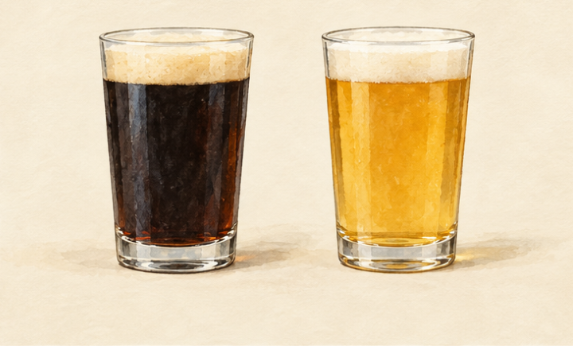
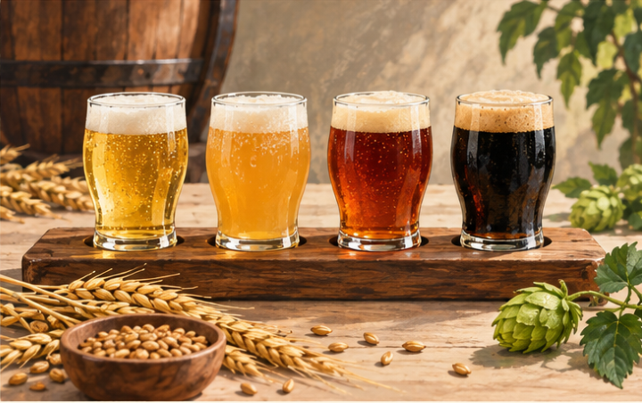
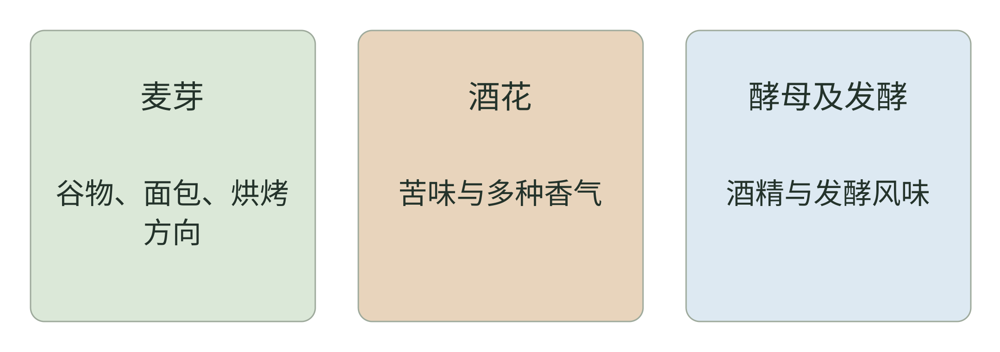

# 04 啤酒是一种会变化的谷物饮品

> 策划与整理：YZ。正文由 AI 编写，插画由 AI 生成。
>
> 许可：[CC BY 4.0](https://creativecommons.org/licenses/by/4.0/)；[作品出处](https://github.com/YZYExp/Learn-A-Cup-Of-World)。分享或改编时保留署名与许可链接，并注明改动；仅对有权许可且依法受保护的部分适用，第三方材料除外。

一杯淡金色啤酒和一杯近乎黑色的啤酒，常让人以为用了完全不同的原料。实际上，许多啤酒都从麦芽、水、酵母与酒花出发；不同选择把它们带向不同风格。[05]

先认识麦芽。谷物发芽后，相关酶能帮助把淀粉变成可供酵母使用的糖。酿造中的糖化，是把这种能力用在麦芽与水的混合物里。随后得到的麦汁经过煮沸、冷却，再让酵母进行发酵。[07]

麦芽还参与颜色和香气。较浅的麦芽可能使人想到面包或谷物，较深烘烤的材料则可能带来烤面包、咖啡或巧克力方向的印象。[05] 因此，闻到咖啡香，不必立即认定添加了咖啡；当然，确实添加咖啡的啤酒也存在，仍要看标签。

酒花既贡献苦味，也能贡献香气。不同酒花和使用方式，会让香气偏向花草、柑橘、热带水果等方向。酵母则负责产酒精，也参与风味形成。[06] 一杯酒里的果香，可能不需要一片真正的水果。

后来，间接麦芽干燥、制冷和大规模运输等技术，帮助拉格从地方饮品走向更广阔市场。[48] 一杯看起来普通的啤酒，因此也装着制造与运输发展的历史。先分清麦芽、酒花与发酵的贡献，再看这些技术怎样改变生产，会比只记品牌更有意思。

本页资料：

- [05] WSET 葡萄酒与烈酒教育基金会，《What is beer A beginner's guide》，2023。[原文](https://www.wsetglobal.com/knowledge-centre/blog/2023/november/what-is-beer-a-beginner-s-guide/)

- [06] WSET，《Your beer questions answered》，2024。[原文](https://www.wsetglobal.com/knowledge-centre/blog/2024/february/our-experts-answer-your-beer-faqs)

- [07] American Homebrewers Association，《The Brewing Process》，网页。[原文](https://www.homebrewersassociation.org/wp-content/uploads/Ingredient-Signs.pdf)

- [48] WSET，《More than just a cold one Lager uncovered》，2025。[原文](https://www.wsetglobal.com/knowledge-centre/blog/2025/more-than-just-a-cold-one-lager-uncovered/)

---

## 拉格 艾尔与其他线索

拉格与艾尔的区别主要与使用的酵母及发酵安排有关，不是淡色与深色的区别。两边都有许多风格，还有使用其他微生物的啤酒。[05] “拉格就是工业啤酒、艾尔就是精酿”也不是可靠分类。

想从菜单进入这个世界，可以先找三种不同主线。皮尔森常给你观察清爽感、酒花与苦味的机会；IPA 家族让酒花的存在更明显；波特和世涛则适合观察深色麦芽带来的烘烤方向。具体产品仍会有差别，风格名称只是入口。[08]

**别把黑色当成浓度表。** 颜色、酒精度、苦味与甜感是不同信息。“黑啤更烈”不能靠颜色证明；“不苦所以没有酒花”也未必成立。[06] 标签上的 ABV 表示酒精体积分数，比颜色更适合回答强度问题。

**本书建议的观察。** 不必一次买三瓶。每次遇见啤酒，记录“颜色、标签酒精度、最明显的香气、苦味是否明显”。过几次再比较，你会发现原来一直混在一起的判断开始分开。

也别因为写着“精酿”，就预先替自己决定好喝。这个词可以关联生产规模与行业定义，不会自动保证一杯酒符合你的口味。对个人学习来说，能看懂一种风格，通常比记住很多品牌更耐用。

本页资料：

- [05] WSET 葡萄酒与烈酒教育基金会，《What is beer A beginner's guide》，2023。[原文](https://www.wsetglobal.com/knowledge-centre/blog/2023/november/what-is-beer-a-beginner-s-guide/)

- [06] WSET，《Your beer questions answered》，2024。[原文](https://www.wsetglobal.com/knowledge-centre/blog/2024/february/our-experts-answer-your-beer-faqs)

- [08] Brewers Association，《2025 Beer Style Guidelines》，2025。[原文](https://cdn.brewersassociation.org/wp-content/uploads/2025/06/20143326/2025_BA_Beer_Style_Guidelines.pdf)

---

## 两杯啤酒，先别把颜色当成强度

**图 04-1　深色世涛与淡金色 IPA。**

**图例。** 左为深色世涛，假想标签 4.2% ABV；右为淡金色 IPA，假想标签 6.5% ABV。

这组构造样例故意让较深色的杯子酒精度较低。两个假想数值分别落在 BJCP 爱尔兰世涛与美式 IPA 的风格范围内，用来说明颜色和酒精度是两项信息，不是记录某两瓶实际产品。[52][56] 深色麦芽会影响色泽与烘烤印象；要判断酒精度，仍看 ABV 标签，不能从图里测出来。

本页资料：

- [52] BJCP，《2021 Beer Style Guidelines American IPA》，2021。[原文](https://www.bjcp.org/style/2021/21/21A/american-ipa/)

- [56] BJCP，《2021 Beer Style Guidelines Irish Stout》，2021。[原文](https://www.bjcp.org/style/2021/15/15B/irish-stout/)

---

## 精酿先看生产 再看风格

走进一家精酿吧，你可能同时遇到皮尔森、小麦、IPA、世涛和酸啤。这里的“精酿”不与这些名字处于同一层：它常讨论生产者，而风格描述杯中的作品。美国 Brewers Association 的定义强调小型与独立，并有其自身口径；不要把它当成全球统一定义。[51]

<!-- figure-height: 160 -->

**图 04-0　四杯啤酒的外观对照。** 从左至右为淡金、浑浊金色、琥珀与深色啤酒。

图中的颜色与杯型只帮助记忆，不用于判断真实产品。精酿可以酿拉格，也可以酿艾尔；传统风格和新创作都可能出现。先前说的四个声音——麦芽、酒花、酵母和其他发酵因素——仍是更稳妥的入口。

点单时试着说“想要酒花香明显，但别太苦”，或者“想试烘烤味，但酒精度低一点”。这比“来一杯最精酿的”更容易让对方理解。下面几页把常见名字放进这些问题中。

本页资料：

- [51] Brewers Association，《Craft Brewer Definition》，网页。[原文](https://www.brewersassociation.org/statistics-and-data/craft-brewer-definition/)

---

## Pale Ale 与 IPA 家族

美式 IPA 常强调酒花与苦味，麦芽支撑整体；Hazy IPA 则更强调浓郁水果方向的酒花表达及相应口感。浑浊不是倒进果汁的证明，也不是品质的排名。[52][53]

| 菜单名称|入门观察方向|读名称时要留意 |
| --- | --- | --- |
| American Pale Ale|麦芽与酒花的配合|不能仅当作较淡的 IPA |
| American IPA|明显酒花 苦味与较干收尾|同名产品仍有差别 |
| Hazy IPA|水果方向酒花 浑浊与口感|看起来像果汁仍含酒精 |
| Double IPA|更强的 IPA 表达|Double 不表示两倍好喝 |

表格结合风格资料作入门整理，不规定每款酒的味道。[08][52][53] “West Coast”“Session”等词还会继续细分方向。遇到它们，先问酒精度、苦味和主香气，不必立刻掌握完整家谱。

假设你觉得某款 IPA 太苦。下一次可以改变选择方向，而不是得出“我不喜欢精酿”。你不喜欢的可能是这款产品的平衡，精酿货架远不止这一排。

本页资料：

- [08] Brewers Association，《2025 Beer Style Guidelines》，2025。[原文](https://cdn.brewersassociation.org/wp-content/uploads/2025/06/20143326/2025_BA_Beer_Style_Guidelines.pdf)

- [52] BJCP，《2021 Beer Style Guidelines American IPA》，2021。[原文](https://www.bjcp.org/style/2021/21/21A/american-ipa/)

- [53] BJCP，《2021 Beer Style Guidelines Hazy IPA》，2021。[原文](https://www.bjcp.org/style/2021/21/21C/hazy-ipa/)

---

## 一杯啤酒里的三条风味线索

**图 04-2　麦芽、酒花与发酵的风味线索。**

**图例。** 从左至右为麦芽、酒花、酵母及发酵的贡献来源。

用这三条线索读啤酒菜单，比先把它排成浅色、深色两组更有帮助。[05][06] 酒花加入方式还会改变你遇见的香气与苦味；“干投”描述一个工艺选择，并不自动给出整杯的 IBU 或甜度。[58] 图中没有把颜色、苦味、酒精度合并为一个“浓度”。

本页资料：

- [05] WSET 葡萄酒与烈酒教育基金会，《What is beer A beginner's guide》，2023。[原文](https://www.wsetglobal.com/knowledge-centre/blog/2023/november/what-is-beer-a-beginner-s-guide/)

- [06] WSET，《Your beer questions answered》，2024。[原文](https://www.wsetglobal.com/knowledge-centre/blog/2024/february/our-experts-answer-your-beer-faqs)

- [58] WSET，《What is dry hopping》，2026。[原文](https://www.wsetglobal.com/knowledge-centre/blog/2026/what-is-dry-hopping)

---

## 不爱 IPA 还有很多入口

德式小麦常让人联想到香蕉与丁香，这些典型方向与发酵表达有关，不要求配方里真加香蕉。赛松则可呈现水果、香辛与偏干收尾。[54][55]

| 风格入口|可能注意到什么|适合先问的问题 |
| --- | --- | --- |
| 皮尔森与 Helles|清爽 谷物与酒花的不同平衡|偏麦芽还是偏苦 |
| 德式小麦 Weissbier|香蕉 丁香 蓬松气泡|有没有明显酵母香 |
| Witbier|小麦与香辛果皮方向|是否使用香料或果皮 |
| 波特与世涛|烘烤 可可或咖啡方向|偏干还是偏甜 |
| Saison 赛松|较干 水果与香辛表达|酒精度与酵母方向 |
| 酸啤及柏林酸小麦|酸味与其他成分的平衡|有没有水果 是否甜 |

这是一张入口地图，概括自风格资料，不把名称视为固定配方。[08][54][55][56][57] 酸啤又包括不同生产路径；“酸”不能一概解释为保存坏了，“加水果”也不自动等于酸啤。

你的第一条路线可以是：清爽型、酵母型、烘烤型、酸味型各读一份介绍。认识这些方向后，精酿吧的菜单会从一串陌生名字，变成几条可以选择的街道。

本页资料：

- [08] Brewers Association，《2025 Beer Style Guidelines》，2025。[原文](https://cdn.brewersassociation.org/wp-content/uploads/2025/06/20143326/2025_BA_Beer_Style_Guidelines.pdf)

- [54] BJCP，《2021 Beer Style Guidelines Weissbier》，2021。[原文](https://styles.bjcp.org/bjcp-2021-beer/10/10a-weissbier)

- [55] BJCP，《2021 Beer Style Guidelines Saison》，2021。[原文](https://www.bjcp.org/style/2021/25/25B/saison/)

- [56] BJCP，《2021 Beer Style Guidelines Irish Stout》，2021。[原文](https://www.bjcp.org/style/2021/15/15B/irish-stout/)

- [57] BJCP，《2021 Beer Style Guidelines Berliner Weisse》，2021。[原文](https://www.bjcp.org/style/2021/23/23A/berliner-weisse/)

---

## 干投与菜单上的缩写

酒花进入啤酒的时间和方式，会影响它贡献什么。干投常指在发酵相关阶段向较冷酒液加入酒花，以强化香气等表现；它不等于让干燥酒花直接成为杯底装饰。[58]

| 菜单信息|主要帮你读什么|它没有单独回答什么 |
| --- | --- | --- |
| ABV|酒精体积分数|一整杯实际酒精量 |
| IBU|苦味相关的分析或估算指标|你主观觉得有多苦 |
| Dry hopped 干投|酒花加入方式的线索|有没有水果添加 |
| Barrel aged 桶陈|木桶相关处理的线索|一定很烈或一定更好 |

表中对数字的提醒是本书的阅读整理。风格指南会给出 IBU 与 ABV 范围，实际苦味体验还要放回酒的整体平衡中。[52] 麦芽、甜感和口感不同，两个相近数字也未必给你相同印象。

下次看见“香气很强、喝着柔和”的描述，记住它没有说酒精量少。把风味问题交给鼻子和口腔，把酒精问题交给容量与标签，会让点单更清楚。[43]

本页资料：

- [43] NIAAA 美国国立酒精滥用与酒精中毒研究所，《Alcohol Calculators》，网页。[原文](https://rethinkingdrinking.niaaa.nih.gov/tools/calculators)

- [52] BJCP，《2021 Beer Style Guidelines American IPA》，2021。[原文](https://www.bjcp.org/style/2021/21/21A/american-ipa/)

- [58] WSET，《What is dry hopping》，2026。[原文](https://www.wsetglobal.com/knowledge-centre/blog/2026/what-is-dry-hopping)
