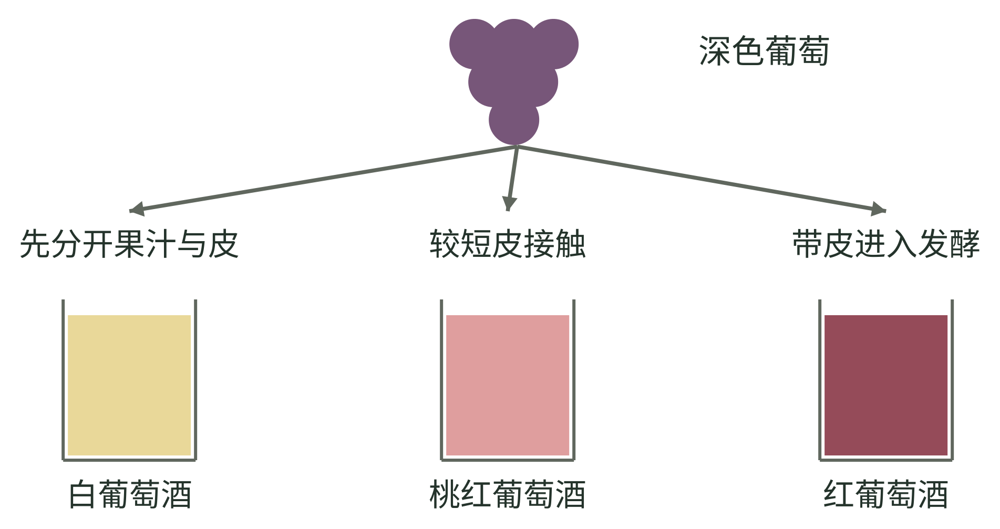

# 05 葡萄酒从果实进入时间

> 策划与整理：YZ。正文由 AI 编写，插画由 AI 生成。
>
> 许可：[CC BY 4.0](https://creativecommons.org/licenses/by/4.0/)；[作品出处](https://github.com/YZYExp/Learn-A-Cup-Of-World)。分享或改编时保留署名与许可链接，并注明改动；仅对有权许可且依法受保护的部分适用，第三方材料除外。

把一颗深色葡萄剥开，果肉通常没有外皮那么深。葡萄酒的红、白与桃红差别，不只是果实在水果摊上看起来什么颜色，更与果汁是否接触葡萄皮有关。[09]

红葡萄酒通常让果汁与皮一起进入发酵阶段，从皮中获得颜色和单宁；许多白葡萄酒先压榨，分开果汁与皮，再发酵。因此，深色葡萄也可能做出白葡萄酒。桃红常通过较短的皮接触获得较浅颜色。[09] 这些是常见路径，不能穷尽所有酿法。

果实提供的东西也不只有糖。酸度、香气前体和其他组成，会与酿造过程共同影响结果。发酵及后续处理还会增加新的风味物质。[10] “葡萄味”只是其中一部分，酒并不是放久的葡萄汁。

这解释了一个入门困惑：名字相同的葡萄，成品为何差别很大？本书的理解办法是，先承认品种给的是范围；成熟程度与酿造选择，还会继续改变这个范围。你不必用产区地图立即解决所有差异。

**小观察。** 有机会吃葡萄时，分别注意果肉的甜酸与葡萄皮的口感。它不能模拟酿酒，但能让“皮接触”从抽象术语变成具体记忆。本书不建议把所有食用葡萄的表现直接套到酿酒葡萄上。

本页资料：

- [09] WSET，《What determines the colour of wine》，2021。[原文](https://www.wsetglobal.com/knowledge-centre/blog/2021/september/23/what-determines-the-colour-of-wine)

- [10] WSET，《What is wine》，2021。[原文](https://www.wsetglobal.com/knowledge-centre/blog/2021/december/14/what-is-wine)

---

## 同一颗深色葡萄，酿法会让路线分叉

**图 05-1　葡萄皮接触与酒色。**

**图例。** 箭头为三种常见酿造方向；杯中色块分别示意白、桃红、红葡萄酒。

果汁与葡萄皮怎样相处，往往比水果摊上的外皮颜色更能解释酒的颜色。先分开果汁与皮可以走向白葡萄酒；较短皮接触常用于桃红；带皮进入发酵则是红葡萄酒的常见路线。[09] 这些是典型路径，不穷尽所有酿法。图中的杯子不代表具体品种，也不能凭颜色判断甜度。

本页资料：

- [09] WSET，《What determines the colour of wine》，2021。[原文](https://www.wsetglobal.com/knowledge-centre/blog/2021/september/23/what-determines-the-colour-of-wine)

---

## 先把甜 酸 涩分开

“干型”谈的是残余糖相关的风格，不是喝完嘴里干不干。干葡萄酒也可能有非常成熟的水果香，让你联想到甜；相反，明显的涩感也不等于糖更少。[10][11]

所以你可以用三个独立问题代替“是不是很干”：舌头有没有明显甜味？酸味让人觉得活泼还是尖锐？嘴里有没有收紧、干涩的感觉？这套问题是本书建议，目的是减少词语误会。

认识品种时，也先把它们当成方向。赤霞珠、黑皮诺、霞多丽、长相思这些名字很常见，但“某品种一定是什么味”会很快遇到例外。本书不要求你记住固定香气清单，而建议同时看：品种、产地、有没有橡木处理，以及酒庄的风格说明。

一张标签可以提供身份，不能替代实际体验。尤其是“果香丰富”这类词，不直接等于甜酒；“酒体饱满”也不是“酒精越高越好”的另一种说法。[10]

**本书建议的第一次记录。** 只选一种熟悉的水果来比喻香气，再记录甜、酸、涩哪个最突出。如果没有准确参照，就写“像熟水果，但说不出名字”。不用开瓶追求比较，可以先借餐饮中的单杯机会理解风格。

葡萄酒的魅力并不要求你先学会给它评分。找到自己喜欢的平衡，比在第一天说对十种香气更有价值。

本页资料：

- [10] WSET，《What is wine》，2021。[原文](https://www.wsetglobal.com/knowledge-centre/blog/2021/december/14/what-is-wine)

- [11] WSET，《A guide to wine types and styles》，2023。[原文](https://www.wsetglobal.com/knowledge-centre/blog/2023/october/03/how-many-wine-types-and-styles-are-there/)
