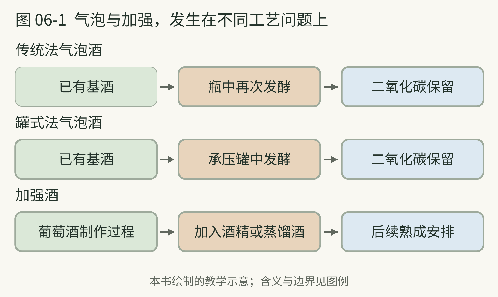

# 06 气泡酒与加强酒

> 策划与整理：YZ。正文由 AI 编写，插画由 AI 生成。
>
> 许可：[CC BY 4.0](https://creativecommons.org/licenses/by/4.0/)；[作品出处](https://github.com/YZYExp/Learn-A-Cup-Of-World)。分享或改编时保留署名与许可链接，并注明改动；仅对有权许可且依法受保护的部分适用，第三方材料除外。

同样是葡萄酒，有的轻轻冒泡，有的带着明显烘焙香，有的甜而浓郁。理解它们，可以先看两个制作问题：二氧化碳怎样留下来？有没有加入蒸馏酒？

很多气泡酒利用发酵形成二氧化碳。传统法常在瓶中进行第二次发酵；罐式法则在承压罐中完成相应过程。二者不仅是设备不同，也会影响生产安排与风格表达。[12]

酒液与酵母沉淀接触的安排，是理解一些面包、饼干方向香气的线索。另一类作品可能更强调新鲜果香。不要把这简化成“瓶中发酵高级、罐中发酵低级”；对个人阅读，更值得问的是你想体验什么，以及制作方式怎样服务这个目标。[12]

香槟是有特定产区和制作要求的名称，不是所有带泡葡萄酒的通称。卡瓦、普罗塞克和其他地方的气泡酒，也值得分别认识。[12] 本书只建立名称边界，不要求你背法规。

**本书建议。** 看到气泡酒标签，先找生产地与制作方式，再找甜度描述。不要仅凭泡沫大小判断品质。倒酒、杯子和观察时刻都可能影响你看到的现象，一次视觉印象不适合承担那么大的结论。

本页资料：

- [12] WSET，《A guide to sparkling wine production methods and regional styles》，2026。[原文](https://www.wsetglobal.com/knowledge-centre/blog/2026/a-guide-to-sparkling-wine-production-methods-and-regional-styles)

---

## 气泡与加强，发生在不同工艺问题上

**图 06-1 图例。** 每行是一条简化路径；箭头表示工艺关系。绿色框为起点，棕色框为关键操作，蓝色框为后续安排；不同列不表示统一的时间长度。

前两行回答二氧化碳怎样留下来，第三行回答有没有加强操作，两种问题不能靠一个“酒精高不高”解决。[12][13] 图中加强的时机不固定：波特与雪利让人看到不同安排。气泡大小也不是这张工艺图的质量评分。

本页资料：

- [12] WSET，《A guide to sparkling wine production methods and regional styles》，2026。[原文](https://www.wsetglobal.com/knowledge-centre/blog/2026/a-guide-to-sparkling-wine-production-methods-and-regional-styles)

- [13] Sherry Wines 雪利产区机构，《Fortification》，网页。[原文](https://www.sherry.wine/sherry-wine/production/fortification)

---

## 加强酒不是烈酒的别名

加强酒是在葡萄酒制作中加入一定量的酒精或蒸馏酒，改变酒精度和生产过程的一类酒。加入的时间与后续陈年方式不同，成品也会不同。[11][13]

波特常用在发酵尚未结束时加强的方式，保留糖分；雪利则让人看到另一条路线：葡萄酒完成发酵后，加强可以服务于不同熟成方向。雪利有干型，也有甜型，不能因为酒精度较高就把它统称为甜酒。[11][13]

这一组饮品可以帮你拆开三件常混淆的事：酒精来自哪里、甜味留下多少、陈年怎样改变风味。同一杯里，三件事会互相影响，却不是同一项指标。

| 问题|先看什么|不宜直接推断 |
| --- | --- | --- |
| 有没有气泡|气泡类型与制作说明|气泡越细一定越好 |
| 是不是甜|甜度或残糖风格说明|闻到果香就是甜 |
| 是不是加强酒|是否有加强工艺|酒精度高就一定是加强酒 |

**本书建议的入口。** 想继续读，先找一款强调果香的气泡酒与一款强调酵母接触的风格介绍，再看一款干型雪利与一款波特的制作说明。即使不实际喝，工艺的两组对照也能帮助你读懂菜单。

这个章节的用处，是提醒你：酒的分类不只是把瓶子排在货架上，更是为不同制作路径取名字。名字知道得越多，仍然要回到过程。

本页资料：

- [11] WSET，《A guide to wine types and styles》，2023。[原文](https://www.wsetglobal.com/knowledge-centre/blog/2023/october/03/how-many-wine-types-and-styles-are-there/)

- [13] Sherry Wines 雪利产区机构，《Fortification》，网页。[原文](https://www.sherry.wine/sherry-wine/production/fortification)
