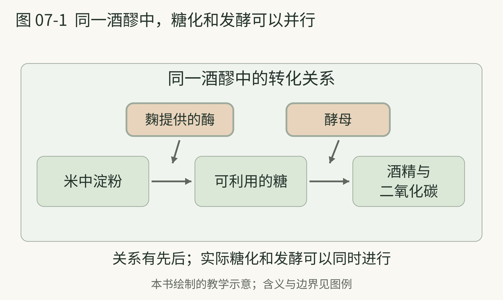
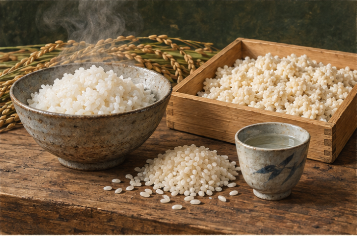

# 07 黄酒与清酒

> 策划与整理：YZ。正文由 AI 编写，插画由 AI 生成。
>
> 许可：[CC BY 4.0](https://creativecommons.org/licenses/by/4.0/)；[作品出处](https://github.com/YZYExp/Learn-A-Cup-Of-World)。分享或改编时保留署名与许可链接，并注明改动；仅对有权许可且依法受保护的部分适用，第三方材料除外。

米饭放进容器，不会因为看起来含有很多能量，就自动像葡萄汁一样发酵成酒。酵母需要可利用的糖，谷物里的淀粉要先经过糖化。理解黄酒与清酒，先认识负责打开这道门的曲或麴。

黄酒通常使用谷物、曲与相关发酵体系。原料、微生物活动及陈年中的反应，共同参与风味形成。[14] 曲不是单纯撒进去的调味粉，更是与酿造能力有关的一套材料和微生物条件。

在酒类货架上，黄酒常被酒精度更高的白酒遮住存在感。但它属于值得独立理解的谷物酿造酒，不能因为名字里有“黄”，就靠颜色判断身份。现代黄酒与古代谷物酒有联系，也不能把每一项史前谷物发酵证据都认作今天的黄酒。

甜感是进入黄酒的一条简单路线。不同产品可能偏干、偏甜，也可能让人联想到谷物、熟果或陈年香。本书建议先看糖分风格说明，再看生产信息；香气词只是可能方向，不能替每一瓶作保证。[14]

**本书建议的观察。** 在同一款成品允许的饮用方式中，比较常温与稍温时的香气，不必追求固定“最佳温度”。加热会改变你遇见香气的方式；如果烫到只注意温度，观察就已经被打断了。并非所有黄酒都需要温饮。

黄酒这一页最值得记住的，是谷物酿酒背后有人在安排糖化，而不仅仅是在等待。

本页资料：

- [14] Frontiers in Microbiology，《Flavor Formation in Chinese Rice Wine Huangjiu Impacts of the Flavor-Active Microorganisms Raw Materials and Fermentation Technology》，2020。[原文](https://pmc.ncbi.nlm.nih.gov/articles/PMC7691429/)

---

## 精米与同时进行的两条路

清酒也从米、水与麴等条件出发。麴提供的酶把淀粉分解成糖，酵母把糖转成酒精；两条过程能在酒醪中同时进行，常被称为并行复发酵。[15] 这里的“并行”值得记住，但不要据此宣布世界其他谷物酒没有相近的糖化与发酵安排。

清酒不是因为名字里有“清”，就与伏特加同类；它一般是酿造酒，不是蒸馏酒。[15] 把它与黄酒放在相邻位置，是为了看见谷物糖化这条共同线，而不是认定二者工艺一样。

精米步合表示磨去外层后，米粒剩下的质量比例。数字越小，磨去的部分越多；不是“磨掉百分之多少”的意思。[16] 它能帮你理解一个生产选择，却不能独自决定哪一瓶最值得喝。

“纯米”“吟酿”等术语也应先作为制作与类别信息来读。别把标签直接变成单一质量排行榜：不同生产目标，可以产生不同的香气与口感方向。[16]

2024 年，日本以麴酿酒的传统知识与技艺列入联合国教科文组织非遗名录。这个项目强调工匠、条件控制、团队协作和文化实践，并不只是给某种酒颁发品质奖章。[17]

本书建议第一次接触清酒时，不急着收集名词。先回答：它是蒸馏酒吗？米的处理信息告诉了我什么？这杯让我想到轻柔的水果香，还是更明显的米与发酵印象？能把这三件事分开，就足够继续读下去。

本页资料：

- [15] 日本酒造組合中央会 JSS，《How is Sake Made》，网页。[原文](https://japansake.or.jp/sake/en/basic/how-is-sake-made/)

- [16] 日本酒造組合中央会 JSS，《Glossary of Sake Terms》，网页。[原文](https://japansake.or.jp/sake/en/basic/glossary/)

- [17] UNESCO，《Traditional knowledge and skills of sake-making with koji mold in Japan》，2024。[原文](https://ich.unesco.org/en/RL/traditional-knowledge-and-skills-of-making-sake-with-koji-mold-in-japan-01977)

---

## 同一酒醪中，糖化和发酵可以并行

**图 07-1 图例。** 绿色框为材料或产物，棕色框内写关键参与者；实线箭头表示淀粉到糖、糖到酒精的物质转化关系。外框表示同一酒醪，不表示必须先完成全部糖化才启动发酵。

清酒资料中的并行复发酵，把麴提供的酶与酵母放在不同职责上：前者帮助淀粉形成可利用的糖，后者把糖转向酒精与二氧化碳。[15] 它们可以在同一酒醪里同时工作。图中箭头画的是关系，不是两段互不重叠的操作日程，也不拿这幅图指导家庭制麴。

本页资料：

- [15] 日本酒造組合中央会 JSS，《How is Sake Made》，网页。[原文](https://japansake.or.jp/sake/en/basic/how-is-sake-made/)

---

## 米里的两条变化

图例：图07-0 米饭、米粒与麴的阅读情境；不用于菌种辨认或家庭制麴。 AI 阅读情境插画。

上图是米与麴的阅读情境，不用于辨认菌种或指导家庭制麴。清酒资料解释的并行复发酵，可以用下面的关系记忆。[15]

| 从哪里开始|关键参与者|发生什么 |
| --- | --- | --- |
| 米中的淀粉|麴提供的相关酶|形成可利用的糖 |
| 形成的糖|酵母|转向酒精与二氧化碳 |
| 同一酒醪中的安排|工艺条件与酿造管理|两条过程可以同时进行 |

过程同时发生，不表示同一种微生物做完全部事情。分清职责以后，谷物为什么需要糖化就更容易记住。

本页资料：

- [15] 日本酒造組合中央会 JSS，《How is Sake Made》，网页。[原文](https://japansake.or.jp/sake/en/basic/how-is-sake-made/)
