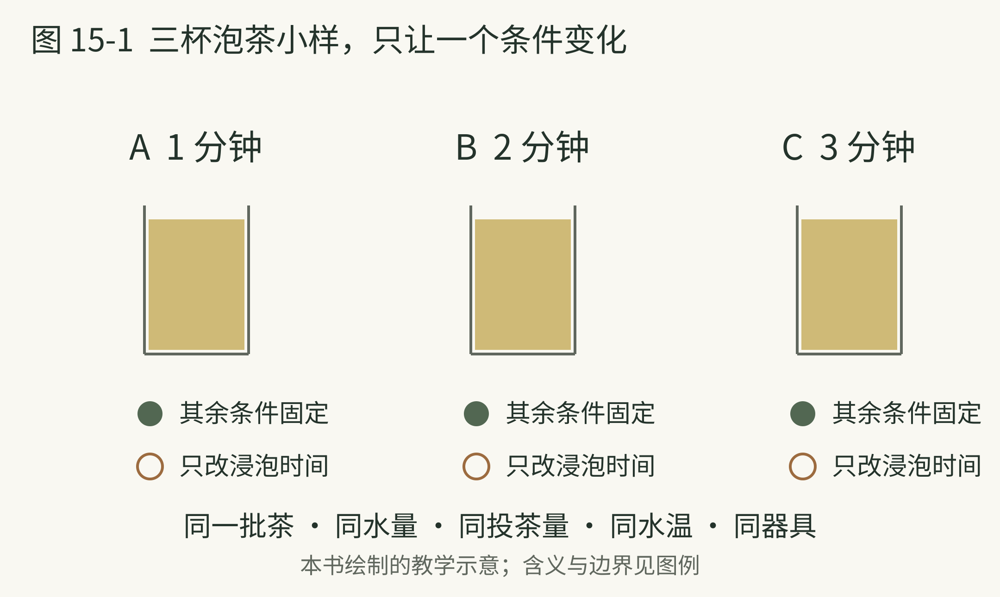
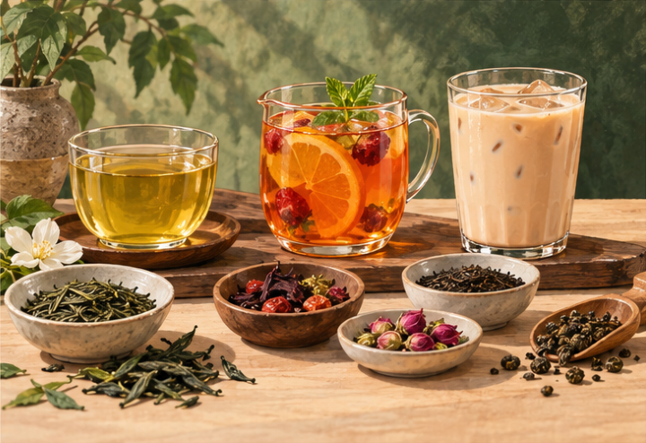
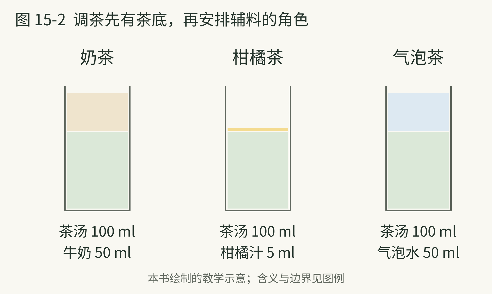

# 15 泡茶是一次温和的实验

> 策划与整理：YZ。正文由 AI 编写，插画由 AI 生成。
>
> 许可：[CC BY 4.0](https://creativecommons.org/licenses/by/4.0/)；[作品出处](https://github.com/YZYExp/Learn-A-Cup-Of-World)。分享或改编时保留署名与许可链接，并注明改动；仅对有权许可且依法受保护的部分适用，第三方材料除外。

泡茶不一定要从一张严格的温度表开始。个人学习可以先把问题拆成四项：叶子多少、水多少、水多热、接触多久。器具与叶子状态还会增加差别，但一次只动一个条件，更容易知道什么发生了变化。

这种观察方法是本书设计的，不宣称有一个适合全部茶的最佳参数。工艺不同的叶子，本身就有不同组成；冲泡时，你又在改变它们进入水里的方式。[34]

**从自己的日常配方开始。** 如果平时是一小撮茶加一杯水，就先保持这套办法，不用为了学习买秤。把同一泡茶分别在较早和较晚时分出一点，等到能舒服入口时再比较。记录颜色、香气与苦涩的变化，不必强行评定哪个正确。

发现“泡久了更苦”，也不要立刻推论所有茶都要越短越好。你观察到的是这款茶在这组条件下的变化。下一次换茶，仍要重新观察。把条件写下来，就是在给结论划清边界。

如果一杯不好喝，先把茶量或时间中的一个调低，而不是同时更换茶、水和器具。一次改变越多，越难解释改善来自哪里。

泡茶的乐趣，可以很简单：今天比昨天更知道自己为什么这样泡。你不需要先掌握全部术语，才能拥有一杯合口味的茶。

本页资料：

- [34] Food Chemistry X，《Processing chemical signature and food industry applications of Camellia sinensis teas An overview》，2021。[原文](https://doi.org/10.1016/j.fochx.2021.100160)

---

## 不必先买一套仪式

本书建议入门器具从能清洗、能控制、用着顺手开始。一只普通杯子与一个滤网，已经可以做许多观察。等你发现明确需求，再选择盖碗、壶或其他器具。

如果需要比较水，先使用两种可饮用、没有明显异味的水，保持茶与冲泡办法不变。把感到的区别写下来即可。这个练习只检验自己的体验，不用它评选全球最好的泡茶水，也不要把矿物含量与结果压成一个简单数字。

多泡几次也可以形成一种学习：第一泡、第二泡和后面几泡，未必呈现同样强度与重点。本书建议把它看成一个展开过程，不要求所有茶都泡到固定次数。

可以留一页简短记录：哪一泡最合口味？是因为香气、口感，还是因为刚好与当时的食物相配？如果只是“下午喝着舒服”，这也是有效信息。个人兴趣里，情境有它的位置。

日常还有一个容易被广告放大的词：回甘。你可以记录吞咽之后的感觉怎样变化，但不必靠某一项体验证明一款茶的全部品质。单个词语承担不了那么大的判断。

我们在纯茶里已经学到保持大部分条件、只改变一项的方法。下面把它用于调茶，先让茶底与其他材料各有自己的职责。

本页资料：

本页为原创阅读说明或自拟观察方法。

---

## 三杯泡茶小样，只让一个条件变化

**图 15-1 图例。** 三个同形杯表示对照小样，A 为基准，B、C 各只改变浸泡时间；绿色实心圆表示保持一致，棕色空心圆表示本次改变。数字是自拟观察起点，不是统一冲泡标准。

图中都取同一批茶、同样的投茶量、水量、水温与器具，只把时间设为 1、2、3 分钟。具体茶品仍按包装或自己已有做法调整。这是本书的控制变量示例，目的是比较某个改变发生后你观察到什么，不承诺时间越长越好。若同时换水、换茶与换器具，就很难只解释时间的影响。

本页资料：

本页为原创阅读说明或自拟观察方法。

---

## 从叶子拼配到成杯调饮

“调茶”不是本书里的一种独立茶类。它可以指干茶拼配，也可以指把泡好的茶与奶、果汁、糖或其他材料组合。英国茶行业机构介绍的拼配，还包括通过不同茶叶组合，保持目标风格的一致性。[64]

图例：图15-0 从左至右：茶汤、水果茶、奶茶；前景材料不表示精确配方。 AI 阅读情境插画。

| 层次|发生在什么时候|可以比较什么 |
| --- | --- | --- |
| 干茶拼配|冲泡之前|不同茶叶怎样组成茶底 |
| 窨花及再加工|茶叶生产中|花香如何进入材料 |
| 茶底萃取|准备成杯时|先把茶泡到什么强度 |
| 成杯调饮|茶汤与其他材料组合时|奶 果味 甜 酸与冰的关系 |

表格是本书的组织办法；窨花属于再加工线索，见第十四章。[31] 先分清层次，你就不会把茉莉茶、茉莉奶茶和把花瓣放进水里，误认成相同产品。

本页资料：

- [31] UNESCO，《Traditional tea processing techniques and associated social practices in China》，2022。[原文](https://ich.unesco.org/en/RL/traditional-tea-processing-techniques-and-associated-social-practices-in-china-01884)

- [64] UK Tea and Infusions Association，《Creating the Perfect Blend》，网页。[原文](https://www.tea.co.uk/tea-processing-and-blending)

---

## 奶茶要先有能站住的茶底

一杯纯饮刚好的茶，加入奶和融水后，可能变成只有奶感。这时可以先调整茶底用量与强度，不必立刻把时间无限拉长。你在处理的是新组合，目标已经与纯饮不同。

Twinings 的冰奶茶示例使用较少热水萃取茶包，再与奶和冰组合；其香料奶茶示例还把豆蔻、桂皮与姜纳入过程。[65][66] 这两份资料展示不同路径，不为全部奶茶确立唯一标准。

| 常见方向|先看哪些成分|容易混淆的地方 |
| --- | --- | --- |
| 鲜奶茶或茶拿铁|茶底 奶 奶泡或糖|名称不保证全用鲜奶 |
| 港式奶茶|具体店家的茶底与乳品说明|不是所有红茶加奶都同一种风格 |
| 珍珠奶茶|茶 奶或替代材料 糖 珍珠|珍珠属于配料 不规定茶底 |
| Masala chai 香料奶茶|茶 奶 香料 甜化安排|不同地区与家庭有不同配方 |
| 抹茶拿铁|抹茶粉与奶|通常不需要咖啡作为基底 |

这张表是菜单阅读提醒，地区名称和配方不强作统一定义。点单可以直接问“茶底是什么”“乳品是什么”“甜度怎样调整”。知道店家实际材料，比只凭名字预测口感更有效。

本页资料：

- [65] Twinings，《Spice Chai Tea Recipe》，网页。[原文](https://twinings-tea.jp/enjoy/milktea/recipe/spicy-chai.html)

- [66] Twinings，《Rich Iced Milk Tea Recipe》，网页。[原文](https://www.twinings-tea.jp/enjoy/milktea/recipe/rich-iced-milk-tea.html)

---

## 让辅料有角色

以下是本书自拟的调饮观察分组，不作为生产标准。重点不在把水果尽量堆多，而是先决定你希望茶、果香、酸味与甜感各占什么位置。

| 方向|材料角色|可以先调整的一项 |
| --- | --- | --- |
| 柑橘茶|茶作主体 柑橘提供香气与酸|先少量加汁 再决定酸度 |
| 水果茶|茶与水果共同组成风味|先分清鲜果 果汁 果酱 |
| 气泡茶|茶提供风味 气泡水改变体积与口感|茶底是否被稀释得太弱 |
| 香料茶|茶与香料建立香气关系|先只用一种香料观察 |
| 无酒精茶调饮|以茶组织酸甜香气|不必用很多糖模仿酒的热感 |

“水果很多”与“茶味清楚”并非同一个目标。先拿少量材料做小样，可以避免一整壶调完才发现不合口味。气泡水宜在组合后段加入并轻轻混合，观察气泡的保留；这些是本书的家庭试验建议。

若要加柑橘，也先分别尝茶底和果汁，再组合。你会更容易知道，酸来自水果、茶的表现，还是整体比例改变。观察用的成杯及时饮用；含奶与鲜果的版本不把久放当作陈年。

本页资料：

本页为原创阅读说明或自拟观察方法。

---

## 调茶先有茶底，再安排辅料的角色

**图 15-2 图例。** 绿色为茶底，米色为牛奶，黄色为柑橘汁，蓝色为气泡水；竖向色块按表列体积比较，只示意组成，成杯不一定真的分层。配方为本书自拟小样。

本章小样把奶茶设为茶汤 100 毫升加奶 50 毫升，柑橘茶先用茶汤 100 毫升加汁 5 毫升，气泡茶用茶汤 100 毫升加无糖气泡水 50 毫升。它们是用来观察的起点，不是港式奶茶、经典水果茶或商业产品标准。先看加入的材料在改变体积、酸味还是香气，再决定下一次只调整哪一项。

本页资料：

本页为原创阅读说明或自拟观察方法。

---

## 一次只让一个条件变化

下面给出三组本书自拟起点，使用已经泡好并放到适宜温度的茶汤，不规定所有茶的萃取办法。数字只服务观察，可以缩小用量，不是经典地区配方。

| 小样|初始组成|下一步只改变什么 |
| --- | --- | --- |
| 奶茶|茶汤 100 毫升 牛奶 50 毫升|茶与奶的比例 |
| 柑橘茶|茶汤 100 毫升 柑橘汁先加 5 毫升|每次只小量增减果汁 |
| 气泡茶|茶汤 100 毫升 无糖气泡水 50 毫升|茶底与补水的比例 |

可以先不加糖，观察组合，再决定是否需要少量甜化。这个顺序是为了看清原来的关系，并不要求你必须喜欢无糖。使用可饮用原料和洁净器具；小样及时饮用。

记录一句“加奶后茶味变弱”，比一句“不高级”更容易指导下一次。若茶底已经苦涩，再靠增加茶底去压过奶，未必是你想要的结果；下一次应回到萃取条件观察。

调茶与调酒的相似处，在于材料都各有职责。不同处，是茶汤常需要你先完成提取，而基酒通常已经是可以直接组合的成品。记住这个分工，茶饮菜单会更容易读。

本页资料：

本页为原创阅读说明或自拟观察方法。
