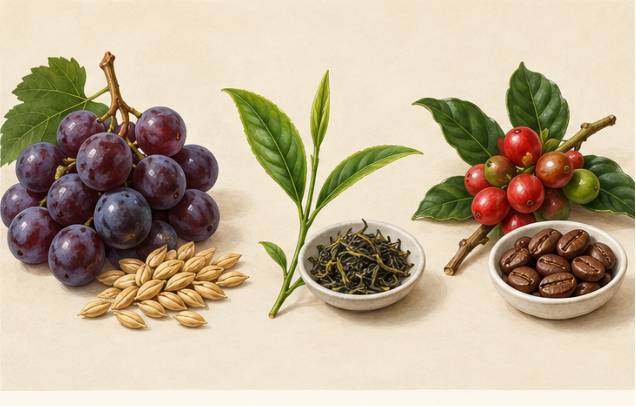
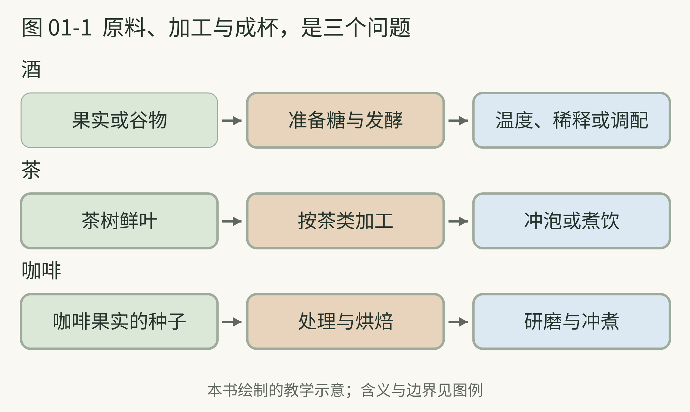
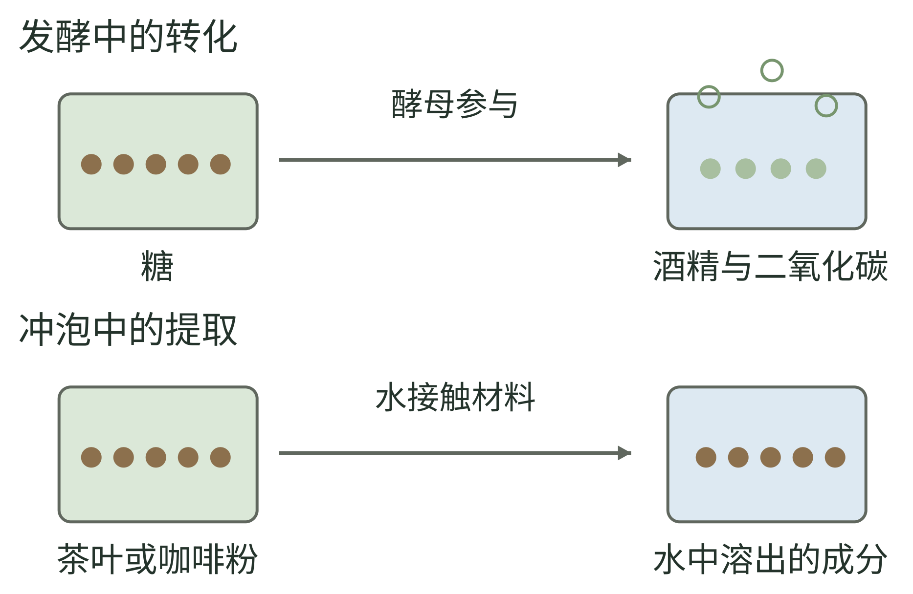

<!-- page: 01|第一部 共同基础|三种饮品为什么能放在一起 -->

# 01 酒 茶 咖啡的亲缘关系

把一粒麦子、一片茶叶和一颗咖啡果摆在桌上，它们没有明显的相似。变成饮品以后，讨论它们的人却会不断说起同样的词：产地、加工、香气、口感，还有“这次与上次不一样”。

<!-- figure-height: 150 -->

**图 01-2　从植物原料进入三类饮品（AI 教学示意）。**

**图例。** 左为葡萄与谷物，中为茶树嫩梢与干茶，右为咖啡果实与烘焙豆；物件没有统一尺寸比例。

咖啡的果实与熟豆之间还有处理、干燥和烘焙；茶树嫩梢也不等于未经加工即可按任意茶类冲泡。[34][37] 先看原料，再追问它经历了什么。

<!-- page: 01|第一部 共同基础|关键变化发生在哪一步 -->

## 关键变化发生在哪一步

本书用一个共同框架理解它们：原料带来可能性，加工选择其中的一部分，饮用方式决定你最后遇见什么。这个框架是阅读工具，不是三类饮品共用的一套科学分类。

酒要先解释糖从哪里来。葡萄汁已有糖，谷物通常需要先把淀粉分解成可发酵的糖；酵母再把糖转成酒精和二氧化碳。不同酿法还会形成不同的风味物质。[15] 茶更常从一片叶子的加工变化开始；咖啡则需要从果实里的种子一路走到处理、烘焙和冲煮。[34][37]

于是，“都发酵”是一个方便但不够准确的说法。红茶常被称为全发酵茶，核心变化却主要是酶促氧化；一些黑茶的加工才明显涉及微生物活动。[34] 咖啡处理可以利用发酵，但普通黑咖啡并不是靠保留酒精来形成饮用身份。

三类饮品都经历材料转变，但关键变化发生的阶段不同。分清糖化、发酵、氧化和萃取各在哪一步，才不会把相似的术语混用。

<!-- page: 01|第一部 共同基础|原料、加工与成杯，是三个问题 -->

## 原料、加工与成杯，是三个问题

**图 01-1　三类饮品的制作与成杯路线。**

**图例。** 绿色为原料，棕色为加工，蓝色为饮用前的呈现；箭头表示简化的阅读顺序。

同样摆在杯中，三类饮品经历的关键变化却不同。先把原料、加工、成杯分开，后面的糖化、氧化和萃取才有位置可放。[15][34][37] 图中只画骨架；酒还可能过滤、调配，茶还可能再加工，咖啡也可能拼配。箭头不是时间刻度。

<!-- page: 01|第一部 共同基础|共同框架也有边界 -->

## 先问过程 再问名气

第一次认识一种饮品时，可以问四个问题：它原来是什么？经过哪些关键变化？喝之前还要做什么？人们通常在哪里、与谁一起喝？

<!-- figure-height: 155 -->

**图 01-3　转化与提取回答不同问题。**

**图例。** 上行用棕点示糖、绿点示转化产物，空心圆示二氧化碳；下行棕点示从材料进入水的成分。点的数量不是分子或含量。

发酵涉及糖的转化；茶与咖啡冲泡则主要把材料中的成分提取到水里。[15][34][37] 图只比较这两个问题，不表示发酵没有其他产物，也不表示冲泡中绝无其他变化。

<!-- page: 01|第一部 共同基础|把工艺线索带回标签 -->

## 把工艺线索带回标签

上图只保留入门主线。实际制作可能有重复、交叉和额外处理，例如酒液过滤、茶叶焙火和咖啡拼配，不应把图当成完整工厂流程。

对“产地”的理解也需要克制。一个地名可以帮助你缩小范围，却不能替你尝到成品。同一地点的原料，经过不同处理，也会变成不同风味。咖啡品种目录之所以同时描述品种表现和适应条件，正说明植物与环境需要一起看。[36]

同样，名气和价格可以告诉你市场在意什么，不能直接告诉你自己喜欢什么。你喜欢淡一点的茶、没有烟熏味的威士忌、加奶的咖啡，都不影响学习。学习是在增加选择，而不是替口味排座次。

**试着观察。** 下次饮用时，只写三行：原料是什么、关键加工是什么、我最先注意到什么。没有资料就写“不知道”。把不知道留下来，比猜出一个专业词更有用。
