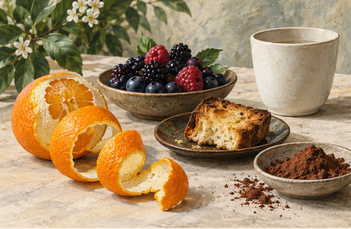

<!-- page: 02|第一部 共同基础|我们到底在尝什么 -->

# 02 舌头之外的风味

你说咖啡“有巧克力味”，并不一定是说它像糖一样甜。许多时候，你是在形容香气或整体印象。味觉与嗅觉共同参与风味；口感和温度也会改变体验。[01]

一个容易理解的例子是感冒鼻塞：甜和咸可能仍能分辨，食物的完整风味却变得模糊。这不是舌头突然失去了全部工作，而是少了嗅觉的参与。[01] 所以品饮时，把“闻到什么”和“嘴里发生什么”分别记下来，会比一句“味道很浓”清楚。

甜、酸、苦描述的是味觉。涩更像口腔摩擦和干燥的触感。红葡萄酒里的单宁会带来抓住口腔的感觉；茶的加工也会影响多酚组成与饮用表现。[09][34] 酒精的热感、咖啡的厚薄、气泡的刺激，又各自增加了体验层次。

你不用一次识别很多香气。先在“植物、果实、烘烤、发酵”这样的日常方向里找位置即可。这是本书的记忆办法，不是正式风味轮。能分清“像鲜果”与“像烤面包”，已经足以比较许多饮品。

**小实验。** 闻一片橘子皮，再闻一小块面包，分别写一句话。随后喝一口熟悉的饮品，看它使你想到哪一种。这只是建立自己的气味记忆，不是在证明饮品里真的有橘子或面包。

<!-- page: 02|第一部 共同基础|把“味道”拆成三个观察位置 -->

## 把“味道”拆成三个观察位置

**图 02-1　香气、味觉与触感。**

**图例。** 从左至右为香气、味觉和触感，词语是观察方向。

“像巧克力”可以是在说香气，“苦”是在说味觉，“嘴里收紧”又是在说触感。把一句笼统的“很浓”分成三个位置，记录会更有用。[01][09][34] 香气参照不等于配料清单；闻到某种水果的印象，仍需另查实际材料。

<!-- page: 02|第一部 共同基础|形容词从自己的生活里长出来 -->

## 不必假装尝到了别人说的东西

菜单上写了白花、莓果和香料，你只闻到“有点香”，非常正常。一部分差别来自经验，另一部分来自人与人感知的差异。描述首先应忠于当下，不必向菜单交作业。

World Coffee Research 的感官词汇研究使用具体参考物，帮助训练者对某种感觉建立比较一致的理解。[42] 本书借用这种“找得到参照”的思路，却不复制专业测试：你自己的参照可以是桂花、米饭、烤红薯、湿木头或柚子皮。

写“像巧克力”，还可以再问：偏可可粉的苦，还是牛奶巧克力的甜香？写“果香”，可以问：偏清鲜，还是偏熟果、果干？第二句话往往比第一个名词更有信息。

**本书建议的简短记录。** 先闻，再喝；写出最明显的一项香气、最明显的一项口感，最后写“喜欢、不喜欢、还不确定”。不要把十项全部填满，也不要把喜好与品质判断混在一起。

有时，饮品放凉后变得更容易描述。你可以隔几分钟重新闻、尝，记录差别，但别急着用一次变化解释所有饮品。咖啡研究也提醒我们，温度、浓度和萃取之间的关系需要拆开研究，而不是凭“越热越好”下结论。[40]

能说“第二次比第一次更容易分辨酸味”，已经是一条有效观察。它比“高级”“醇厚”“层次丰富”更容易让另一个人明白你经历了什么。

<!-- page: 02|第一部 共同基础|先在生活里收集香气 -->

## 一张自己的气味地图

<!-- figure-height: 180 -->

**图 02-0　生活中的香气参照。** 柑橘、莓果、面包与可可作为气味参照。

图中的果实、烘烤面包与可可只是记忆参照，不是杯中添加物的清单。你可以把自己熟悉的气味放在旁边；参照能使描述更具体，这是感官词汇研究也使用的思路。[42]

@table
先找的方向|生活中的参照|再多问一句
清鲜或果香|柑橘皮 鲜莓果|偏果皮 果汁还是熟果
烘烤|面包边 可可 烤坚果|偏轻烤还是明显焦烤
植物与香料|鲜叶 花香 熟悉香料|偏清鲜 干燥还是辛香
@endtable

这张地图是本书自拟学习工具，不是正式风味轮。一次认识一项已经足够。
