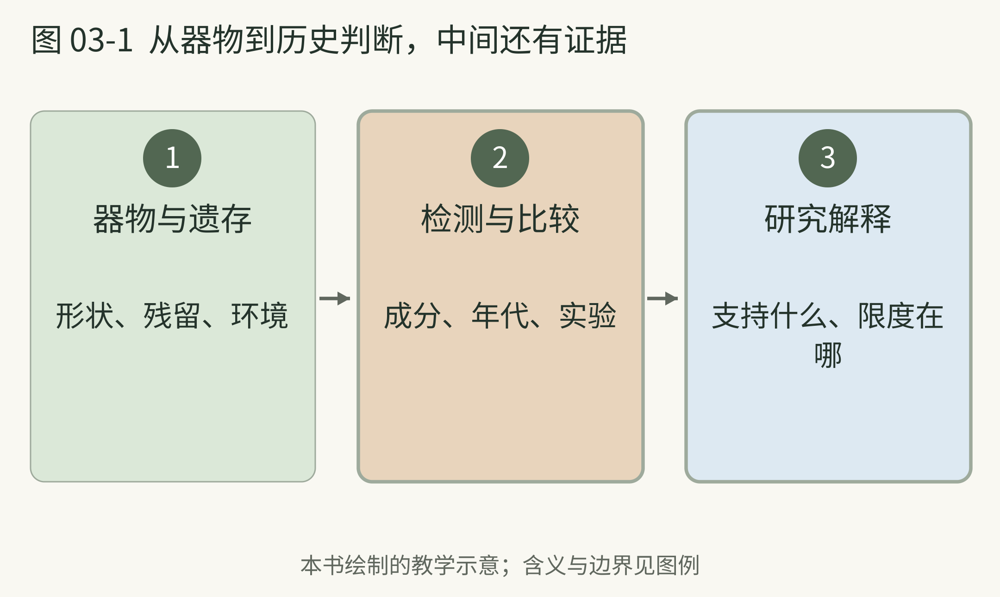
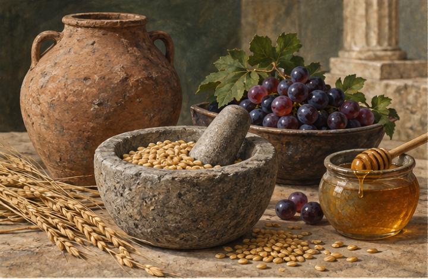

<!-- page: 03|第一部 共同基础|第一杯酒究竟从哪里来 -->

# 03 起源常常没有发明人

想象史前的一只容器，里头留着谷物或果实。今天的研究者不可能伸手拿到一杯当年的成品，只能从残留物、植物遗存和器物环境寻找线索。起源研究更像拼图，很少像“某年某人发明”的登记表。

2004 年发表的贾湖研究，把河南新石器时代陶器中的残留解释为米、蜂蜜和水果组成的混合发酵饮品，年代约在公元前第七千纪。水果可能涉及山楂和／或葡萄；原文也说明，酒精本身没有直接保存为化学证据。[02]

这很值得兴奋，却不能直接写成“九千年前已在酿今天的黄酒”。原料组合、工艺与现代分类都可能不同。更准确的说法是：这些发现支持中国很早就存在制作混合发酵饮品的活动。

格鲁吉亚遗址的研究则报告了约公元前 6000—5800 年与葡萄酒相关的化学和考古证据。[03] 它支持当地很早已有葡萄酿造活动，但不能确定世界上第一位酿酒者。

这两项研究放在一起，最有趣的不是争谁第一，而是看到不同人群如何使用身边的糖、果实与容器。人类很早就开始探索能入口的变化；我们今天熟悉的商品类别，是更长时间里逐步形成的。

<!-- page: 03|第一部 共同基础|从器物到历史判断，中间还有证据 -->

## 从器物到历史判断，中间还有证据

**图 03-1　从遗存到历史解释。**

**图例。** 箭头依次连接遗存、检测比较与研究解释。

一只陶罐的样子可以启发提问，但饮品身份需要残留物、年代与情境共同支撑。贾湖、格鲁吉亚与 Raqefet 的研究也使用不同组合的证据。[02][03][04] 这幅图是本书整理的阅读路线，不是某个遗址的出土记录或复原图。

<!-- page: 03|第一部 共同基础|时间线不是排行榜 -->

## 证据能说到哪里

Raqefet 洞穴的研究把约一万三千年前石臼中的遗存及使用痕迹，与谷物酿造活动联系起来，并通过实验与情境分析提出解释。[04] 这是很早的酿造线索，但读者应记住：研究讨论的是古代遗存的解释，不是发现了一罐仍能饮用的古代啤酒。

@diagram evidence

上图按年代并列线索，饮品、证据类型和研究方法并不相同。它不能用于宣布“所有酒都源于某一种酒”，也不能把今天的清澈啤酒、白酒或葡萄酒原样投射回史前。

本书采用一个读历史的规则：看到“最早”，再问一句“最早的什么证据”。是文字记录、化学残留，还是器具？看到“发明”，再问一句“故事来自什么时代”。

后面的茶与咖啡也会遇见同样问题。咖啡牧羊人的故事会让人记住植物的吸引力，却不能替代史料；某一份酿酒账目可以证明当地当时已经在生产，却不能证明此前无人尝试。

目前发现的最早记录，只是已知证据的起点，不一定是实践本身的起点。

<!-- page: 03|第一部 共同基础|一只容器能让我们知道什么 -->

## 看见器物 仍要读证据

<!-- figure-height: 180 -->

**图 03-0　从容器与材料提出历史问题。** 陶器、谷物与果实呈现材料线索。

这幅图用容器、谷物和果实表现“从材料寻找线索”的阅读情境，不复原某一遗址。真实研究会把残留物分析、植物证据与环境结合，证据也有各自限度。[02][03][04]

@table
看到什么|可能帮助回答什么|还不能直接断定什么
器物形状|使用场景与处理方式的线索|装过哪一种现代酒
残留物|曾有什么成分的线索|完整配方与全部步骤
年代与环境|活动发生的大致背景|全世界唯一发明起点
@endtable

器物外观提供线索，饮品身份仍须由检测和考古情境支持。
