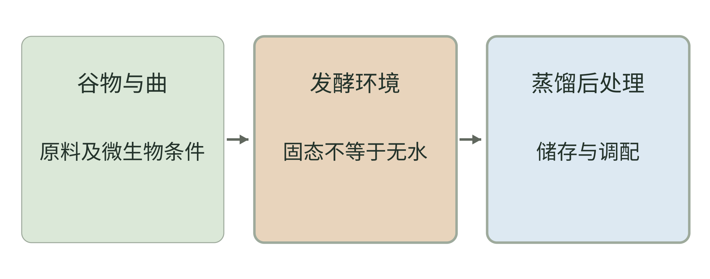

<!-- page: 08|第二部 酒的世界|白酒的关键不只有高酒精度 -->

# 08 白酒与微生物的房间

白酒常给初学者留下一个强烈印象：热、冲、香气很大。假如只用“烈”来解释它，就会错过真正有趣的部分。许多传统白酒从谷物、酒曲与固态发酵出发，再经过蒸馏、储存和调配。[18]

“固态”不表示完全没有水，而是与大量液体中的发酵环境不同。蒸熟的原料、曲、空间与温度，给微生物创造特定条件。曲也不是只有一种酵母，研究讨论的是复杂微生物体系与工艺之间的关系。[18][19]

本书把它比喻成一间共同工作的房间：有的成员提供分解能力，有的负责后续转化，环境还会筛选谁能活跃。这个类比帮助理解复杂性，不能拿来认定每种微生物在所有香型里都有相同职责。

不同白酒的工序和发酵条件并不统一。[19] 因此，听到“老窖”“大曲”“高温”时，最好追问它具体属于哪种工艺，而不是把熟悉的一套说法套到全部白酒。

白酒的历史同样需要区分谷物酿造与蒸馏酒的发展。贾湖的混合饮品证据支持早期发酵活动，不能直接证明当时已有现代意义的白酒。我们可以承认酿酒传统很长，也承认今天的类别在更晚阶段逐渐形成。

<!-- page: 08|第二部 酒的世界|白酒工艺，沿着关键变化来读 -->

## 白酒工艺，沿着关键变化来读

**图 08-1　白酒制作的三个观察段落。**

**图例。** 箭头连接原料与曲、发酵环境、蒸馏后处理三个观察段落。

这幅图把原料、发酵条件与蒸馏后的安排分别放好。许多传统白酒涉及固态发酵与复杂微生物体系，不同香型与工艺之间还会有差别。[18][19] 闻起来强烈只是一项感受；要认识身份，还需看香型、产品类别及具体生产说明。

<!-- page: 08|第二部 酒的世界|香型是入口而不是全部答案 -->

## 从清香 浓香 酱香进入

白酒有多种分类和香型。对个人入门，先认识清香、浓香、酱香这些常见名称，比一次背全分类更合适。研究把它们与不同原料处理、曲和发酵体系联系起来，说明“香型”不是随意的广告形容词。[19]

但香型也不能代替成品。你可以把它理解成一片范围较大的街区，具体产品仍可能不同。闻到的香气强弱、酒精刺激、入口质地与后段变化，值得分别观察。

**本书建议。** 如果实际接触白酒，先用极少量观察香气，杯子与鼻子保持舒服的距离，不必深吸，也不必把“能喝下去”当成能力。写下最明显的一项印象即可：偏清爽、偏浓郁发酵、偏烘烤，或者暂时无法形容。它们是你的观察，不是正式香型定义。

“勾调”也常被误会。不同基酒的组合，是生产中可能存在的工序；看到调配一词，本身不能判定为劣质或造假。[18] 真正需要看的，是产品类别、标签与具体生产信息。把所有调配都想成随便兑酒精，会把许多正常工艺一起误解。

你也完全可以不喜欢白酒。理解它所使用的发酵与蒸馏方式，并不要求你的身体和口味配合某种社交期待。个人兴趣阅读的收获，是看见原来“只有酒精味”的杯子背后，有一套丰富而具体的制造过程。
