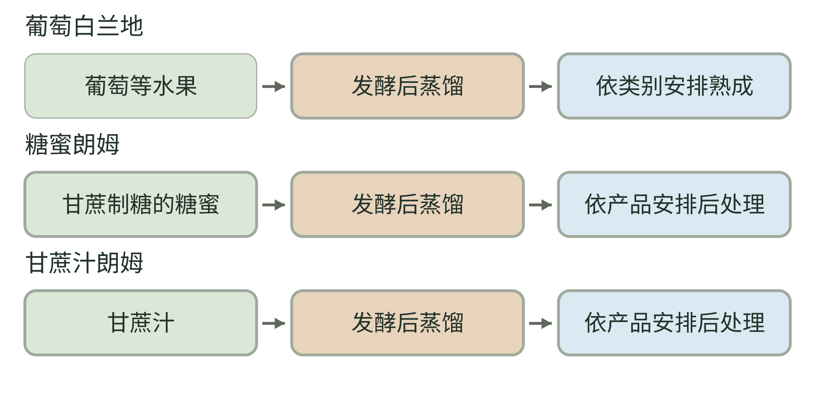
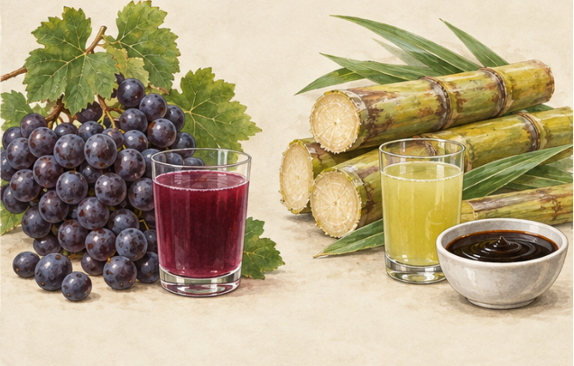

<!-- page: 10|第二部 酒的世界|葡萄也能走向蒸馏 -->

# 10 白兰地与朗姆

白兰地让我们回到果实，只是这次不会停在酿造酒。它以水果发酵液为起点，经蒸馏进入烈酒世界；葡萄白兰地是常见的一支。[29] 原料像什么，并不能保证最终入口就像同一种鲜果。

干邑是特定来源与工艺条件下的一类葡萄白兰地。BNIC 的制作资料把葡萄种植、采收、酿造、蒸馏、陈年与调配放在同一条链上。[23] “干邑”与“白兰地”因此不是两个平行而互不相干的名字，更接近特定类别与较大范围的关系。

可以先比较葡萄酒与葡萄白兰地的过程，而不是立刻比较名气。前者的风味在发酵和后续处理里成形；后者还经过蒸馏及相应陈年选择。原料共同，路线却分叉了。

想理解这种差别，可以读一段酒厂工艺介绍，标出“发酵结束”在哪里，再标出“蒸馏”和“桶”在哪里。你会发现，好些香气不必来自新添加的香料，而可能与生产过程有关。

**闻香练习。** 若有适合的成品，只比较自己的三个印象：偏鲜果、偏果干，还是偏木质烘烤。不要把它们当成真假鉴别方法，更不必为这些方向寻找昂贵样品。

<!-- page: 10|第二部 酒的世界|水果与甘蔗，分别走向哪条烈酒路线 -->

## 水果与甘蔗，分别走向哪条烈酒路线

**图 10-1　白兰地与朗姆的原料路线。**

**图例。** 绿色为原料，棕色为关键变化，蓝色为后续安排；箭头表示简化工艺顺序。

白兰地与朗姆都进入了蒸馏路线，但发酵前的材料不同。[25][29] 后处理可能包括熟成与调配，具体安排需查生产说明。酒色不直接等于年龄，甘蔗原料也不保证成品有甜味。

<!-- page: 10|第二部 酒的世界|甘蔗的故事不只有甜 -->

## 朗姆与制糖世界

朗姆以甘蔗相关原料为出发点，可以使用糖蜜，也可以使用甘蔗汁等原料。发酵、蒸馏与熟成选择，会让这个类别出现不同地域风格。[25] 由甜的植物而来，并不意味着成品一定保留明显甜味。

<!-- figure-height: 150 -->

**图 10-2　葡萄、甘蔗汁与糖蜜（AI 教学示意）。**

**图例。** 左为葡萄与果汁；右为甘蔗、浅色蔗汁与碗中深色糖蜜。不是三份成品烈酒，也没有按含糖量着色。

糖蜜是甘蔗制糖相关原料，与直接取用的甘蔗汁应分开读。发酵和蒸馏以后，原料甜也不保证成品入口甜。[25][29]

<!-- page: 10|第二部 酒的世界|制糖、贸易与生产说明 -->

## 制糖、贸易与生产说明

它的历史也不该只用海盗和海岛作背景。美国国家历史博物馆把早期加勒比朗姆生产与制糖、糖蜜利用、出口贸易，以及被奴役者的劳动放在一起讲述。[24] 一瓶看起来轻松的饮品，也可能连着沉重的经济史。

制糖、贸易与劳动条件，共同影响了朗姆在当地的生产与传播。

看到白朗姆、金色或深色朗姆时，可以先把颜色当成外观信息。它不是全球统一的风格等级，也不能单独替你解释原料、桶和添加处理。[25] 更有帮助的是查生产者说明，以及这瓶酒准备怎样使用。

**试一试。** 读两份朗姆介绍，一份以糖蜜为原料，一份以甘蔗汁为原料；用同样三个问题记录：发酵原料是什么、有没有熟成信息、风味说明更强调什么。这组文字对照就能帮助你理解区别，不必通过实际饮酒完成。

读到这里，你已经能沿着谷物、葡萄与甘蔗，追踪三条通往烈酒的路线。下一章再看龙舌兰原料中的糖怎样变得可利用。
