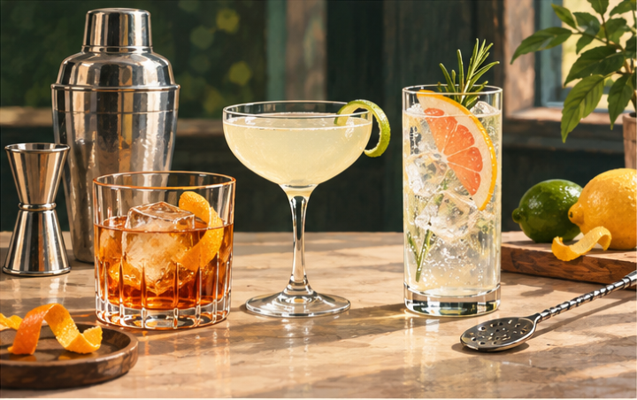
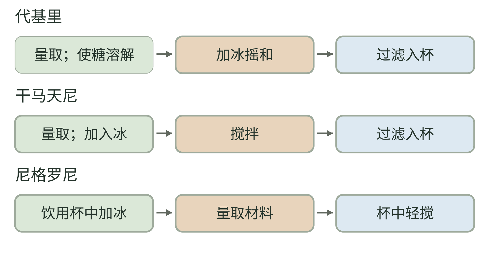
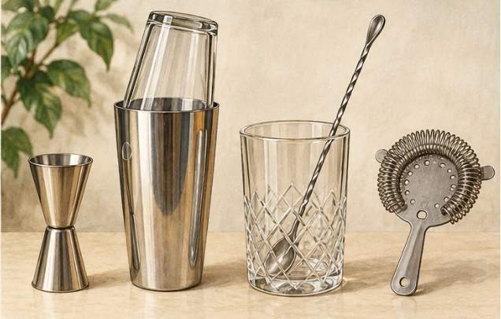
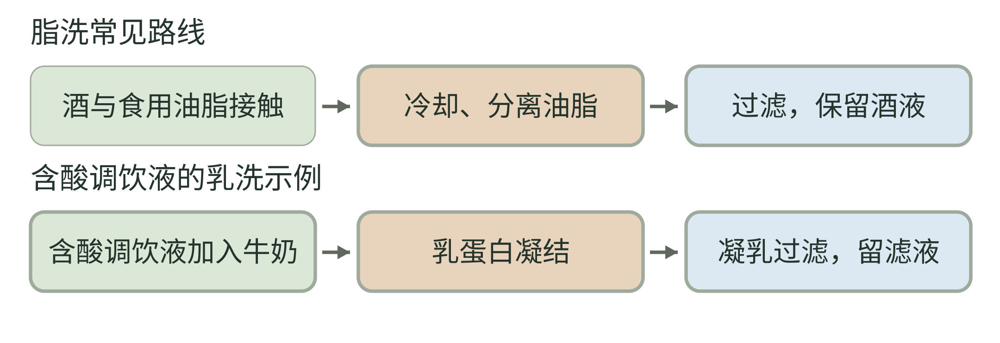

<!-- page: 12|第二部 酒的世界|把调酒看成关系而不是魔法 -->

# 12 鸡尾酒与一杯里的平衡

鸡尾酒把成品饮料重新组合。你可以把它理解为第二次设计：基酒提供风味与酒精，其他材料改变甜、酸、苦、香气和口感，冰又通过降温与融水参与结果。

读配方时，先找“谁是主体、谁在调整”。这套问题是本书的理解办法，并不是所有鸡尾酒都遵守同一个公式。某些作品主要围绕基酒，某些重视酸甜结构，还有些利用气泡或低酒精材料组织风味。

代基里提供一个简单例子。IBA 的配方使用白朗姆、青柠汁和糖，以冰摇和后过滤入杯。[30] 三种主要材料清楚地展示了基酒、酸和甜如何组合。你不用立刻照做，也能从配方读懂它大致在解决什么问题。

利口酒则是认识调酒时常遇见的材料类别。它通常以基酒、风味材料和甜化处理组成；与一杯现场调好的鸡尾酒不是同一个层面的分类。芳香化葡萄酒也有自己的生产路径，不能把所有带香味的酒都叫利口酒。[29]

读菜单时，先看材料表：有没有柑橘汁、有没有明显甜化材料、有没有苦味材料、有没有气泡。你会开始预测风味，但仍要给实际作品和个人感知留下空间。

<!-- page: 12|第二部 酒的世界|冰在做什么 -->

## 稀释不是自动变差

在许多调饮里，冰不只是把杯子变冷，还会带来水。加入水改变了成分在整杯里的比例。对于需要稀释的配方，融水属于设计的一部分，不该自动理解为偷工减料。

这个想法与茶、咖啡相通：同样的香气材料，用不同的液体比例呈现，会给人不同体验。区别是调酒常在成品之间组合，茶与咖啡通常还要把材料中的成分提取出来。

**不用酒也能做的观察。** 取一杯自己熟悉的柠檬水，先尝原样，再分出一小杯加入少量清水。比较酸、甜和整体强度怎样改变。随后在另一杯里调整一点甜度，看看“变淡”与“改变平衡”是否是同一种感觉。用可饮用原料，保持卫生，比例不必追求专业标准。

这个对照帮助区分整体变淡与酸甜平衡改变。

最后提醒一个容易忽略的数字：兑了果汁或气泡水，会降低整杯酒精浓度，却不会把原来倒入的酒精删除。NIAAA 的计算工具也提醒，一杯混合饮品可能含有不止一份标准酒精量。[43]

前面的酒类知识在这里成为材料知识。下面再读几种经典结构和动作，把这杯里的关系看得更具体。

<!-- page: 12|第二部 酒的世界|补水改变浓度，酒精不会自动消失 -->

## 补水改变浓度，酒精不会自动消失

**图 12-2　补水前后的体积与酒精量。**

**图例。** 棕色为纯酒精，蓝色为其余液体；液面高度按假想体积比较，忽略混合体积收缩。

假设 40 毫升、40% ABV 的基酒含 16 毫升纯酒精；再补 40 毫升水，按简单体积相加得到约 80 毫升、20% ABV 的饮品，纯酒精仍是 16 毫升。数字只用于说明浓度与总量的区别，不是经典配方。[43] 冰融化或加入其他饮料也需要分别考虑；口感变轻不等于原来倒入的酒精被删除。

<!-- page: 12|第二部 酒的世界|先把鸡尾酒菜单分成几种结构 -->

## 用结构读菜单

以下四组是本书为学习整理的方向，并非 IBA 的官方分类；经典配方是各组的参照。[30][59][60][61][62][63]

<!-- figure-height: 110 -->

**图 12-0　短饮、碟形杯与长饮的情境。** 从左至右为短饮、碟形杯调饮与气泡长饮。

@table
学习方向|主要结构|参照作品
基酒主导|基酒 少量甜与苦的调整|Old Fashioned
酸甜组织|基酒 柑橘酸 甜化材料|Daiquiri Margarita
芳香与苦味|基酒 芳香化酒或苦味酒|Dry Martini Negroni
长饮与清爽|基酒 辅料 较大液体体积|Mojito 及多种 Highball
@endtable

一个家族里的材料还会继续变化。奶油、蛋白、水果与香料也能参与调饮；无酒精调饮同样可以组织酸甜苦与香气。学习结构的好处，是换了名字仍知道先问什么。

<!-- page: 12|第二部 酒的世界|摇和搅拌在做什么 -->

## 调酒的几个动作

经典代基里与玛格丽特采用加冰摇和；干马天尼使用搅拌后过滤，尼格罗尼则在杯中轻搅。它们让我们看到，做法与材料结构一起决定呈现。[30][60][61][62]

<!-- figure-height: 155 -->

**图 12-5　三份配方的动作顺序。**

**图例。** 上中下分别为代基里、干马天尼、尼格罗尼；箭头示主体动作先后，色块不表示用量或时长。

三条路线分别依 IBA 配方整理。[30][61][60] 过滤入杯与饮用杯中保留冰是不同安排；本图省略装饰和完整器具细节，不能替代原配方。

<!-- page: 12|第二部 酒的世界|量取、混合与分离的器具 -->

## 量取、混合与分离的器具

<!-- figure-height: 150 -->

**图 12-4　量取、混合与分离的器具（AI 教学示意）。**

**图例。** 从左至右为量酒器、摇壶、带吧匙的搅拌杯与弹簧滤器；器具大小不代表配方比例。

先按计量、处理、分离理解功能，再看配方选择了哪一种动作。滤器不表示所有作品都要滤掉杯中的冰；要回到具体做法。[30][60][61][62]

<!-- page: 12|第二部 酒的世界|动作与观察点 -->

## 动作与观察点

@table
动作|你在安排什么|入门观察点
量取|材料间的相对用量|先能重复 再改比例
摇和 Shake|混合 降温 稀释与空气参与|液体质地和整体结合
搅拌 Stir|混合 降温与稀释|动作并非不产生融水
直接杯中调制 Build|在饮用杯中组合|先后次序及气泡保留
过滤 Strain|分离所需液体与冰或固体|看配方要不要保留冰
@endtable

表格是本书对动作的解释，不能压成“有果汁一律摇、清澈一律搅”的无例外规则。参照配方学习，比只背动作口诀更可靠。

基础器具也可以按功能理解：量酒器负责计量，摇壶或搅拌杯负责处理，滤器负责分离。个人阅读不要求买齐器具；看一段制作视频，标出每个动作在做什么，也能学到这杯的结构。

<!-- page: 12|第二部 酒的世界|脂洗是在引入风味，不是洗掉酒精 -->

## 脂洗：先接触油脂，再把油脂分离

菜单里的“黄油洗威士忌”或“培根脂洗波本”，通常指脂洗（fat-washing）。它发生在基酒或调饮材料的准备阶段：让酒与带有风味的食用油脂接触，再冷却、分离凝固的油脂并过滤。分离后保留酒液，用作后续调饮材料。[93]

这里的“洗”不是用水冲净，更不是洗掉酒精。Difford's Guide 以 Don Lee 在纽约 PDT 创作的 Benton's Old Fashioned 为代表案例：波本先用带烟熏风味的培根脂调味，再进入古典鸡尾酒的组合。[93] 这个案例说明的是技法，不把它写成脂洗唯一的起源。

黄油、培根脂等材料会改变引入的风味；实际分离条件还与油脂种类有关。“脂洗”不是一种新酒类，也不能只凭名字推断配方或酒精度。看菜单时可以问：洗的是哪种酒，用了什么油脂，之后怎样组合？

**与浸泡、加奶的区别。** 植物香料泡在酒里，是另一种引香安排；脂洗特别涉及油脂接触后再分离。奶油直接留在杯里，也不自动等于脂洗。下一页的乳洗还会用到蛋白质凝结，应另看工序。

<!-- page: 12|第二部 酒的世界|乳洗与脂洗不能合成一种洗法 -->

## 乳洗：让凝乳参与澄清

乳洗（milk-washing）常见于澄清乳宾治（clarified milk punch）。一条常见路线，是准备好牛奶，再将含酸的调饮液慢慢倒入牛奶，使乳蛋白凝结，随后通过凝乳与滤材过滤。酪蛋白能够结合部分酚类物质，过滤后得到较清澈的液体；涩感和风味也可能随之改变。[94]

这与脂洗关注的环节不同：脂洗先引入油脂材料的风味，再分离油脂；乳洗利用凝乳与过滤改变液体。它也不同于普通奶类鸡尾酒——后者可以把奶直接保留在成杯中，不以凝乳过滤为必要步骤。[93][94]

@table
菜单词|关键工序|读懂名字以后还要问
脂洗 油洗 Fat-washing|油脂接触 冷却分离 过滤|油脂是什么 处理的是哪种基酒
乳洗 奶洗 Milk-washing|乳蛋白凝结 凝乳过滤|乳品是什么 酸与其他材料是什么
澄清 Clarification|分离造成浑浊的部分|采用乳洗还是其他分离方法
@endtable

表格是本书按工序整理的阅读线索。“澄清”范围比乳洗更宽，不能把任何透明鸡尾酒都叫乳洗。乳洗后也不能仅凭透明外观认定没有乳成分；需要避开乳品时，仍应询问实际原料。风味柔和与酒精总量是两个问题，不能把“洗过”理解成无酒精。[43][94]

<!-- page: 12|第二部 酒的世界|脂洗与乳洗，分离的材料不同 -->

## 脂洗与乳洗，分离的材料不同

**图 12-3　脂洗与乳洗的工序对照。**

**图例。** 上行为脂洗，下行为含酸调饮液参与的乳洗示例；绿色为接触或混合，棕色为分离准备，蓝色为过滤及所得液体。箭头表示工序先后，不表示用量、时长或两种液体具有相同澄清度。

脂洗分离的是油脂，乳洗过滤时利用的是凝乳。[93][94] 图中“保留酒液”不表示油脂或乳成分完全归零，也不表示酒精消失。这是简化的工序比较，不是通用配方或保存指南；具体操作与保存须依据实际材料和可靠配方。

<!-- page: 12|第二部 酒的世界|两杯酸甜结构的经典示例 -->

## 代基里与玛格丽特

下面的用量依据 IBA 原配方整理，目的在于读懂结构，具体制作细节见原配方链接。

@table
配方信息|Daiquiri 代基里|Margarita 玛格丽特
基酒|白朗姆 60 毫升|100% agave Tequila 50 毫升
酸|鲜青柠汁 20 毫升|鲜青柠汁 15 毫升
甜与其他香气|细砂糖 2 吧匙|Triple Sec 橙味利口酒 20 毫升
方法|使糖溶解 加冰摇和 过滤|加冰摇和 过滤
装饰|原配方无指定装饰|半圈盐口可选
@endtable

两份表列配方分别出自 [30] 与 [62]。吧匙是配方所用的量具名称，这里不把它猜换成固定克重。也不要把糖与利口酒视为可按同一体积互换：后者还会带入酒精和香气。

读这两杯时，可以沿着同一条问题走：基酒提供什么，酸来自哪里，甜化材料是否还有别的职责？柑橘品种、酸度与材料品牌都会使实际结果变化。能看见这种结构，已经可以读懂许多相邻配方。

<!-- page: 12|第二部 酒的世界|三杯经典调酒，把量与职责分开看 -->

## 三杯经典调酒，把量与职责分开看

**图 12-1　三款鸡尾酒的主体液体用量。**

**图例。** 横带按各配方主体液体的毫升量绘制；同一条内可比较比例，各条总宽不表示相同成杯体积。

尼格罗尼的金酒、Campari 与甜红味美思各 30 毫升；干马天尼的金酒 60 毫升、干味美思 10 毫升；玛格丽特的龙舌兰酒 50 毫升、橙味利口酒 20 毫升、青柠汁 15 毫升。[60][61][62] 橙味利口酒另用带名称的浅棕色块区分。横带未计融水与装饰；等量也不等于风味贡献相同。

<!-- page: 12|第二部 酒的世界|另外四杯怎样改变结构 -->

## 从古典到莫吉托

以下是配方的核心材料与做法速查，完整装饰和细节以本页链接为准。[59][60]

@table
名字|核心组成|配方方法线索
Old Fashioned 古典|波本或黑麦威士忌 45 毫升 方糖 1 块 苦精与清水各少量|溶解糖 加冰与威士忌 轻搅
Negroni 尼格罗尼|金酒 Campari 苦味酒 甜红味美思各 30 毫升|在有冰杯中轻搅
@endtable

古典的苦精与清水按原文为少量，避免把“几滴”强行变成精确毫升。尼格罗尼的三种主体材料等量，仍不表示它们在风味上贡献一样大。

<!-- page: 12|第二部 酒的世界|从小份芳香走向清爽长饮 -->

## 马天尼与莫吉托

这两份 IBA 配方把另一组区别放在一起：小份芳香基底与加入柑橘、薄荷、苏打的长饮。核心用量与做法分别见 [61] 和 [63]。

@table
名字|核心组成|配方方法线索
Dry Martini 干马天尼|金酒 60 毫升 干味美思 10 毫升|加冰搅拌 过滤
Mojito 莫吉托|白朗姆 45 毫升 青柠汁 20 毫升 薄荷枝 6 枝 白蔗糖 2 茶匙 苏打水补足|杯中混合材料 加冰与苏打 轻搅
@endtable

这份莫吉托配方未规定苏打的补足体积；实际用量还需结合杯型与成杯目标。基酒虽被更多液体包围，原来倒入的酒精量仍需单独理解。[43]

这些作品的价值，是展示选择如何改变关系。芳香化葡萄酒不等于果汁，苦味酒不等于苦精；一个名字相近的材料换过去，可能已经换了结构。读菜单时，先认清材料类别，再看它们的用量与组合方式。
