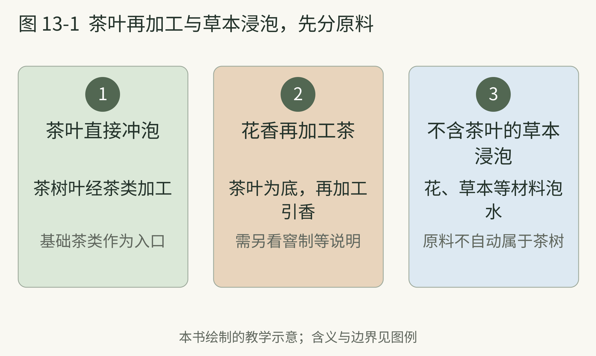

<!-- page: 13|第三部 茶的世界|一片叶子怎样进入生活 -->

# 茶从植物走向习惯

茶的历史常从神农尝百草的故事讲起。它可以作为文化传说阅读，却不适合变成准确的发现日期。真正追踪古代饮茶活动，仍需要文字、器物与植物遗存等不同证据。

<!-- figure-height: 150 -->

**图 13-1　茶叶、花与草本的原料对照（AI 教学示意）。**

**图例。** 左为干茶与白色茉莉花，右为菊花与薄荷；分开放置便于观察，不表示任何现成商品的配料比例。

茉莉花茶有茶叶作为基础；菊花或薄荷单独浸泡时，可以没有茶树叶。[31] 可见花瓣的数量不能证明窨制，本图只提示先核对原料。

<!-- page: 13|第三部 茶的世界|原料与饮茶习惯 -->

## 原料与饮茶习惯

2016 年的一项研究使用植物微体遗存、化学标志物与年代分析，把汉阳陵相关材料认作约两千一百年前的茶证据；研究还讨论了西藏西部遗存与传播路线。[45] 它说明考古可以补充文字历史，也提醒我们不要把今天的泡茶方法直接安在当年的茶上。

茶的发展不只是知道叶子可以饮用，更包括怎样采、怎样处理、怎样保存，以及在哪里与人分享。2022 年列入非遗名录的“中国传统制茶技艺及其相关习俗”，同时涵盖生产知识和社会实践。[31]

这也解释了为什么只列茶名不够。茶在家里是日常，在茶馆是相聚，在不同仪式里又有不同意义。器具和动作既服务饮用，也让人表达待客与关系。

唐代陆羽《茶经》的整理，以及僧人等人群的饮茶与传播活动，是理解茶文化发展的另一条线索。James A. Benn 的研究把它们放在宗教与社会生活里讨论。[49] 一本关于茶的书，也能参与改变人们如何看待茶。

饮茶习惯不仅包含制作，也包含器具、待客方式与社会交往。

<!-- page: 13|第三部 茶的世界|茶叶再加工与草本浸泡，先分原料 -->

## 茶叶再加工与草本浸泡，先分原料

**图 13-2　茶叶与草本浸泡的原料区别。**

**图例。** 从左至右为直接冲泡的茶叶、花香再加工茶和不含茶叶的草本浸泡。

中文商品名称中的“茶”可以指多种饮用习惯。UNESCO 资料把六类茶和花香再加工茶作了区分，这为阅读原料表提供了线索。[31] 看见花朵时，先问有没有茶树叶，再问花香如何进入成品；同样的称呼未必对应同样材料。

<!-- page: 13|第三部 茶的世界|茶为什么走到了远方 -->

## 船、茶壶与贸易

一把茶壶的形状，也能告诉我们饮茶习惯怎样变化。V&A 的茶壶史把中国及日本茶叶的海上出口、欧洲饮茶与器物设计联系起来。早期欧洲茶壶甚至与咖啡壶在设计上有相近之处。[32]

随着茶进入英国生活，器具、加入奶糖的习惯、消费与贸易一起发展。这里的故事同样不只是优雅的下午茶。博物馆资料会把糖与殖民种植经济、被奴役者的劳动联系起来。[32]

英国国家档案馆关于鸦片战争的教学材料，则让我们看到茶需求、贸易与鸦片走私之间的历史纠葛，还并列了不同视角的档案。[33] 茶因此既是杯中之物，也是贸易结构中的商品。

茶具随饮品跨过海洋，饮用习惯也随贸易改变。它们的设计和使用，能留下这些变化的痕迹。

**观察。** 选一件自己常用的茶具，不查价格，先回答它解决了什么问题：保温、过滤、方便分杯，还是让人围坐？然后找一张博物馆的古代或早期现代茶具图片，看看相同问题如何被另一种形状解决。

这个练习也可以换成咖啡壶或酒杯。历史不一定从背人物开始；有时，从“为什么要做成这样”开始更容易读下去。

<!-- page: 13|第三部 茶的世界|把茶史拆成三条相连的线 -->

## 一片叶子的历史，不只有传播地图

读茶史时，可以把问题暂时拆成三条线。第一条是**材料与制作**：当时处理的是什么原料，怎样让它适合储存与饮用？第二条是**器具与动作**：怎样加热、盛放、分饮，人坐在哪里？第三条是**人与交易**：谁种植、加工和运输，谁有机会消费？三条线相互影响，却不必同时改变。

例如，博物馆里的茶壶能帮助我们理解盛放、倒出与分享，也能联系海上贸易和欧洲消费习惯。[32] 但仅看壶形，无法断定壶里是哪一类茶，更无法重建所有人的日常生活。反过来，一份讲制作技艺的资料，也不一定告诉我们普通家庭怎样喝。UNESCO 将制茶知识与相关社会实践一起记录，正好提醒我们把材料和生活放在同一幅图景中。[31]

本书建议读到一则历史故事时，补问一句：“这份资料具体支持哪条线？”看到运输路线，可以追问货物与人群；看到器具，可以追问使用痕迹与场景；看到茶名，则追问当时的含义。这样读，容易理解茶为什么会改变，也不至于把今天的六类名称、泡法与审美原封不动地搬到古代。

<!-- page: 13|第三部 茶的世界|茶的证据怎样与故事相遇 -->

## “发现得早”与“从这里开始”是两个问题

汉阳陵相关研究结合植物微体、化学标志物与年代分析来讨论茶的遗存。[45] 多种证据相互配合，比只凭一片形似茶叶的材料更有解释力；但发现一处早期证据，仍不等于找到了人类第一次饮茶的那一杯。保存条件、取样地点和研究方法，都会影响我们今天看得见什么。

文字与实物也有不同的提问方式。一部茶书能显示作者怎样整理知识、评价饮茶，却不能自动代表同一时代所有人的实践。Benn 对陆羽、宗教与社会生活的讨论，把文本放回了具体人群与文化关系中。[49] 因此，读到“古人都怎样喝茶”，可以先检查故事说的是哪一地、哪一群人、哪一种材料。

**一页资料的小练习。** 打开本章任意一项来源，写下它的对象、证据和局限各一句。例如：“研究对象是某遗址材料”“依据残留物与年代”“没有完整重建冲泡配方”。这不是要把兴趣阅读变成考据考试，而是让下一章的分类有清楚边界：现代加工路线用于认识今天的茶，历史资料用于理解它怎样进入生活。
