<!-- page: 14|第三部 茶的世界|先把茶类与茶名分开 -->

# 14 同一类植物的不同道路

茶名很多，先分清它在回答哪一个问题。绿茶、白茶、黄茶、乌龙、红茶与黑茶是基础茶类；中国制茶传统中，这六类又能成为窨花等再加工茶的基础。[31] 茶树品种、产地、采摘与工艺共同影响具体产品，不能只从名字中的颜色猜类别。

<!-- figure-height: 150 -->
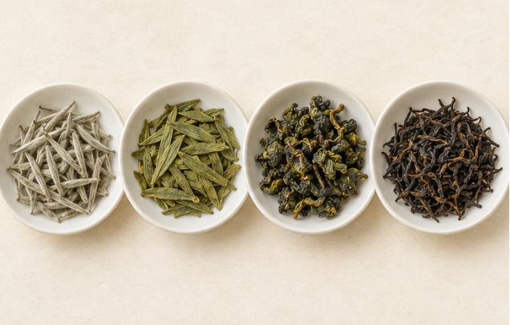

**图 14-3　芽、扁、球与条四种外形（AI 教学示意）。**

**图例。** 从左至右为芽形、扁形、球形与深色条形干茶；外形没有对应的真实样本编号。

外形是另一层信息。压扁、揉卷或保留芽形不能独立确定茶类；球形乌龙与扁形绿茶只是本书选取的实例。[76][77]

<!-- page: 14|第三部 茶的世界|类别、产地与形态 -->

## 类别、产地与形态

@table
标签层次|它在回答什么|阅读时怎么用
茶类|采用哪种主要加工路线|先确定比较范围
茶树品种|叶子来自什么栽培材料|与成品茶类分开读
产地与茶款|在哪里做 成品叫什么|再看实际工艺说明
外形与再加工|条形 球形 紧压 窨花等|不把形状当成茶类
@endtable

例如，安吉白茶虽有“白”字，却按绿茶工艺制作；嫩叶的浅色与其茶树材料有关。[80] 白茶也不必全呈白色。普洱则还需要追问生茶还是熟茶。[78]

本章用三层观察展开：先看采下的鲜叶，再看加工后的干茶，最后看泡开后的叶底。**叶底**就是沥去茶汤后留下的湿润芽叶。三者放在一起，才能看到原料与加工留下的不同线索。

<!-- page: 14|第三部 茶的世界|鲜叶、干茶与茶汤，不是同一种观察对象 -->

## 鲜叶、干茶与茶汤，不是同一种观察对象

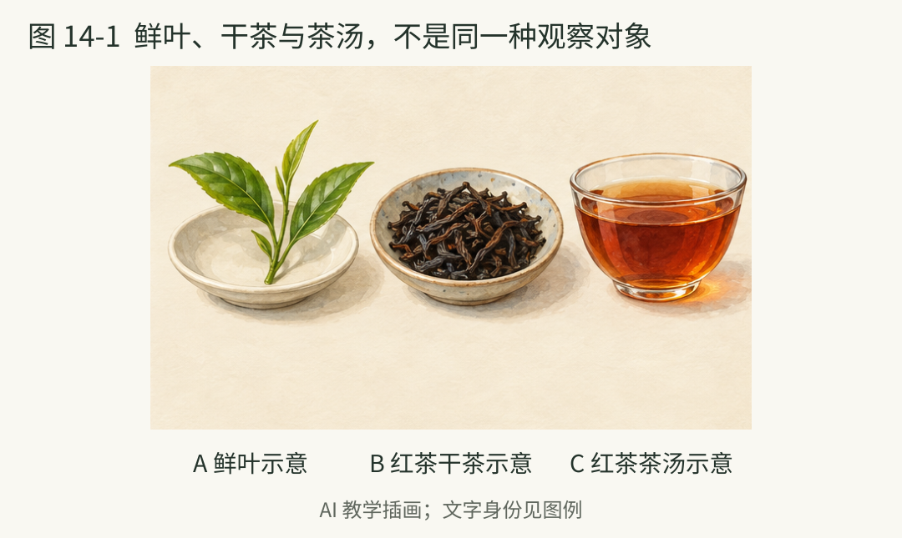

**图 14-1　红茶的鲜叶、干茶与茶汤。**

**图例。** 从左至右为茶树鲜叶、红茶干茶与红茶茶汤。

这幅典型加工情境把同一条学习主线的三个观察对象放在一起。鲜叶是绿色，不妨碍它经过红茶路线后形成颜色与风味都不同的干茶和茶汤。[34] 茶类主要围绕加工差异来理解，不是从杯中颜色取一个最接近的名称。茶汤色泽会随茶款和冲泡条件变化。

<!-- page: 14|第三部 茶的世界|原叶到底可以看什么 -->

## 原叶：芽 叶与采摘组合

本书所说的“原叶”，在这里指加工前的茶树鲜叶与嫩梢；商品上的“原叶茶”则常用于描述成品形态，两者不能混用。采摘会选择不同嫩度和芽叶组合，原料选择也是加工的一部分。[81]

<!-- figure-height: 160 -->
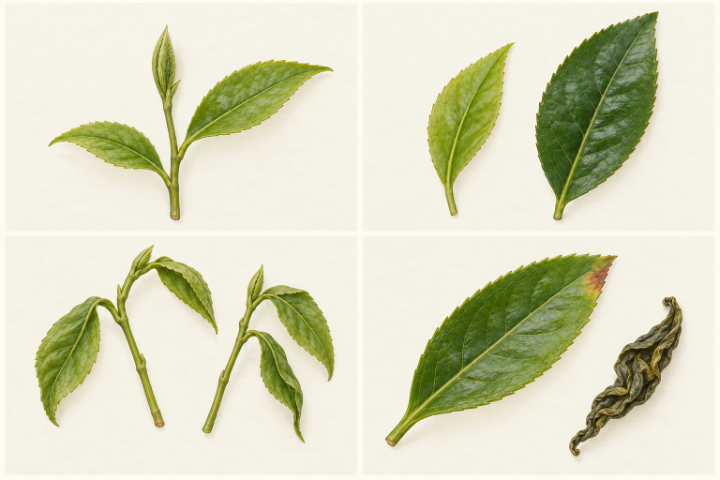

**图 14-L1　茶树原叶与质感。**

图中从左上顺时针看：一芽二叶的嫩梢、嫩叶与较成熟叶、鲜叶与干叶的质感比较、失水变软的嫩梢。示意没有按真实尺寸绘制，不能拿叶片大小直接判定茶树品种或等级。

先找最尖端尚未展开的芽，再数已经展开的叶。茶树叶在枝条上互生；看一芽二叶的嫩梢，应能辨认两片叶在茎上不同位置的连接，不是同一节点左右对生的一对叶。观察叶缘、主脉、侧脉与芽上的短细毛，比只看“绿不绿”更具体。白毫是芽叶表面的细毛，不是羽毛状附属物，也不是白茶独有的分类证据。

**观察提醒。** 有芽、有梗或有较成熟叶都先如实记录，不立即写成优劣判断。不同茶款需要的原料不完全相同；一芽二叶也只是采摘组合，不能据此猜出最后一定制成哪一类茶。

<!-- page: 14|第三部 茶的世界|叶子怎样从鲜变干 -->

## 处理：变化从来不止一条线

叶子采下以后，失水、受热、机械作用与氧化会改变它的状态。以下是工序的入门解释，不是要求每款茶全部经过的操作顺序。[34][82]

<!-- figure-height: 195 -->
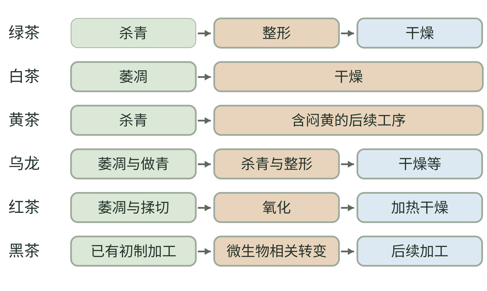

**图 14-2　六类茶的主要加工线索。**

**图例。** 每行是一个基础茶类的简化路线；箭头表示该行的阅读顺序，颜色只区分位置，不表示氧化程度。

绿茶的早期杀青、白茶的萎凋干燥、黄茶的闷黄、乌龙的做青、红茶的氧化与黑茶的微生物相关转变，是不同加工线索。[34][76] 黄茶闷黄位置依茶款变化；黑茶所画不是六堡、茯砖与普洱熟茶共用的固定工序。

<!-- page: 14|第三部 茶的世界|工序分别改变什么 -->

## 工序分别改变什么

@table
工序|主要在改变什么|容易误读的地方
萎凋|失水并伴随叶内变化|不等于把鲜叶直接晒成成品
杀青|以热处理抑制相关酶活性|不意味着后续再无变化
揉捻与整形|改变形状与组织状态|球形不代表一种独立茶类
酶促氧化|叶中成分参与氧化变化|与微生物发酵不同
闷黄|特定湿热条件下的转变|不能从黄色茶汤倒推出它
渥堆|堆积条件下的微生物等转变|不是红茶氧化的另一叫法
干燥与焙火|降低水分 并影响风味|火香强弱不是氧化百分比
@endtable

传统茶语中的“发酵”有时指酶促氧化，有时涉及微生物。绿茶较早杀青，红茶让氧化充分展开，乌龙安排部分氧化与杀青；白茶、黄茶和黑茶又各有重要工序。因此不能用一条“发酵从零到百分百”的刻度代替六类路线。[34]

<!-- page: 14|第三部 茶的世界|绿茶的形状也不只有一种 -->

## 绿茶：先控制氧化，再看整形

绿茶的重要线索是较早杀青，抑制酶促氧化；之后仍有整形和干燥。炒制或蒸汽等热处理方式、原料与后续工序不同，成品也会不同。[34][76] 所以绿茶不是“未经处理的叶子”。

<!-- figure-height: 130 -->
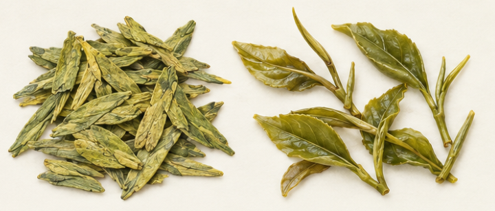

**图 14-L2　绿茶的干茶与叶底。** 左为加工后的干茶，右为冲泡后的叶底。

本图选扁形绿茶作示意：左边的干茶压扁、失水，右边的叶底吸水后较舒展。它只呈现一种形态，不代表全部绿茶。真实茶款可参看西湖龙井杀青的 UNESCO 影像资料。[83]

**怎么读细节。** 干茶先看扁、细条还是卷曲，再看芽叶能否辨认；泡开后看叶片是否舒展、有没有折痕。干叶的皱缩与湿叶的展开，比图中微小色差更可靠。外形只是线索，类别仍要核对制作说明。

**一个名字陷阱。** 安吉白茶按绿茶工艺制成，名称与浅色嫩叶有关，不等于萎凋干燥路线的白茶。[80] 遇到它时先问“怎么做”，比问“为什么汤不是绿色”更接近分类。

<!-- page: 14|第三部 茶的世界|绿茶怎样从加工走向杯中 -->

## 绿茶实例：把龙井的“扁”拆开看

看到龙井式扁茶，先把两个问题分开：较早杀青解释它采用的基础路线，压扁整形解释它的外观。加热还会影响香气，因此“绿茶”并不保证只有鲜草气息；同类中也可以感到熟豆、炒米一类联想，但这些词是闻香时的参照，不是每款龙井都要兑现的清单。[34][83]

把一片干茶放到白碟上，会看到它很薄、边缘收拢，有些芽叶紧贴在一起。泡开后，原先压在一起的部位可能分开，叶片也可能保留折痕。**吸水舒展不等于恢复成刚采下的鲜叶**：干燥、受热和机械处理已经改变了组织。不要要求每片叶底都像枝头上一片平整新叶。

换成卷曲形或细条形绿茶时，观察方法仍然适用：分别写下“整形成什么样”和“采用什么路线”，不要把龙井式扁形当成绿茶的通行身份证。购买时也可把“嫩、扁、色浅”等外观描述，和自己实际喜欢的香气、苦涩与厚薄分开。形态好认，口味仍需要尝。

<!-- page: 14|第三部 茶的世界|白茶不等于白色茶叶 -->

## 白茶：看萎凋，也看芽叶比例

白茶通常以萎凋和干燥为核心，传统路线较少依赖揉捻整形。[34] 这不等于“什么都没做”：萎凋条件与干燥安排都需要控制。福鼎白茶的官方推介列出白毫银针、白牡丹、贡眉和寿眉等茶款。[79]

<!-- figure-height: 130 -->
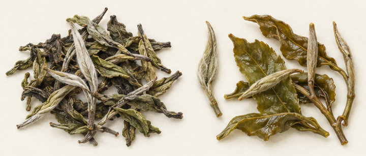

**图 14-L3　白茶的干茶与叶底。** 左为加工后的干茶，右为冲泡后的叶底。

图中以白牡丹式芽叶组合示意：干茶保留较自然的叶态，夹着浅色带毫芽；泡开后芽、叶与梗更容易分辨。不是每一片白茶都应银白，也不是带白毫的茶就一定是白茶。

**几个名字怎样比较。** 白毫银针与白牡丹的区别，可以从芽为主还是芽叶相连入手；看到寿眉时则进一步观察叶与梗的比例。具体原料、等级和批次要核对产品说明，不靠一张图把所有商品定级。[84]

**同类里的变化。** 散白茶和压成饼的白茶仍可能采用同一基础路线；压制是一种形态变化，不能自动把白茶改判成黑茶。[77] 年份、仓储与茶款也应分开看，别用“老白茶”三个字替代它们。

<!-- page: 14|第三部 茶的世界|白茶的自然叶态怎样观察 -->

## 白茶实例：银针与白牡丹不是大小号关系

白毫银针与白牡丹提供了一个很直观的入门比较：前者以芽为主要识别对象，后者可以观察芽与展开叶的组合。两者不是同一种叶片的大小号；芽的轮廓较细长、两端收尖，展开叶则能看见更宽的叶面与脉络。[84]

白牡丹式干茶常显得比较蓬松，叶片有卷边、弯曲与交叠。泡开后叶片更容易摊开，梗与芽的连接关系也更清楚。自然叶态仍是加工后的形态，不意味着没有失水与叶内变化。白茶以萎凋和干燥为核心，**工序较少并不等于控制较少**；光看“自然”两个字，解释不了萎凋条件与干燥安排。[34][79]

初次比较时，可以先分别泡少量银针与白牡丹，记录芽、叶、梗的比例，再写香气与口感。不要预先规定芽多的一杯就一定更香、更甜或更适合自己。两个茶款若产地、年份与冲泡条件也不同，就把差异保留为一次具体体验，不能只凭这次结果宣布“都是芽叶比例造成的”。

<!-- page: 14|第三部 茶的世界|黄茶的关键是闷黄 -->

## 黄茶：与绿茶相近，另有闷黄

黄茶与绿茶都可以较早经过杀青，但黄茶有重要的闷黄安排。闷黄涉及湿热条件下的转变，具体位置与实施方法依茶款而异。[34] 不宜把所有黄茶硬写成同一套固定顺序。

<!-- figure-height: 130 -->
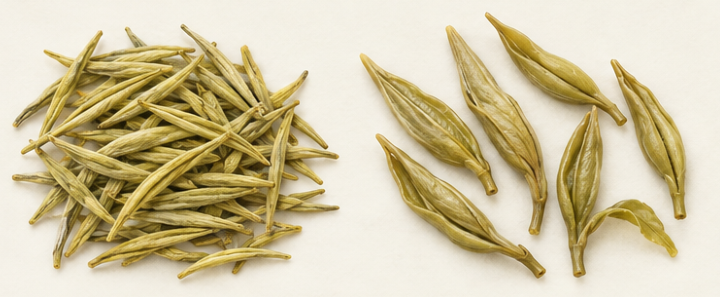

**图 14-L4　黄茶的干茶与叶底。** 左为加工后的干茶，右为冲泡后的叶底。

这里选君山银针式芽形作示意：左边干芽偏黄绿，右边泡开后仍以芽为主。它与上一页白牡丹的芽叶组合不同，但这种差别也包含原料选择，不能全部归因于闷黄。

中国非物质文化遗产档案介绍君山银针的两次闷黄安排，并描述成品芽身与白毫。[85] 这是具体茶款的工艺案例，不代表所有黄茶都用两次相同闷黄，也不靠图中颜色证实工序。

**最有用的区别。** 茶汤泡久而偏黄，或绿茶储存后颜色改变，都不能因此改叫黄茶；分类需要实际工艺。白毫银针与君山银针虽都叫“银针”，也不能因此并成同类。

黄茶并非只由芽制作；本页限定为芽形实例，不概括全部原料。

<!-- page: 14|第三部 茶的世界|两个银针怎样比较 -->

## 黄茶实例：名字相近，观察问题不同

把白毫银针与君山银针放在一起，最容易先被“银针”吸引：两者都可以保留芽形，也都可能看见细毫。真正区分基础路线，仍要回到白茶的萎凋干燥与君山银针的杀青、闷黄等加工安排。两个名称相似，不代表只是同一种茶的两种产地版本。[84][85]

观察芽形时，先看是独立的芽，还是带着已经展开的叶；再看轮廓、饱满程度与表面质感。芽吸水后可以变得更饱满、稍有张开，却不会因此变成一片宽大的成熟叶。比较干湿时，应在同一种原料形态之内观察变化。

闷黄给理解黄茶提供了工艺线索，但不是一块可直接贴到照片上的黄色滤镜。原料、加工和照明都影响看到的色泽；想在杯中学习，可以把一款黄茶与一款手边绿茶并排，记录鲜爽、柔和、苦涩等自己的感受。即使两杯喝起来相近，也不推翻其工艺差别；喝出差别同样不能证明差别全部来自闷黄。[34]

<!-- page: 14|第三部 茶的世界|乌龙需要分开看氧化与焙火 -->

## 乌龙：做青 整形与焙火的组合

乌龙又称青茶，常通过萎凋、搅拌或摇青等安排促进部分氧化，再杀青、整形、干燥。做青通常交替安排摇青等机械作用与静置，控制叶内变化，不只是把叶子摇一下。[76] 氧化、整形与焙火应分开理解。

<!-- figure-height: 130 -->
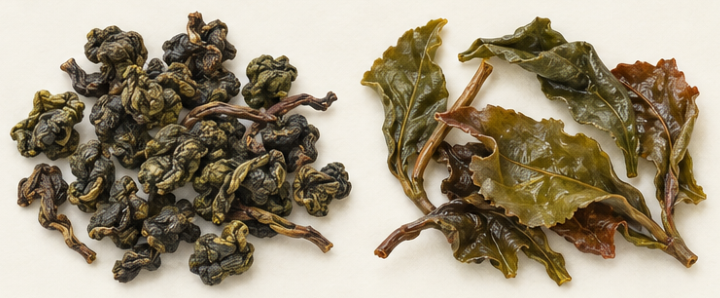

**图 14-L5　乌龙的干茶与叶底。** 左为加工后的干茶，右为冲泡后的叶底。

本图选择球形乌龙：左边的紧卷干茶像不规则小团，右边吸水后展开为明显更大的叶片。球形来自整形，不是茶树结了“茶珠”；条形乌龙则不会有同样的展开形态。

**同类内部怎样展开。** 可以把包种与球形乌龙放在一起观察外形，再比较不同焙火说明的乌龙。不要把“火香重”直接换算成“氧化高”。焙火和氧化是不同加工线索。[76]

真实案例还有东方美人：茶改场介绍其特定鲜叶条件、较重的萎凋与搅拌，以及成茶的多色外观。[86] 它提醒我们，乌龙不只是一杯浅色、清香的茶。

叶底边缘偏红有时可作观察线索，但不要求所有乌龙都完整呈现“绿叶红镶边”。精制、受热与叶片破损会影响外观；标签与工艺资料仍比一句口诀可靠。

<!-- page: 14|第三部 茶的世界|乌龙的三条比较轴 -->

## 乌龙实例：条索、球形与火香分开记

在乌龙里，形状与香气尤其容易被捆在一起：看见紧卷小团，就预期一定清香；看见深色条索，就预期一定火香重。这样的预期会漏掉同一外形之内的加工变化。可以建立三栏记录：**外形怎样、氧化相关工序怎样、焙火说明怎样**，再把实际尝到的香气写在旁边。[76]

球形干茶不是光滑的豆粒。它由叶片揉卷而成，表面应能看到叶组织的褶皱与不规则接缝；泡开后，团块逐渐松开，叶片和小梗才容易辨认。条形乌龙则以弯曲条索为起点，不必经历从“球”到“叶”的同一种展开。比较插图时，先检查这个最基本的形态因果，再看颜色。

有条件时，选两款标签明确、焙火说明不同的乌龙比较；先闻干茶，再闻温热茶汤，最后看叶底。把“像烤谷物”“像花香”写成自己的联想，不把它们直接当成工序证明。东方美人的案例也提醒我们，鲜叶条件与较重萎凋、搅拌可以参与形成另一种风格；乌龙的范围，比清香与浓香两个商品词更宽。[86]

<!-- page: 14|第三部 茶的世界|红茶看氧化也看叶形 -->

## 红茶：氧化充分，成品可整可碎

红茶常在萎凋后揉捻，或采用切碎揉碎等处理，使叶内物质更容易接触并参与氧化；随后通过加热干燥控制过程。[76][81] 红茶“发酵”通常主要指酶促氧化，不能直接理解成靠微生物把茶叶酿成红色。

<!-- figure-height: 130 -->
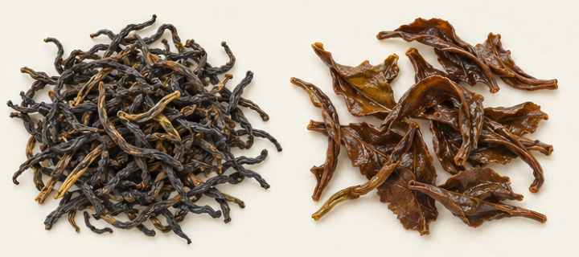

**图 14-L6　红茶的干茶与叶底。** 左为加工后的干茶，右为冲泡后的叶底。

图中是条形红茶示意：左边干茶呈深色扭曲条索，右边湿叶偏铜褐、纹理较舒展。它不是所有红茶的标准色卡，也不能由此判断有没有额外香料。

**分支要看制作与形态。** 条形红茶与碎形红茶都属于红茶；碎茶、颗粒茶和茶包中的材料也需要看实际加工说明。[76] 不能用“泡不开一整片叶”直接判为假茶，原料嫩度、机械切碎与精制都会影响叶底。

**跨语言的小坑。** 中文红茶一般对应英文 black tea；中文黑茶另有后发酵相关路线。[34] 读英文菜单或资料时，别把 black tea 按字面译成黑茶。

可以分别观察干茶完整程度与出味速度。两者可以有关联，却不能单凭形状预测整杯风味；比较时保持茶量、杯子与冲泡条件尽可能接近。

<!-- page: 14|第三部 茶的世界|红茶整叶与碎形怎样看 -->

## 红茶实例：叶底不是完整叶片考试

条形红茶的干茶看起来细而深，吸水后可见偏铜褐的叶组织；但一根条索未必对应一张完整大叶。原料的芽叶组合、揉捻破损与后续筛分，都会影响最终看到的是芽、整叶、半叶还是碎片。碎形红茶还可能有专门的机械切碎揉碎安排。[81]

因此，检视叶底时应先问“它原本就是哪种产品”，再讨论完整程度。拿茶包里的细碎红茶去和整叶茶比谁更像枝头叶片，比较对象就错位了。细碎材料也不是许多圆润种子；它们仍是加工后的茶组织，只是颗粒尺度与破碎状态不同。

一个容易做的练习，是在相近条件下比较手边的整叶红茶与碎形红茶，观察颜色和滋味出现的节奏。材料更碎会改变与水接触的条件，但两款茶还可能有原料和配方差别，所以这只是出味过程的观察，不是“整叶一定清淡、碎茶一定粗劣”的验证。[81] 同样，金色芽尖是外观线索，不能代替对原料、工艺与整杯风味的判断。

<!-- page: 14|第三部 茶的世界|黑茶与紧压茶不是一回事 -->

## 黑茶：看微生物过程，别只看深色

黑茶加工中的微生物相关转变，与红茶的酶促氧化不能混为一谈。[34] 有的茶采用堆积条件促进转变，具体原料与路线仍要逐款看。深色干茶和深色茶汤都不是独立的分类证据。

<!-- figure-height: 130 -->
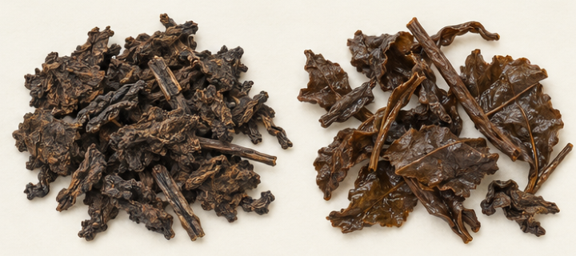

**图 14-L7　普洱熟茶的干茶与叶底。** 左为加工后的干茶，右为冲泡后的叶底。

图中选普洱熟茶散茶作实例：左边是深褐色干茶条与少量梗，右边是泡开后较深色的湿叶片。它只帮助比较干湿状态，不呈现微生物种类，也不证明年份、仓储或品质。

**散与压是另一条轴。** 熟茶可以散装，也可以压制。食品生产许可分类目录同时列有普洱生茶紧压茶、普洱熟茶紧压茶、六堡紧压茶与白茶紧压茶。[77] 所以茶饼、茶砖或沱形只能告诉你形态，不能单独告诉你茶类。

**读茶款时问什么。** 看到六堡、茯砖或普洱熟茶等名称，继续核对原料与生产说明，不把它们当成完全相同的处理法。尤其普洱要另分生熟，下一页把这条岔路单独展开。

可以把“深褐、叶片破碎、含梗”与气味记录分开写。外观可以提示继续检查，不能代替产地、年代与工艺的证据。

<!-- page: 14|第三部 茶的世界|深色茶怎样避免望图猜工艺 -->

## 黑茶实例：先把外观记录写具体

遇到熟普洱式的深色茶，先不用“黑乎乎”概括。试着分成三个问题：干茶是细条、粗条还是碎片？能否看到叶脉、卷边与梗？湿叶是柔软展开，还是依然成团？这些记录能帮助你描述手中的材料，却无法从叶面直接看出用了哪些微生物。[34]

本章图中的熟茶应保留深褐色叶组织的质感，泡开后仍是有厚薄、有脉络的湿叶或叶片碎块，不是几块坚硬木片，也不是重新变回嫩绿鲜叶。颜色深时，更需要靠轮廓、褶皱与光泽区分干湿，不只比较哪一边更大、更亮。

六堡、茯茶与普洱熟茶可以作为继续阅读的不同入口，不能把一款熟普洱的外观推广为全部黑茶的标准。实际商品还要看原料、工艺与形态说明。[77][87] 如果记录到明显的不愉快气味，就如实写下具体感觉，不为了符合“陈香”一词勉强改写体验；判断异常与保存问题，应结合来源、包装和储存情况，单张示意图承担不了这个任务。

<!-- page: 14|第三部 茶的世界|普洱先问生茶还是熟茶 -->

## 普洱：同一名称里的两条道路

普洱以云南大叶种晒青茶为原料，分生茶与熟茶；生茶不经过熟茶式的人工渥堆，熟茶则有这一处理。[78] 把所有普洱都画在黑茶的同一个格子里，会掩盖这项差别。

<!-- figure-height: 165 -->
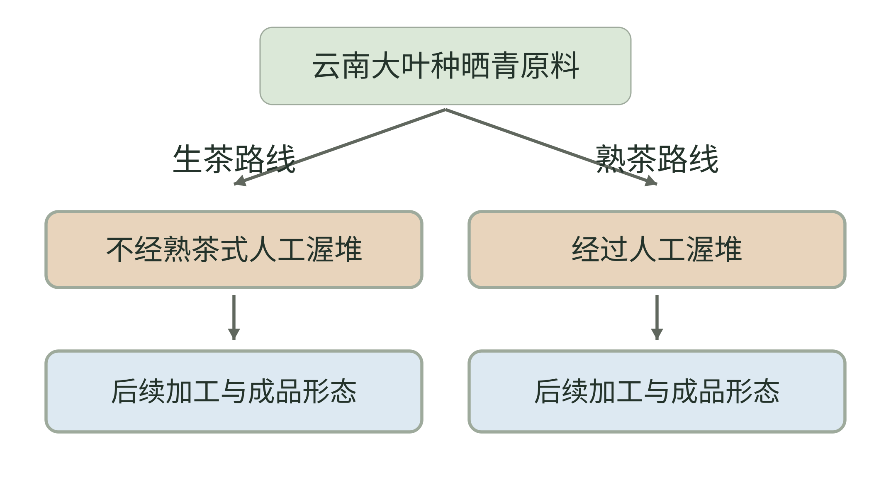

**图 14-5　晒青原料之后的生熟分岔。**

**图例。** 共同起点为云南大叶种晒青原料；棕色框分别指出有无熟茶式人工渥堆，蓝色框只提示后续加工。

两条路线依据现有普洱资料整理。[78] 这里不把生茶强行归入一个无争议的六类格子，也不把后续存放中的变化画成转入熟茶路线；紧压与散装还需另外读形态。[77]

<!-- page: 14|第三部 茶的世界|生熟以外，再读年份与形态 -->

## 生熟以外，再读年份与形态

图中依据资料提炼加工差别，不给生茶强行套一个无争议的六类归属。生茶在后续存放中也会发生变化，但不能把陈年生茶简单改写为采用熟茶工艺制作的熟茶。

**别把压制当发酵。** 晒青毛茶是加工后的原料，不是刚采下来的“生叶”；“生茶”也不意味着没有杀青、揉捻和干燥。茶饼则可能装的是不同加工路线的茶。[78][77]

查看包装时，先圈出生或熟，再记录生产日期和储存信息。尝到的陈香是感官记录，不能单凭它验证十年、二十年等年份；也不要仅凭“越陈越香”的宣传决定保存多久。

<!-- page: 14|第三部 茶的世界|普洱的加工身份与存放记录 -->

## 普洱实例：把四项信息分开读

一款普洱至少有四项需要分别记录：生或熟、散或压、生产日期、储存情况。“生熟”回答加工路线，“散压”回答商品形态，日期与储存则帮助理解这批茶后来的经历。这四项不能互相代替；熟茶不必做成饼，生茶也不会因放久了就自动取得熟茶的加工身份。[77][78]

例如，拿到一饼标为生茶的产品，第一步是读清生熟说明，不是先猜汤色；第二步辨认压制形态，不是把紧压当作人工渥堆；第三步记录包装所列日期和自己知道的储存信息，未掌握的部分就写“未知”。一杯颜色较深的茶汤，可以提出继续核查的问题，不能补上这些缺失的履历。

做长期个人记录时，可保留同一批茶的标签照片和每次取样日期，在相近泡法下比较。这样得到的是“这份茶在我这里怎样变化”的观察，比仅凭一次陈香感受猜年份更有用。不同仓储、批次与冲泡条件可能同时存在；不要把两款陌生茶的差别，直接讲成一条所有普洱都必经的陈化故事。

<!-- page: 14|第三部 茶的世界|花茶 抹茶与草本饮品放在哪里 -->

## 六类之外：再加工 形态与原料

六大茶类建立基础路线，实际商品还会再窨花、拼配、压制或制成粉。UNESCO 把花香再加工茶与基础茶类区分介绍；茶行业资料也说明了通过茶叶组合形成目标风格的拼配。[31][64]

@table
遇到的名称|先问哪一层|不要仅凭什么判断
茉莉花茶|茶底是什么 是否窨花|有无可见花瓣
伯爵茶等调香茶|茶底与所加香味材料|茶名或包装颜色
抹茶等粉末茶|原料与具体粉茶工艺|绿色粉末的外观
茶饼 茶砖 沱茶|内部茶叶采用什么路线|压制形状
菊花 洛神 薄荷浸泡饮品|有无茶树叶作为原料|口语上是否称它为茶
@endtable

以上表格是本书的标签阅读分组，不是新增五种基础茶类。粉末会遮住原来的叶形；具体粉茶产品需要核对原料和加工，不能拿粉末与整叶图逐一对号入座。

茉莉花茶与把几朵茉莉投入茶汤，也不必是同一种制作方式。香气强弱或花瓣多少都不足以证实窨制过程；最好读产品说明。

调好的奶茶、果茶与气泡茶则再往前一步：它们是成杯组合，茶底仍可以来自不同类别。把“茶底怎样做”和“最后怎样调”分开，下章的调茶会更容易理解。

<!-- page: 14|第三部 茶的世界|从茶款名字走向实际风味 -->

## 代表茶款与风味的入口

下面的茶款名称依公共机构的六类介绍选取。[87] 右栏是本书设计的比较问题，不是每款必有的香味，也不作为品质标准。先知道名字属于哪条路线，再用自己的杯子验证感受。

@table
茶类|可查的代表茶款|尝味时可以问什么
绿茶|龙井 毛峰 瓜片|清鲜与熟香哪项更显著
白茶|银针 白牡丹 寿眉|芽叶比例不同 感受怎样
黄茶|君山银针 蒙顶黄芽|与手边绿茶的鲜醇感怎样
乌龙|铁观音 岩茶 单丛|花果香与焙火感怎样组合
红茶|正山小种 滇红 祁红|甜香 苦涩与厚度怎样
黑茶|六堡 茯茶 普洱熟茶|陈香与口感怎样描述
@endtable

**香气与滋味分开写。** 花香、果香、烘烤香主要是嗅觉描述；甜、苦属于味觉，涩和厚薄主要属于口感。觉得有甜香，不等于茶汤里加了糖；闻到花香，也不等于一定窨过花。

想做第一次比较，不需要凑齐六类。拿自己已有的两款茶，分别看标签、干茶与叶底，再尝味；把“我喜欢哪一杯”与“它采用哪种路线”分别记录。风味帮助建立兴趣，工艺帮助解释类别，两者相互补充。

<!-- page: 14|第三部 茶的世界|把三种状态连成一次观察 -->

## 细节图怎样用才学得到

鲜叶、干茶与叶底记录了茶叶的不同状态。鲜叶让你问原料的芽叶组合，干茶让你问失水与整形，叶底则让你在吸水展开后重新看到叶与梗。加工中的组织破损、氧化与受热，也会留下不同状态。[81][82]

<!-- figure-height: 150 -->
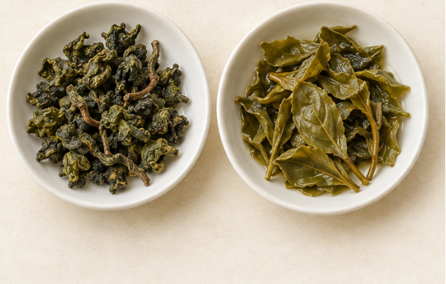

**图 14-4　揉卷干茶吸水后的展开（AI 教学示意）。**

**图例。** 左为紧卷干茶，右为舒展的湿叶与梗；干湿不是同一批真实样本，数量与展开倍率不能测量。

观察时先看卷曲、叶片和梗，再看颜色；真实对照应使用同款茶、相近光线与固定尺标。整形和吸水改变外形，不会凭展开程度自动产生等级判断。[76][81]

<!-- page: 14|第三部 茶的世界|给干茶与叶底留下对照 -->

## 给干茶与叶底留下对照

**四步观察。** 冲泡前留少量干茶在白纸或白碟上；记录条、球、扁、芽或碎片；泡好后沥出少量叶底，摊开比较；最后把标签上的茶类、茶款与工艺说明补进记录。

条件方便时，可以给同一款茶的干茶与叶底拍照，使用相近光线，旁边放同一把尺作参照。不要为了制造颜色差异更换滤镜。没有实际鲜叶时就注明，别把别处的一枝茶树当作这一批产品的原料证据。

**图像边界。** 本章原叶图与六类干湿对照图均为生成的教学示意，代表选定形态，没有真实样本编号，也不作等级、年份、产地或植物鉴定。原叶与六类成品不是同批鲜叶分流加工的实验，不能把画中所有差异都归因于某一道工序。

想看真实工序，可打开 UNESCO 的中国制茶图片档案，观看白茶萎凋、龙井杀青等实景。[83]
