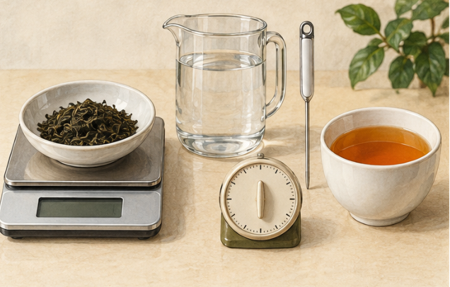
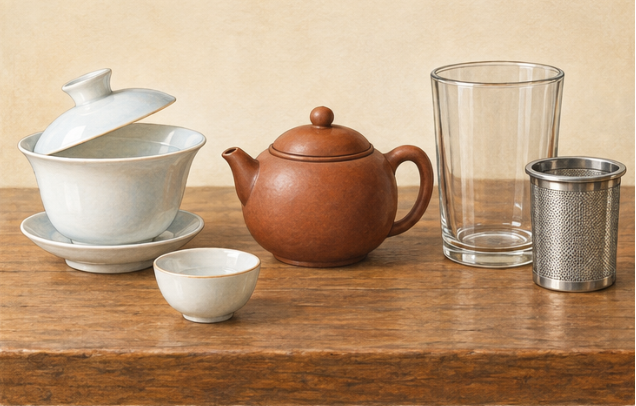
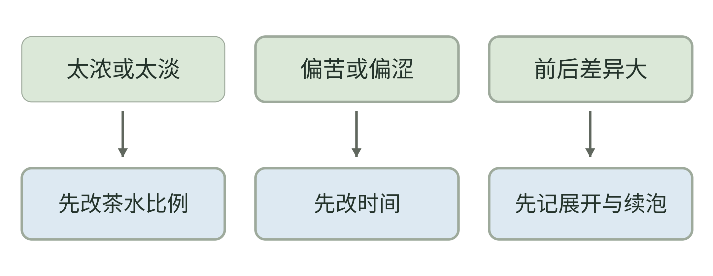
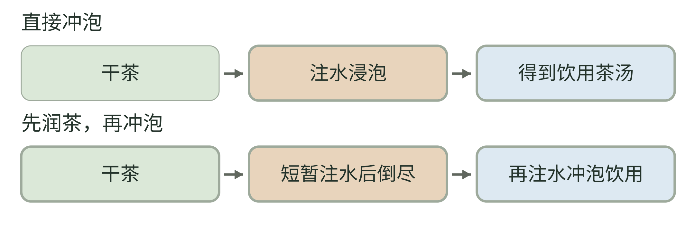

<!-- page: 15|第三部 茶的世界|冲泡是在控制哪些事情 -->

# 把茶泡得合口味

泡茶不一定要从一张严格的温度表开始。个人学习可以先把问题拆成四项：叶子多少、水多少、水多热、接触多久。器具与叶子状态还会增加差别，但一次只动一个条件，更容易知道什么发生了变化。

<!-- figure-height: 150 -->

**图 21-1　茶量、水温与时间的工具（AI 教学示意）。**

**图例。** 左为茶与秤，中为水壶及温度计，右为计时器与茶杯；仪表没有读数，不指定克数、温度或秒数。

不使用量具时也能从日常泡法开始；需要重复比较时，再记录茶量、水量、水温与接触时间。仪表的作用是让条件可追踪，不是替你规定最好喝的一杯。

<!-- page: 15|第三部 茶的世界|从日常泡法做一次比较 -->

## 从日常泡法做一次比较

不同茶款的适宜条件并不相同。工艺不同的叶子，本身就有不同组成；冲泡时，你又在改变它们进入水里的方式。[34]

**从自己的日常配方开始。** 如果平时是一小撮茶加一杯水，就先保持这套办法，不用为了学习买秤。把同一泡茶分别在较早和较晚时分出一点，等到能舒服入口时再比较。记录颜色、香气与苦涩的变化，不必强行评定哪个正确。

发现“泡久了更苦”，也不要立刻推论所有茶都要越短越好。你观察到的是这款茶在这组条件下的变化。下一次换茶，仍要重新观察。把条件写下来，就是在给结论划清边界。

如果一杯不好喝，先把茶量或时间中的一个调低，而不是同时更换茶、水和器具。一次改变越多，越难解释改善来自哪里。

记下每次改变的条件和结果，逐渐找到合口味的泡法。

<!-- page: 15|第三部 茶的世界|茶水比例与浓淡分开记录 -->

## 茶放得多，与泡得久有什么不同

投茶比例是开始时干茶与用水的关系；喝到的浓淡是这次冲泡后的感受。两者有关，却不能画等号。同样一小撮茶，叶片形态、接触时间和是否续泡不同，得到的杯子也可能不同。记录“茶多水少”，还不足以复现一次冲泡。

**本书自拟的比例小样。** 若已有秤和量杯，可取同款茶两份，分别用干茶 2 克与 3 克，各加水 200 毫升；采用相同水温、器具和接触时间，到时都把茶与水分开。它只比较增加投茶量的影响，不是六类茶的统一推荐配方。没有量具时，用同一小匙、同一杯的固定水位作粗略记录也可以，只注明没有称量。

想比较时间时，另外取两份相同干茶，从相同条件开始，分别在约定时间出汤。比从同一杯不断舀走茶汤更容易保持各自的茶水关系；后者适合随手体验，不是严格对照。

若一杯只是整体太浓，可先分出一点加少量饮用水尝试。补水是在调整已经得到的茶汤；下一次减少茶量或缩短浸泡，则是在改变提取过程。不要把这几种调整混记成同一个配方。

<!-- page: 15|第三部 茶的世界|水与杯子先当工具看 -->

## 不必先买一套仪式

入门器具先选容易清洗、便于操作、用着顺手的。一只普通杯子与一个滤网，已经可以做许多观察。等你发现明确需求，再选择盖碗、壶或其他器具。

<!-- figure-height: 150 -->

**图 21-2　盖碗、壶与玻璃杯（AI 教学示意）。**

**图例。** 左为盖碗与小杯，中为壶，右为玻璃杯与可取出的滤篮；不是完整茶席，也不代表器具价格顺序。

先看叶子放在哪里、怎样把叶与茶汤分开，再看倒茶与清洗是否顺手。普通杯与滤篮也能完成观察；选择器具从实际需要开始。

<!-- page: 15|第三部 茶的世界|器具服务于哪些需求 -->

## 器具服务于哪些需求

如果需要比较水，先使用两种可饮用、没有明显异味的水，保持茶与冲泡办法不变。把感到的区别写下来即可。这个练习只检验自己的体验，不用它评选全球最好的泡茶水，也不要把矿物含量与结果压成一个简单数字。

多泡几次也可以形成一种学习：第一泡、第二泡和后面几泡，未必呈现同样强度与重点。可以把它看成一个展开过程，不要求所有茶都泡到固定次数。

可以留一页简短记录：哪一泡最合口味？是因为香气、口感，还是因为刚好与当时的食物相配？如果只是“下午喝着舒服”，这也是有效信息。个人兴趣里，情境有它的位置。

日常还有一个容易被广告放大的词：回甘。你可以记录吞咽之后的感觉怎样变化，但不必靠某一项体验证明一款茶的全部品质。单个词语承担不了那么大的判断。

这种比较方法也适用于后面的[成杯调茶](tea-mixing.md)：先看茶底，再看奶、果汁和冰分别改变了什么。

<!-- page: 15|第三部 茶的世界|让叶子有展开与离水的空间 -->

## 滤篮解决的不只是过滤

[乌龙章](tea-oolong.md)的球形乌龙，干时是揉卷的叶团，泡后才逐渐展开；碎茶则不会重新拼回完整叶片。把两者都装进同样狭小的滤球，看到的叶态和使用体验可能不同。观察揉卷茶时，选能容纳展开叶片的滤篮，不要把“塞得满”当作投茶量合适的依据。

**用一次冲泡认识器具。** 注水前确认滤篮能稳定放在杯口，手柄方便提取；到时把滤篮取出并放进接水的小碟。使用壶或盖碗时，也留意倒出后里面是否还有明显余汤。叶片继续接触水，就仍属于后续冲泡安排；“计时结束”不自动等于停止接触。

不熟悉盖碗时，可先用常温水练习握持和倒水，控制在能稳稳操作的装水量。盛热水的杯壶放稳，倒茶时让手避开出水口和蒸汽；不必为追求动作好看使用难以握持的器具。

喜欢大杯久浸或随喝随续水，也可以照常饮用。只是记录时注明“叶子一直在杯里”，别与每泡都出尽茶汤的小壶泡法直接比较秒数。先说明操作，数字才有意义。

<!-- page: 15|第三部 茶的世界|续泡与冷却后的比较 -->

## 下一泡不只是重新按一次计时

续泡时，材料已经吸过水，也经历过前一次提取；第一泡与第二泡不是两份相同的干茶重新开始。紧卷叶逐渐舒展是可见变化之一，实际滋味还需要尝。不能只凭叶片泡大了，就宣布下一泡一定更浓或更好。[95]

**给续泡留三项记录。** 写下本次加水量、接触时间，以及两泡之间是否留有余汤。若上一泡偏淡，下一泡可以先只延长接触时间；若偏浓，则试着缩短。以合口味为目标，不要求用同一时间泡到底，也不靠固定的耐泡次数给茶定级。

比较时还要照顾饮用温度。先把样品放到能舒服入口的程度，再各取一小口；别让一杯刚出汤、另一杯已放很久，却把全部区别都归给茶。温度下降后的香气与口感也可另外记录，但冷却过程中出现的变化不等于原来的冲泡条件改变。

叶底照可以在这一轮结束后再拍：沥出少量叶片，放在同一白碟上。把干茶、泡开后的叶态和每泡记录连起来，比只拍一杯深浅不明的茶汤更便于回顾。

<!-- page: 15|第三部 茶的世界|三杯泡茶小样，只让一个条件变化 -->

## 三杯泡茶小样，只让一个条件变化

**图 21-3　只改变浸泡时间的三杯小样。**

**图例。** A、B、C 分别浸泡 1、2、3 分钟；茶、水量、投茶量、水温与器具保持一致。

图中都取同一批茶、同样的投茶量、水量、水温与器具，只把时间设为 1、2、3 分钟。具体茶品仍按包装或自己已有做法调整。这是本书的控制变量示例，目的是比较某个改变发生后你观察到什么，不承诺时间越长越好。若同时换水、换茶与换器具，就很难只解释时间的影响。

<!-- page: 15|第三部 茶的世界|先选一个要调整的问题 -->

## 把冲泡调整拆成三个问题

<!-- figure-height: 155 -->

**图 21-4　把冲泡调整拆成三个问题。**

**图例。** 三列分别从浓淡、苦涩和前后差异出发，提示先观察茶水比例、时间以及展开与续泡；箭头是下一轮尝试的方向，不表示单一因果。

这张图是本书自拟的排查起点。偏苦也可能伴随太浓，续泡差异也不只来自叶子展开；先选一个问题、改一项、再尝结果。若改变后没有改善，就保留记录，重新判断，而不是认定自己的舌头错了。

<!-- page: 15|第三部 茶的世界|泡得不合口味时怎样调整 -->

## 先说清楚是苦、涩，还是淡

“这杯不好喝”还不是一个足够具体的修改方向。苦是味觉感受；涩更接近口腔发干、收敛的感觉。香气弱、整体淡、入口厚薄又是另外的观察。它们可以同时出现，先写最明显的一项即可，不要求第一次就用准所有术语。

若这次主要是苦涩过强，下次先保持水、器具和茶量，缩短接触时间。若苦涩减轻却整体过淡，再另开一轮调整投茶量。不要在一次尝试里同时降温、换水、减茶和换壶，否则即使改善，也难知道下一次该保留什么。

若茶汤闻着香、入口却觉得淡，先问自己期待的是更强香气、更多滋味，还是奶茶那样的厚度。纯茶与加奶后的触感不同，延长浸泡不保证能得到后者。[鲜叶与加工章](14.md)的工艺说明用于理解材料，这里的比较用于寻找自己的饮用办法，两者并不互相替代。[34]

为下一次留一句具体动作，例如“同款茶、同一杯，下次提前出汤”；再补一句结果，例如“苦减轻，仍有香气”。两句话已能构成有用的个人配方记录。

<!-- page: 15|第三部 茶的世界|洗茶、润茶与醒茶是在说什么 -->

## 第一泡一定要倒掉吗

在一些功夫泡法中，会先向干茶短暂注水，再把这道水倒掉，随后开始正式冲泡。这常被叫作洗茶或润茶；“洗茶”偏重冲去碎屑等表面材料，“润茶”偏重让叶子先接触水、帮助紧压或揉卷的结构展开。[95] 这些说法常有重叠，不能仅凭名称判断做法。

“醒茶”则要看语境：有人用它指这次短暂润泡，也有人指冲泡前拆散紧压茶、安排放置等准备。中国非物质文化遗产网的介绍也区分“干醒”和“湿醒”。[97] 本书把它作为需要追问操作的习惯用语，不设所有茶通用的醒茶时间，更不把“醒”理解为可测量的单一品质变化。

ICHA TEA 的冲泡指南把紧压茶、紧揉乌龙等列为可考虑润泡的对象，同时提醒细嫩、未紧压的绿茶不一定需要这一步。[95] 本书只用它说明实际冲泡选择，不采用“所有某类茶必须洗”或“洗后必然更好”的口径。

**先看形态，再看目标。** 如果你想让茶饼拆出的一块更容易舒展，可以比较润泡前后的展开情况；如果叶子已经细碎、浸出很快，倒掉第一泡也可能损失想保留的滋味。预热空器具又是另一件事，不必为了温杯而把茶汤一起倒掉。

<!-- page: 15|第三部 茶的世界|润茶可以比较，不能代替安全判断 -->

## 把润茶作为可选条件

**图 21-5　直接冲泡与先润茶的路径。**

**图例。** 上行直接冲泡，下行先润茶；绿色为起始材料，棕色为接触水的安排，蓝色为去向。箭头只表示先后，图不规定温度、秒数、次数或哪条路径更好。

短暂润泡不是不发生萃取：被倒掉的水里也可能已有香气和可溶物。因此，它属于冲泡条件的一部分；比较时应记录，而不是当作完全不影响结果的准备动作。[95]

<!-- page: 15|第三部 茶的世界|润茶对照与安全边界 -->

## 观察滋味，另看原料与保存

**本书自拟的两份对照。** 取同一款茶分成两份，一份直接泡，一份先短暂注水并倒尽，再用相同条件冲泡。保持投茶量、后续水量、水温和时间一致，比较叶片展开与第一道饮用茶汤。这两份经历的总接触时间和弃液不同，不能把结果只归因于“洗掉了脏东西”。

如果平时已经润茶，也可以把直接冲泡的一份作为参照。记录“第一道香气更强”或“紧压块更容易散开”，比只写“洗了更好”更容易指导下一次。这个对照检验自己的冲泡体验，不测定污染物，也不能用颜色深浅判断茶是否安全。

**“洗过”不等于通过安全检查。** 茶叶中不同农药向茶汤的转移受各自理化性质影响，研究不能概括成“一次快洗就能去除农残”。[96] 本书不把弃掉第一泡作为去农残或消毒保证；原料合规与保存状态仍应单独判断。
