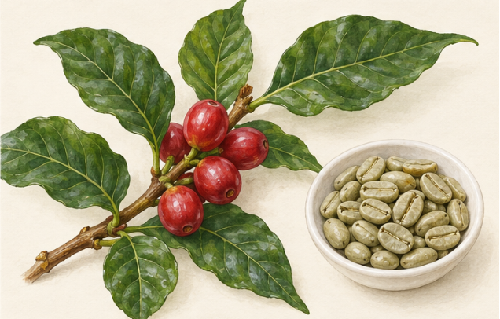
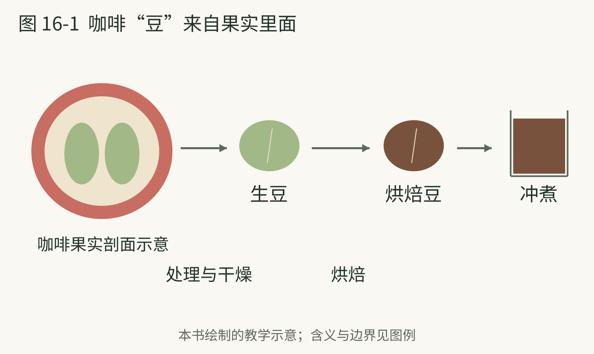
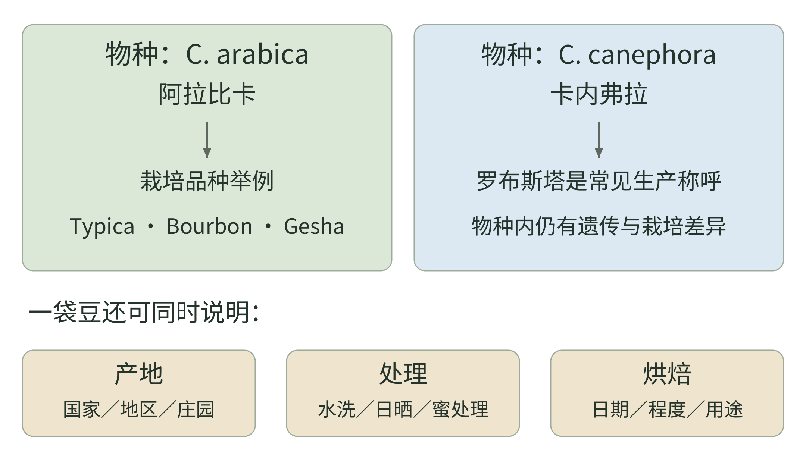

<!-- page: 16|第四部 咖啡的世界|果实里的种子怎样走遍世界 -->

# 16 咖啡从传说进入城市

咖啡“豆”其实是咖啡果实中的种子。这个事实让很多事情重新排列：红色果实不是最后冲进杯里的豆子，种子还需要处理、干燥与烘焙，才成为我们熟悉的材料。[35][37]

<!-- figure-height: 150 -->

**图 16-2　咖啡果实与生豆（AI 教学示意）。**

**图例。** 左为带红色果实的咖啡枝，右为浅绿生豆；种子已经与果实分开，并非枝上结出的绿色豆子。

从红果到生豆，还要去除包覆材料并干燥，之后才进入烘焙。[35][37] 外形不能用来区分图中植物究竟是哪一种栽培品种。

<!-- page: 16|第四部 咖啡的世界|咖啡馆与传播的线索 -->

## 咖啡馆与传播的线索

咖啡的著名开场是埃塞俄比亚牧羊人发现羊吃了果实后变得兴奋。NCA 在介绍中明确把它作为传说，并指出无法用正式文献确定谁最先发现咖啡或发明今天的饮料。[35] 记住故事，同时记住它的身份，两者并不矛盾。

较明确的传播线索把我们带到也门及阿拉伯半岛。到了十五至十六世纪，咖啡栽培、贸易与公共咖啡馆的发展，已成为理解它走向更大范围的重要环节。[35]

咖啡馆不只有一台制作饮料的装置。人可以在那里交谈、听消息和参与城市生活。读到这里，你可能会想到茶馆和酒馆：饮品让人有理由停下来，共同的空间又反过来赋予饮品意义。

这个跨饮品比较是本书的解释，不表示三种场所的历史角色处处相同。酒精与咖啡因不同，地方制度与习俗也不同。相似之处，是杯子之外还有人；不同之处，要回到具体时代与地点。

**观察。** 下次走进咖啡馆，先看谁在独处、谁在交谈、器具如何安排。看看座位、取杯和制作区的安排怎样影响停留与交谈。

<!-- page: 16|第四部 咖啡的世界|传播的不只是喝法，还有活的植物 -->

## 传播的不只是喝法

顺着咖啡走向世界，可以同时追两条线：人把饮料带到哪里，种子和植株又在哪里扎根。喝过咖啡的城市，未必具备种咖啡的条件；种植地与消费地逐渐分开，贸易也就成为杯中风味的一部分。

@table
时期与地点|值得记住的变化
十五至十六世纪 也门及周边|栽培、贸易和饮用实践发展，向红海沿岸及更远城市传播
十七世纪 欧洲城市|咖啡馆逐渐成为交谈、消息与商业活动的场所
十七世纪末 爪哇|荷兰东印度公司推动殖民地咖啡种植
十八世纪 美洲与加勒比|欧洲殖民体系继续转移植株并扩展种植
@endtable

这是一张传播线索表，不是把某一年定为全世界共同的“咖啡元年”。前两行见 NCA 的历史介绍，后两行参照 Plant Humanities Lab 的植物史梳理。[35][98]

植株移动也有沉重的一面：殖民种植园中的咖啡生产曾依赖被奴役者的劳动。[98] 因而，咖啡的全球化既有饮食和社交的新习惯，也有土地、劳力与权力的重新分配。记住这层背景，能让一串地名不只是一条浪漫旅行路线。

<!-- page: 16|第四部 咖啡的世界|咖啡“豆”来自果实里面 -->

## 咖啡“豆”来自果实里面

**图 16-1　咖啡果实、种子与冲煮。**

**图例。** 红色为果实外部，浅色为包覆材料，绿色为种子；右侧依次为生豆、烘焙豆与冲煮。

咖啡豆是果实中的种子。果实采下后，种子需要经过处理与干燥，再进入烘焙和冲煮。[35][37] 图中的横向顺序帮助放好这些工序，不能从熟豆的颜色反推全部处理信息。左侧特意省略种皮等细节，也不规定每颗果实都有完全相同的种子形态。

<!-- page: 16|第四部 咖啡的世界|物种 品种与产地别混在一起 -->

## 阿拉比卡与罗布斯塔之后

咖啡讨论中常见阿拉比卡（Coffea arabica）与罗布斯塔；后者通常用来称呼卡内弗拉（Coffea canephora）。这是两种广泛栽培的咖啡植物，并非“浅烘焙豆”和“深烘焙豆”的别名。World Coffee Research 的目录分别整理两者的品种，提供适应条件、农艺表现等信息。[36]

阿拉比卡内部仍有许多栽培品种。铁皮卡（Typica）、波旁（Bourbon）和卡杜拉（Caturra）都可处在这个更具体的层级。说“这袋是阿拉比卡”，像是在先确认材料范围；说“这是卡杜拉”，才继续缩小到一种植物材料。[36][99][100]

罗布斯塔也不是一个毫无差异的统一原料。它适应的环境通常更温暖湿润，平均咖啡因水平较高，但内部还有不同遗传群体与栽培材料。[104] 这些农业特征解释了生产者为什么会种它；评价一杯时仍要看具体批次与制作。

<!-- page: 16|第四部 咖啡的世界|一张标签回答不同问题 -->

## 一张标签回答不同问题

所以，一张咖啡标签可以同时有国家、庄园、品种、处理方式与烘焙信息。它们分别回答在哪里生长、种的是什么、采下来怎样处理、怎样烘焙。不能把其中任何一个词单独当成完整风味保证。

不要用“阿拉比卡一定高级、罗布斯塔一定低级”来替代观察。了解原料范围有帮助，但最终成品还受到生产、处理与冲煮影响。

@table
标签信息|它主要回答什么
国家 地区 庄园|来源在哪里
物种 栽培品种|植物材料是什么
水洗 日晒 蜜处理|果实怎样处理成生豆
烘焙日期与程度说明|烘焙与时间信息是什么
@endtable

表格是本书对标签阅读的整理，处理方式将在下一章展开。[37]

还有一个巧合：咖啡的 Bourbon 通常是栽培品种名称，而 Bourbon whiskey 是威士忌类别。相同字样不意味着咖啡经过波本桶处理。看到“桶陈咖啡”，需要另看具体说明。读标签时先辨认词的所属领域，可以避免一个有趣名字造成的大误会。

<!-- page: 16|第四部 咖啡的世界|把标签拆成几条独立线索 -->

## 把标签拆成几条独立线索

<!-- figure-height: 170 -->

**图 16-3　咖啡标签中的物种、品种与制作信息。**

**图例。** 物种到栽培品种是一条由宽到窄的材料线索；产地、处理与烘焙是另外几条信息。箭头表达层级，不表示全部品种的亲缘谱系。

读一张标签时，可以先把“阿拉比卡—卡杜拉”放在一起，再把国家或庄园、水洗或日晒、烘焙日期分别放到旁边。图中列举的品种属于阿拉比卡；右侧的卡内弗拉内部同样有遗传与栽培差异。[36][99][101][104]

**虚构标签练习。** “哥伦比亚某庄园／卡杜拉／水洗／中浅烘焙”分别回答来源、植物、处理与烘焙四个问题。如果把水洗换成日晒，物种和品种不会因此跟着改名；把烘焙改深，也不会把卡杜拉变成罗布斯塔。先分清这些位置，后面比较风味时就更容易知道自己在比较什么。

<!-- page: 16|第四部 咖啡的世界|几个品种名字，怎样记才有用 -->

## 几个品种名字，怎样记才有用

品种名值得认识，却不必把它们背成“每个名字对应一种香气”。先记一个关系或特点，往往比记一串形容词更稳。

@table
标签上的名字|先记住这一点
Typica 铁皮卡|阿拉比卡中有重要传播与遗传意义的传统品种，植株较高
Bourbon 波旁|另一支重要传统品种；咖啡中的名字不等于威士忌或桶陈
Caturra 卡杜拉|由波旁自然变异而来，株型较紧凑
Geisha／Gesha 瑰夏|名字涉及不同材料；WCR 单列巴拿马瑰夏，强调其遗传身份
@endtable

前三项的关系可结合 WCR 目录阅读。[36][99][100] 瑰夏尤其适合练习问清楚材料：WCR 说明，同样使用 Geisha 名称的咖啡，不一定都具有巴拿马瑰夏的那组遗传特征。[101]

为什么目录还关心树高、产量、病害与适种条件？消费者主要看杯中表现，种植者却要让树活下来、结出果实、能被采收。卡杜拉的紧凑株型就是一个例子：品种的意义不仅在香气，也在农田里怎样安排植株。[100]

所以，看到陌生名字时，先问“它是什么材料、为什么在这里种”，再把实际喝到的表现记下来。无需等记全品种，才开始享受一杯。

<!-- page: 16|第四部 咖啡的世界|产地提供背景，批次让背景具体 -->

## 产地提供背景，批次让背景具体

同样写着一个国家，可能来自不同地区与庄园，也可能包含不同品种、处理和采收批次。国家名让你先找到地图上的位置；更具体的信息，才逐步接近这一袋材料。本书建议把产地当成提问的入口，而不是风味答案。

“海拔越高就越好”也把事情压得太平。WCR 的品种目录在解释适种海拔时，会把纬度一起考虑：靠近赤道与远离赤道的地方，适宜条件不在同一条海拔线上。[99] 因而，两个来自不同地方的海拔数字，不宜直接排成品质名次。

在日常比较里，可以先选一种容易执行的安排：同一家烘焙商、相近烘焙说明的两个来源。喝之前写下标签差别，喝之后分别记录酸感、烘烤印象和口感。由于品种、土壤、处理等条件仍可能一起变化，这只能帮助认识两个批次，不能单凭两杯就概括整个国家。

下一章要把这张标签继续拆开：果实怎样变成生豆，以及生豆怎样在热里变成有熟悉香气的咖啡。
