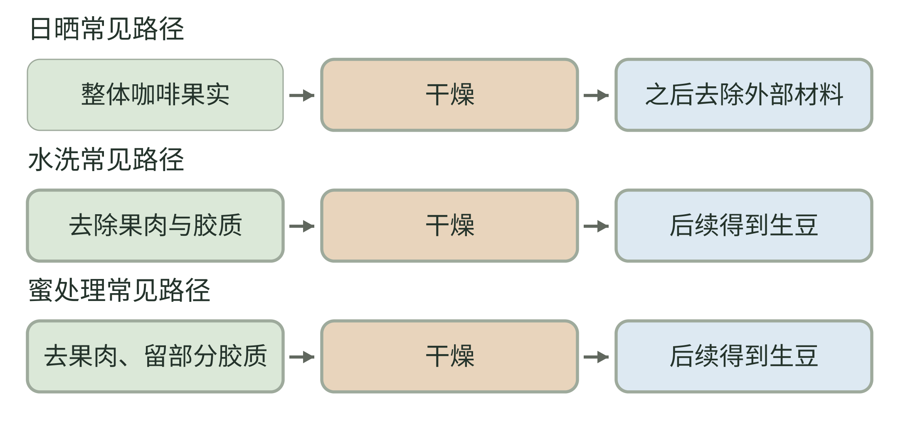
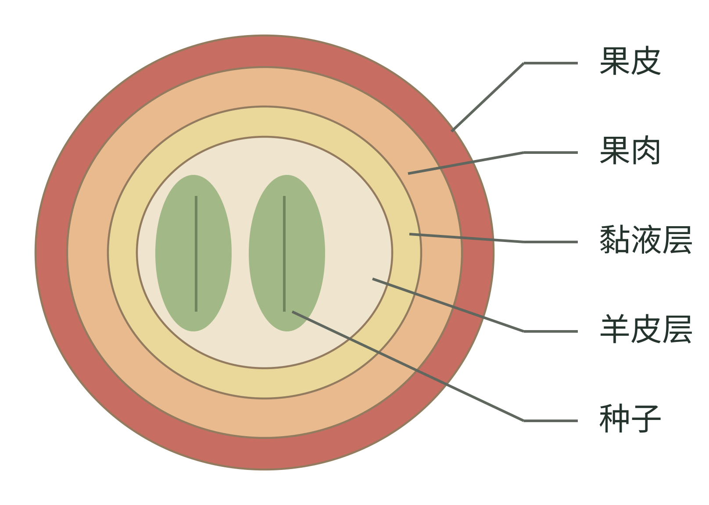
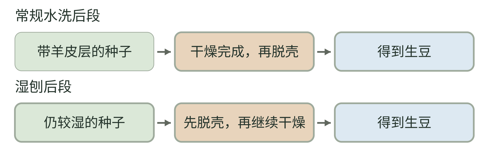

<!-- page: 17|第四部 咖啡的世界|生豆怎样从果实里出来 -->

# 17 处理与烘焙

咖啡果实采下以后，生产者要处理果皮、果肉与种子之间的材料，再把种子干燥到适合后续储存与加工的状态。咖啡处理是从果实走向生豆的重要阶段，不是你在家里冲煮那一步。[37]

日晒、水洗与蜜处理，是入门常遇到的路径。日晒通常让果实整体干燥后再去除外部材料；水洗围绕去除果肉、胶质等材料再干燥展开；蜜处理则保留一定胶质参与干燥。“蜜”并不表示加入蜂蜜。[37]

这些区别会改变处理环境，但“水洗一定清淡、日晒一定甜”不适合当成无例外规则。可以把它们看成可能影响风味的生产信息，仍与原料、控制条件和后续烘焙一起理解。

发酵也会在处理讨论中出现。它可能是工序中的一环，但咖啡进入杯中的主要身份仍是处理并烘焙后的种子。不要因为标签谈到发酵，就把它理解成一杯酒。

**纸上对照。** 找同一产区的两份咖啡介绍，分别圈出处理方式与烘焙说明。先看是否真的只差一个条件。如果连品种、批次和烘焙都不同，就不宜把全部风味差异都归给水洗或日晒。

品种、批次和烘焙越接近，越便于比较处理方式的影响。

<!-- page: 17|第四部 咖啡的世界|三种处理方式，主要在什么状态下干燥 -->

## 三种处理方式，主要在什么状态下干燥

**图 17-1　三种咖啡处理路线。**

**图例。** 绿色为主要干燥阶段的材料状态，棕色为干燥，蓝色为后续方向。

图中比较的是主要干燥阶段的材料状态：日晒保留果实外部材料，水洗先去除果肉与黏液，蜜处理保留一定黏液。[37] 这些路线可能影响风味，但不能单凭名称预测甜度与口感。

<!-- page: 17|第四部 咖啡的世界|水洗究竟洗的是哪一层 -->

## 水洗不是把烘焙豆洗一遍

把咖啡果实想成包着种子的材料：外面是果皮和果肉，往里有黏稠的黏液层，种子外还包着常称“羊皮层”的内果皮。处理要安排这些材料何时去除；不是在冲煮前清洗已经烘焙好的豆。[88][90]

<!-- figure-height: 170 -->

**图 17-4　咖啡果实里要去掉哪些层。**

**图例。** 从外向内标出果皮、果肉、黏液层、羊皮层与种子；层厚、种子数和形状为理想化示意，省略种皮等细节。

处理名称主要在说这些材料何时去掉，哪些还参与干燥；水洗不是清洗已烘焙的豆。[88][90] 和图 17-1、17-2 合看，再定位日晒、蜜处理与湿刨的差别。

<!-- page: 17|第四部 咖啡的世界|黏液去除与处理名称 -->

## 黏液去除与处理名称

常见的发酵水洗路线，是先去皮去果肉，让黏液在受控条件下分解，再清洗并干燥带羊皮层的种子。另一条路线会以机械去除黏液，不一定经历相同的发酵槽或用水过程。行业中“水洗”与“全水洗”的具体口径也可能有区别，不能仅凭名字断定发酵时长或用水量。[88]

蜜处理在去皮去果肉后，保留部分或全部黏液干燥；巴西常见的去果肉日晒（pulped natural）与它有相近之处。黄蜜、红蜜、黑蜜等名称可能涉及黏液保留及干燥安排，不是全球统一的含糖量或品质等级。[89]

**“半水洗”尤其要问流程。** North Star 的说明用 semi-washed 指蜜处理／去果肉日晒一类路线，Cafe Imports 则把它列为湿刨法的别名。[90][92] 两家实际用词已经不同。因此本书保留这个标签，但不定义为“只洗一半”，也不把它与蜜处理、湿刨法全部画等号。

<!-- page: 17|第四部 咖啡的世界|湿刨法的关键是提前去羊皮层 -->

## 湿刨：在种子仍较湿时脱壳

湿刨法（wet-hulled，印尼语 giling basah）在印度尼西亚部分产区常见。它的识别点不是“有没有用水”，而是种子还较湿时就去掉羊皮层，之后再继续干燥。[90] 因而，同样涉及去果肉或清洗，也不等于常规水洗的完整工序。

**图 17-2　常规水洗与湿刨的脱壳时机。**

**图例。** 上行为常规水洗后段，下行为湿刨后段；绿色为起始状态，棕色为脱壳与干燥的次序，蓝色为所得生豆。箭头表示先后，不表示工序时长；“较湿”不设通用含水率刻度。

两行都省略前段去果皮、果肉与黏液的变体。比较点是羊皮层何时离开：常规水洗通常带着羊皮层完成干燥，再脱壳；湿刨则提前脱壳，再完成后续干燥。[90] 这能帮助读懂生产者的工序说明，而不能只凭熟豆颜色或某种“泥土味”鉴定处理方式。

<!-- page: 17|第四部 咖啡的世界|厌氧发酵与水洗可以同时出现在标签上 -->

## 厌氧水洗为什么不矛盾

“厌氧”主要描述发酵阶段的氧气条件。生产者可能使用密闭容器等安排限制氧气进入，再选择水洗、蜜处理或日晒的后续路径。因此“厌氧水洗”“厌氧日晒”可以成立；厌氧不是把前三种全部替换掉的第四种互斥处理法。[91]

@table
标签线索|主要回答什么|仍需补问的信息
水洗 Washed|果肉与黏液如何去除|用发酵还是机械去黏液
蜜处理 Honey|干燥时保留哪些黏液|保留与干燥的具体安排
湿刨 Wet-hulled|羊皮层何时脱除|前段处理与后续干燥
厌氧 Anaerobic|发酵的氧气环境|配合哪条处理路线
@endtable

表格按工序问题整理，不作为互斥分类或品质排序。[88][89][90][91] 同一个批次可以同时回答几行；“双重发酵”“特殊水洗”等名称也要回到生产者说明，不能从数字或新奇名称推断风味必然更复杂。

读咖啡介绍时，可以依次圈出三项：果肉与黏液怎样处理，发酵怎样安排，羊皮层何时脱除。如果说明只写“半水洗”，缺少的内容就先记为未知，不靠标签补出一条并未公布的流程。

<!-- page: 17|第四部 咖啡的世界|烘焙不是把颜色加深这么简单 -->

## 从生豆到熟悉的香气

咖啡烘焙让种子发生复杂的物理与化学变化。研究把许多香气物质的形成与美拉德反应、相关降解与热反应联系起来。[38] 生豆与烘焙豆闻起来不同，不只是表面颜色变深。

<!-- figure-height: 150 -->

**图 17-3　生豆与两种烘焙外观（AI 教学示意）。**

**图例。** 从左至右为浅绿生豆、较浅棕熟豆与较深棕熟豆；这是选定外观，没有实测色值、温度或烘焙时长。

先观察从生豆到熟豆的明显变化，再问烘焙怎样改变香气与组成。[38] 不能把每种棕色都当成统一等级，也不能只从照片诊断萃取或品质。

<!-- page: 17|第四部 咖啡的世界|烘焙与冲煮怎样相遇 -->

## 烘焙与冲煮怎样相遇

这也让咖啡与啤酒里的深色麦芽、某些茶的焙火产生可供比较的线索：热处理都可能影响风味，但原料、条件和结果并不相同。不能把三种加工的热反应和风味结果直接等同。

浅、中、深烘焙是常见描述，却不宜把不同店家的三个词当成精确一致的刻度。个人学习可以先看生产者怎样说明，再靠同一来源的对照建立自己的感觉。

**“深”不等于所有意义上的“浓”。** 你可能用浓形容烘烤印象、苦味、液体浓度，甚至咖啡因。它们是不同问题。咖啡冲煮研究把杯中浓度与萃取率分别处理，正适合帮助我们拆开这种语言混淆。[39]

描述时可以多补一句：是香气更偏烘烤，还是同样一口液体更厚重？是更苦，还是少一点酸？这些话比只写“很浓”更利于下一次选择。

烘焙日期还属于另一项信息。咖啡会随储存失去新鲜风味，保存方式也重要。[41] 最佳饮用时段因豆子、烘焙和保存条件而异。你可以观察同一袋豆在不同日期的变化，再决定自己的节奏。
