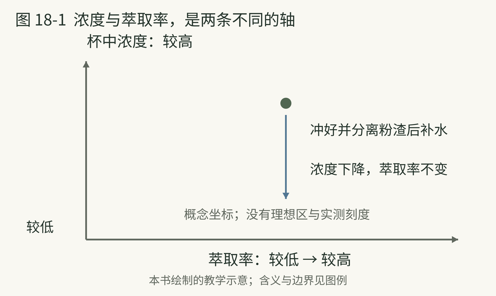
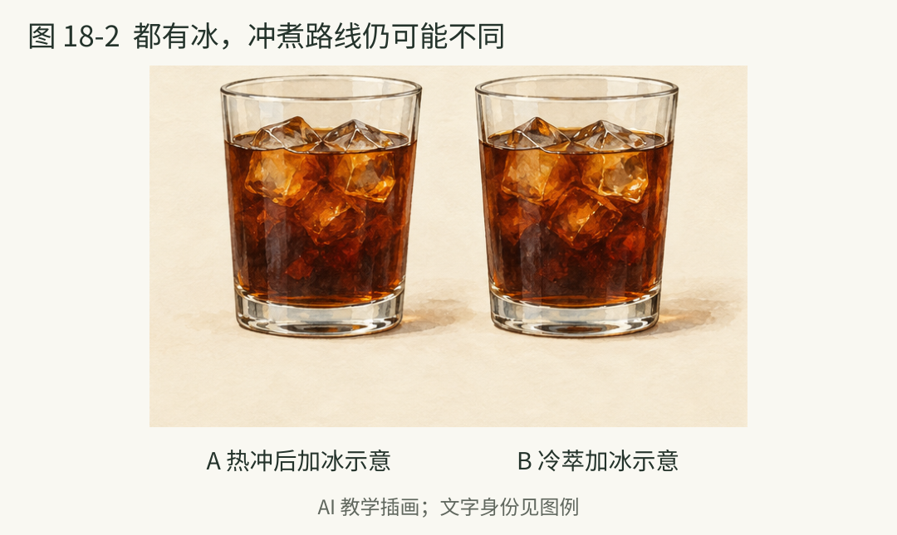

<!-- page: 18|第四部 咖啡的世界|浓度和萃取不是同一回事 -->

# 18 把咖啡冲得更明白

一杯咖啡偏淡，有可能只是水多，也可能与从粉中取出了多少成分有关。研究中的浓度描述咖啡液中溶解固形物的质量比例；萃取率描述从咖啡粉中提取出的溶解固形物，占原始干咖啡粉质量的比例。二者有关联，但不是一个数字。[39]

可以用一个补水对照理解：把同一杯已冲好的咖啡加水，浓度会改变，却没有重新从咖啡粉里多提取成分。实际计算仍需记录咖啡粉量、出液量与浓度。

在家不必先买折射仪。先控制咖啡量与加水量，再留意研磨、时间和冲煮方式。称重能帮助重复，如果没有秤，也可以先用固定勺与固定杯。关键是知道自己每次改了什么。

**试验起点。** 对常见滤泡方法，可以把 15 克咖啡与约 240 克加水量当作一组试验条件。这是便于计算的初始比例，不是通用标准；方法、烘焙与个人喜好不同，都可能需要调整。记录的是加水量，最终杯中液体通常不会恰好同重。

若感觉偏淡，先别同时改研磨、温度与比例。可以先适当减少加水量，再观察。若想研究研磨，就保持咖啡量与加水量不变。把每次改变与结果对应起来，才能决定下一步怎样调整。

<!-- page: 18|第四部 咖啡的世界|浓度与萃取率，是两条不同的轴 -->

## 浓度与萃取率，是两条不同的轴

**图 18-1　浓度与萃取率的关系。**

**图例。** 横轴为萃取率，纵轴为杯中浓度；蓝色箭头表示冲好并分离粉渣后补水的方向。

杯中浓度以咖啡液质量为分母，萃取率以原始干咖啡粉质量为分母。[39] 如果咖啡已经冲好、粉渣已分离，再补水会让浓度下降；它不会回到粉里继续萃取。图不以一个位置诊断全部酸、苦或好喝程度，真实冲煮还需结合测量、材料和感官观察。

<!-- page: 18|第四部 咖啡的世界|别用一个味道诊断全部问题 -->

## 苦 酸与控制变量

“酸就是萃取不足，苦就是萃取过度”是方便记忆的口号，却容易把原料、烘焙、浓度和提取过程全部混在一起。咖啡研究也在重新审视传统冲煮图中那些过于整齐的风味边界。[39]

水温当然值得记录，但并不应被单独神化。SCA 介绍的实验在控制浓度与萃取等条件时，探讨了水温对感官结果的影响。[40] 它不能被扩大为“温度永远不重要”，也不能支持某一个温度适合所有咖啡和器具。

**调整顺序。** 先确认材料与基本比例，再观察研磨和冲煮是否能稳定重复，最后一次只调一项。尝到偏苦，先把它写成观察，而不是立即判定机器或豆子有问题。

意式浓缩、手冲和浸泡式咖啡，还使用不同提取安排。加水得到美式、加奶得到奶咖，是成品后的组合选择；不能直接拿一杯最终体积去推断用了多少咖啡或咖啡因。对实际摄入，仍要看材料与产品信息。[44]

如果你喜欢加奶，这同样是学习起点。先试着分辨：换了咖啡以后，奶中的咖啡存在感怎样变化？不要用“必须喝黑咖啡”作为进入这门兴趣的门票。

到这里，咖啡与茶已经共享了一项方法：固定大部分条件，观察一次改变。记录条件，才能判断两次结果为何不同。

<!-- page: 18|第四部 咖啡的世界|菜单其实混合了两套名称 -->

## 先分冲煮方法与成杯名称

“手冲”和“拿铁”不是同一层分类。前者在说怎样提取咖啡，后者通常在说浓缩咖啡与奶怎样组合。NCA 把滴滤、手冲、意式、法压和冷萃分别作为冲煮方法介绍。[67]

<!-- figure-height: 145 -->

**图 18-0　咖啡菜单的成杯情境。** 从左至右为小份咖啡、黑咖啡、奶咖与带奶纹理的冰饮。

@table
冲煮路线|典型方法|先观察什么
水流经过咖啡粉|手冲 滴滤机|研磨 水流与过滤
咖啡粉浸在水中|法压 常见浸泡冷萃|接触时间及后续分离
压力参与提取|意式浓缩|细研磨 压力与出液
@endtable

表是本书根据方法资料整理的主线，不把全部器具强行装进三个互斥盒子。法压还会压下滤网，但不因此成为意式浓缩；名字里同样有“压”，目的和条件仍不同。[68][69]

<!-- page: 18|第四部 咖啡的世界|黑咖啡并不只有美式 -->

## 把提取与补水分开

意式浓缩通过压力让热水经过较细咖啡粉，形成小份、较集中的咖啡；它又可用于多种成杯组合。[69] “意式”在这里不是咖啡树品种，包装上的意式豆说明仍要另读。

<!-- figure-height: 75 -->

**图 18-C　咖啡的成杯组成。**

**图例。** 棕色为咖啡，蓝色为水，米色为奶；色块只示意组成，不表示配方比例。

@table
名字|你通常在点什么|容易混淆之处
Espresso 浓缩|意式方法提取的基底|小杯不等于咖啡因一定少
Americano 美式|浓缩咖啡加水|不是手冲的另一个名字
Filter coffee 滤泡|通过滤泡路线制作的咖啡|不只是把浓缩冲淡
Iced coffee 冰咖啡|冰饮呈现方式的总称|不保证采用冷萃
Cold brew 冷萃|以较低温度长时间提取|不等于热咖啡放凉
@endtable

成杯名称参照生产者与研究机构资料作整理，具体杯量以店家为准。[67][69][70][71] 图只说明成分关系，不表示标准比例。

<!-- page: 18|第四部 咖啡的世界|奶咖里哪一项发生了变化 -->

## 拿铁 卡布奇诺与馥芮白

常见奶咖共享浓缩咖啡与奶，但总量、奶泡和呈现目标不同。Nespresso 的说明可作为常见做法示例，不把某一家生产者的用量定为全球菜单标准。[71][72]

@table
名称|常见组成与方向|点单时可以问什么
Latte 拿铁|浓缩与较多奶 常有少量奶泡|杯量和浓缩份数
Cappuccino 卡布奇诺|浓缩 热奶与较明显的奶泡|奶泡与成杯体积
Flat white 馥芮白|浓缩与细腻奶泡 常强调咖啡存在感|与店里拿铁差在哪
Macchiato 玛奇朵|常表示用少量奶或奶泡标记浓缩|是否是经典小杯 或甜味大杯变体
Mocha 摩卡|咖啡 奶与巧克力方向材料|糖和巧克力来自什么
@endtable

同一份浓缩倒进更大的奶量里，咖啡存在感可能变弱，杯子却变大。不要把杯大、味浓、咖啡因多合并成一个判断；咖啡因仍要看实际用料。[44]

奶的选择也会改变体验。普通奶、燕麦等替代饮品及甜化材料，并非只换了颜色。最有帮助的记录是“这杯里咖啡和奶哪边更明显”，再把答案与杯量和基底份数联系起来。

<!-- page: 18|第四部 咖啡的世界|都有冰，冲煮路线仍可能不同 -->

## 都有冰，冲煮路线仍可能不同

**图 18-2　热冲冰咖啡与冷萃冰咖啡。**

**图例。** 左杯为热冲后加冰，右杯为冷萃加冰；杯形、颜色与冰块相似，制作路线不同。

一杯热冲咖啡放凉或加冰，与以较低温水接触咖啡粉制作的冷萃，都可能作为冰咖啡端上来。[70] 杯里出现冰块，并不能揭晓它是在什么时候、以什么温度完成萃取的。点单时直接询问制作路线，比凭颜色猜测更可靠。

<!-- page: 18|第四部 咖啡的世界|冰与器具让路线继续分叉 -->

## 冷萃 冰手冲与其他器具

SCA 的研究介绍区分低温长时间提取的冷萃，与热提取后冷却或加冰的咖啡。两条路径的时间、过滤和饮用条件都可能不同，不宜把“更甜、更低酸”当成所有冷萃无条件的保证。[70]

@table
路线或器具|认识它的一个问题|怎样继续阅读
冷萃|低温提取后是否还要稀释|看浓缩液与直饮说明
冰手冲|热提取与融冰怎样组合|先记录总用水与冰
摩卡壶|加热产生的条件怎样推动水流|不是意式机的等比例缩小
AeroPress|浸泡 过滤与手动压力怎样组合|方法可变 不只有一种配方
土耳其咖啡|细粉与煮制如何形成饮法|饮用与文化实践也属于身份
@endtable

后面三种器具或饮法的基础线索分别见生产者及文化遗产资料。[73][74][75] 选择器具时，可以比较成杯特点、操作和清洗所需的时间。

下次遇见“低因冷萃燕麦拿铁”，你可以拆成三个问题：原料是否去咖啡因，采用什么提取，再与什么组合。菜单很长，你需要的基础问题仍然只有几个。
