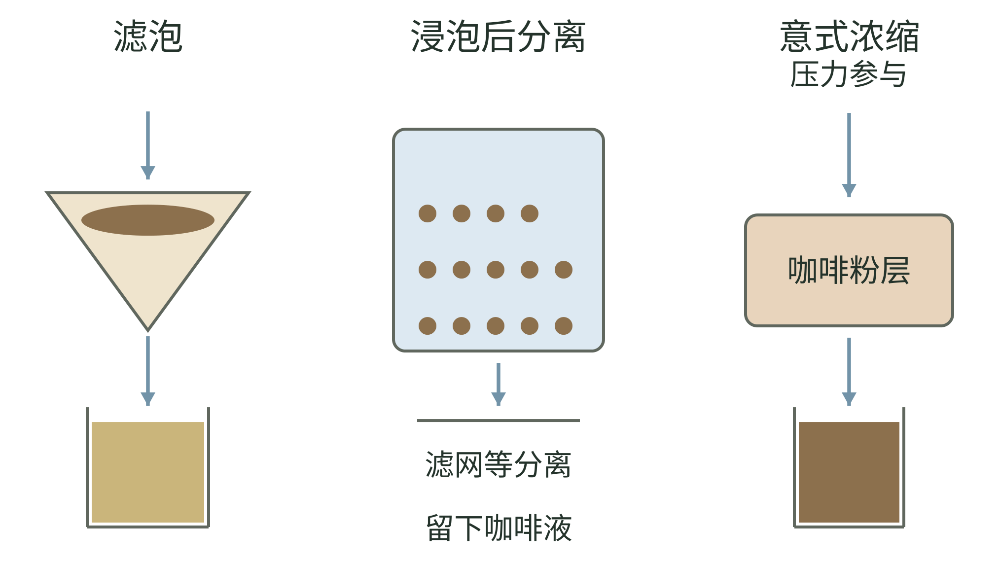
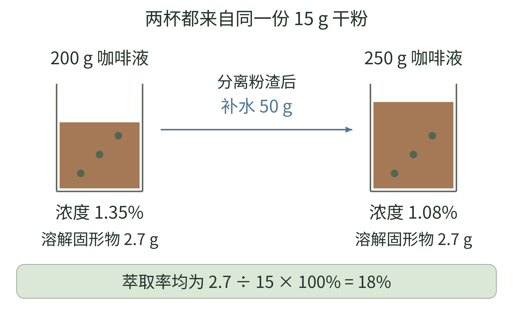
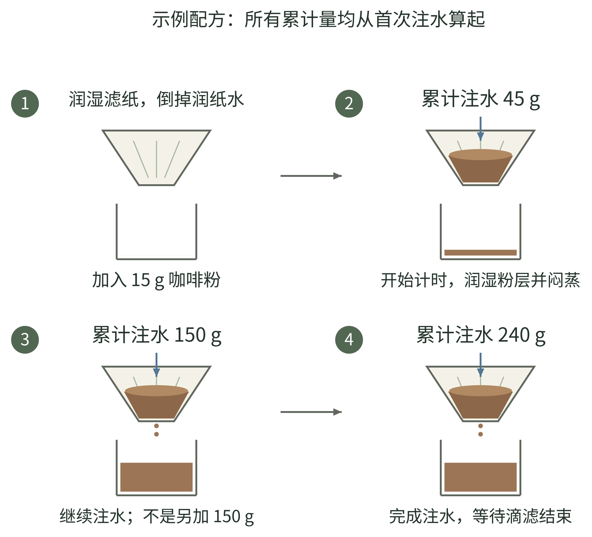
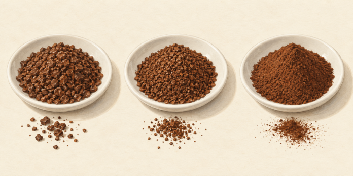
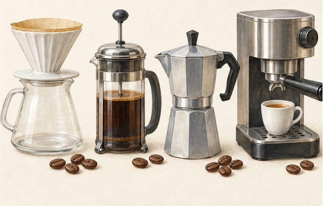
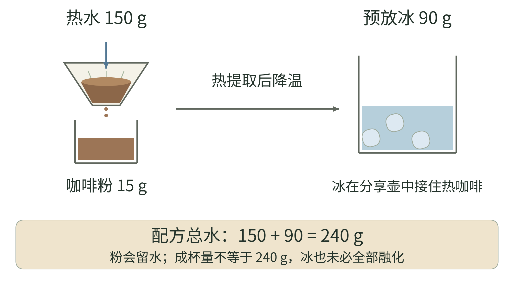

<!-- page: 18|第四部 咖啡的世界|浓度和萃取不是同一回事 -->

# 18 把咖啡冲得更明白

一杯咖啡偏淡，有可能只是水多，也可能与从粉中取出了多少成分有关。研究中的浓度描述咖啡液中溶解固形物的质量比例；萃取率描述从咖啡粉中提取出的溶解固形物，占原始干咖啡粉质量的比例。二者有关联，但不是一个数字。[39]

<!-- figure-height: 165 -->

**图 18-6　三种提取安排里的水与粉。**

**图例。** 左为水流过粉层，中为粉与水浸泡后分离，右为压力参与下的水流过粉层；蓝箭头表示流向，不表示压力或流速。

这三格用于读冲煮方法，不把器具划成互斥分类。[67][68][69] 法压分离时的压滤与意式机的提取压力不同；补水和加奶则属于之后的成杯组合。

<!-- page: 18|第四部 咖啡的世界|把两种质量比例分开 -->

## 把两种质量比例分开

可以用一个补水对照理解：把同一杯已冲好的咖啡加水，浓度会改变，却没有重新从咖啡粉里多提取成分。实际计算仍需记录咖啡粉量、出液量与浓度。

在家不必先买折射仪。先控制咖啡量与加水量，再留意研磨、时间和冲煮方式。称重能帮助重复，如果没有秤，也可以先用固定勺与固定杯。关键是知道自己每次改了什么。

**试验起点。** 对常见滤泡方法，可以把 15 克咖啡与约 240 克加水量当作一组试验条件。这是便于计算的初始比例，不是通用标准；方法、烘焙与个人喜好不同，都可能需要调整。记录的是加水量，最终杯中液体通常不会恰好同重。

若感觉偏淡，先别同时改研磨、温度与比例。可以先适当减少加水量，再观察。若想研究研磨，就保持咖啡量与加水量不变。把每次改变与结果对应起来，才能决定下一步怎样调整。

<!-- page: 18|第四部 咖啡的世界|浓度与萃取率，是两条不同的轴 -->

## 浓度与萃取率，是两条不同的轴

**图 18-1　浓度与萃取率的关系。**

**图例。** 横轴为萃取率，纵轴为杯中浓度；蓝色箭头表示冲好并分离粉渣后补水的方向。

杯中浓度以咖啡液质量为分母，萃取率以原始干咖啡粉质量为分母。[39] 如果咖啡已经冲好、粉渣已分离，再补水会让浓度下降；它不会回到粉里继续萃取。图不以一个位置诊断全部酸、苦或好喝程度，真实冲煮还需结合测量、材料和感官观察。

<!-- page: 18|第四部 咖啡的世界|用一组数字看懂补水 -->

## 15 克粉，最后去了哪里

把前面的两个比例放进一个假想算例。15 克干咖啡粉冲出 200 克咖啡液，测得溶解固形物浓度（TDS）为 1.35%，则杯中溶解固形物为 200 × 1.35%＝2.7 克；按杯中回收的溶解物计算，萃取率为 2.7 ÷ 15＝18%。[39]

<!-- figure-height: 155 -->

**图 18-8　分离粉渣后补水的质量算例。**

**图例。** 绿色圆点象征溶解物，不是杯中可见颗粒。两杯都含 2.7 克溶解物；补水 50 克后，液体增至 250 克，浓度为 1.08%，按杯中回收量计算的萃取率仍为 18%。

这里的数字是本书为解释关系设置的算例，不是对图中咖啡的实测。它简化了粉床滞留液等问题，适合理解杯中回收量的计算，不能代替研究所有冲煮方式的完整质量平衡。没有浓度测量时，不能从“喝着像 18%”倒算萃取率。[39]

<!-- page: 18|第四部 咖啡的世界|别用一个味道诊断全部问题 -->

## 苦 酸与控制变量

“酸就是萃取不足，苦就是萃取过度”是方便记忆的口号，却容易把原料、烘焙、浓度和提取过程全部混在一起。咖啡研究也在重新审视传统冲煮图中那些过于整齐的风味边界。[39]

水温当然值得记录，但并不应被单独神化。SCA 介绍的实验在控制浓度与萃取等条件时，探讨了水温对感官结果的影响。[40] 它不能被扩大为“温度永远不重要”，也不能支持某一个温度适合所有咖啡和器具。

**调整顺序。** 先确认材料与基本比例，再观察研磨和冲煮是否能稳定重复，最后一次只调一项。尝到偏苦，先把它写成观察，而不是立即判定机器或豆子有问题。

意式浓缩、手冲和浸泡式咖啡，还使用不同提取安排。加水得到美式、加奶得到奶咖，是成品后的组合选择；不能直接拿一杯最终体积去推断用了多少咖啡或咖啡因。对实际摄入，仍要看材料与产品信息。[44]

如果你喜欢加奶，这同样是学习起点。先试着分辨：换了咖啡以后，奶中的咖啡存在感怎样变化？不要用“必须喝黑咖啡”作为进入这门兴趣的门票。

到这里，咖啡与茶已经共享了一项方法：固定大部分条件，观察一次改变。记录条件，才能判断两次结果为何不同。

<!-- page: 18|第四部 咖啡的世界|把第一杯手冲做完整 -->

## 一杯手冲的准备与起手

先选一种滤杯和适配滤纸，准备分享壶或耐热杯、热水壶、秤与计时器。取 15 克咖啡，研磨到供滤泡使用的中等至中细状态；用 240 克水作为本书的练习起点，粉水质量比为 1∶16。Hario 的单杯指南也采用相近的粉量与水量，但注水分段有所不同。[105]

把滤纸放稳，用热水润湿，使它贴住滤杯，并预热下方容器；倒掉这部分水。加入咖啡粉，轻晃滤杯摊平粉面。将整套器具放上秤并归零，润纸用水不计入这次的 240 克。

先以约 93℃的热水试做，往后保持同一测温方法。这个温度是便于开始的选择；水离开壶口以后还会降温，壶上读数与粉床温度也不同。[40]

准备完成后先看一眼：滤纸是否贴合，粉是否均匀摊开，下方杯子是否装得下。重复这些小动作，通常比每次换一套复杂注水法更有助于比较。

<!-- page: 18|第四部 咖啡的世界|三段注水怎样接起来 -->

## 先浸湿，再分段加到总量

<!-- figure-height: 250 -->

**图 18-7　15 克咖啡的三段注水练习。**

**图例。** 图中沿用同一滤杯，润纸后加入 15 克粉，第二至四格保留粉床；标注数字为累计注水量 45、150、240 克，本次新增水量分别为 45、105、90 克。

**第一段：浸湿。** 开始计时，小水流尽量浸湿全部粉，注至 45 克，停约 30—45 秒。这段常称“闷蒸”，可看到气泡或粉面膨起；形态会随豆子与时间改变，不是品质评分。[105]

**第二、三段：续水。** 绕小圈稳定注至累计 150 克，水位下降一些后续至 240 克；别把 150 和 240 当成两次新增量。待滴流明显放缓，移走滤杯，轻摇咖啡液使其混合，再等到适口温度品尝。此分段为本书练习方案，不照搬特定竞赛配方。

<!-- page: 18|第四部 咖啡的世界|研磨为什么同时改变流动与接触 -->

## 看颗粒，也看水怎样通过

把一颗豆磨成许多小颗粒，水就能接触更多表面。颗粒变细，同时可能让水更难通过粉层；研磨调整因此既改变接触，也改变流动。磨得越细，并不保证整杯提取得越均匀。[106]

<!-- figure-height: 155 -->

**图 18-10　粗、中、细三种咖啡粉外观（AI 教学示意）。**

**图例。** 从左至右比较颗粒由粗到细的外观方向；没有显微标尺，不代表特定器具的规定粒径。

一份粉里往往还混有更细的颗粒，不能只找出最大的几粒判断整份研磨。盐粒、砂糖等比喻能帮助沟通，但实物粒径也不一致；“某品牌第几格”更只能在同一型号、相近校准条件下参考。[106]

**观察。** 留一点干粉在白碟上，用同一光线对比两次设置。先辨认变化方向，再把它与注水和滴滤记录联系起来。

<!-- page: 18|第四部 咖啡的世界|下一杯只改一项 -->

## 从重复走向调整

第一次完成手冲，记下咖啡、研磨设置、粉量、总注水、壶上水温与结束时间，再用自己的词写一句感受。用同一操作再做一遍，才知道原本的变化有多大。

如果水很快流完，先检查注水是否过猛、是否明显绕过粉床；确认操作相近后，可以试着稍微磨细。如果后段长时间滴不完，先看滤纸是否贴合、粉是否过细或扰动过多，再试着稍微磨粗。研磨指南可提供调整方向，实际仍要结合味道判断。[106]

**一次小对照。** 保持 15 克粉、240 克水及注水分段不变，只调一小格研磨。两杯放到相近温度再尝：哪杯香气清楚，哪杯口腔更干，哪杯更喜欢？若只是想让一杯已经冲好的咖啡淡一点，先分出少量补水比较，就能把浓度问题与冲煮问题分开。[39]

不要为了追某个结束秒数同时修改所有条件。时间是观察结果，也是一项记录；同样三分钟，不代表水流、粉床与提取都相同。

<!-- page: 18|第四部 咖啡的世界|水不是没有味道的背景 -->

## 先固定水，再讨论豆

家中同一袋咖啡换了水，酸感和口感可能发生变化。水里的矿物质、硬度与碱度是不同信息：硬度主要与钙、镁等离子有关；碱度描述抵抗酸化的能力。SCA 的水质说明特别强调，判断咖啡酸感不能只看水的 pH。[107]

入门先用适合饮用、没有明显异味的水，固定来源。若怀疑水影响了结果，可用同一袋豆、同一配方比较两种水；不要同时换豆子与滤纸。先闻冷水和热水，再尝冷却后的咖啡，有助于分清异味来自哪里。

包装上一个“矿物质多”的宣传词，或水质笔一个读数，都不足以说明它一定更适合冲咖啡。讨论更细的水配方时，才需要分别查看硬度与碱度；暂时不必购买矿物盐自行调水。[107]

意式机还涉及水垢、腐蚀与设备要求，入口味道喜欢并不能代替厂商的用水说明。本书的对照练习以手冲为主，机器用水遵循该机型要求。

<!-- page: 18|第四部 咖啡的世界|菜单其实混合了两套名称 -->

## 先分冲煮方法与成杯名称

“手冲”和“拿铁”不是同一层分类。前者在说怎样提取咖啡，后者通常在说浓缩咖啡与奶怎样组合。NCA 把滴滤、手冲、意式、法压和冷萃分别作为冲煮方法介绍。[67]

<!-- figure-height: 145 -->

**图 18-0　咖啡菜单的成杯情境。** 从左至右为小份咖啡、黑咖啡、奶咖与带奶纹理的冰饮。

@table
冲煮路线|典型方法|先观察什么
水流经过咖啡粉|手冲 滴滤机|研磨 水流与过滤
咖啡粉浸在水中|法压 常见浸泡冷萃|接触时间及后续分离
压力参与提取|意式浓缩|细研磨 压力与出液
@endtable

表是本书根据方法资料整理的主线，不把全部器具强行装进三个互斥盒子。法压还会压下滤网，但不因此成为意式浓缩；名字里同样有“压”，目的和条件仍不同。[68][69]

<!-- page: 18|第四部 咖啡的世界|黑咖啡并不只有美式 -->

## 把提取与补水分开

意式浓缩通过压力让热水经过较细咖啡粉，形成小份、较集中的咖啡；它又可用于多种成杯组合。[69] “意式”在这里不是咖啡树品种，包装上的意式豆说明仍要另读。

<!-- figure-height: 150 -->

**图 18-4　小份浓缩与一杯滤泡（AI 教学示意）。**

**图例。** 左为小份浓缩外观，右为较大杯黑咖啡；右杯作为滤泡示意，外观本身不能证明冲煮方法。

不同杯量与表面状态帮助认识常见呈现，不规定标准配方，也不能据此推断咖啡因摄入。浓缩加水与直接滤泡仍是不同路线。[67][69][44]

<!-- page: 18|第四部 咖啡的世界|意式的比例要看粉与出液 -->

## 18 克进，36 克出，说明什么

意式配方常写“18 克粉，36 克出液，约 30 秒”。其中 1∶2 是干粉质量与杯中咖啡液质量的比，不是咖啡与机器水箱加水量的比。La Marzocco 把这类比例作为建立配方的起点；粉量还要配合粉碗的容量。[108]

用同样 18 克粉，目标从 36 克出液改成 45 克，通常意味着让更多水继续经过粉床。它与先做出 36 克、再加 9 克水不同：前者继续提取，后者只调整已分离咖啡液的浓度。两杯最终质量相同，也可能味道不同。[39][108]

居家操作先按粉碗要求称粉，均匀布粉并压平，锁好手柄后以秤观察出液。记录机器如何计时，再结合滴流和感官微调研磨。若同一粉量和目标出液突然快了很多，可以检查研磨与布粉是否一致，而不是只看表面有没有油脂层。[108]

店里的“一份”“双份”仍可能使用不同粉碗与配方。点奶咖时问浓缩份数，是在了解基底；知道确切粉量与做法，信息会更完整。

<!-- page: 18|第四部 咖啡的世界|咖啡的成杯组成 -->

## 咖啡的成杯组成

<!-- figure-height: 75 -->

**图 18-C　咖啡的成杯组成。**

**图例。** 棕色为咖啡，蓝色为水，米色为奶；色块只示意组成，不表示配方比例。

@table
名字|你通常在点什么|容易混淆之处
Espresso 浓缩|意式方法提取的基底|小杯不等于咖啡因一定少
Americano 美式|浓缩咖啡加水|不是手冲的另一个名字
Filter coffee 滤泡|通过滤泡路线制作的咖啡|不只是把浓缩冲淡
Iced coffee 冰咖啡|冰饮呈现方式的总称|不保证采用冷萃
Cold brew 冷萃|以较低温度长时间提取|不等于热咖啡放凉
@endtable

成杯名称参照生产者与研究机构资料作整理，具体杯量以店家为准。[67][69][70][71] 图只说明成分关系，不表示标准比例。

<!-- page: 18|第四部 咖啡的世界|奶咖里哪一项发生了变化 -->

## 拿铁 卡布奇诺与馥芮白

常见奶咖共享浓缩咖啡与奶，但总量、奶泡和呈现目标不同。Nespresso 的说明可作为常见做法示例，不把某一家生产者的用量定为全球菜单标准。[71][72]

<!-- figure-height: 150 -->

**图 18-5　三种奶咖的杯量与奶泡情境（AI 教学示意）。**

**图例。** 左为拿铁式长杯，中为较明显泡沫的卡布奇诺式杯，右为较小杯细泡奶咖；名字由图文约定，不靠外观鉴别。

拉花与表面装饰不承担分类作用。奶量、泡沫与咖啡基底应分别询问，不能从本图读出固定比例或全球杯量标准。[71][72]

<!-- page: 18|第四部 咖啡的世界|奶量、泡沫与基底份数 -->

## 奶量、泡沫与基底份数

@table
名称|常见组成与方向|点单时可以问什么
Latte 拿铁|浓缩与较多奶 常有少量奶泡|杯量和浓缩份数
Cappuccino 卡布奇诺|浓缩 热奶与较明显的奶泡|奶泡与成杯体积
Flat white 馥芮白|浓缩与细腻奶泡 常强调咖啡存在感|与店里拿铁差在哪
Macchiato 玛奇朵|常表示用少量奶或奶泡标记浓缩|是否是经典小杯 或甜味大杯变体
Mocha 摩卡|咖啡 奶与巧克力方向材料|糖和巧克力来自什么
@endtable

同一份浓缩倒进更大的奶量里，咖啡存在感可能变弱，杯子却变大。不要把杯大、味浓、咖啡因多合并成一个判断；咖啡因仍要看实际用料。[44]

奶的选择也会改变体验。普通奶、燕麦等替代饮品及甜化材料，并非只换了颜色。最有帮助的记录是“这杯里咖啡和奶哪边更明显”，再把答案与杯量和基底份数联系起来。

<!-- page: 18|第四部 咖啡的世界|都有冰，冲煮路线仍可能不同 -->

## 都有冰，冲煮路线仍可能不同

**图 18-2　热冲冰咖啡与冷萃冰咖啡。**

**图例。** 左杯为热冲后加冰，右杯为冷萃加冰；杯形、颜色与冰块相似，制作路线不同。

一杯热冲咖啡放凉或加冰，与以较低温水接触咖啡粉制作的冷萃，都可能作为冰咖啡端上来。[70] 杯里出现冰块，并不能揭晓它是在什么时候、以什么温度完成萃取的。点单时直接询问制作路线，比凭颜色猜测更可靠。

<!-- page: 18|第四部 咖啡的世界|冰与器具让路线继续分叉 -->

## 冷萃 冰手冲与其他器具

SCA 的研究介绍区分低温长时间提取的冷萃，与热提取后冷却或加冰的咖啡。两条路径的时间、过滤和饮用条件都可能不同，不宜把“更甜、更低酸”当成所有冷萃无条件的保证。[70]

<!-- figure-height: 150 -->

**图 18-3　四种冲煮器具的外形（AI 教学示意）。**

**图例。** 从左至右为滤杯与分享壶、法压壶、摩卡壶、意式机；器具不按同一尺寸比例绘制。

先辨认水经过粉层、粉浸在水中或压力参与等提取安排，再看具体操作。摩卡壶和意式机都可能用到压力，但不是同一套条件。[67][68][69][73]

<!-- page: 18|第四部 咖啡的世界|冰块也是用水的一部分 -->

## 把冰先放进用水预算

想把手冲练习改成冰饮，可以先把总用水分成热水与冰两份。例如仍用 15 克粉、总计 240 克水，但安排为热水 150 克、冰 90 克。这是本书为练习核算设置的起点；热水经过粉层，冰在分享壶里接触咖啡并帮助降温。Hario 的冰咖啡资料也采用热提取与冰降温相接的安排。[110]

<!-- figure-height: 150 -->

**图 18-9　冰手冲的热水与冰质量预算。**

**图例。** 150 克热水加 90 克冰，合计投入 240 克水；蓝色分别表示热水与冰，不表示温度。粉量仍为 15 克。

总投入 240 克，不等于最后得到 240 克液体：粉床会留水，冰也可能没有完全融化。图中不做热量平衡。若把完整热冲配方的 240 克水再加 90 克冰，水的总投入就变为 330 克，融冰后会进一步稀释。

<!-- page: 18|第四部 咖啡的世界|冷萃要记录浸泡和稀释两步 -->

## 冷萃：把等待和后续补水分开

冷萃不必从“越久越好”开始。Hario Europe 的瓶式示例以 55 克咖啡、约 700 毫升水在冰箱中浸泡约 8 小时，说明低温、时间与过滤需要作为一组安排理解。[109] 这是该器具的做法，换成不同滤网、研磨与容量时应重新观察。

在家先用洁净容器与饮用水，保证粉充分接触水，盖好并冷藏浸泡；到预定时间把粉渣分离，记录实际得到多少咖啡液。使用专用器具时按其说明装填和拆洗。冷藏制作与少量现做，比凭香气估计可以存放多久更容易管理；该生产者也建议尽早饮用。[109]

接下来才问它是直饮还是需要稀释。假如你把 100 克已经过滤的冷萃液加 100 克水，记录应写“冷萃液∶补水＝1∶1”；它不是“干粉∶水＝1∶1”。两次记录分别保留浸泡配方与成杯补水，下一次才容易复现。

想做奶冷萃，也先从分出少量咖啡液加奶比较开始。加奶、加糖和冰融化都属于后续成杯变化，不要把最后甜润的感觉全部归给低温提取。[70]

<!-- page: 18|第四部 咖啡的世界|冷萃与其他器具的路线 -->

## 冷萃与其他器具的路线

@table
路线或器具|认识它的一个问题|怎样继续阅读
冷萃|低温提取后是否还要稀释|看浓缩液与直饮说明
冰手冲|热提取与融冰怎样组合|先记录总用水与冰
摩卡壶|加热产生的条件怎样推动水流|不是意式机的等比例缩小
AeroPress|浸泡 过滤与手动压力怎样组合|方法可变 不只有一种配方
土耳其咖啡|细粉与煮制如何形成饮法|饮用与文化实践也属于身份
@endtable

后面三种器具或饮法的基础线索分别见生产者及文化遗产资料。[73][74][75] 选择器具时，可以比较成杯特点、操作和清洗所需的时间。

下次遇见“低因冷萃燕麦拿铁”，你可以拆成三个问题：原料是否去咖啡因，采用什么提取，再与什么组合。菜单很长，你需要的基础问题仍然只有几个。

<!-- page: 18|第四部 咖啡的世界|低因是在原料阶段减少咖啡因 -->

## 低因，也是一种原料选择

菜单上的低因或脱因咖啡（decaf），通常指生豆阶段经过脱咖啡因处理，再干燥和烘焙的咖啡。NCA 的说明把它与普通咖啡区分为咖啡因含量经过减少，而不是改用一种完全不同的冲煮法。[111]

因此，低因豆仍可以手冲、做意式或冷萃，也仍有品种、处理和烘焙信息。它与本章的冲煮方法交叉组合，就像“水洗浅烘焙手冲”由几个独立问题组成。脱咖啡因处理和上一章去果肉、黏液的处理，也应分别阅读。

低因并不等于零咖啡因，实际含量仍与产品和杯量有关。[44][111] 如果想减少摄入，点单时先问是否使用低因原料；只把普通浓缩多加水，会改变浓度，却不会移走那份基底里已有的咖啡因。

**把选择说完整。** “我想要低因原料，做成热拿铁，请问杯量与浓缩份数？”这句话已经分别交代原料、提取后的组合与成杯大小。至此，读懂菜单和记录自己的冲煮，其实用的是同一套提问方法。
