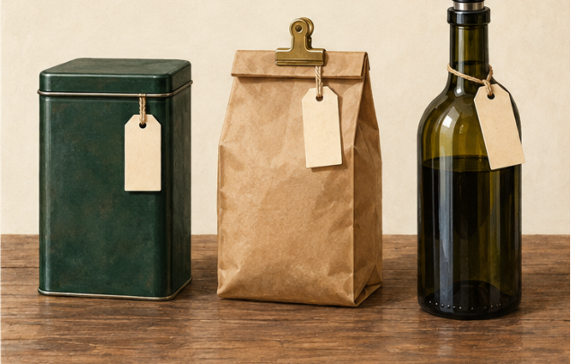
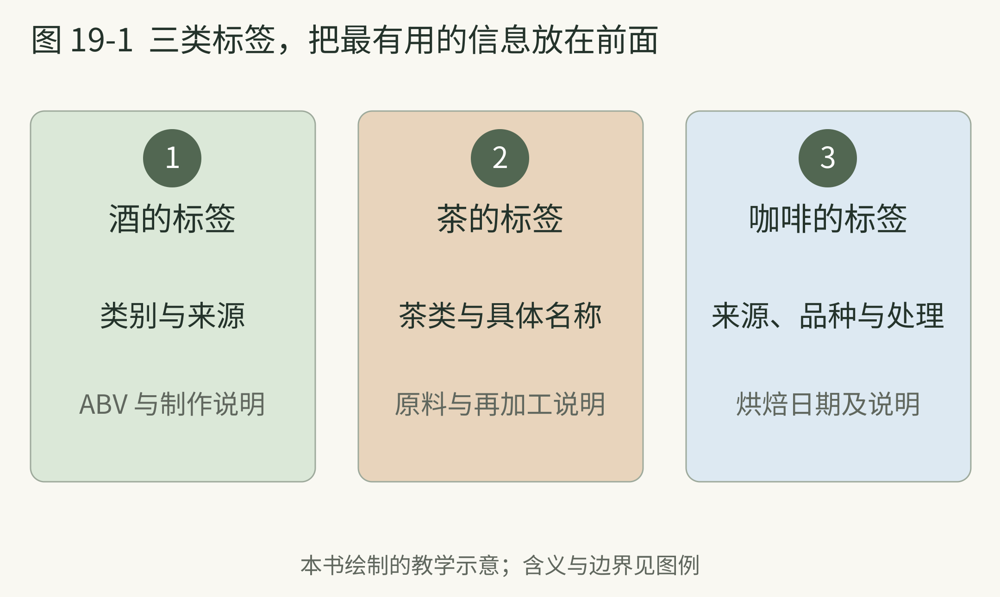

<!-- page: 19|第五部 带回日常|保存也是体验的一部分 -->

# 时间 标签与自己的预算

买回来的饮品不会自动停在购买那一天。咖啡、茶与酒都要面对时间，只是它们需要的条件、变化速度和目标不同。把“越陈越好”当成所有饮品共用的规则，会带来不少失望。

<!-- figure-height: 150 -->

**图 31-1　开封后的三个保存对象（AI 教学示意）。**

**图例。** 从左至右为带盖茶罐、夹紧的咖啡袋与重新封口的酒瓶；空白标签用于提示记录开封时间。

密闭外观不保证长期隔绝空气。咖啡保存还要避开潮气、热和光；酒瓶重新封口后，也需按酒款及产品说明安排保存。[41][47]

<!-- page: 19|第五部 带回日常|开封以后分别怎样保存 -->

## 开封以后分别怎样保存

咖啡的保存可以先从减少空气、潮气、热和光的影响开始，磨粉尽量接近冲煮时。NCA 的保存资料也提醒，普通家用容器并非完全隔绝氧气，冰箱环境还可能引入冷凝问题。[41] 按实际饮用速度买适量，避免一次囤积过多。

葡萄酒开瓶以后，空气接触变成更直接的问题。重新封好、放在较冷环境、减少不必要的暴露，都是保存思路；气泡酒还需要考虑保留气泡，不能照搬静止酒的真空抽气办法。[47] 可保存时长因酒款、开瓶状态和保存条件而异。

茶的日常保存，可以先依据包装的产品要求，减少受潮和异味干扰。若一款茶以陈化为目标，仍需了解它的具体工艺与储存条件，不能因为写着“老茶”就认为怎样放都行。

**一个很实际的小动作。** 在包装上写下开封日期，不用另建复杂表格。下一次你觉得“这回怎么不一样”，就多了一条线索。日期不能回答所有问题，但能把模糊印象变成可以追踪的变化。

<!-- page: 19|第五部 带回日常|三类标签，把最有用的信息放在前面 -->

## 三类标签，把最有用的信息放在前面

**图 31-2　三类饮品的标签信息。**

**图例。** 从左至右为酒、茶、咖啡标签中可优先阅读的信息。

标签让外观之外的信息进入判断：相同颜色的饮品，也可能有不同原料和工艺。先读身份与制作，再读宣传词。保存还要另看产品要求和开封状态；咖啡减少空气、潮气、热和光的影响，葡萄酒开瓶后也需考虑空气及气泡保留。[41][47]

<!-- page: 19|第五部 带回日常|把钱花在能够回答的问题上 -->

## 先提出一个小问题

个人兴趣最容易在入门时变成购物：刚知道一点名字，就想把所有名字都放到家里。可以反过来，先提出一个问题，再找能回答它的材料。

你想理解麦芽与酒花，就不必先追高年份威士忌；想知道烘焙差别，就不必同时买三种处理法、三个产区和三套器具。比较中改变的条件太多，花了钱也可能只留下“每个都不一样”。

从日常机会开始很好：餐厅的一杯、朋友分享的一点、家里已有的茶，或者同一袋咖啡的两次冲煮。只要记录条件与观察，普通材料同样能提供学习价值。

标签可以按顺序读。酒先看类别、来源与酒精度；茶先看茶类、生产信息与是否再加工；咖啡先看来源、处理、烘焙日期和说明。这是本书的阅读路线，不是真假鉴别程序。模糊宣传语留到后面看，不要让它抢走全部注意力。

价格不能单独说明品质。价格可能包含生产成本、稀缺性、品牌与销售安排，最终是否适合你，还要回到用途和喜好。

**购买前记录。** 写一句“我想用它比较什么”，再写一句“家里已有材料能不能回答”。若暂时没有问题，也可以只是喜欢而购买；承认这是享受，比替每次购买编一个学习理由更轻松。
