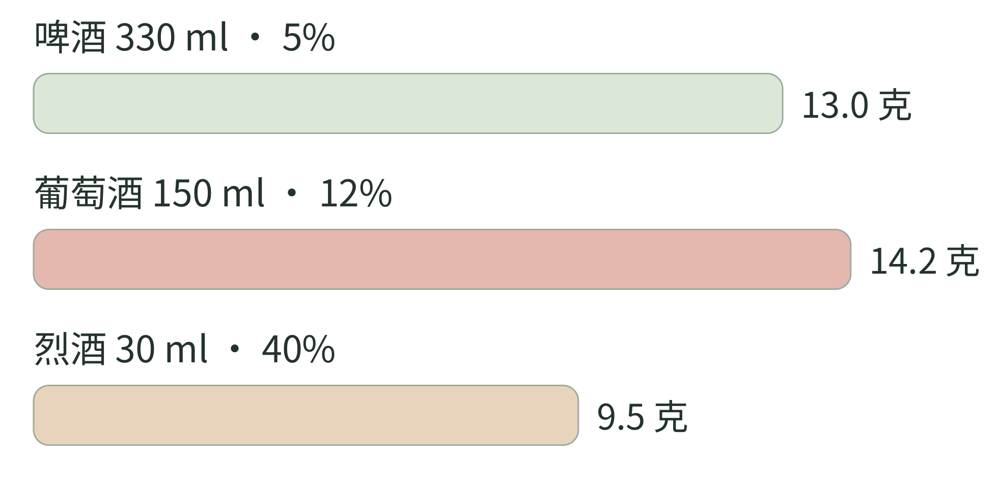

<!-- page: 20|第五部 带回日常|有趣不需要靠喝得多来证明 -->

# 20 兴趣的节奏与边界

本书把酒、茶和咖啡放在一起，是因为它们能共享一些理解风味的方法，不表示它们对身体有相同作用。个人学习可以读、看、闻和记录，实际饮用只是其中一种方式。

酒精量值得与“几杯”分开。NIAAA 提供的计算工具提醒，杯子大小和配方不同，实际酒精量就可能不同。[43] 对自己的杯子，更清楚的做法是看容量与酒精体积分数，而不是只凭“它喝着不烈”。

例如，用近似密度 0.789 克／毫升作算术估计：[50] 330 毫升、5% ABV 的啤酒，含约 13.0 克酒精；150 毫升、12% 的葡萄酒，约 14.2 克；30 毫升、40% 的烈酒，约 9.5 克。计算式是容量 × ABV 小数 × 密度。这是量的比较，不是安全饮用额度，也不是血液酒精浓度预测。

喝咖啡或浓茶不能把酒精消除。NIAAA 说明，咖啡因可能减轻困意，却不能恢复酒精影响下的判断和协调能力。[46] 不要把感觉清醒当作可以驾驶的依据。

茶与咖啡的咖啡因也应合并理解。FDA 提醒，敏感程度、身体状况与药物等因素会影响反应。[44] 本书不为你制定个人摄入上限；如果饮用影响睡眠或引起不适，可以减少、调整时间，涉及健康或用药问题时再寻求专业意见。

<!-- page: 20|第五部 带回日常|杯子大小不同，换成酒精克数再比较 -->

## 杯子大小不同，换成酒精克数再比较

**图 20-1　三种饮品的纯酒精量。**

**图例。** 横带按算术估计的纯酒精克数绘制，单位为克。

同本章的三个例子：330 毫升、5% ABV 啤酒约含 13.0 克酒精；150 毫升、12% 葡萄酒约 14.2 克；30 毫升、40% 烈酒约 9.5 克。按容量乘以 ABV 小数，再乘近似密度 0.789 克／毫升估算。[43][50] 比较图把“一杯”的视觉差异换成同一个单位，帮助读懂总量，不用它规定个人饮用边界。

<!-- page: 20|第五部 带回日常|这本书怎样在日常里继续 -->

## 从喜欢的一杯开始

读完一本兴趣书，不一定要记住所有内容。你可能只记住了清酒不是蒸馏酒，茶的“发酵”要分情况，咖啡里的浓度与萃取不是同一个词。这些小区别，会慢慢改变你看一杯饮料的方式。

可以给自己一个很轻的节奏：一周只认真观察一次。不是每周必须喝一次酒，也不必每周购买东西；读一段工艺介绍、比较两张标签，都可以算这次观察。

本书建议的四周路线是：第一周把一杯熟悉饮品描述清楚；第二周选一个加工词，查它实际在做什么；第三周保持条件，改变一个小变量；第四周翻回记录，找一项变化与一个仍不知道的问题。

如果学习开始变得像任务，就先回到喜欢的一杯。不必每次喝茶都计时，不必每次咖啡都评分。你可以今天只是喝，明天才认真观察。兴趣需要留下一点不用解释的空间。

但当你愿意解释时，可以把书中的线索重新串起来：植物给出材料，加工塑造差异，杯子与水改变呈现，历史让人聚在一起。酒、茶和咖啡的相似处，在这些具体关系里；它们的不同，也正在这些关系里。

愿你以后面对一杯饮料时，既能问“它怎样来到这里”，也能安心说“这一杯，我喜欢”。全书到此结束。后面的速查与记录页，供你想起一个词或想继续观察时使用。
