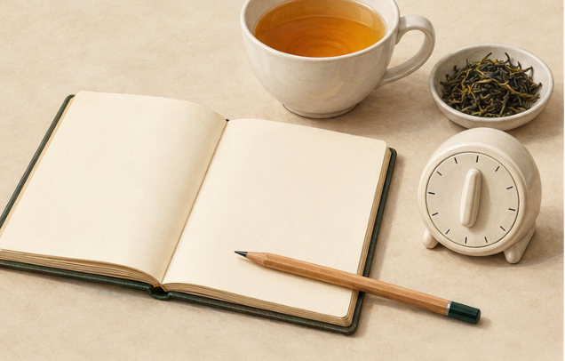

<!-- page: A3|附录|留下一条自己的观察 -->

# 附录三 个人杯中笔记

这是本书自拟的记录模板，不是专业品评表。复制一页，或拿纸手写都可以。空白可以保留，不必为了填满而猜测。

<!-- figure-height: 150 -->

**图 A3-1　一条记录从身边材料开始（AI 教学示意）。**

**图例。** 画面为笔记本、笔、茶杯、少量干茶与计时器；本子和仪表留白，不要求填满或配齐工具。

先写已知条件，再记一项观察，最后留一个仍不知道的问题。空白不是失败；没有测量过的数据，也不必凭印象补成精确数字。

<!-- page: A3|附录|自己的杯中记录模板 -->

## 自己的杯中记录模板

@table
记录项|写些什么
日期与情境|什么时候 在哪里 是否搭配食物
饮品身份|类别 具体名称 能确认的来源
已知加工|标签或可靠资料里明确的信息
呈现条件|温度 用量 比例或冲煮方法
最明显的香气|一个日常参照即可
口感与味觉|甜 酸 苦 涩 热感 厚薄中最明显的一项
我是否喜欢|喜欢 不喜欢 还不确定
下次只改变什么|一项条件 或暂时不改变
仍然不知道什么|一个具体问题
@endtable

本书自拟示例：同一袋咖啡，同样的冲煮方法。今天只减少一点冲好后的补水量，入口感觉更集中，苦味也更明显；我比较喜欢前一杯，但还不知道研磨是否影响结果。

这条记录不需要准确识别全部香气，也不急着宣判原因。它留下了条件、观察和下一步。用同样方法记录茶，或者只记录一次菜单阅读，仍然成立。

积累几条后再回看：哪些词经常出现？哪些偏好改变了？哪些不喜欢来自呈现方式？留下一项问题，供下次比较。
