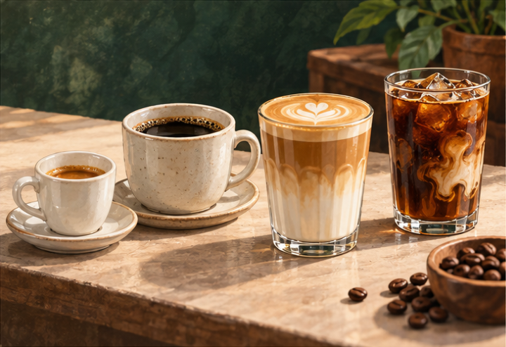
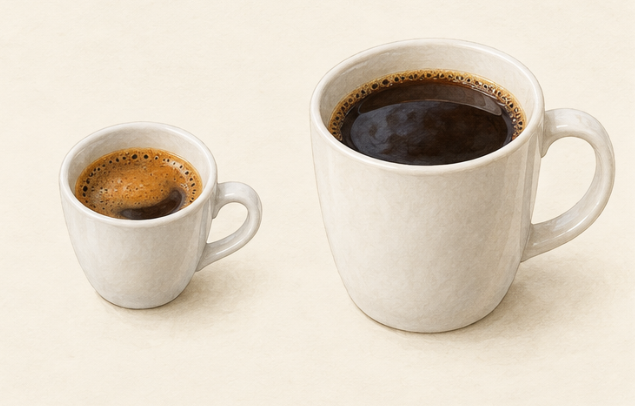
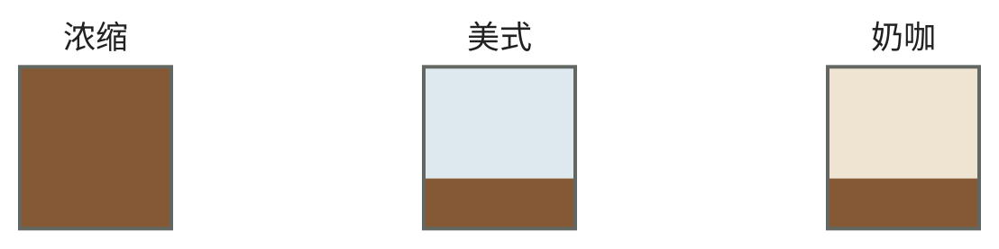
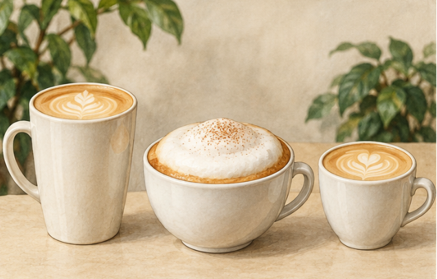

<!-- page: coffee-menu|第四部 咖啡的世界|菜单其实混合了两套名称 -->

# 从浓缩读懂咖啡菜单

“手冲”和“拿铁”不是同一层分类。前者在说怎样提取咖啡，后者通常在说浓缩咖啡与奶怎样组合。NCA 把滴滤、手冲、意式、法压和冷萃分别作为冲煮方法介绍。[67]

<!-- figure-height: 145 -->

**图 29-1　咖啡菜单的成杯情境。** 从左至右为小份咖啡、黑咖啡、奶咖与带奶纹理的冰饮。

@table
冲煮路线|典型方法|先观察什么
水流经过咖啡粉|手冲 滴滤机|研磨 水流与过滤
咖啡粉浸在水中|法压 常见浸泡冷萃|接触时间及后续分离
压力参与提取|意式浓缩|细研磨 压力与出液
@endtable

表是本书根据方法资料整理的主线，不把全部器具强行装进三个互斥盒子。法压还会压下滤网，但不因此成为意式浓缩；名字里同样有“压”，目的和条件仍不同。[68][69]

<!-- page: coffee-menu|第四部 咖啡的世界|黑咖啡并不只有美式 -->

## 把提取与补水分开

意式浓缩通过压力让热水经过较细咖啡粉，形成小份、较集中的咖啡；它又可用于多种成杯组合。[69] “意式”在这里不是咖啡树品种，包装上的意式豆说明仍要另读。

<!-- figure-height: 150 -->

**图 29-2　小份浓缩与一杯滤泡（AI 教学示意）。**

**图例。** 左为小份浓缩外观，右为较大杯黑咖啡；右杯作为滤泡示意，外观本身不能证明冲煮方法。

不同杯量与表面状态帮助认识常见呈现，不规定标准配方，也不能据此推断咖啡因摄入。浓缩加水与直接滤泡仍是不同路线。[67][69][44]

<!-- page: coffee-menu|第四部 咖啡的世界|意式的比例要看粉与出液 -->

## 18 克进，36 克出，说明什么

意式配方常写“18 克粉，36 克出液，约 30 秒”。其中 1∶2 是干粉质量与杯中咖啡液质量的比，不是咖啡与机器水箱加水量的比。La Marzocco 把这类比例作为建立配方的起点；粉量还要配合粉碗的容量。[108]

用同样 18 克粉，目标从 36 克出液改成 45 克，通常意味着让更多水继续经过粉床。它与先做出 36 克、再加 9 克水不同：前者继续提取，后者只调整已分离咖啡液的浓度。两杯最终质量相同，也可能味道不同。[39][108]

居家操作先按粉碗要求称粉，均匀布粉并压平，锁好手柄后以秤观察出液。记录机器如何计时，再结合滴流和感官微调研磨。若同一粉量和目标出液突然快了很多，可以检查研磨与布粉是否一致，而不是只看表面有没有油脂层。[108]

店里的“一份”“双份”仍可能使用不同粉碗与配方。点奶咖时问浓缩份数，是在了解基底；知道确切粉量与做法，信息会更完整。

<!-- page: coffee-menu|第四部 咖啡的世界|咖啡的成杯组成 -->

## 咖啡的成杯组成

<!-- figure-height: 75 -->

**图 29-3　咖啡的成杯组成。**

**图例。** 棕色为咖啡，蓝色为水，米色为奶；色块只示意组成，不表示配方比例。

@table
名字|你通常在点什么|容易混淆之处
Espresso 浓缩|意式方法提取的基底|小杯不等于咖啡因一定少
Americano 美式|浓缩咖啡加水|不是手冲的另一个名字
Filter coffee 滤泡|通过滤泡路线制作的咖啡|不只是把浓缩冲淡
Iced coffee 冰咖啡|冰饮呈现方式的总称|不保证采用冷萃
Cold brew 冷萃|以较低温度长时间提取|不等于热咖啡放凉
@endtable

成杯名称参照生产者与研究机构资料作整理，具体杯量以店家为准。[67][69][70][71] 图只说明成分关系，不表示标准比例。

<!-- page: coffee-menu|第四部 咖啡的世界|奶咖里哪一项发生了变化 -->

## 拿铁 卡布奇诺与馥芮白

常见奶咖共享浓缩咖啡与奶，但总量、奶泡和呈现目标不同。Nespresso 的说明可作为常见做法示例，不把某一家生产者的用量定为全球菜单标准。[71][72]

<!-- figure-height: 150 -->

**图 29-4　三种奶咖的杯量与奶泡情境（AI 教学示意）。**

**图例。** 左为拿铁式长杯，中为较明显泡沫的卡布奇诺式杯，右为较小杯细泡奶咖；名字由图文约定，不靠外观鉴别。

拉花与表面装饰不承担分类作用。奶量、泡沫与咖啡基底应分别询问，不能从本图读出固定比例或全球杯量标准。[71][72]

<!-- page: coffee-menu|第四部 咖啡的世界|奶量、泡沫与基底份数 -->

## 奶量、泡沫与基底份数

@table
名称|常见组成与方向|点单时可以问什么
Latte 拿铁|浓缩与较多奶 常有少量奶泡|杯量和浓缩份数
Cappuccino 卡布奇诺|浓缩 热奶与较明显的奶泡|奶泡与成杯体积
Flat white 馥芮白|浓缩与细腻奶泡 常强调咖啡存在感|与店里拿铁差在哪
Macchiato 玛奇朵|常表示用少量奶或奶泡标记浓缩|是否是经典小杯 或甜味大杯变体
Mocha 摩卡|咖啡 奶与巧克力方向材料|糖和巧克力来自什么
@endtable

同一份浓缩倒进更大的奶量里，咖啡存在感可能变弱，杯子却变大。不要把杯大、味浓、咖啡因多合并成一个判断；咖啡因仍要看实际用料。[44]

奶的选择也会改变体验。普通奶、燕麦等替代饮品及甜化材料，并非只换了颜色。最有帮助的记录是“这杯里咖啡和奶哪边更明显”，再把答案与杯量和基底份数联系起来。
