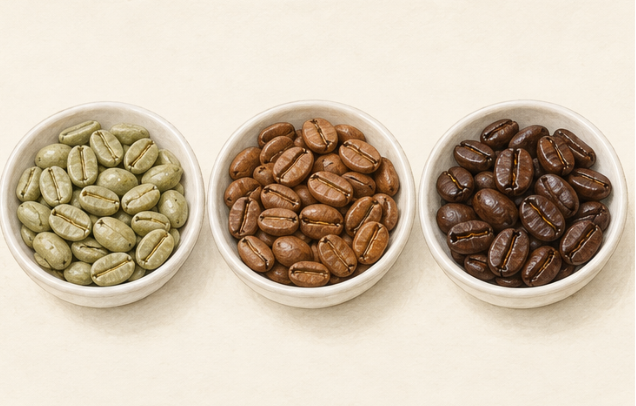
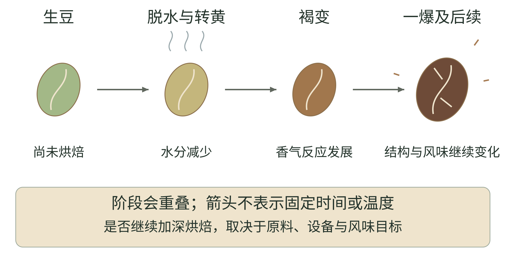

<!-- page: coffee-roasting|第四部 咖啡的世界|烘焙不是把颜色加深这么简单 -->

# 烘焙、排气与保存

咖啡烘焙让种子发生复杂的物理与化学变化。研究把许多香气物质的形成与美拉德反应、相关降解与热反应联系起来。[38] 生豆与烘焙豆闻起来不同，不只是表面颜色变深。

<!-- figure-height: 150 -->

**图 26-1　生豆与两种烘焙外观（AI 教学示意）。**

**图例。** 从左至右为浅绿生豆、较浅棕熟豆与较深棕熟豆；这是选定外观，没有实测色值、温度或烘焙时长。

先观察从生豆到熟豆的明显变化，再问烘焙怎样改变香气与组成。[38] 不能把每种棕色都当成统一等级，也不能只从照片诊断萃取或品质。

<!-- page: coffee-roasting|第四部 咖啡的世界|烘焙中的几个路标 -->

## 烘焙中的几个路标

看烘焙，除了深浅，还可以沿着变化找路标。开始时，生豆受热，失去部分水分；随后颜色逐渐转黄、转棕，许多形成香气与色泽的热反应继续进行。美拉德反应涉及糖与含氨基的成分，不是往豆子里加入焦糖。[38][102]

<!-- figure-height: 160 -->

**图 26-2　从生豆到烘焙结束的变化路标。**

**图例。** 从左向右依次观察生豆、受热脱水、褐变、一爆及后续；色块和箭头表示教学顺序，不是实测温度曲线，也不表示各阶段一样长。

一爆是烘焙中的一轮爆裂声，和豆内气体积累、压力及结构膨胀有关。[102] 它能帮助烘焙师标记进程，但听到声音不代表这一炉已自动达到最佳风味。不同批次与目标还需要继续决定何时结束并冷却。

这些变化会重叠。把图读成“前一格所有反应结束，后一格才开始”，会误解连续的受热过程。它的用处是把颜色、声音与材料变化放在一起，让你下次看烘焙演示时知道要观察什么。

<!-- page: coffee-roasting|第四部 咖啡的世界|发展时间是什么，不是什么 -->

## 发展时间怎样理解

烘焙讨论中的“发展时间”，常指一爆开始到烘焙结束之间的时间。[112]它不是从生豆到熟豆的全部变化，也不是“多发展一秒就一定更好”。前段受热、豆子状态和结束目标，都影响这一段该怎样安排。

可以把它想成烹饪里的收尾：知道收尾花了多久，不等于知道之前如何加热，也不能只靠这个数字判断成品。这里的类比帮助理解记录方式，不表示烘焙豆和炒菜遵循同一套反应。

**读烘焙说明的方法。** 先看它是为滤泡、浓缩还是较宽用途设计，再看烘焙商怎样描述成杯。若只写一个发展比例，缺少原料与其他条件，就先把它当成工艺记录。对刚入门的读者，能稳定冲好同一袋豆，比照抄陌生机器上的秒数更有用。

回到味道，也要分开问：酸感怎样，苦感怎样，香气更像果实还是烘烤食物，入口是轻盈还是厚实？这种写法让“烘焙深浅”与后面的[浓度、萃取](18.md)各自有位置。

<!-- page: coffee-roasting|第四部 咖啡的世界|烘焙与冲煮怎样相遇 -->

## 烘焙与冲煮怎样相遇

这也让咖啡与啤酒里的深色麦芽、某些茶的焙火产生可供比较的线索：热处理都可能影响风味，但原料、条件和结果并不相同。不能把三种加工的热反应和风味结果直接等同。

浅、中、深烘焙是常见描述，却不宜把不同店家的三个词当成精确一致的刻度。个人学习可以先看生产者怎样说明，再靠同一来源的对照建立自己的感觉。

**“深”不等于所有意义上的“浓”。** 你可能用浓形容烘烤印象、苦味、液体浓度，甚至咖啡因。它们是不同问题。咖啡冲煮研究把杯中浓度与萃取率分别处理，正适合帮助我们拆开这种语言混淆。[39]

描述时可以多补一句：是香气更偏烘烤，还是同样一口液体更厚重？是更苦，还是少一点酸？这些话比只写“很浓”更利于下一次选择。

烘焙日期还属于另一项信息。咖啡会随储存失去新鲜风味，保存方式也重要。[41] 最佳饮用时段因豆子、烘焙和保存条件而异。你可以观察同一袋豆在不同日期的变化，再决定自己的节奏。

<!-- page: coffee-roasting|第四部 咖啡的世界|烘好以后，气体还在离开 -->

## 烘好以后，气体还在离开

咖啡离开烘焙机，不意味着变化停止。烘焙形成的气体会从豆内逐渐释放，这叫排气；其中很大一部分是二氧化碳。SCA 的资料把排气这种物理变化，与香气组成随时间改变的化学新鲜度分开讨论。[103]

排气速度和烘焙、豆子结构及保存环境有关。[103] 因此，“养豆”更适合理解为烘后放置与观察的安排，而非每一袋都要等待相同天数。也别把它和[果实处理阶段](17.md)的发酵混在一起：一项发生在果实处理的语境，一项是在烘焙之后看气体与风味怎样变化。

在家可以做一个轻松的记录：同一袋豆分几次冲，每次写下距烘焙日的天数、配方与气泡表现，再记录入口感受。若只有气泡多，却没有更喜欢的味道，便不必把气泡当成分数。比较时保留冲煮条件，才能看见时间这条线索。

磨成粉会增大与外界接触的面积，日常保存仍以临近冲煮再磨、减少空气、潮气、热和光的影响为起点。[41] “让它休息”不等于敞口散放；储存与新鲜度的日常安排，见[时间、标签与自己的预算](19.md)。
