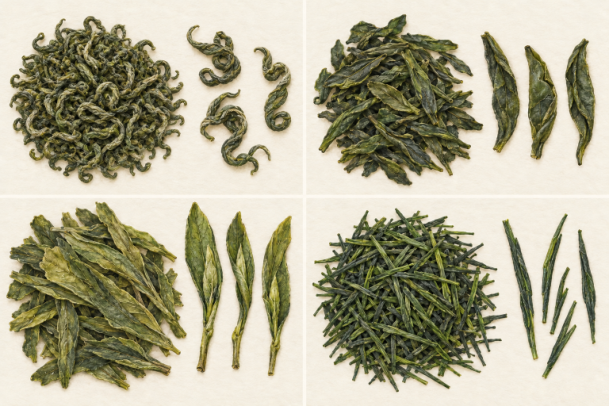

<!-- page: tea-green|第三部 茶的世界|绿茶的形状也不只有一种 -->

# 绿茶的形态与常见茶款

绿茶的重要线索是较早杀青，抑制酶促氧化；之后仍有整形和干燥。炒制或蒸汽等热处理方式、原料与后续工序不同，成品也会不同。[34][76] 所以绿茶不是“未经处理的叶子”。

<!-- figure-height: 130 -->

**图 15-1　绿茶的干茶与叶底。** 左为加工后的干茶，右为冲泡后的叶底。

本图选扁形绿茶作示意：左边的干茶压扁、失水，右边的叶底吸水后较舒展。它只呈现一种形态，不代表全部绿茶。真实茶款可参看西湖龙井杀青的 UNESCO 影像资料。[83]

**怎么读细节。** 干茶先看扁、细条还是卷曲，再看芽叶能否辨认；泡开后看叶片是否舒展、有没有折痕。干叶的皱缩与湿叶的展开，比图中微小色差更可靠。外形只是线索，类别仍要核对制作说明。

**一个名字陷阱。** 安吉白茶按绿茶工艺制成，名称与浅色嫩叶有关，不等于萎凋干燥路线的白茶。[80] 遇到它时先问“怎么做”，比问“为什么汤不是绿色”更接近分类。

<!-- page: tea-green|第三部 茶的世界|绿茶怎样从加工走向杯中 -->

## 绿茶实例：把龙井的“扁”拆开看

看到龙井式扁茶，先把两个问题分开：较早杀青解释它采用的基础路线，压扁整形解释它的外观。加热还会影响香气，因此“绿茶”并不保证只有鲜草气息；同类中也可以感到熟豆、炒米一类联想，但这些词是闻香时的参照，不是每款龙井都要兑现的清单。[34][83]

把一片干茶放到白碟上，会看到它很薄、边缘收拢，有些芽叶紧贴在一起。泡开后，原先压在一起的部位可能分开，叶片也可能保留折痕。**吸水舒展不等于恢复成刚采下的鲜叶**：干燥、受热和机械处理已经改变了组织。不要要求每片叶底都像枝头上一片平整新叶。

换成卷曲形或细条形绿茶时，观察方法仍然适用：分别写下“整形成什么样”和“采用什么路线”，不要把龙井式扁形当成绿茶的通行身份证。购买时也可把“嫩、扁、色浅”等外观描述，和自己实际喜欢的香气、苦涩与厚薄分开。形态好认，口味仍需要尝。

<!-- page: tea-green|第三部 茶的世界|常见茶款图鉴从四种绿茶外形开始 -->

## 四种绿茶的外形入口

本章先认识常见绿茶的产地、制作与风味。同属绿茶，卷曲、片形、扁展芽叶和细条仍有明显区别；图中的日式煎茶还会在[世界茶饮](tea-world.md)中展开。各条风味词概括典型方向，不要求每个批次都有同样的香气。

<!-- figure-height: 190 -->

**图 15-2　四种绿茶的干茶外形（AI 教学示意）。**

**图例。** 左上碧螺春为细小卷曲条索；右上六安瓜片为无芽梗的单片叶；左下太平猴魁为较舒长的扁展芽叶；右下日式煎茶为细长揉条。各格单独放大，不比较真实尺寸；图不用于品种、等级或产地鉴定。[114][115][164]

<!-- page: tea-green|第三部 茶的世界|绿茶茶款一：扁片与卷螺 -->

## 绿茶茶款：龙井与碧螺春

**龙井与西湖龙井。** 龙井是浙江的扁形绿茶，炒制与整形让芽叶呈薄扁的条片，杯中常以清香、熟香和鲜醇感相结合。龙井茶的地理标志产区分西湖、钱塘、越州；西湖龙井专指西湖产区产品，并不是所有龙井的统称。读包装时，把“龙井”这个茶款名与具体产区并排看，会比只认扁平外形更清楚。[113][83]

**洞庭山碧螺春。** 产自江苏苏州太湖的洞庭东山、西山，和湖南洞庭湖不是同一个地方。细嫩芽叶经杀青、揉捻整形与搓团显毫，形成细小卷曲、带短细白毫的干茶；清鲜香气与爽甜滋味是典型入口。它的“螺”指卷曲条索，比龙井更细卷，并不是一粒粒结实的圆球。[114]

<!-- page: tea-green|第三部 茶的世界|绿茶茶款二：安徽三种不同叶态 -->

## 绿茶茶款：黄山毛峰、瓜片与猴魁

**黄山毛峰。** 来自安徽黄山一带，徽州区富溪等地是传统产地。以初展的细嫩芽叶加工，杀青之后轻揉、烘焙，属于烘青绿茶；杯中可从清香或兰花香联想、清亮略黄的汤色与醇甘滋味认识它。其芽叶形态较自然，和压成薄片的龙井不同，也与同在黄山地区、叶形舒长的太平猴魁各有面貌。[115]

**六安瓜片。** 安徽六安大别山一带的片形绿茶，以叶片作为鲜明特征，制作中有扳片、炒片和烘焙等安排，典型成品不带芽尖和茶梗。单片叶边缘略翘，形似瓜子，所以名为瓜片；不是用瓜子调味。它适合认识叶片本身的清香与鲜醇回甘，也说明绿茶并非都以“芽越多越好”为目标。[115]

**太平猴魁。** 安徽黄山市黄山区的绿茶，经过拣尖、杀青、整形和烘焙等工序，形成舒长、扁展的芽叶组合。相较细卷的碧螺春，猴魁的叶面更容易辨认，外形并非极细的针芽；鲜灵香气、清亮茶汤与醇厚感是入门线索。它和黄山毛峰同属绿茶，却没有因此制成相同的叶态。[115]

<!-- page: tea-green|第三部 茶的世界|绿茶茶款三：毛尖、白叶与蒸青 -->

## 绿茶茶款：信阳毛尖、安吉白茶与恩施玉露

**信阳毛尖。** 河南信阳的代表绿茶，传统炒制分生锅与熟锅，揉缩、甩条等动作参与形成细、圆、紧、直的条索，表面可见白毫。它适合从清香和醇香认识杯中风格；“毛尖”在这里是茶名的一部分，不能只凭这两个字便把不同产区的毛尖茶看成同一产品。和卷曲的都匀毛尖并看，外形差异尤其直观。[116]

**安吉白茶。** 浙江安吉的绿茶，以白叶一号茶树的鲜叶为重要原料；春季嫩叶在特定条件下呈浅色，成品仍经过杀青、理条和烘干。典型外形舒展如凤羽，叶底常能观察到浅叶面与较绿叶脉，入口以鲜醇为线索。“白”在此联系原料叶色，和白毫银针所走的白茶萎凋、干燥路线不同。[80]

**恩施玉露。** 湖北恩施的蒸青针形绿茶，以蒸汽杀青，再经揉捻、整形上光和烘焙等处理。典型干茶细直如松针，色泽绿润，茶汤清亮，清香与鲜爽回甘是常见描述。它让人看到中国绿茶中蒸青的一条路线：杀青的目的相近，热量传入叶子的方式与之后的整形，却可以和锅炒茶不同。[117]

<!-- page: tea-green|第三部 茶的世界|绿茶茶款四：卷曲毛尖与蒙顶甘露 -->

## 绿茶茶款：都匀毛尖与蒙顶甘露

**都匀毛尖。** 贵州都匀的绿茶，手工制作有杀青、揉捻、做形、提毫和烘焙等工序，成茶条索细卷、白毫明显。清嫩香、鲜浓滋味与甘甜回味是典型风格；干茶、茶汤和叶底的绿色中也可能透黄。它与信阳毛尖共有“毛尖”之名，但卷曲外形和产区传统不同，适合作为同名词下两款茶的入门对照。[118]

**蒙顶甘露。** 四川雅安蒙顶山茶中的绿茶茶款，细嫩芽叶经过杀青、炒揉、烘干及整形，形成纤细匀卷、带毫的外观。香气可从嫩香、清香认识，滋味以鲜醇甘爽见长。蒙顶山并非只制作这一款茶：名字同样带“蒙顶”的蒙顶黄芽走黄茶路线，甘露与黄芽不能当作同一种茶的两个等级。[119][153]

<!-- page: tea-green|第三部 茶的世界|绿茶茶款五：从峨眉、庐山到日照 -->

## 绿茶茶款：竹叶青、庐山云雾与日照绿茶

**竹叶青。** 与四川峨眉山相联系的绿茶，嫩芽经杀青、做形等处理，形成两端收尖、扁平光滑的竹叶状外形，茶汤常见黄绿色，香气可带栗香，入口鲜醇。这里的竹叶形来自茶芽整形，原料仍是茶树，并非竹叶浸泡饮品。“竹叶青”同时涉及商业品牌名称，阅读商品时应把茶的形态与具体出品者分开确认。[151]

**庐山云雾。** 江西九江庐山一带的绿茶，以清香、鲜醇和较舒展的芽叶形态认识更容易。庐山云雾并不对应唯一茶树品种：茶叶研究机构已从当地材料中选育专用品种，记录的成品有兰花形、显芽或显毫等不同表现。茶款的共同风格与原料品种可以同时存在，名称中的“云雾”则联系产区环境与文化意象。[150]

**日照绿茶。** 山东日照的区域绿茶，适合补上南方名茶之外的北方产区视角。中国茶叶学会对当地茶样的评价记录了叶片较厚、干茶绿、汤色黄绿、香气清高与滋味鲜醇甘爽等特征。它是区域产品名称，内部仍有不同企业、采季与加工安排；认识它时，可以先记住产区和醇爽风格，再比较手中具体茶样。[120]
