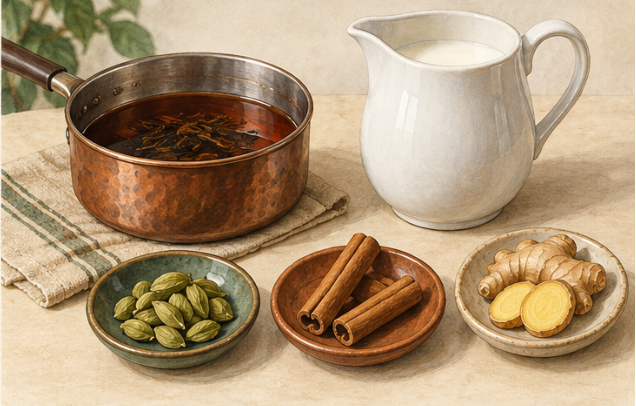

<!-- page: tea-mixing|第三部 茶的世界|调茶其实涉及几个层次 -->

# 从茶底到奶茶与果茶

“调茶”不是本书里的一种独立茶类。它可以指干茶拼配，也可以指把泡好的茶与奶、果汁、糖或其他材料组合。英国茶行业机构介绍的拼配，还包括通过不同茶叶组合，保持目标风格的一致性。[64]

<!-- figure-height: 150 -->

**图 22-1　茶底与不同辅料的成杯。** 从左至右为茶汤、水果茶与奶茶。

@table
层次|发生在什么时候|可以比较什么
干茶拼配|冲泡之前|不同茶叶怎样组成茶底
窨花及再加工|茶叶生产中|花香如何进入材料
茶底萃取|准备成杯时|先把茶泡到什么强度
成杯调饮|茶汤与其他材料组合时|奶 果味 甜 酸与冰的关系
@endtable

窨花属于再加工，见[花香、拼配与世界茶饮](tea-world.md)。[31] 先分清层次，你就不会把茉莉茶、茉莉奶茶和把花瓣放进水里，误认成相同产品。

<!-- page: tea-mixing|第三部 茶的世界|为什么加奶以后茶消失了 -->

## 奶茶要先有能站住的茶底

一杯纯饮刚好的茶，加入奶和融水后，可能变成只有奶感。这时可以先调整茶底用量与强度，不必立刻把时间无限拉长。你在处理的是新组合，目标已经与纯饮不同。

<!-- figure-height: 150 -->

**图 22-2　香料奶茶先拆成材料（AI 教学示意）。**

**图例。** 左为茶液，中为奶，前方依次为豆蔻、桂皮与姜；图不规定加入次序和用量。

香料、奶与茶分别参与组合。Twinings 的香料奶茶示例可作具体做法参照，不把图中的材料组合当成所有 Masala chai 的统一配方。[66]

<!-- page: tea-mixing|第三部 茶的世界|按茶底与乳品读菜单 -->

## 按茶底与乳品读菜单

Twinings 的冰奶茶示例使用较少热水萃取茶包，再与奶和冰组合；其香料奶茶示例还把豆蔻、桂皮与姜纳入过程。[65][66] 这两份资料展示不同路径，不为全部奶茶确立唯一标准。

@table
常见方向|先看哪些成分|容易混淆的地方
鲜奶茶或茶拿铁|茶底 奶 奶泡或糖|名称不保证全用鲜奶
港式奶茶|具体店家的茶底与乳品说明|不是所有红茶加奶都同一种风格
珍珠奶茶|茶 奶或替代材料 糖 珍珠|珍珠属于配料 不规定茶底
Masala chai 香料奶茶|茶 奶 香料 甜化安排|不同地区与家庭有不同配方
抹茶拿铁|抹茶粉与奶|通常不需要咖啡作为基底
@endtable

这张表是菜单阅读提醒，地区名称和配方不强作统一定义。点单可以直接问“茶底是什么”“乳品是什么”“甜度怎样调整”。知道店家实际材料，比只凭名字预测口感更有效。

<!-- page: tea-mixing|第三部 茶的世界|果茶与气泡茶怎样保留茶的存在 -->

## 让辅料有角色

以下是本书自拟的调饮观察分组，不作为生产标准。重点不在把水果尽量堆多，而是先决定你希望茶、果香、酸味与甜感各占什么位置。

@table
方向|材料角色|可以先调整的一项
柑橘茶|茶作主体 柑橘提供香气与酸|先少量加汁 再决定酸度
水果茶|茶与水果共同组成风味|先分清鲜果 果汁 果酱
气泡茶|茶提供风味 气泡水改变体积与口感|茶底是否被稀释得太弱
香料茶|茶与香料建立香气关系|先只用一种香料观察
无酒精茶调饮|以茶组织酸甜香气|不必用很多糖模仿酒的热感
@endtable

“水果很多”与“茶味清楚”并非同一个目标。先拿少量材料做小样，可以避免一整壶调完才发现不合口味。气泡水宜在组合后段加入并轻轻混合，观察气泡的保留；这些是本书的家庭试验建议。

若要加柑橘，也先分别尝茶底和果汁，再组合。你会更容易知道，酸来自水果、茶的表现，还是整体比例改变。含奶与鲜果的小样应及时饮用，不适合长时间常温放置。

<!-- page: tea-mixing|第三部 茶的世界|调茶先有茶底，再安排辅料的角色 -->

## 调茶先有茶底，再安排辅料的角色

**图 22-3　三种调茶小样的组成。**

**图例。** 绿色为茶底，米色为奶，黄色为柑橘汁，蓝色为气泡水；按自拟小样体积示意，成杯未必分层。

本章小样把奶茶设为茶汤 100 毫升加奶 50 毫升，柑橘茶先用茶汤 100 毫升加汁 5 毫升，气泡茶用茶汤 100 毫升加无糖气泡水 50 毫升。它们是用来观察的起点，不是港式奶茶、经典水果茶或商业产品标准。先看加入的材料在改变体积、酸味还是香气，再决定下一次只调整哪一项。

<!-- page: tea-mixing|第三部 茶的世界|用三杯小样试着调一次 -->

## 一次只让一个条件变化

下面给出三组本书自拟起点，使用已经泡好并放到适宜温度的茶汤，不规定所有茶的萃取办法。数字只服务观察，可以缩小用量，不是经典地区配方。

@table
小样|初始组成|下一步只改变什么
奶茶|茶汤 100 毫升 牛奶 50 毫升|茶与奶的比例
柑橘茶|茶汤 100 毫升 柑橘汁先加 5 毫升|每次只小量增减果汁
气泡茶|茶汤 100 毫升 无糖气泡水 50 毫升|茶底与补水的比例
@endtable

可以先不加糖，观察组合，再决定是否需要少量甜化。这个顺序是为了看清原来的关系，并不要求你必须喜欢无糖。使用可饮用原料和洁净器具；小样及时饮用。

记录一句“加奶后茶味变弱”，比一句“不高级”更容易指导下一次。若茶底已经苦涩，再靠增加茶底去压过奶，未必是你想要的结果；下一次应回到萃取条件观察。

调茶与调酒的相似处，在于材料都各有职责。不同处，是茶汤常需要你先完成提取，而基酒通常已经是可以直接组合的成品。记住这个分工，茶饮菜单会更容易读。
